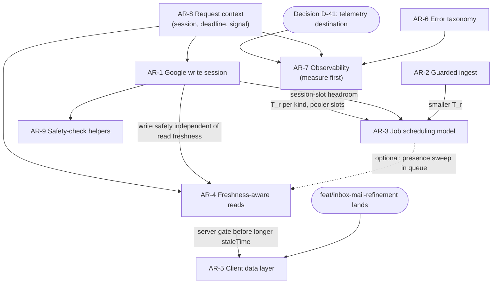

# Architecture improvements: NabaPresence

**Audit:** 2026-10-14 full-stack audit · **Deliverable:** D-arch · **Snapshot:** `main` at `d8759c74` plus the uncommitted inbox work on `feat/inbox-mail-refinement`.

## Scope and method

This document covers **structural** changes: primitives, contracts and scheduling models that several findings share. Line-level fixes are in the sibling deliverables (`BACKEND_DATABASE_AUDIT.md`, `PERFORMANCE_OPTIMISATION.md`, `MUTATIONS_AND_HOOKS_AUDIT.md`). They are referenced here only when a structural change absorbs them.

- **Sources.** All `raw/*.md` reports, with `VERIFIED_FINDINGS.md` as the source of truth for priority and status. Where a raw report disagrees with a verifier (`raw/R2-V*.md`), the verifier wins. Finding IDs are kept as they appear in the raw reports.
- **Status labels.**
  - **Confirmed:** confirmed by a second agent or the coordinator, per the ledger.
  - **Partially confirmed:** a verifier corrected it.
  - **Plausible:** the code path is cited by one report but was not independently verified.
  - **Unverified:** needs a live environment.
  - Where this document spot-checked a citation, it says so.
- **Static analysis only.** Nothing was run against a database, Google, Stripe, OpenAI or production. No new investigations were started. Every "benefit" below is either a count derived from the code or the name of the metric that would measure it. No figures were invented.
- **Guiding rule: no arbitrary architectural change.** Each proposal below extends a pattern that already exists and works in this codebase:
  - the `route()` wrapper;
  - the `runGbpWrite` durable intent;
  - row leases with `FOR UPDATE SKIP LOCKED`;
  - the `media.ts` freshness gate;
  - `queryKeys`;
  - `useResourceMutation`.

  Nothing here proposes a new service, queue product, cache tier or framework. §11 lists what was considered and rejected.

- **Coordination constraint.** The user is actively editing the inbox (`components/inbox/*`, `app/(dashboard)/inbox/*`, the related tests). Any change below that touches those files (parts of AR-5) must wait until `feat/inbox-mail-refinement` lands.

## Summary

| AR   | Structural change                                                                                                                        | Findings absorbed                                                                        | Priority | Status (worst-supported part)             | Complexity     | Regression risk | Depends on                                                     |
| ---- | ---------------------------------------------------------------------------------------------------------------------------------------- | ---------------------------------------------------------------------------------------- | -------- | ----------------------------------------- | -------------- | --------------- | -------------------------------------------------------------- |
| AR-1 | One **Google write session** primitive replaces 13 hand-rolled lock-and-publish transactions                                             | W4-01, W0-03, W4-02, W8-15, (R2B-09 analogue)                                            | **P1**   | Confirmed                                 | M              | Medium          | AR-8 (deadline), AR-7 (metrics)                                |
| AR-2 | Sync ingest as a **guarded, change-detecting upsert**                                                                                    | W4-03, W8-04, W8-08 (checkpoint claim), W4-09                                            | **P1**   | Confirmed                                 | M              | Medium          | none                                                           |
| AR-3 | Job runner **scheduling model**: lanes, per-kind priority, deadline-aware start, K parallel ticks, one enqueue path                      | W8-01, W8-02/W0-01, W8-03, W8-05, W8-09, W8-16, W0-02, W3-04a/b, W8-06, W8-10, W8-07     | **P1**   | Confirmed (W8-01 as an upper bound)       | M–L (stepwise) | Medium          | AR-7 (measure T_r), AR-1 (pooler headroom), AR-2 (smaller T_r) |
| AR-4 | **Freshness-aware read model** for Google-backed editors, generalising `media.ts`                                                        | W3-2, W0-04, W8-14, W5-07, W3-01, W3-09                                                  | **P1**   | Confirmed                                 | M per resource | Medium          | AR-1 (write-time safety), AR-8 (signal)                        |
| AR-5 | **Client data layer**: key factory, one invalidation map per entity, entity-returning mutations, background semantics, shallow URL state | W1-F2, W5-01, W2-01, W1-F3, W8-11, W8-12, W1-F8, W1-F10, W1 retry, W2-05/F11, F12, W2-06 | **P1**   | Partially confirmed (F2 rounds corrected) | M              | Medium          | AR-4 (server freshness), inbox branch landing                  |
| AR-6 | **Error taxonomy**: input versus provider-contract versus invariant versus upstream                                                      | W3-3, W3-14                                                                              | **P1**   | Confirmed                                 | S–M            | Low–Medium      | none; feeds AR-7                                               |
| AR-7 | **Observability architecture** for Vercel functions                                                                                      | W7-1 (W7-02), W7-11                                                                      | **P1**   | Plausible                                 | S–M            | Low             | D-41 decision; AR-8                                            |
| AR-8 | **Request-scoped context**: session once, throttled slide, deadline, signal, per-request memo                                            | W0-05 (+W3-05, W4-05, W8-13), W3-06, W4-10, R2B-05/W3-04d, session-prop P3               | P2       | Confirmed                                 | S–M            | Low             | none                                                           |
| AR-9 | **Shared safety-check helpers** for the Google approval families, limited to proven duplication                                          | W0-06, (W2-11 deferred)                                                                  | P3       | Confirmed (duplication); drift Unverified | S              | Low             | after AR-1 (same files)                                        |

**Recommended sequencing** (dependency graph in §10): AR-7 first, at least the log-based `durationMs` interim, because later gates need numbers. Then AR-1 step 1, AR-2, AR-6 and AR-8, which are independent small steps. Then AR-3, then AR-4 one resource at a time, AR-5 after the inbox branch lands, and AR-9 last.

---

# Server write path

## AR-1 A single "Google write session" primitive

### Findings covered

| ID     | Title                                                                                           | Priority | Status                                                                                   | Location                                                                                                                                                                                                                                                                                                           |
| ------ | ----------------------------------------------------------------------------------------------- | -------- | ---------------------------------------------------------------------------------------- | ------------------------------------------------------------------------------------------------------------------------------------------------------------------------------------------------------------------------------------------------------------------------------------------------------------------ |
| W4-01  | 13 publish paths hold a lock-only transaction across the Google read, check, write and readback | P1       | Confirmed (coordinator, R2-V1, R2-V2, R2-V4)                                             | `hours.ts:739`, `profile.ts:641`, `food-menus.ts:460`, `business-information.ts:203,216,510`, `industry-management.ts:68,119`, `google-verification-execution.ts:90`, `google-administration-execution.ts:16`, `google-lifecycle-execution.ts:15`, `google-account-change-lock.ts:9`, `bulk-listing-runner.ts:384` |
| W0-03  | The dedicated lock client sets no timeouts                                                      | P2       | Partially confirmed (R2-V1: an advisory lock, not a row lock; role-level timeouts apply) | `lib/server/db.ts:62-77`                                                                                                                                                                                                                                                                                           |
| W4-02  | Session-pooler slot pressure (15 slots)                                                         | P2       | Partially confirmed (R2-V4)                                                              | `db.ts:62-75`, `bulk-listing-runner.ts:398-401`                                                                                                                                                                                                                                                                    |
| W8-15  | Each token-refresh waiter reconnects every 150 ms                                               | P2       | Confirmed (R2-V4, W4-02 detail)                                                          | `google/connections.ts:394,433-470`                                                                                                                                                                                                                                                                                |
| R2B-09 | The billing row lock is held across Stripe HTTP calls (same anti-pattern, different resource)   | P3       | Plausible (single report)                                                                | `billing/process-events.ts:310-327`, `subscription-changes.ts:144-306`                                                                                                                                                                                                                                             |

### Current implementation and evidence

All 13 sites hand-roll the same shape. This document spot-checked the shape at `hours.ts:737-760` and counted the sites with `grep withSessionConnection(`. Excluding `leases.ts` and `connections.ts`, the count is 13.

```ts
withSessionConnection((c) => c.begin(async (lock) => {
  await lock`select pg_advisory_xact_lock(...)`   // or pg_try_advisory_xact_lock + 409
  const live = await readLive...()                // Google GET (≤15 s, retry sleep can overrun)
  ...validateOnly PATCH (≤20 s) → PATCH (≤20 s) → readback (≤15 s, maxAttempts 3)
}))
```

- **Two contradictory budgets.** The lock transaction sits idle in transaction for the whole provider sequence, because data writes use pooled `withTenant`.
  - The runtime role pins `idle_in_transaction_session_timeout=60s` and `statement_timeout=30s` (`scripts/db-create-runtime-role.mjs:37-40`).
  - The worst case for `publishCanonicalHours` is about 85 s nominal and about 120 s at worst (R2-V4 table).
- **What the user sees when the limit is hit:**
  - Google has applied the change, and the attempt receipt says `succeeded` (it settled in its own pooled transaction).
  - The outer `COMMIT` then fails, so the user gets a 5xx.
  - Mutual exclusion is lost from the 60 s mark onward.
  - A blocked `pg_advisory_xact_lock` waiter fails at 30 s with 57014. That contradicts the "waits for a running bulk child" comment (`hours.ts:730-735`).
- **Pooler slots and connection churn:**
  - Each site opens a fresh TLS client to the session pooler and holds a slot for the whole provider sequence.
  - A bulk child with `accountLock` (only `bulk-families/place-actions.ts:54`) opens **two** clients.
  - Token-refresh waiters reconnect every 150 ms for up to 20 s.

### Root cause

Per-resource serialisation is expressed as "a transaction-scoped advisory lock on a dedicated connection", copy-pasted per call site. No shared component owns the time budget, the lock wait, or what happens to the receipt when the lock connection dies.

### Proposed shape

One module, `lib/server/google-write-session.ts`, owns lock acquisition, the budget and receipt semantics. Call sites keep their domain logic.

```ts
type WriteSessionOptions = {
  keys: string[]                 // acquired in sorted order on ONE connection (bulk child: resource + account)
  mode: "wait" | "try"           // "try" → onBusy() 409, as account-change and verification do today
  onBusy?: () => ApiError
  waitMs: number                 // lock-wait bound; < role statement_timeout (30 s)
  budgetMs: number               // provider-sequence budget; derived from the request deadline (AR-8)
}
type WriteSession = {
  deadline: number
  remaining(): number
  /** Throws a retryable 503 `write_budget_exhausted` BEFORE a step that cannot finish in time. */
  ensure(stepMs: number, step: "read" | "mutate" | "readback"): void
  sql: TransactionSql            // for the two confirm paths that read RLS rows on the lock connection
}
withGoogleWriteSession<T>(opts: WriteSessionOptions, work: (s: WriteSession) => Promise<T>): Promise<T>
```

**Semantics:**

1. **Bounded lock lifetime.** Inside `begin()`:
   - `SET LOCAL statement_timeout = waitMs` for the acquisition;
   - then `SET LOCAL idle_in_transaction_session_timeout = budgetMs + margin`.

   This is the R2-V4 recommendation (b). It keeps the 60 s dead-man bound for a frozen Vercel instance, and it keeps `set_config(…, true)` tenant context for the confirm reads (`business-information.ts:217`, `industry-management.ts:69`).

2. **Never start a mutation that cannot finish.**
   - `ensure(GOOGLE_MUTATION_TIMEOUT_MS + readback margin, "mutate")` runs before the validateOnly and before the PATCH.
   - Transport calls inside the session get `min(callTimeout, deadline − now)`, which also caps the retry-sleep overrun at `transport.ts:439`.
   - Running out of budget before the PATCH is a clean, retryable failure with nothing written to Google.
3. **The receipt is the truth; the lock is advisory.**
   - If `work()` resolved and the lock connection then fails (`COMMIT` error, 25P03 or 57P01), the primitive logs `google_write_session.lock_lost_after_settle` and **returns the settled result**.
   - It does not surface a 5xx. The attempt row was already settled in its own pooled transaction (`gbp-write.ts:11`).
4. **One connection per session.** Multiple keys are taken on the same connection, which removes W4-02's nested second client.
5. **Instrumented by construction** (feeds AR-7): `write_session.lock_wait_ms`, `write_session.duration_ms{surface}`, `write_session.budget_exhausted`, `write_session.lock_lost_after_settle`.

### Alternatives considered

| Option                                                                                       | Verdict                                                                                                                                                                                                                                                       |
| -------------------------------------------------------------------------------------------- | ------------------------------------------------------------------------------------------------------------------------------------------------------------------------------------------------------------------------------------------------------------- |
| (a) Session-level `pg_advisory_lock` with no transaction (W4's original fix)                 | **Rejected as unsafe** (R2-V4). It removes the only dead-man bound, because there is no `idle_session_timeout`. It orphans locks if `DATABASE_SESSION_URL` falls back to the transaction pooler (`db.ts:66`). And it breaks RLS context on the confirm paths. |
| (b) `SET LOCAL` timeouts inside the existing transaction                                     | **Step 1.** Smallest change, and it keeps every current guarantee. It does not reduce pooler slot use.                                                                                                                                                        |
| (c) Table lease `resource_lock(org, key, holder, expires_at)` through the transaction pooler | **Step 3, only if measured pooler pressure warrants it.** It frees a session slot per write, and the same table could back AR-3's fleet leases (W8-05). The cost is a migration, steal-on-expiry logic, and losing "released on disconnect".                  |
| (d) Rely only on the `runGbpWrite` durable intent's in-flight 409                            | **Insufficient.** It serialises per attempt key, not per resource. A bulk child and an editor writing different payloads to the same hours do not collide on key, and the hours path deliberately _waits_ for the bulk child.                                 |

### Migration path

1. **Step 1 (S).**
   - Add the primitive with semantics 1–3.
   - Port `hours.ts:739` first, as the reference site with the worst-case budget table.
   - Then `profile.ts` and `food-menus.ts`.
   - One PR per two or three sites. No behaviour change on healthy Google.
2. **Step 2 (S).**
   - Port the try-lock sites (account-change, verification, administration, lifecycle) using `mode: "try"`.
   - Port `bulk-listing-runner.ts:384` using multi-key, which removes the nested client.
   - Separately, switch refresh waiters to poll the token row through the transaction pool and retry the lock about every 1 s (W8-15). That is not part of the primitive, but it is the same pooler budget.
3. **Step 3 (M, conditional).** Only if `pg_stat_activity` or Supavisor metrics show session-slot pressure (open question Q3), back the primitive with a lease table. Call sites stay unchanged.
4. **Same rule elsewhere.** "No lock held across an external call without a budget" also applies to Stripe (R2B-09): either per-request Stripe options matching `SYNC_REQUEST_OPTIONS`, or an optimistic `version` check. This is P3 and tracked in the backend deliverable.

### Expected benefit and what it unlocks

- **Removed failure path.** The "Google applied, receipt `succeeded`, user sees 5xx" outcome disappears on all 13 paths.
- **Lock waits stay within their budget.** A waiter either gets the lock inside `waitMs` or receives a clear 409 or 503. Today it gets a 57014 error at 30 s.
- **Fewer session-pooler clients.** A bulk child with `accountLock` opens one instead of two. Every other site keeps the same count.
- **Unlocks AR-3 parallel ticks.** Those need known session-slot headroom.

**Measure:** occurrences of 25P03 and 57014 in Postgres logs; `write_session.duration_ms` p99 against the budget; session-pooler client count during bulk runs.

### Complexity, risk, tests, dependencies

- **Complexity:** M overall (S per step). · **Regression risk:** Medium. Lock semantics are subtle, so keep wait versus try per site exactly as today.
- **Tests:** An integration test with `idle_in_transaction_session_timeout` set to 1 s in a test role: a lost-after-settle result is returned, not thrown; concurrent editor publish and bulk child serialise; `ensure()` refuses to start a PATCH when less than the mutation timeout remains (fake clock); the existing bulk and editor interleave tests.
- **Dependencies:** AR-8 for the request deadline (until then, use `route maxDuration − margin`); AR-7 for export.

---

# Background processing

## AR-2 Sync ingest as a guarded, change-detecting upsert

### Findings covered

| ID           | Title                                                                                                                                            | Priority | Status                   | Location                                                                                   |
| ------------ | ------------------------------------------------------------------------------------------------------------------------------------------------ | -------- | ------------------------ | ------------------------------------------------------------------------------------------ |
| W4-03        | Review sync rewrites every review on every reconcile. There is no `WHERE`, `content_hash` is never read, and the update is not HOT.              | P1       | Confirmed (R2-V4, R2-V3) | `lib/server/reviews.ts:254-288`, `:302-327` (media), `:332-387` (reply)                    |
| W8-04        | Sync can overwrite a just-published reply: it blanks the body, reverts the review to `new`, or reverts edited text. It self-heals within 15 min. | P2       | Confirmed (R2-V3)        | `reviews.ts:253-296,375-383`; `publishing/intent.ts:302-322`; `publishing/settle.ts:40-53` |
| W8-08 (part) | `syncLinkedLocation`'s checkpoint claim is unconditional, so a runner job and "Sync now" can sync one location concurrently                      | P2       | Confirmed (R2-V3)        | `reviews.ts:491-501`                                                                       |
| W4-09        | About 6,028 single-row metric upserts on a location's first performance sync                                                                     | P2       | Confirmed (R2-V4)        | `performance.ts:199-223`                                                                   |

### Current implementation and evidence

- **Cost of an unchanged review.** Reconcile fetches page 1 (50 reviews) for every linked location every 15 min. For each review it runs:
  - a per-review `set_config`;
  - an `INSERT … ON CONFLICT DO UPDATE` with no `WHERE`;
  - a media delete and re-insert;
  - a reply upsert.

  That is about 4–5 + M statements per review and about 200–250 per page (W4-03), almost all no-op rewrites.

- **Why the rewrite is never HOT.** `raw_content_expires_at` is rewritten on every pass and is indexed, so HOT updates are impossible across the 12 indexes on `review`, which include GIN `search_document`.
- **The stale-payload race (W8-04).** The same unconditional write applies a stale Google payload over a reply that is mid-publish. R2-V3 traced three interleavings (A, B and variant C), with no guard on reply update time or an in-flight `publish_attempt`.
- **Why a hash skip alone is not enough.** R2-V3 showed that a `content_hash` skip would avoid the race in the common case only. It does not cover a stale payload that differs for another reason.

### Root cause

"Idempotent by overwrite" ingest: there is no change detection and no ordering against local writes.

### Proposed shape

One page-level ingest step with three guards, applied in this order:

1. **Ordering guard (correctness).**
   - Do not overwrite the reply or the workflow while the review has an in-flight `publish_attempt` (`started`, `ambiguous`, `retryable`) or `publish_status = 'accepted'`.
   - Otherwise, apply the reply only when the incoming `reviewReply.updateTime ≥ review_reply.google_reply_updated_at`.
   - `applyPublishedReply` also writes `current_body`, so the settle heals itself.
2. **Change guard (cost).** `DO UPDATE … WHERE review.content_hash IS DISTINCT FROM excluded.content_hash OR review.provider_deleted_at IS NOT NULL OR review.raw_content_expires_at < now() + (retention − 1 day)`.
   - `RETURNING` the changed ids.
   - Media and reply writes run only for those ids.
   - The expiry disjunct refreshes the Google-cache window at most daily.
3. **Checkpoint guard (concurrency).** Claim the checkpoint with `… WHERE status <> 'running' OR lease_expires_at < now()`, so the runner and "Sync now" exclude each other per location.

`set_config('app.provider_reconciliation')` runs once per page transaction. Optionally, the page becomes one multi-row `unnest` upsert. W4-09 adopts the same pattern for performance metrics: a batched upsert with a conditional update.

### Alternatives considered

- **Hash skip only:** cheaper, but leaves W8-04 open for differing stale payloads (R2-V3).
- **Row lock (`FOR UPDATE`) during ingest:** this only serialises. Under READ COMMITTED the stale predicate still matches (R2-V3).
- **Webhook-only ingest with no reconcile:** rejected. Pub/Sub delivery is not guaranteed, and reconcile is the backstop.

### Migration path

1. Ordering guard and settle self-heal. This is a correctness fix with a small diff in `upsertGoogleReview` and `settle.ts`.
2. Change guard, plus the `RETURNING` handling for the no-row case.
3. Checkpoint claim guard.
4. Batch the page (optional), then apply the pattern to `performance.ts`.

### Expected benefit and what it unlocks

- **Steady-state write volume.** Unchanged reviews produce zero row versions instead of a non-HOT rewrite plus media and reply churn.
- **Shorter jobs.** A shorter reconcile job time T_r raises AR-3's fleet ceiling directly, since L_max ≈ 2,700 / T_r (W8 arithmetic).
- **No phantom reverts.** Published reviews no longer go back to "needs reply" or appear with blank bodies.
- **Cheaper read indexes.** Read indexes such as W4-04's audit-log index cost less to maintain.

**Measure:** `n_tup_upd`, `n_tup_hot_upd` and `n_dead_tup` on `review`, `review_media_item` and `review_reply`; `pg_stat_statements` calls for the upsert; per-page `rows_changed` against `rows_seen` (AR-7).

### Complexity, risk, tests, dependencies

- **Complexity:** M. · **Regression risk:** Medium.
  - The erasure guard and the `published/rejected → new` reset must still fire on real changes.
  - Decide explicitly whether a retention-redacted row should be repopulated before the daily refresh (W4-03 notes it currently would not be).
- **Tests:** An unchanged payload leaves `xmin` unchanged; A changed reply rewrites; expiry near its end refreshes; all three W8-04 interleavings: start the intent, sync without the reply, settle, then assert body and workflow, in both orders; two concurrent `syncLinkedLocation` calls on one checkpoint: exactly one runs.
- **Dependencies:** none. It benefits AR-3.

---

## AR-3 Job runner scheduling model

### Findings covered

| ID            | Title                                                                                                                                                | Priority         | Status                                                             | Location                                                                                  |
| ------------- | ---------------------------------------------------------------------------------------------------------------------------------------------------- | ---------------- | ------------------------------------------------------------------ | ----------------------------------------------------------------------------------------- |
| W8-01         | One locked tick per minute with 4 workers caps all recurring work at ≤180 worker-s/min (135 with billing)                                            | P1               | Confirmed (upper bound, R2-V3)                                     | `app/api/jobs/run/route.ts:10-14`, `jobs.ts:1111-1121`, `env.ts:294-296`                  |
| W8-02 / W0-01 | Scheduled posts and bulk children run on the leftover budget and are marked missed after the 5-min window. Latent until about 450 or more locations. | P2 (latent P1)   | Confirmed (R2-V1, R2-V3)                                           | `jobs.ts:1111-1139`, `publication-schedule-runner.ts:942`, `0118:210`, `0119:43`          |
| W8-03         | No per-kind priority in the claim; recurring herds are phase-locked                                                                                  | P2               | Confirmed (R2-V3)                                                  | `0092:182-195`, `0048:43-63,91,97`                                                        |
| W8-05         | Fleet session locks have no expiry; the real overrun is `runPool` starting items with no bound on how long they run                                  | P2               | Partially confirmed (R2-V3)                                        | `leases.ts:153-189`, `jobs.ts:278`                                                        |
| W8-09         | The bulk runner runs up to 25 children at once with `Promise.all`; an unguarded await can fail the tick                                              | P2               | Confirmed (R2-V3)                                                  | `bulk-listing-runner.ts:650-685`, `jobs.ts:1129-1133`                                     |
| W8-16         | A full batch claimed near the deadline strands its leases for 105 s                                                                                  | P3               | Plausible                                                          | `jobs.ts:1106,1111-1121`                                                                  |
| W0-02         | Two recurring-sync models: Vercel GET enqueues, while the self-hosted scheduler POSTs and walks inline                                               | P2 here (W0: P1) | Confirmed (W0; `scheduler.mjs:223,343,367,392` POSTs spot-checked) | `app/api/sync/{reconcile,performance,keywords}/route.ts`, `scripts/scheduler.mjs:117-195` |
| W3-10 / W6-07 | The session-or-cron hybrid auth is re-implemented in four routes and bypasses wrapper entitlement and audit actor                                    | P3               | Confirmed (found independently by W0, W3 and W6)                   | `sync/{sweep,reconcile,keywords,performance}/route.ts`                                    |
| W3-4 (a, b)   | Manual backfill has no deadline; non-engine bulk approve runs ≤100 sequential publishes                                                              | P1               | Confirmed (R2-V2)                                                  | `sync/backfill/route.ts:127-138`, `reviews/bulk/route.ts:103-113`                         |
| W8-06 / W8-10 | Interactive and background Google calls share one budget bucket; the budget fails open after a 2 s DB timeout                                        | P2               | Plausible                                                          | `google/rate-budget.ts:33,76-170`                                                         |
| W8-07         | The presence-resources cursor skips half-walked orgs; its fleet ceiling is ≤200 location-visits/h                                                    | P2               | Plausible                                                          | `app/api/sync/presence-resources/route.ts:230,246,316-324`                                |

W0-02 is ranked P2 here because production runs Vercel crons, not `scripts/scheduler.mjs` (W7-08: "On Vercel there is no scheduler process"). The coordinator should confirm this ranking.

### Current implementation and evidence

`runDueJobs` (spot-checked at `jobs.ts:1036-1165`) runs in this order:

1. schedule sweep;
2. billing slice (`min(15 s, budget/4)`);
3. reclaim;
4. `while (now + GOOGLE_TIMEOUT_MS ≤ deadline) { claimBatch; runPool }`;
5. bulk children;
6. scheduled posts;
7. privacy;
8. invitations.

The post-loop runners each claim only with at least 15 s left.

What already exists and does not need replacing:

- `claimBatch` already takes a `kinds` filter (`jobs.ts:313-327`).
- Claims are already safe for concurrent tickers (`FOR UPDATE SKIP LOCKED` plus leases, `0092:203-324`). The file header says the `naba:jobs` lock "is now an optimisation".

### Root cause

One minute-tick serves throughput work (sync herds) and deadline work (scheduled posts, user retries) with first-come budget allocation and no kind ranking. The only reservation is billing. Capacity is fixed by a single fleet lock rather than by the safety mechanism, which already supports concurrency.

### Proposed shape: a tick plan

The tick plan stays inside the existing route and table.

```ts
const TICK_PLAN: Lane[] = [
  { name: "deadline",    run: [runDueSchedules, runDueBulkChildren], reserveMs: /* ≥ one Google timeout */ },
  { name: "interactive", kinds: ["retry", "recover", "mutation_recover", "webhook"], reserveMs: /* small */ },
  { name: "billing",     run: [processBillingEvents], reserveMs: /* today's slice */ },
  { name: "throughput",  kinds: ["checkpoint", "reconcile", "performance", "keywords"], reserveMs: "rest" },
  { name: "obligations", run: [runDuePrivacyWithdrawals, runDueInvitationDeliveries], reserveMs: /* small */ },
]
```

1. **Reserved budgets per lane.**
   - Deadline work runs first, on a reserved slice (W8-02 and W0-01 recommendation).
   - Each lane is wrapped in its own `.catch`, so one throwing runner cannot skip privacy erasures (W8-09).
   - The bulk runner reuses `runPool` with `JOBS_CONCURRENCY` and the deadline instead of `Promise.all`.
2. **Per-kind priority inside `claim_due_jobs`.** Order by `(kind_rank, due_at, id)`, both inside the per-org partition and outside it.
3. **Herd flattening.** On first arming, phase each checkpoint by a stable hash of the location id modulo the interval. `next_scheduled_run` then keeps the spread for ever.
4. **Deadline-aware item start.**
   - `runPool` starts an item only if `now + expected(kind) ≤ deadline`, where `expected` is initially `GOOGLE_TIMEOUT_MS` and later the measured p95 per kind.
   - The claim size becomes `min(BATCH, concurrency × ceil(remaining / expected))`.
   - Unstarted items get `release_job_lease`.
   - R2-V3 showed that passing `deadline` into performance and keyword jobs would not help. Start-gating is the fix.
5. **K parallel ticks.**
   - Replace `naba:jobs` with K lock slots (`naba:jobs:0..K-1`, take the first free one) rather than dropping the lock. Each slot keeps a heartbeat, so `ops-liveness.ts` semantics survive.
   - K is gated by measured T_r and by connection headroom. Production runs `DATABASE_POOL_MAX=5` and `JOBS_CONCURRENCY=3` (runbook, W4-02 and W4-10). The session pooler has 15 slots (AR-1).
6. **Bounded fleet locks.** Give the lock connection an `idle_session_timeout` above `maxDuration`, or reuse AR-1's lease table if step 3 lands (W8-05).
7. **One enqueue model.**
   - `scheduler.mjs` calls the same GET enqueue path as Vercel.
   - The four hybrid POSTs become wrapper-managed session routes. Either add `auth: "session_or_cron"` to `route()` (W3-10), or split them into a session POST and a cron GET (W6-07's alternative).
   - This deletes the scheduler's cursor walker and four hand-rolled `authenticate()` functions.
8. **Request-to-queue rule.** A request whose worst-case provider work exceeds its `maxDuration` enqueues and returns 202 with progress:
   - manual backfill (W3-4a);
   - non-engine bulk approve over a small cap (W3-4b);
   - the OAuth-callback `after()` backfill. Three initial-backfill mechanisms collapse to one.
9. **Background versus interactive Google budget.**
   - Background callers acquire against a lower effective capacity and fail closed when the budget query times out.
   - Interactive callers keep the full capacity and stay fail-open (W8-06, W8-10).
10. **Later (M).** Presence resources become a per-location recurring kind, as migration 0048 did for reconcile (W8-07). That inherits fairness, leases and K-tick scaling. Fix the cursor bug (W8-07, S) first.

### Alternatives considered

| Option                                                                                | Verdict                                                                                                                                                                     |
| ------------------------------------------------------------------------------------- | --------------------------------------------------------------------------------------------------------------------------------------------------------------------------- |
| Separate cron routes per lane (`/api/jobs/schedules`, `/api/jobs/run?lane=recurring`) | Viable and simple. Each has its own lock and heartbeat. Kept as the fallback if the in-tick plan proves hard to reason about. It costs more cron entries and liveness rows. |
| Drop the `naba:jobs` lock entirely and rely on leases                                 | Safe for claiming, but it loses the per-tick heartbeat and skip accounting that ops alerts rely on. K slots keep both.                                                      |
| External queue or workflow product                                                    | Rejected (§11). The Postgres queue is not the bottleneck; the single lock and the ordering are.                                                                             |
| Raise `JOBS_CONCURRENCY` alone                                                        | Rejected. It queues on a pool of 5 to 10 connections (W8 arithmetic) and does nothing for priority.                                                                         |

### Migration path (each step shippable alone)

1. **S:** lane reorder, a reserved slice for deadline work, per-lane `.catch`, and the bulk runner on `runPool`. No schema change.
2. **S:** deadline-aware start and lease release for unstarted items.
3. **S–M:** a migration adding kind rank to `claim_due_jobs`, and hash-phased arming for new checkpoints. Optionally a one-off re-phase of existing rows.
4. **M:** one enqueue model, wrapper `session_or_cron`, and backfill moved to the queue. The UI already has a backfill-progress GET.
5. **M, gated on AR-7 numbers:** K lock slots. Start with K = 2 on staging.
6. **M:** background versus interactive Google budget priority.
7. **M:** presence resources move into the queue.

### Expected benefit and what it unlocks

- **Scheduled posts.** They publish inside their window whatever the sync backlog (W8-02).
- **User-facing retries.** User-facing retries and recoveries are claimed in the first batch after they fall due, not after ⌈N/3⌉ batches of their organisation's herd (W8-03).
- **Capacity.** It scales roughly with K until the Google v4 bucket binds at about 3,000 calls per 15 min (W8 arithmetic).
- **Fewer execution models.** One execution model instead of two, and four fewer custom auth paths.

**Measure:** `jobs.item.duration{kind}`; backlog per kind and the age of the oldest due item (already exposed by `/api/operations/health?scope=platform`); `post_occurrence.lateness_ms`; missed occurrences by reason.

### Complexity, risk, tests, dependencies

- **Complexity:** S (steps 1–2) to L (all steps). · **Regression risk:** Medium. It changes fairness and liveness semantics. Recurring starvation stays bounded because user-facing kinds are low volume.
- **Tests:** A claim stub that never empties still runs `runDueSchedules` with at least its reserve; 100 due recurring rows plus 1 later retry puts the retry in the first claim; two concurrent `runDueJobs` calls claim disjoint sets; one owner lookup throwing in a bulk child leaves the others settled and privacy still run; A route test asserts that a cron POST is 401 or enqueues.
- **Dependencies:**
  - AR-7 to measure T_r before K > 1.
  - AR-1 for session-slot headroom.
  - AR-2 to shrink T_r.

---

# Read path

## AR-4 Freshness-aware read model for Google-backed editors

### Findings covered

| ID    | Title                                                                                                                                                                | Priority | Status                                 | Location                                                                                                                |
| ----- | -------------------------------------------------------------------------------------------------------------------------------------------------------------------- | -------- | -------------------------------------- | ----------------------------------------------------------------------------------------------------------------------- |
| W3-2  | The hours, profile, posts and place-actions GETs read Google live on every open. Hours costs 4 transactions plus an observation write per read. Only media is gated. | P1       | Confirmed (R2-V2)                      | `hours.ts:98,186,213,266`; `profile.ts:242`; `posts.ts:703-711`; `place-actions.ts:114-115`; gate at `media.ts:318-328` |
| W0-04 | Profile load is a live read plus 6 transactions including writes. Save-and-publish reads Google at least 4 times. `useProfile` invalidates 3 families in `finally`.  | P2       | Confirmed (R2-V1)                      | `profile.ts:189,216,100,144,274,282`; `use-location-profile.ts:16-21`; `profile-editor.tsx:440`                         |
| W8-14 | Listing GETs read Google live; only media has a server-side cache                                                                                                    | P2       | Confirmed (same paths as W3-2)         | as above                                                                                                                |
| W5-07 | Google-backed tab queries refetch on focus after 30 s                                                                                                                | P2       | Confirmed (defaults verified by R2-V2) | `lib/queries/query-client.ts:7-9`, `use-location-*.ts`                                                                  |
| W3-01 | Discovery GETs page all of Google and upsert per row on each fetch                                                                                                   | P2       | Partially confirmed (P1 → P2, R2-V2)   | `app/api/google/{accounts,locations}/route.ts`                                                                          |
| W3-09 | Client cancellation never reaches server provider calls                                                                                                              | P2       | Plausible                              | `transport.ts:378-388`; 0 hits for `request.signal`                                                                     |

### Current implementation and evidence

- **No freshness gate.** The editor GETs reconcile with Google on every read, with no gate. Combined with `staleTime: 30s` and focus refetch, every tab switch after 30 s re-reads Google for each mounted editor.
- **A sweep already covers the same resources.** `/api/sync/presence-resources` already reconciles exactly these resources every 15 min. This document spot-checked the list at `route.ts:28-35`: hours, profile, posts, media, food menus and place actions. Read-through therefore duplicates the sweep.
- **Media already solves this.** `shouldSyncMediaCache({ refresh, count, observedAt })` is the only gate (spot-checked at `media.ts:318-328`).

### Root cause

The editors were designed to read live (`prefetch.ts:319-326` says so). No freshness contract was added when the presence sweep landed. Reads also double as the observation sync, so a read writes.

### Proposed shape

Generalise the media gate into one helper and one response contract.

```ts
readThrough<TState>({
  resource: "hours" | "profile" | "posts" | "placeActions" | "foodMenus" | "media",
  locationId,
  maxAgeMs,                       // per resource staleness budget
  refresh,                        // explicit ?refresh=1 / "Check Google now"
  signal,                         // AR-8: aborts safe-mode reads only
  readStored: (sql) => Promise<{ state: TState; observedAt: string | null } | null>,
  readLive:   () => Promise<TState>,
  persistObservation: (sql, state) => Promise<{ changed: boolean }>,
}) → { state: TState; observedAt: string; source: "stored" | "live"; observationChanged: boolean }
```

- **When to read live.** Only on `refresh`, when there is no observation, or when `observedAt` is older than `maxAgeMs`. Otherwise the request reads in one tenant transaction with no Google call.
- **Write only on change.** The observation is written only when it changed. That also gives `observationChanged`, so the client invalidates listing summaries and clients only when it is true. This replaces the `finally` side effect in `useProfile`'s `queryFn` (W0-04).
- **What the UI shows.** The response carries `observedAt` and `source`, so the editor can show "Checked with Google N min ago · Check now".
- **Safety stays in the write path.** Publish preflight, `validateOnly` and readback keep reading live inside the AR-1 session. The drift banner can therefore be up to `maxAgeMs` old without making a write unsafe: `checkPublishSnapshot` compares against a live read under the lock.
- **Mutations return state.** `PUT …/profile` returns the fresh `ProfileState`, so the editor stops calling `fetchProfile` directly (`profile-editor.tsx:440`).
- **Client defaults.** Once a resource is gated server-side, its hook gets a multi-minute `staleTime` and `refetchOnWindowFocus: false`, relying on explicit invalidation after writes (W5-07). This is safe only after the server gate exists. Otherwise it merely hides staleness.
- **Discovery (W3-01).** The same pattern applies: serve the stored accounts and locations, with an explicit "Rediscover" action, `staleTime: Infinity` and no focus refetch.
- **Cancellation (W3-09).** `ctx.signal` is combined into safe-mode Google calls only, and paging loops (posts reconcile, discovery) check `signal.aborted` between pages. Mutations never take the signal.

### Interaction with the scheduled syncs

- **Review reconcile does not cover these resources.** The 15-min review reconcile applies to reviews, which are already served from storage. It is not what keeps editors fresh.
- **The presence sweep cannot keep editors fresh at scale.** The sweep is the relevant job, and its fleet ceiling is ≤50 location-visits per fire, so ≤200 per hour (W8 arithmetic):
  - Its 10-min target holds only while the fleet has 50 or fewer linked locations.
  - At 1,000 locations each one is revisited about every 5 h.
  - The sweep therefore cannot keep observations inside a minutes-scale budget.
- **Division of labour.**
  - The **on-open staleness check is the primary freshness mechanism**.
  - The sweep is the floor for drift detection on listings nobody opens.
  - If AR-3 step 7 moves presence resources into the queue, the sweep's revisit interval shrinks and more opens are served from storage. No contract change is needed.
- **Stale-while-revalidate is deferred.** Return the stored state and refresh with `after()`. On Vercel the post-response work is bounded by the function lifetime, and it adds a second writer racing the sweep. Start with a synchronous live read when stale.

### Alternatives considered

| Option                                                    | Verdict                                                                                                                                        |
| --------------------------------------------------------- | ---------------------------------------------------------------------------------------------------------------------------------------------- |
| Client-only: raise `staleTime` and turn off focus refetch | **Interim only.** Cheap, but the server stays unguarded: every first open, refresh and new tab still reads Google.                             |
| A shared cache tier (Redis or KV)                         | Rejected. The observation tables already are the cache, protected by RLS. A second store adds invalidation and tenant-safety work for no gain. |
| Next `'use cache'`, `unstable_cache` or `staleTimes`      | Rejected for this data. Per-tenant, cookie-scoped and RLS-guarded reads do not fit a framework cache keyed outside the tenant transaction.     |

### Migration path

Each step is one PR per resource, in order of cost per read:

1. Hours: 4 transactions, 1–2 Google calls and a write per read.
2. Profile: removes the `finally` invalidation and makes the PUT return state.
3. Posts: up to 100 Google pages per first page.
4. Place actions, then food menus.
5. Discovery GETs.
6. Client `staleTime` and focus defaults per resource, after its server gate ships.

### Expected benefit

- **Per editor open within the budget.** Zero Google calls and one tenant transaction, instead of:
  - hours: 1–2 Google calls and 4 transactions plus a write;
  - profile: 1 call and 6 transactions;
  - posts: up to 100 pages plus per-post upserts.
- **Quota follows edits.** Google read quota scales with edits and the sweep, not with focus events. That also reduces interactive `google_rate_limited` errors when background work is busy (W8-06).

**Measure:** `nabapresence.google.request.count` by `http.route` (this needs AR-7's route attribute); stored versus live hits per resource; editor GET p95.

### Complexity, risk, tests, dependencies

- **Complexity:** M per resource. · **Regression risk:** Medium. The drift and "Load theirs" UX must keep an explicit refresh, and readbacks and preflights must keep forcing live reads.
- **Tests:** A second GET within `maxAgeMs` makes no `googleRequest`, and `refresh=1` bypasses the gate; an unchanged observation writes nothing; A profile refetch does not invalidate `clientsAll` unless `observationChanged`; the existing drift-banner end-to-end tests.
- **Dependencies:** AR-1, so that publish safety is independent of read freshness; AR-8 for the signal; AR-7 for measurement.

---

# Client

## AR-5 Client data layer

### Findings covered

| ID            | Title                                                                                                                                                   | Priority | Status                                              | Location                                                                                                                                         |
| ------------- | ------------------------------------------------------------------------------------------------------------------------------------------------------- | -------- | --------------------------------------------------- | ------------------------------------------------------------------------------------------------------------------------------------------------ |
| W1-F2         | Each review write awaits a refetch of the detail, every loaded page and all counts: 1–3 rounds per Publish press                                        | P1       | Partially confirmed (R2-V1)                         | `lib/queries/invalidate.ts:15-20`                                                                                                                |
| W5-01         | Inbox and listings URL state goes through `router.replace/push`, which triggers a server segment refresh plus the inbox prefetch per click or keystroke | P1       | Confirmed (coordinator, R2-V2)                      | `inbox-view.tsx:212-213,314,404`; `listings-board.tsx:482`                                                                                       |
| W2-01         | `reviews` is rebuilt every render, so effects and observers rerun and the list scroll-snaps to the selected row within ≤15 s                            | P1       | Confirmed (R2-V5)                                   | `inbox-view.tsx:195`; `review-list.tsx:174-183`                                                                                                  |
| W1-F3 / W8-12 | The settling poll runs every 5 s with no bound and refetches all pages                                                                                  | P2       | Partially confirmed (R2-V1)                         | `lib/inbox/settling.ts:33-37`, `use-review-counts.ts:38-43`                                                                                      |
| W8-11         | Publish errors do not invalidate, so a server state that changed stays invisible                                                                        | P2       | Plausible                                           | `use-publish-review.ts:9-18`                                                                                                                     |
| W1-F8         | Invalidation is hand-rolled in 5 places and has drifted                                                                                                 | P3       | Confirmed (R2-V1)                                   | `invalidate.ts`, `template-reply-dialog.tsx:126-130`, `sync-reviews-button.tsx:44-46`, `use-clients.ts:95-96`, `use-bulk-review-action.ts:20-26` |
| W1-F10 (401)  | A background `/api/clients` refetch 401 redirects to sign-in                                                                                            | P2       | Confirmed (R2-V1)                                   | `lib/api/clients.ts:14-18`, `client.ts:351-355`                                                                                                  |
| W1 retry      | `retry: 1` retries deterministic 4xx failures                                                                                                           | P2       | Confirmed (R2-V1)                                   | `query-client.ts:8`                                                                                                                              |
| W2-05 / F11   | Location-scoped keys outside the cleared roots                                                                                                          | P3       | Confirmed (R2-V5)                                   | `lifecycle-workspace.tsx:39,48` and 3 more                                                                                                       |
| F12           | Counts key derivation is duplicated between prefetch and hook                                                                                           | P3       | Plausible                                           | `use-review-counts.ts:21-30`, `prefetch.ts:48`                                                                                                   |
| W2-06         | Three URL-search implementations; listings writes the URL per keystroke                                                                                 | P2       | Plausible (undebounced listings confirmed by R2-V2) | `review-filters.tsx:39-63`, `listings-board.tsx:436-501`                                                                                         |

### Current implementation and evidence

The building blocks exist:

- the `queryKeys` factory (`lib/queries/keys.ts`);
- `useResourceMutation`, which fires and forgets list invalidation (`use-resource-mutation.ts:151-156`);
- `requestOptions(ctx)`, which carries the `background` flag;
- the bounded receipt poll (`use-mutation-receipt.ts`);
- a correct debounced URL hook (`clients-index-search.ts:20-70`);
- one correct shallow URL write (`team-view.tsx:92`).

The defects come from bypassing them:

- **Review writes await list freshness.** Review writes await the lists, counts and detail as if they were part of the write. `mutation.js:123` awaits `onSuccess`, and an infinite refetch walks every page (W1-F2).
- **Invalidation drift.** Five invalidation sites have drifted. For example, `clientsAll` is missing after a publish, so client badges lag by up to 60 s.
- **Inline keys.** 28 inline `queryKey` literals escape the factory (W2 lead).
- **URL state round-trips the server.** URL state uses the router, so every selection re-runs the `InboxPage` RSC, including a DB prefetch that duplicates the client's own fetch (R2-V2, against Next 16.3.8 source).
- **Wrong 401 behaviour on refetch.** Background refetches without `background: true` hard-navigate on a 401.

### Root cause

There is no single owner per entity for these four things:

- which caches an entity write affects;
- what the client should await;
- how a refetch identifies itself (foreground or background);
- whether URL state is client-only or server-relevant.

Each surface decides for itself, and the decisions have drifted.

### Proposed shape

1. **A complete key factory.** Every key comes from `queryKeys`, and every per-location key lives under `["locations", id, …]` so access-lost cleanup drops it. Counts get `queryKeys.reviewCounts({ locationId, clientId })`, imported by `prefetch.ts`.
2. **One invalidation map per entity.**

   ```ts
   // lib/queries/surfaces.ts
   export const reviewSurfaces = {
     awaited: (id) => [queryKeys.reviewDetail(id)], // what the user is looking at
     background: [
       queryKeys.reviewsAll,
       queryKeys.reviewCountsAll,
       queryKeys.clientsAll,
     ], // fire-and-forget
   }
   invalidateEntity(qc, reviewSurfaces, { ids, on: "success" | "settled" })
   ```

   All five review sites call it. Error codes after which the server state has moved (`google_mutation_ambiguous`, `google_publish_failed`, 429) also invalidate (W8-11).

3. **Mutations return the updated entity.** Publish, approval and delete responses already carry status. Extend them to the row shape, then:
   - `setQueryData` the detail;
   - patch the matching row across infinite pages with `setQueriesData`;
   - do **not** refetch every loaded page.

   This is server-confirmed data, not optimistic, so it stays within decision D7 ("server-confirmed only").

4. **Bounded polling.** The settling poll targets the detail, or a small `GET /api/reviews/status?ids=`. It backs off with age (5 s → 15 s → 60 s) and stops on parked states (`reconnect_blocked`, `billing_read_only`). This follows the receipt-poll model. Infinite lists also get `maxPages`.
5. **Background-refetch semantics.**
   - Every `queryFn` goes through `requestOptions(ctx)`.
   - A 401 on a background refetch does not redirect.
   - Retry uses a predicate: no retry on 4xx.
   - One shell-level poller per shared key instead of one per observer (W1-F10), or a single `/api/shell-status`.
6. **Shallow URL state.**
   - `useUrlState(parse, serialize)` writes with `window.history.replaceState` or `pushState` for client-only state (inbox selection and filters, listings `q`, `health`, `order`, `clientId`, plus the other 6 call sites in W5-01).
   - It debounces search through one shared `useDebouncedSearchParam`.
   - First-load server prefetch stays, because it keys off the request header.
   - `router.push` remains only where a server re-render is wanted.
7. **Stable inbox renders** (prerequisites, owned by the hooks deliverable): memoise `reviews`, scroll only when `selectedId` changes (R2-V5: memoising alone is insufficient), and use an hour-granular clock subscription (W5-02).

### Alternatives considered

| Option                                                              | Verdict                                                                                                                                                                          |
| ------------------------------------------------------------------- | -------------------------------------------------------------------------------------------------------------------------------------------------------------------------------- |
| Optimistic updates with rollback                                    | Rejected. Decision D7 is deliberate, and no rollback or `cancelQueries` race class exists today (W1 "already good"). Entity-returning mutations give the latency win without it. |
| `experimental.staleTimes.dynamic > 0` instead of shallow URL writes | Weaker. It caches stale RSC payloads and still issues requests after expiry (R2-V2).                                                                                             |
| Move URL state to a parallel route or client segment                | Heavier for the same result.                                                                                                                                                     |
| A normalised entity store, or replacing TanStack Query              | Rejected. The problems are policy drift, not library limits.                                                                                                                     |
| Server push (SSE or websockets) for the inbox                       | Not needed once polling is bounded. Revisit only if measured poll load stays material (Q8).                                                                                      |

### Migration path

1. **S, outside the inbox:** key factory completion (W2-05/F11, F12, the 28 literals); the `requestOptions` sweep; the retry predicate.
2. **S:** `invalidateEntity` plus `reviewSurfaces`. Await only the detail.
3. **M:** entity-returning publish, approval and delete contracts with row patching; `maxPages`; the bounded status poll.
4. **S–M:** `useUrlState` with shallow writes, listings first because the user is not editing it. Then the inbox **after `feat/inbox-mail-refinement` lands**, together with the step 7 prerequisites.

The leave guard monkey-patches `history.pushState`/`replaceState` (`use-leave-guard.ts:172-206`), so its tests must run with shallow writes.

### Expected benefit

- **Publish latency.** Press-to-outcome becomes the write's own round trip, instead of 1–3 rounds of (detail + k pages + counts) (W1-F2, R2-V1).
- **Selection and keystrokes.** Row selection and listings keystrokes no longer issue an RSC request. Each such request currently re-runs `getSession` (a DB write, AR-8) and the inbox prefetch.
- **Consistency.** Client badges stop lagging the rail.
- **No surprise sign-outs.** Background refetches no longer redirect to sign-in.

**Measure:** `_rsc` requests per inbox interaction (Playwright network assertion); `/api/reviews` requests per Publish press; the client timing around `onPublish` (AR-7).

### Complexity, risk, tests, dependencies

- **Complexity:** M. · **Regression risk:** Medium. Back and forward history, focus management, the leave guard, and keeping the status line and footer in agreement (`use-reply-pending.ts`) are the sensitive areas.
- **Tests:** `mutateAsync` resolves before the list refetch; the row updates from the response; no `?_rsc=` request on selection or search (Playwright); the helper hits all four roots; A background 401 does not navigate; typing "abcd" across a debounce keeps every letter.
- **Dependencies:** AR-4 (server freshness before longer `staleTime`); the inbox branch landing.

---

# Cross-cutting

## AR-6 Error taxonomy

### Findings covered

| ID    | Title                                                                               | Priority | Status            | Location                                                        |
| ----- | ----------------------------------------------------------------------------------- | -------- | ----------------- | --------------------------------------------------------------- |
| W3-3  | Server-side invariant and provider `ZodError`s map to 400 and are never logged      | P1       | Confirmed (R2-V2) | `lib/server/http.ts:139-150` (spot-checked); `route.ts:387-398` |
| W3-14 | Upstream 5xx pass through as this API's own status; OpenAI 429 has no `Retry-After` | P3       | Plausible         | `google/transport.ts:470-482`; `ai.ts:122-127`                  |

### Current implementation and evidence

- `mapError` turns any `ZodError` into `400 invalid_request` with `details: error.issues` and no log. Only unknown errors are logged (`http.ts:151`).
- `route()` parses params, query and body with the same `.parse()`, so input failures and server-side assertions are indistinguishable.
- **Parse-site counts (R2-V2):** 89 `Schema.parse(` sites in `lib/server` and 33 in `app/api`.
  - Most parse provider or stored data, for example `google/locations.ts:298`, `password-auth.ts` (6 sites) and `publication-schedules.ts:212,238`.
  - A few are deliberate input parses (`sync/backfill/route.ts:104`).
- Google 5xx surface as our 5xx with Google's code, so provider faults look like app faults.

### Root cause

There is one error class, `ZodError`, for two different meanings, and no upstream classification at the transport boundary.

### Proposed shape

| Class                               | Raised by                                                                             | HTTP                                                       | Logged                           | Client sees                             |
| ----------------------------------- | ------------------------------------------------------------------------------------- | ---------------------------------------------------------- | -------------------------------- | --------------------------------------- |
| Input                               | `route()` parsing `params`/`query`/`body`, converted to `ApiError(400)` at that point | 400                                                        | no (info at most)                | `fieldErrors`                           |
| Provider contract                   | `parseProvider(schema, value, "google" \| "openai" \| "stripe")`                      | 502 `<provider>_invalid_response`                          | `error`, issue **paths** only    | generic, retryable flag                 |
| Invariant (stored or internal data) | `parseStored(schema, value)`, or any residual `ZodError` in `mapError`                | 500 `internal_error`                                       | `error` `api.contract_violation` | generic; no `issues` echoed             |
| Upstream                            | transport after retries                                                               | 502/503 `google_unavailable` with `details.providerStatus` | warn                             | retryable, with `Retry-After` forwarded |
| Domain                              | existing `ApiError`                                                                   | as today                                                   | as today                         | as today                                |

Every class increments `nabapresence.api.errors{class, code, route}` (AR-7).

### Alternatives

- **Keep a 400 for all `ZodError`s and only add a log.** Logging alone still mis-attributes errors in 5xx SLOs and keeps echoing internal paths. It is rejected as the end state, but it is an acceptable first commit.

### Migration path

1. **S:** `route()` converts its own parse failures to `ApiError(400)`. The output is identical for real input errors.
2. **S:** `mapError` treats any residual `ZodError` as 500 and logs it. Update tests that assert 400 for handler-internal input parses, converting those call sites to explicit input parsing (the backfill route).
3. **M, incremental:** replace provider parses with `parseProvider`, starting with `lib/server/google/*`. Map upstream 5xx in the transport.

### Expected benefit

- Provider contract drift becomes visible and alertable, instead of a silent "fix your input" message to the user.
- 5xx metrics separate our faults from Google's.
- Internal response paths stop leaking in `details`.

**Measure:** error counts by class, before and after step 2.

### Complexity, risk, tests, dependencies

- **Complexity:** S–M. · **Regression risk:** Low–Medium. Client code keyed on 5xx statuses must be checked (`lib/errors/action-errors.ts`).
- **Tests:** A handler throwing `ZodError` returns 500 and calls `log.error`; an input schema failure returns 400 with `fieldErrors`; `parseProvider` returns 502.
- **Dependencies:** none. It feeds AR-7.

---

## AR-7 Observability architecture for Vercel functions

### Findings covered

| ID           | Title                                                                                                                                     | Priority | Status    | Location                                                                |
| ------------ | ----------------------------------------------------------------------------------------------------------------------------------------- | -------- | --------- | ----------------------------------------------------------------------- |
| W7-1 (W7-02) | No production telemetry exporter, so latency percentiles cannot be measured; the 60 s periodic reader may never flush on frozen instances | P1       | Plausible | `instrumentation.ts:12-40`; release receipt `configNames` (no `OTEL_*`) |
| W7-11        | No request-level latency, DB-per-request or cache metrics in code; `tenant.id` is a metric attribute                                      | P2       | Plausible | `lib/server/route.ts:368-453`; `db.ts:19-31`                            |

### Current implementation and evidence

- **The instruments exist in code:**
  - `tenant_transaction.duration`;
  - `google.request.duration` and `google.request.count`;
  - performance, keywords and pubsub counters.
- **They record into a no-op provider** unless an OTLP endpoint is set, and production sets none (W7-02).
- **Flushing.** `PeriodicExportingMetricReader` runs at 60 s, and nothing calls `forceFlush`. That is a plausible data loss on serverless; verify it against `@vercel/otel`.
- **Gaps.** There is no route timer, no per-request DB count, and no lock, queue or freshness instrumentation.
- **What exists today.** The only production signals are structured JSON logs and the health endpoint's backlog figures.

### Root cause

Telemetry was built for a long-lived server process. Production is Vercel functions (W7-08), and nobody chose an export destination (decision D-41 is open).

### Proposed shape

Instrument at the choke points that already exist, rather than per feature:

1. **`route()`:**
   - `http.server.duration{route template, method, status class}`;
   - an error class counter (AR-6);
   - per-request `db.transactions`, `db.statements` and `google.calls` counters carried in the AR-8 request context. ALS is already in use in `mutation-operations.ts` and `audit.ts`.
2. **The write session (AR-1):** lock wait, duration, budget exhausted, lost after settle.
3. **The job runner (AR-3):**
   - `jobs.item.duration{kind}`;
   - per-lane budget used;
   - backlog per kind and age of the oldest due item. These are already computed for health, so emit them.
4. **Ingest (AR-2):** `rows_seen` and `rows_changed` per page.
5. **The read model (AR-4):** stored versus live per resource.
6. **The client:** a timing around the publish press, and an RSC-requests-per-interaction count in lab runs.
7. **Cardinality.** Move `tenant.id` from metric attributes to span attributes.

**Export path, in order:**

1. **Interim, with no new infrastructure:** a `durationMs` structured log line per request and per tick, read from a Vercel log drain.
2. **Then:** an OTLP endpoint (D-41) in Preview first. Flush at the end of each request and tick through `after()`, or a `forceFlush` hook. Confirm `@vercel/otel`'s own behaviour first (Q6).

### Alternatives

- **An error-tracking SDK only.** It gives exceptions, not latency or saturation. It complements this but does not replace it.
- **Per-feature dashboards first.** They are premature without the choke-point metrics.

### Migration path

1. Log-line interim.
2. Route and runner instrumentation in code (no-op until exported).
3. Exporter in Preview.
4. Flush verification.
5. Production.

### Expected benefit

This makes measurable every "measure" item in AR-1 to AR-5 and every open question in §12. Without it, AR-3 step 5 (K ticks) and the AR-4 budgets are guesses.

### Complexity, risk, tests, dependencies

- **Complexity:** S (code) to M (flush). · **Regression risk:** Low.
- **Tests:** A `route-wrapper` test that the histogram is recorded with a templated route; A unit test of flush at end of request, if implemented.
- **Dependencies:** D-41; AR-8 for per-request counters. The external readiness prober (W7-3) is an ops item, covered in the release and ops deliverables.

---

## AR-8 Request-scoped context

### Findings covered

| ID                            | Title                                                                                                                           | Priority | Status                                             | Location                                                 |
| ----------------------------- | ------------------------------------------------------------------------------------------------------------------------------- | -------- | -------------------------------------------------- | -------------------------------------------------------- |
| W0-05 (= W3-05, W4-05, W8-13) | `last_seen_at` is written on every authenticated request with no throttle                                                       | P2       | Confirmed (R2-V1; found independently by 4 agents) | `lib/server/session.ts:217-229` (spot-checked)           |
| W3-06                         | Extra tenant transactions per request; one token read per call                                                                  | P2       | Plausible                                          | `hours.ts:98,186,213,266`; `google/connections.ts:525+`  |
| W4-10                         | The dashboard layout fans out 5 concurrent tenant transactions against a production pool of 5                                   | P2       | Plausible (inconsistency confirmed by W4)          | `app/(dashboard)/layout.tsx:61-77`                       |
| W3-4 (d) / R2B-05             | The AI draft is charged before the second OpenAI call and the insert, so a killed function leaves a charged credit and no draft | P1       | Confirmed (R2-V2, R2-W0b)                          | `review-drafts.ts:369,387,417`; route `maxDuration = 60` |
| P3 (session prop)             | The layout passes the raw `session`, including `sessionId`, to the client                                                       | P3       | Confirmed (coordinator)                            | `app/(dashboard)/layout.tsx:149`                         |

### Current implementation and evidence

- **Session lookup cost.** `getSession` is `React.cache`d (`session.ts:245`), so an RSC render looks the session up once. Route handlers get no such dedupe. Each API request runs a session transaction of about 8 round trips, including an unconditional `UPDATE app_session`, and then opens `ctx.tenant` as a second transaction.
- **Polling multiplies it.** Polls at 5 s and 60 s, and the W5-01 RSC refreshes, each write the session row.
- **Budgets are per call, not per request.** The draft path settles the credit between two OpenAI calls whose combined timeout (30 + 30 s by default, up to 55 + 55 s) exceeds the route's 60 s.

### Root cause

There is no request-scoped object for the resolved session, the request's deadline, its abort signal, or per-request memoisation. `React.cache` covers only RSC, not route handlers.

### Proposed shape

`route()` establishes an ALS `RequestContext`. RSC keeps `React.cache`.

```ts
type RequestContext = {
  requestId: string
  session?: Session // resolved once; shared by ctx.tenant
  deadline: number // start + maxDuration − margin (default when a route declares none)
  signal: AbortSignal // request.signal; safe-mode provider calls only (AR-4)
  memo: Map<string, Promise<unknown>> // e.g. connectionAccessToken per connection (W3-06)
  counters: { tx: number; statements: number; googleCalls: number } // AR-7
}
```

- **Throttled slide.** `UPDATE app_session … WHERE id = $1 AND last_seen_at < now() - interval '<N>'`.
  - The reports propose 60 s (W8-13) or 5 min (W4-05). Both are far below the 14-day idle window, and the choice is a security-owner decision.
  - Fold the identity and session selects into one statement.
- **Deadline consumers:** the AR-1 `budgetMs`, AR-3 inline walks, and the AI draft. Size the verification call to `min(OPENAI_TIMEOUT_MS, deadline − now − margin)` and skip verification (draft left `pending`) when too little time is left. Or, as R2-W0b proposes, settle the credit in the transaction that inserts the draft.
- **Layout loader dedupe.** Merge the layout's four short reads into one `withTenant` (W4-10), so one render uses one connection, not five.
- **Session sent to the client.** Trim the client-bound `session` prop to the display fields.

### Alternatives

- **Pass a context argument explicitly through every service.** That is a very large diff across 219 `lib/server` files. ALS is already used here and needs none.
- **Cache the session in memory per instance.** Rejected. It weakens revocation and is unsafe across Fluid instances.

### Migration path

1. **S:** throttled slide and folded selects.
2. **S:** `RequestContext` with the deadline and signal; the AI draft deadline.
3. **S:** layout merge and session prop trim.
4. **S–M:** per-request token memo, and merging hours' three post-Google transactions.

### Expected benefit

- About one session write per session per throttle interval, instead of one per request. That covers polls, RSC refreshes and every API call.
- 2–3 fewer round trips per API request (W3-05).
- No charged generation without a draft.
- One pooled connection per dashboard render.

**Measure:** `n_tup_upd` on `app_session`; p50 of a `lookupSession` span (one needs to be added); per-request `tx` count.

### Complexity, risk, tests, dependencies

- **Complexity:** S–M. · **Regression risk:** Low. Idle expiry moves at the throttle granularity only.
- **Tests:** Two lookups inside the interval produce one update; after the interval the slide happens; fake-timer draft test: verification is skipped when time is short, and the draft is stored; layout prefetch still hydrates every key.
- **Dependencies:** none. It enables AR-1, AR-4 and AR-7.

---

## AR-9 Shared safety-check helpers for the Google approval families (narrow)

### Findings covered

| ID    | Title                                                                                                                                                          | Priority              | Status                                                                                                                                                                                | Location                                                                                                                                      |
| ----- | -------------------------------------------------------------------------------------------------------------------------------------------------------------- | --------------------- | ------------------------------------------------------------------------------------------------------------------------------------------------------------------------------------- | --------------------------------------------------------------------------------------------------------------------------------------------- |
| W0-06 | Guards in the reviewed-write families are copy-pasted: the unresolved predicate ×3 (+1 variant), "same Google binding" ×8, lodging/service about 90% identical | P2 in W0; **P3 here** | Duplication Confirmed (W0; the lifecycle copy was spot-checked at `google-lifecycle-execution.ts:37-44` and is identical to `google-account-change-lock.ts:24-31`). Drift Unverified. | `google-lifecycle-execution.ts:37-44`, `google-administration-execution.ts:52-59`, `gbp-management.ts:212`; binding checks at 8 sites (W0-06) |
| W2-11 | Six hand-rolled client "reviewed write" state machines                                                                                                         | P2                    | Plausible                                                                                                                                                                             | `components/locations/administration/use-*.ts`, `profile/sections/use-*-review.ts`, `place-actions/use-place-action-review.ts`                |

### Assessment against the brief's rule

The brief says to consolidate only where duplication is proven to have drifted.

- **The predicate copies.** The lifecycle and administration copies are currently **identical** to the existing helper. This is duplication, not drift.
- **The only candidate drift is a hypothesis.** `gbp-management.ts:212` omits `local_reconciliation_state`, and W0 rated that a hypothesis: it may be intentional, because it is location-scoped. The binding checks differ in field sets (verification omits some fields), and that too is undocumented rather than proven wrong.

### Recommendation (S)

1. Call the existing `requireNoUnresolvedAccountChange` from the two execution modules instead of the inlined SQL. This changes no behaviour and stops future drift.
2. Ask the owner whether `gbp-management.ts:212` is intentionally narrower. Either align it or add a comment stating why.
3. Add `assertSameGoogleBinding(before, after, fields)` with an **explicit** field list per family, so each difference becomes a visible decision.
4. Collapse lodging and service only alongside moving role gating onto the business-information GET route (W0-06 item 3).

Do this after AR-1, which touches the same files. **Do not** build a generic reviewed-write phase machine (W0-06 rejects it as a second `runGbpWrite`). **Defer** `useReviewedWrite` (W2-11: L complexity, High risk, guards Google writes) until a drift between the six client hooks is demonstrated by a bug or a test.

- **Expected benefit:** guard changes land in one place, and about 150 LOC are removed (W0-06 estimate).
- **Regression risk:** Low.
- **Tests:** the existing administration, lifecycle and place-action concurrency tests, plus one test that a lifecycle write is blocked by an unresolved place action through the shared helper.

---

## 10. Dependency graph



Solid edges are hard prerequisites for the step that depends on them. The dotted edge improves the target but is not required.

These start independently and immediately:

- AR-2;
- AR-6;
- AR-8 step 1;
- AR-1 step 1, using `maxDuration − margin` until AR-8 exists;
- AR-3 steps 1–2;
- AR-5 step 1.

## 11. Considered and rejected

| Proposal                                                                   | Why rejected                                                                                                                                                                                                                                                                                          |
| -------------------------------------------------------------------------- | ----------------------------------------------------------------------------------------------------------------------------------------------------------------------------------------------------------------------------------------------------------------------------------------------------- |
| **Rewrite, or split into microservices** (separate sync or worker service) | The constraint is ordering and one fleet lock, not the process model (W8-01, W8-02, W8-03). Leases with SKIP LOCKED already allow concurrent runners. A separate service would add deploy, auth and observability surface while AR-7 is still missing.                                                |
| **External queue or workflow product** (SQS, QStash, Inngest, Temporal)    | The Postgres queue has leases, back-off, dead-letter ceilings, skip-missed-slot grids and pause controls (W8 "already good"). Nothing in the evidence shows the queue table is the bottleneck. Revisit only if K parallel ticks, once measured, cannot meet freshness before the Google bucket binds. |
| **Event bus or CQRS** for cross-surface freshness                          | The cross-surface couplings are a few invalidation edges (AR-5) and one `observationChanged` flag (AR-4). A bus would hide them.                                                                                                                                                                      |
| **Generic reviewed-write phase machine** (server)                          | A second `runGbpWrite` with a large surface; the families differ in substance (W0-06).                                                                                                                                                                                                                |
| **`useReviewedWrite` extraction now** (client)                             | L complexity and High risk on Google-write guards, with no demonstrated drift (AR-9). Deferred.                                                                                                                                                                                                       |
| **Session-level advisory locks with no transaction** (W4-01 fix (a))       | Unsafe (R2-V4): no dead-man bound, orphaned locks on pooler fallback, lost RLS context.                                                                                                                                                                                                               |
| **Cache tier** (Redis or KV) or Next data cache for Google-backed reads    | The observation tables are the cache, under RLS. A second store adds tenant-safety and invalidation risk (AR-4).                                                                                                                                                                                      |
| **Optimistic client updates**                                              | They conflict with decision D7 and would introduce the rollback and race class the codebase deliberately avoids. Entity-returning mutations give the latency win (AR-5).                                                                                                                              |
| **Server push** (SSE or websockets) for the inbox                          | Bounded polling plus status polling (AR-5) addresses the load. No evidence yet that push is needed.                                                                                                                                                                                                   |
| **`staleTimes.dynamic` to hide RSC refreshes**                             | Caches stale server payloads. Shallow URL writes remove the request instead (AR-5).                                                                                                                                                                                                                   |
| **Dropping the `naba:jobs` lock entirely**                                 | Loses tick heartbeats and skip accounting used by liveness alerts. K slots keep them (AR-3).                                                                                                                                                                                                          |
| **Per-instance in-memory session cache**                                   | Weakens revocation and is unsafe across instances (AR-8).                                                                                                                                                                                                                                             |

## 12. Open questions / needs live measurement

| #   | Question                                                                                                                                                 | Blocks                                  | How to measure (read-only or staging)                                                  |
| --- | -------------------------------------------------------------------------------------------------------------------------------------------------------- | --------------------------------------- | -------------------------------------------------------------------------------------- |
| Q1  | What is T_r, the mean wall time per job, per kind? The fleet ceiling L_max ≈ 2,700 / T_r is derived from code, not measured.                             | AR-3 step 5 (K)                         | `jobs.item.duration{kind}` once AR-7 lands; interim: tick summary logs                 |
| Q2  | Does the 60 s idle-in-transaction limit fire on publish paths today?                                                                                     | AR-1 urgency                            | Postgres logs for 25P03 and 57014 on the runtime role; `write_session.duration_ms` p99 |
| Q3  | How close is the session pooler to its 15-slot limit during bulk runs and cron coincidences at :00/:15/:30/:45?                                          | AR-1 step 3, AR-3 step 5                | Supavisor client metrics; `pg_stat_activity` grouped by state on staging               |
| Q4  | What share of `review` updates are no-ops, and what is the current HOT ratio?                                                                            | AR-2 benefit size                       | `n_tup_upd`, `n_tup_hot_upd`, `n_dead_tup`; `pg_stat_statements`                       |
| Q5  | Does every inbox selection issue an `_rsc` request in production? R2-V2 confirmed it from the Next 16.3.8 source, but nobody has observed it at runtime. | AR-5 step 4 priority                    | DevTools `_rsc` filter; Playwright network assertion                                   |
| Q6  | Does `@vercel/otel` flush metrics before an instance freezes?                                                                                            | AR-7 export design                      | Preview deployment with a test endpoint; compare emitted and received counts           |
| Q7  | Google calls per editor open and per focus event, by route                                                                                               | AR-4 budgets (`maxAgeMs`)               | `google.request.count` by `http.route` (needs the AR-7 route attribute)                |
| Q8  | Poll load per open tab after AR-5 steps 2–3                                                                                                              | Whether server push is ever needed      | `/api/*` requests per session per minute                                               |
| Q9  | How often scheduled posts are marked `outside_dispatch_window` today                                                                                     | AR-3 step 1 urgency (latent, per R2-V3) | Count occurrences by reason (read-only SQL)                                            |
| Q10 | How often the W8-04 interleavings occur (reply blanked or review reverted to `new`)                                                                      | AR-2 step 1 urgency                     | Audit events for `published → new` within 15 min of a settle                           |
| Q11 | Is Vercel Fluid compute on? It changes how many concurrent invocations share one pool of 5.                                                              | AR-8 layout merge, AR-3 sizing          | Project settings (read-only)                                                           |
| Q12 | Session slide interval: 60 s or 5 min?                                                                                                                   | AR-8 step 1                             | Security-owner decision; both are far inside the 14-day idle window                    |
| Q13 | Is `gbp-management.ts:212`'s narrower unresolved predicate intentional?                                                                                  | AR-9 step 2                             | Owner confirmation                                                                     |
