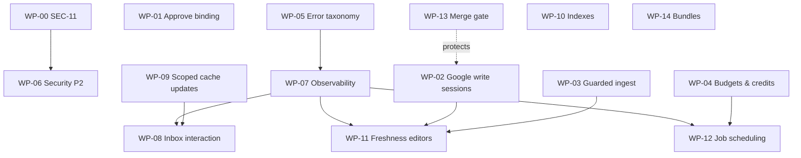

# Implementation roadmap

Ordered by expected impact against cost and risk, using the priorities in
`VERIFIED_FINDINGS.md`. Each work package (WP) is sized to be one PR, or a short
stack, on its own task branch off `main`. Changes land through PRs, per repo
policy.

Effort is engineering days for one agent plus review: **S** ≤1 d, **M** 2–4 d,
**L** 5+ d.

Acceptance criteria are written to be testable. Where they need a metric that
isn't collected yet, WP-07 supplies the instrumentation, and the criterion says
so.

**Ground rules for every WP:**

- Preserve behaviour except for the defect being fixed.
- Run `pnpm verify` (typecheck, lint, unit). Add `test:integration` for
  anything touching SQL, locks or publishing.
- Migrations follow the repo's expand-then-contract rule. New indexes use
  `CREATE INDEX CONCURRENTLY` in a migration of their own.
- Nothing is promoted to production except through `pnpm release:promote`, by
  the operator.

---

## Phase 0: before anything else (this week)

### WP-00 Settle SEC-11 (P0) [operator + 1 agent]

1. **Operator.** Run the read-only SQL in `CODEBASE_AUDIT.md §3.4` on staging,
   then production.
2. **Operator, if exposed.** Disable the Data API, or remove `public` from the
   exposed schemas, in the Supabase dashboard. No app impact was found.
3. **Agent.** Write the migration in `CODEBASE_AUDIT.md §3.5`:
   - revoke the API roles;
   - set default privileges;
   - scope the routing policies to `naba_app_runtime`;
   - add the local-only guard to `provision_local_bootstrap`;
   - drop `attach_member_user` and `provision_google_user`, updating their
     integration test.
4. **Agent.** Add a catalogue integration test.

- **Effort:** S (agent), plus about 30 min of operator time.
- **Acceptance:**
  - On staging and production, queries 3.4(c) and 3.4(d) return 0 rows, or
    `public` is not exposed.
  - The catalogue test passes on the throwaway Postgres (roles absent, so it
    no-ops) and on local Supabase.
  - SEC-11 in `docs/release/ledger.md` moves to verified, with evidence.
- **Risk:** low. The app makes no PostgREST calls. If any operator tooling uses
  the `service_role` key with PostgREST, check before revoking `service_role`.

### WP-01 Bind single-review approval to what the approver saw (W1-F1, P1)

`useApprovalDecision` must send `draftId` and `expectedReviewUpdateTime`, the
same fields bulk approve already sends. The server guards
(`review-approval.ts:121,149`) and the error copy already exist.

- **Effort:** S.
- **Files:** `lib/queries/use-approval-decision.ts`,
  `components/inbox/action-bar.tsx`. The action bar is on the user's
  in-progress inbox branch, so sequence this after it lands.
- **Acceptance:**
  - Component test: approve sends both fields.
  - Integration test: approving after the draft changes returns 409
    `approval_draft_changed`, and the UI shows the existing copy.
- **Risk:** low.

---

## Phase 1: correctness and reliability (weeks 1–2)

### WP-02 Google write sessions with honest timeouts (W4-01, P1)

Replace the 13 hand-rolled `withSessionConnection(begin(pg_advisory_xact_lock …))`
sites with one primitive. The proposed shape is in `ARCHITECTURE_IMPROVEMENTS.md`.

Requirements:

- Lock acquisition uses `SET LOCAL lock_timeout`, with user-facing
  "another change is in progress" copy, instead of a 30 s
  `statement_timeout` failure.
- `SET LOCAL idle_in_transaction_session_timeout` is sized from the Google
  budget: reads + validate + write + readback, retries included. Bound the
  retry sleep (`transport.ts:439`) by the remaining deadline.
- If COMMIT fails after Google accepted the write, the API returns the
  settled receipt's outcome, not a 5xx.
- The deadline sits below the route's `maxDuration`.
- **Do not** move to a session-level lock outside a transaction. That fix was
  rejected in R2-V4: it removes the only time limit on a lock held by a frozen
  instance.

- **Effort:** M–L. Migrate in two batches: hours, profile and menus first; then
  business info, industry, verification, administration, lifecycle, account
  change and bulk.
- **Acceptance:**
  - Integration tests with a fake Google transport that stalls past the
    deadline. Verify the lock is released, the user gets a typed timeout
    error, and the receipt state is consistent.
  - A test where COMMIT fails after Google succeeds returns 200 with the
    settled outcome.
  - No route can exceed its `maxDuration` by construction. Assert it in a unit
    test of the budget calculator.
- **Risk:** medium, because it touches every listing write path. Feature-flag
  the primitive per family.

### WP-03 Guarded, change-detecting review ingest (W4-03 P1 + W8-04 P2)

- Skip the upsert when the stored `content_hash` equals the incoming one.
- Guard the reply columns: never overwrite a reply whose `update_time` is
  newer than the payload, or that has a `publish_attempt` in `accepted`
  status.
- Only touch photo and reply rows when they changed.
- Update `content_hash` on settle, so a local publish and the next sync agree.

- **Effort:** M.
- **Files:** `lib/server/reviews.ts:155-383`, `lib/server/publishing/settle.ts`,
  possibly the trigger from `0006`.
- **Acceptance:**
  - Integration test: replay the W8-04 interleaving (sync reads before the PUT
    and commits before and after settle). The reply body and status survive in
    all three cases.
  - A second sync of an unchanged page performs 0 `review` updates (count via
    `pg_stat_user_tables.n_tup_upd` in the test DB).
- **Risk:** medium. The interaction with the `published→new` trigger
  allowance needs care.

### WP-04 Request budgets and AI credit ordering (W3-4, R2B-05, P1)

- **AI draft:** move the credit charge after the draft insert, or refund on any
  failure path.
- **Draft time budget:** cap each OpenAI call so generation plus verification
  fits under `maxDuration`, with margin.
- **Backfill:** pass a deadline.
- **Non-bulk "bulk approve":** route it to the bulk runner, or cap it to what
  fits.

- **Effort:** M.
- **Acceptance:**
  - Fault-injection test: a timeout after generation leaves the credit
    balance unchanged and no orphan reservation.
  - Every route doing Google or OpenAI work declares a `maxDuration` and
    passes a deadline. Enforce this with a lint test over `app/api`.
- **Risk:** low–medium.

### WP-05 Error taxonomy and visibility (W3-3, P1)

- Split input-validation errors (400) from upstream-response and invariant
  failures: 502 for upstream, 500 for invariants, logged with redaction.
- Parse Google and stored data with a distinct error class or wrapper.

- **Effort:** S–M.
- **Acceptance:**
  - Unit tests on the `http.ts` mapping.
  - A malformed Google payload in a test yields 502 and one structured log
    line.
  - Request-input failures are still 400.
- **Risk:** low. Clients that branch on 400 for these paths must be checked;
  W1's inventory lists them.

### WP-06 Security P2 bundle

- **`/auth/confirm`:** require a POST behind an interstitial before consuming
  the token (W6-05).
- **Legal holds:** add a DB trigger blocking delete or redaction of held
  reviews, and change `legal_hold.review_id` from `ON DELETE CASCADE` to
  `RESTRICT` (R2B-01).
- **Erasure:** add a preview for erasure by display name (R2B-02), and include
  `verification_result` reasons (R2B-03).
- **Session payload:** pass only display fields of `session` to `AppShell`
  (`app/(dashboard)/layout.tsx:149`).

- **Effort:** M.
- **Acceptance:** one test per item. The retention sweep integration test
  covers a hold created mid-sweep.

---

## Phase 2: interaction performance (weeks 2–3)

These WPs touch the inbox. Start them after the user's
`feat/inbox-mail-refinement` work merges, to avoid conflicts.

### WP-07 Production observability and an error budget (W7-1, W7-3; enables every metric below)

- Configure the OTLP exporter for Vercel, with a flush per invocation.
- Add spans or metrics for:
  - route latency (p50/p95/p99);
  - DB transactions and queries per request;
  - Google calls per request and per tick;
  - job lag by kind;
  - cron tick duration.
- Move the readiness probe off the operator's laptop to a hosted scheduler.
  This needs an operator decision.

- **Effort:** M.
- **Acceptance:**
  - A dashboard shows the baseline metrics from `PERFORMANCE_OPTIMISATION.md
§1` for at least 7 days before any Phase 2 change merges.
  - The readiness probe alerts within 5 minutes of a 503.

### WP-08 Inbox interaction fixes (W5-01, W2-01, W2-02, W5-02, W0-05; P1/P2)

- **Shallow URL state:** keep selection and filters with the history API
  (`team-view.tsx` already does this). Fix the misleading comments.
- **List stability:** memoise `reviews`. Scroll to the selected row only when
  `selectedId` changes. Stop the 15 s clock from re-rendering the list, by
  scoping it to the timestamps that need it.
- **Composer seeding:** seed the composer before first commit (initial state or
  a keyed initialiser), not from an effect.
- **Session writes:** throttle `app_session.last_seen_at` with
  `where last_seen_at < now() - interval '5 minutes'`.
- **Listings search:** debounce it.

- **Effort:** M. The parts are separable into small PRs.
- **Acceptance (needs WP-07, or a local trace):**
  - A row click causes 0 RSC requests: no `_rsc` fetch in a Playwright network
    assertion.
  - Opening N reviews adds 0 extra history entries (a Playwright Back-button
    test).
  - A scrolled list keeps its position across a 5 s settling poll (Playwright).
  - `app_session` updates per authenticated minute ≤ 1/5 of requests (DB
    counter in integration).

### WP-09 Scoped cache updates instead of refetch-all (W1-F2, W1-F3, W1 retry/401; P1/P2)

- Return the updated review row from publish, approve and delete. This is a
  contract change: `lib/contracts/reviews.ts` returns only status today.
- `setQueryData` the row into loaded pages, then invalidate counts only.
- Bound the settling poll: stop after N minutes, or switch parked replies to
  normal staleness.
- Make the retry policy skip 4xx.
- Mark shell refetches as background, so a 401 doesn't hijack the session
  (W1-F10).
- Write one per-entity invalidation map to replace the 5 hand-written sites.

- **Effort:** M.
- **Acceptance:**
  - A publish with K loaded pages issues ≤ 2 follow-up requests (detail +
    counts), down from K + 2. Assert it in a component test with a mocked
    fetch counter.
  - A deterministic 4xx is not retried.

### WP-10 Audit-log and FK indexes (W4-04, W4-08)

- `CREATE INDEX CONCURRENTLY … ON audit_log (organisation_id, subject_type,
subject_id, created_at desc) INCLUDE (action)`.
- Add the lateral rewrite of the posts-list query.
- Add single-column `review_id` indexes for the `draft` and `review_reply`
  cascades.

- **Effort:** S.
- **Acceptance:** on a seeded large tenant in integration, `EXPLAIN` of the
  timeline query shows an index scan on the new index, and a retention delete
  of one review avoids a seq scan.

### WP-11 Freshness-aware editors (W3-2, W0-04; P1/P2)

- Serve hours, profile, posts and place-actions from stored data when it's
  within a staleness budget, following the `media.ts:318-328` pattern.
- Do a live read on explicit refresh, before publish, or when stale.
- Stop profile GET writes and the `finally` invalidation fan-out.
- Return the post-publish state from the publish call, instead of refetching
  live.

- **Effort:** L. Do one editor per PR, hours first.
- **Acceptance:**
  - Opening an editor within the budget makes 0 Google calls and runs ≤ 2
    transactions (a test with a Google transport spy).
  - "Save and publish" on profile makes ≤ 2 live profile reads (from ≥ 4).

---

## Phase 3: scale and delivery (weeks 3–6, or when triggered)

### WP-12 Job runner scheduling (W8-01/02/03/05/08/09)

- **Reserve budget:** give scheduled posts and bulk children a reserved slice
  of each tick, as billing already has.
- **Prioritise by kind:** `user_retry` and `publish` before `reconcile` and
  `performance`.
- **Deadline-aware start:** only start an item if its worst case fits.
- **Parallel ticks:** allow more than one tick at a time. Leases already make
  this safe; a dedicated lock per queue is needed only for fleet sweeps.
- **Stale fleet locks:** use expiring lease rows instead of session advisory
  locks.
- **Cap bulk concurrency:** limit bulk children to `JOBS_CONCURRENCY`.
- **"Sync now" lock:** key it per tenant.

- **Trigger:** job lag p95 over 2 minutes, or more than about 300 linked
  locations. The arithmetic in `raw/W8` puts the latent limit at about 450
  locations at 2 s each.
- **Effort:** L.
- **Acceptance:**
  - A synthetic backlog test with 1,000 queued sync jobs still publishes a due
    scheduled post inside its 5-minute window.
  - A user retry starts within one tick.

### WP-13 Merge gate and staged promotion (W7-2, W7-4, W7-5)

- **Merge gate:** restore hosted CI (`typecheck`, `lint`, unit, build) as a
  required check, and require 1 approval.
- **Staged promotion:** `promote.mjs` deploys without assigning the domain,
  runs the readiness probe, then promotes.
- **Migration safety:** add `lock_timeout` to migrations, and a CI check for
  the expand-then-contract rule.
- **Release gate:** fail when the integration step ran 0 tests.

- **Effort:** M.
- **Acceptance:**
  - A PR cannot merge red.
  - A promotion with a failing readiness probe leaves the old deployment live.

### WP-14 Bundle hygiene (P2)

- Investigate the roughly 2.0 MB of duplicated chunk content, starting with
  webpack `splitChunks` and the `components/ui` barrel imports.
- Move the 56 KB lodging schema server-side, or lazy-load it.
- Keep zod off the auth pages.
- Load rarely-opened dialogs with `next/dynamic`.
- Remove the 7 unused dependencies. This changes the lockfile, so it needs the
  user's approval.

- **Effort:** M.
- **Acceptance:** measured with the same isolated-build method as
  `raw/R2-W7b`. Total chunk bytes drop and no route's first-load JS grows.
  Report the before/after table.

### WP-15 Remaining P2/P3 clean-up

Batch these as capacity allows:

- the idempotency polish from R2-W1b (forward intents; treat "already done" as
  success; dedupe bulk batches);
- one composite dirty-guard hook (W2-07);
- query-key roots (W2-05);
- the multiple-deadlines timer (W2-04);
- counts and search query shape (W4-06/07);
- batched metric upserts (W4-09);
- shared guard helpers for the reviewed-write families (W0-06);
- the self-hosted scheduler path parity (W0-02);
- documentation drift (W0-10).

---

## Dependency graph

WP-01, WP-10 and WP-14 have no dependencies and can start at any time.

## Parallel execution plan

Each WP gets its own worktree and branch, and the file ownership below avoids
overlapping edits. The coordinator reviews and merges in dependency order.

| Wave                          | Agent              | WP                                                    | Owns                                                                                |
| ----------------------------- | ------------------ | ----------------------------------------------------- | ----------------------------------------------------------------------------------- |
| 1                             | operator + claude6 | WP-00                                                 | `supabase/migrations/0132_*`, catalogue test                                        |
| 1                             | claude4            | WP-02 (batch 1)                                       | new `lib/server/google-write-session.ts`, `hours.ts`, `profile.ts`, `food-menus.ts` |
| 1                             | claude8            | WP-03                                                 | `lib/server/reviews.ts`, `publishing/settle.ts`                                     |
| 1                             | claude3            | WP-04 + WP-05                                         | `review-drafts.ts`, `ai*.ts`, `http.ts`, `route.ts`, backfill route                 |
| 1                             | claude7            | WP-13                                                 | `.github/workflows/*`, `scripts/release/*`, `scripts/db-migrate.mjs`                |
| 1                             | claude5            | WP-10 + WP-14                                         | new index migrations, `next.config.ts`, lazy-loaded dialogs (non-inbox)             |
| 2 (after inbox branch merges) | claude1            | WP-01 + WP-09                                         | `lib/queries/*`, `lib/contracts/reviews.ts`, review write routes                    |
| 2                             | claude2            | WP-08                                                 | `components/inbox/*`, `lib/inbox/*`, `session.ts` last-seen                         |
| 2                             | claudeAgent        | WP-06                                                 | `app/auth/confirm`, retention and privacy modules, the legal-hold migration         |
| 2                             | claude4            | WP-02 (batch 2)                                       | remaining lock sites                                                                |
| 3                             | any                | WP-07 (operator decision on exporter) → WP-11 → WP-12 | as listed                                                                           |

**Conflict hot-spots:**

- **`lib/server/session.ts`:** WP-06 and WP-08 both edit it. Merge WP-06
  first.
- **Review contracts:** WP-09 and WP-03 both affect review contracts and
  settle. Agree the returned review shape before starting.
- **Migrations:** WP-00, WP-06 and WP-10 all add migrations. Number them in
  merge order.

## Top 10, in order

| #   | WP                               | Why first                                                                                     |
| --- | -------------------------------- | --------------------------------------------------------------------------------------------- |
| 1   | WP-00 SEC-11                     | Possible tenant and account takeover; cheap to verify and to block                            |
| 2   | WP-01 Approve binding            | Approver can approve text they never saw; S effort, fix already half-built                    |
| 3   | WP-02 Google write sessions      | User sees 5xx for writes Google applied; lock and pooler pressure on 13 paths                 |
| 4   | WP-03 Guarded ingest             | Removes the largest write load on `review`, and the reply-overwrite race                      |
| 5   | WP-04 Budgets & AI credits       | Customers charged with nothing delivered; functions killed mid-work                           |
| 6   | WP-05 + WP-07 Errors & telemetry | Today these failures are invisible; every later claim needs measurement                       |
| 7   | WP-08 Inbox interaction          | Biggest user-visible latency and UX defects (server render per click, scroll-snap, Back trap) |
| 8   | WP-09 Scoped cache updates       | Cuts refetch storms after every reply action                                                  |
| 9   | WP-10 Audit/FK indexes           | One index fixes the review timeline scan; low risk                                            |
| 10  | WP-11 Freshness editors          | Removes live Google reads on every editor open; largest quota and latency win, but L effort   |

WP-13 (merge gate) is outside the top 10 by impact. It is a precondition for
landing this volume of change safely, so run it alongside wave 1.
