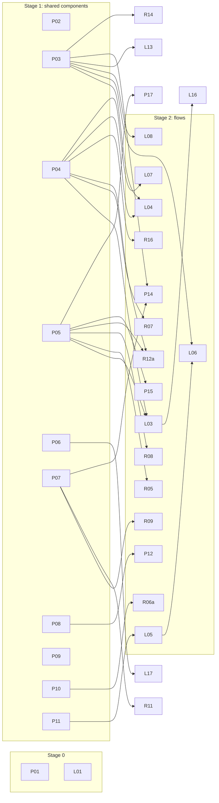

# UX flows audit: plan

The fixes for [findings.md](findings.md), grouped into independent slices. One slice is one branch and one PR. **Phase 2 starts only after the owner approves this plan.** Slices marked **Owner decision** also need the named decision first.

## How to read this

- **Lane** is who builds the slice:
  - **Platform** (Presence Platform): shared components, shell, design system, audit tooling, and Team, Settings and sign-in.
  - **Listings** (Listings & GBP): listing, Google profile and Calendar flows.
  - **Reviews** (Reviews & AI): Inbox, Notifications, Clients, client setup and Reports.
- **Stage** orders the work. A slice may start when every slice in its **Depends on** has merged. Slices in the same stage with no shared files can run in parallel. Within a stage, slices are ordered by impact ÷ effort.
  - Stage 0: measure correctly, and fix the one P0.
  - Stage 1: shared components, plus flow slices that need nothing shared.
  - Stage 2: flow slices that adopt Stage 1 components.
  - Stage 3: slices waiting on an owner decision.
  - Stage 4: larger or optional work.
- **Impact** (H 3, M 2, L 1) weighs severity, reach and frequency. **Effort** (S 1, M 2, L 3) is the size of one PR. **Score** = impact ÷ effort.
- **Closes** lists finding IDs from findings.md. A finding with two slices (for example `DSK-01 L03, P04`) is closed by the first, once the second has landed.

## Gates for every slice (G)

Every PR runs and reports, with real output:

1. `pnpm verify` (typecheck, lint, unit)
2. `pnpm check:design --ratchet`, which must not rise and should fall in touched files (baseline 106 at `4e0fa805`)
3. `pnpm check:contrast`
4. `pnpm test:e2e:touch` and `pnpm test:a11y`
5. The e2e specs named on the slice
6. Before/after screenshots at 390 light, 390 dark and 1280, taken with `tests/visual/shoot.mjs` against `visual-fixtures` + `visual-app` (one harness at a time; stop it with SIGINT)
7. The measured change: taps and steps for the touched flow, and `audit:mobile` totals (after P01), perf-lab or `route-js` where the slice touches loading or bundles

Behaviour and permissions stay identical unless the slice says otherwise. No backend, schema, migration or flag change without the owner. New patterns go into the design system and `/design-system` before any flow uses them.

## Owner decisions needed before Phase 2

| # | Decision | Unblocks |
| --- | --- | --- |
| D1 | Add the organisation's two-person flag and a server-computed `approvalScope` to the review-detail payload (no schema change) | R01b |
| D2 | Add `approval_requested` and `reply_sent_back` notification kinds | R03b |
| D3 | Add a server undo for "No reply needed" (`mark_unreviewed`), so the confirmation can become Undo | R06b |
| D4 | Allow publishing a post straight from the composer (consent line in the footer instead of a separate dialog), and add a photo to new posts | L10 |
| D5 | One write path for the business profile (local fields and reviewed requests collected in one review sheet) | L14 |
| D6 | Return a disjoint status per location for Reports provenance (server read model, no schema change) | R12b |
| D7 | Scope "Refresh from Google" to the selected client, or relabel it "Refresh all clients" | R13 |
| D8 | Return role and expiry from the invitation lookup | P19b |
| D9 | Password rules: drop "confirm password" and decide on character-class rules (security decision) | P19b |
| D10 | Which help and feedback channel to link (email, form or help centre) | P21 |
| D11 | Enable billing in the fixture so `/settings/billing` can be measured | P22 |

## Order

| Order | Slice | Lane | Stage | Closes | I | E | Score | Depends on |
| --- | --- | --- | --- | --- | --- | --- | --- | --- |
| 1 | L01 Readable menu diff at consent | Listings | 0 | LST-01 | H | S | 3 | none |
| 2 | P01 Audit measures the effective hit area | Platform | 0 | MEA-01 | H | S | 3 | none |
| 3 | P02 ActionBar in editors and Review & publish | Platform | 1 | LST-04, LST-05 | H | S | 3 | none |
| 4 | R01a Reply status matches Google | Reviews | 1 | INB-01, INB-15 | H | S | 3 | none |
| 5 | L02 Activity labels in words | Listings | 1 | LST-02 | M | S | 2 | none |
| 6 | R04 Role-aware connection actions | Reviews | 1 | INB-06 | M | S | 2 | none |
| 7 | R02 Read-only reply while awaiting approval | Reviews | 1 | INB-04 | M | S | 2 | none |
| 8 | P05 Phone app bar and scope chip | Platform | 1 | SET-07, SET-08 | H | M | 1.5 | none |
| 9 | P04 Navigation-strip primitives | Platform | 1 | MEA-03 (+ primitives for DSK-01, INB-11, CLR-19) | H | M | 1.5 | none |
| 10 | P03 One overlay anatomy | Platform | 1 | SET-13 | M | M | 1 | none |
| 11 | P07 Feedback primitives | Platform | 1 | INB-24 | M | S | 2 | none |
| 12 | P08 State primitives and system pages | Platform | 1 | SET-19, SET-20 (+ part of SET-09) | M | S | 2 | none |
| 13 | P09 Form primitives | Platform | 1 | SET-24, DSK-18 | L | S | 1 | none |
| 14 | P11 Shared vocabulary helpers | Platform | 1 | (helpers for CLR-06, LST-17, LST-19) | M | S | 2 | none |
| 15 | P10 ListRow trailing and swipe actions | Platform | 1 | (primitive for INB-08) | M | M | 1 | none |
| 16 | P06 Desk navigation | Platform | 1 | DSK-07, DSK-08, DSK-09 | M | M | 1 | none |
| 17 | L12 Verification page in plain words | Listings | 1 | LST-09 | M | S | 2 | none |
| 18 | L11 Publish failure and read-only views | Listings | 1 | LST-13, LST-27 | M | S | 2 | none |
| 19 | R18 Client setup connect step | Reviews | 1 | CLR-18, SET-12 | M | S | 2 | none |
| 20 | R15 Client hub | Reviews | 1 | CLR-13, CLR-14, CLR-15, CLR-05, DSK-10 | H | M | 1.5 | none (CLR-06 wording after P11) |
| 21 | R17 Client forms and settings | Reviews | 1 | CLR-16, CLR-17, CLR-21, CLR-22 | M | M | 1 | none |
| 22 | P13 Invite and role sheets | Platform | 1 | SET-01, SET-03, SET-14 | H | M | 1.5 | none |
| 23 | L03 Listing area header | Listings | 2 | LST-06, DSK-01, DSK-05, DSK-06, LST-21, DSK-15 | H | M | 1.5 | P04, P05 |
| 24 | L05 Hours states and formats | Listings | 2 | LST-18, LST-17, LST-19, LST-29 | H | S | 3 | P11 |
| 25 | R07 Inbox filters and counts | Reviews | 2 | INB-10, INB-11, INB-12 | M | M | 1 | P04 |
| 26 | R05 One client scope in Inbox | Reviews | 2 | INB-07 | H | S | 3 | P05 |
| 27 | R12a Reports scope, period and density | Reviews | 2 | CLR-01, CLR-02, CLR-10, CLR-24 | H | M | 1.5 | P05, P04 |
| 28 | R16 Clients index and health filters | Reviews | 2 | CLR-19, CLR-20, DSK-11 | H | S | 3 | P04 |
| 29 | L04 Listings board and overview | Listings | 2 | LST-07, LST-23 (+ one-item overflow from SET-13) | H | S | 3 | P03, P04 |
| 30 | P12 Team list as rows | Platform | 2 | SET-02, SET-10, SET-09 | H | M | 1.5 | P08 |
| 31 | P14 Notification settings | Platform | 2 | SET-05, SET-06, SET-29 | M | M | 1 | P03, P07 |
| 32 | R08 Review detail and composer | Reviews | 2 | INB-13, INB-16, INB-14, DSK-22 | M | M | 1 | P05 |
| 33 | R06a Triage from the review | Reviews | 2 | INB-08 | H | M | 1.5 | P10 |
| 34 | R09 Inbox list chrome and first load | Reviews | 2 | INB-23, INB-17, INB-18, INB-22, DSK-12 | M | M | 1 | P07 |
| 35 | R11 Notifications page | Reviews | 2 | INB-21 | L | S | 1 | P07 |
| 36 | L08 Booking links on the reviewed-write sheet | Listings | 2 | LST-10, LST-31 (+ single-type picker from SET-13) | M | M | 1 | P03 |
| 37 | L06 Hours day rows | Listings | 2 | LST-16 | M | M | 1 | P03, L05 |
| 38 | L07 Menu editor | Listings | 2 | LST-03, LST-20 | M | S | 2 | P04 |
| 39 | L09 Posts copy and empty state | Listings | 2 | LST-24, LST-25, DSK-14 | L | S | 1 | none |
| 40 | L13 Invitations on one sheet | Listings | 2 | LST-26 | L | S | 1 | P03 |
| 41 | L15 Photos sheet | Listings | 2 | LST-15 | L | S | 1 | none |
| 42 | L16 Area data streaming | Listings | 2 | LST-14, MEA-04 | M | M | 1 | L03 |
| 43 | L17 Calendar off state | Listings | 2 | LST-28 | L | S | 1 | P06 |
| 44 | R13 Reports charts, loading and refresh | Reviews | 2 | CLR-04, CLR-08, CLR-09, CLR-07 | M | M | 1 | none (D7 for the refresh label) |
| 45 | R14 Share sheet and public report | Reviews | 2 | CLR-11, CLR-12 | L | S | 1 | P03 |
| 46 | P15 Settings shell | Platform | 2 | SET-04, SET-11, SET-26 | M | S | 2 | P05 |
| 47 | P16 Reply policy | Platform | 2 | SET-15, SET-16 | L | S | 1 | none |
| 48 | P17 Google connections page | Platform | 2 | SET-25, SET-28 | L | S | 1 | P05, P09 |
| 49 | P18 Operations page | Platform | 2 | SET-21, SET-30 | L | S | 1 | none |
| 50 | P20 Settings and Team server prefetch | Platform | 2 | SET-22 | M | M | 1 | P12, P14 |
| 51 | P19a Sign-in error copy | Platform | 2 | SET-23 | L | S | 1 | none |
| 52 | R01b Two-person approval wording | Reviews | 3 | INB-02, INB-03 | H | M | 1.5 | D1, R01a |
| 53 | R06b Undo for "No reply needed" | Reviews | 3 | INB-09 | M | M | 1 | D3, R06a, P07 |
| 54 | R03 Approver signals | Reviews | 3 | INB-05 | H | M | 1.5 | D2 for the notification half |
| 55 | L10 Publish from the post composer, with a photo | Listings | 3 | LST-11, LST-12 | H | L | 1 | D4, P02 |
| 56 | R12b One status per location | Reviews | 3 | CLR-03 | M | M | 1 | D6, R12a |
| 57 | P19b Invitation role, password form | Platform | 3 | SET-17, SET-18 | M | M | 1 | D8, D9 |
| 58 | P21 Help and feedback entry | Platform | 3 | SET-27 | L | S | 1 | D10 |
| 59 | L14 One write path for the profile | Listings | 3 | LST-08 | M | L | 0.7 | D5, P02 |
| 60 | P22 Disabled-route paint time | Platform | 3 | MEA-02 | L | S | 1 | D11 |
| 61 | R10 Inbox bottom toolbar | Reviews | 4 | INB-19 | M | L | 0.7 | P10, R09 |
| 62 | P23 Desk quick-look panel | Platform | 4 | DSK-23 | L | L | 0.3 | P03; adoption by R16 and L04 |

Counted by lane: Platform 24 slices, Listings 17, Reviews 21: 62 PRs in all, with R01, R06, R12 and P19 each split in two by decision.

## Slices

Each slice lists its files, the expected before → after, and its checks on top of **G**. The files are the likely set from the findings, so the builder confirms them before starting.

### Stage 0

#### L01 · Readable menu diff at consent (Listings)
- **Closes:** LST-01 (P0)
- **Files:** `lib/locations/menu-diff.ts`, `components/editors/change-diff.tsx`, `components/ui/diff-view.tsx` (consumer only), a unit test beside `menu-diff`
- **Before → after:** "After publishing" prints raw JSON with `nanos`/`units` on Review & publish and in the menu editor's review sheet → added and removed menus, sections and items show as rows (name, description, "£16.50" via `formatMenuPrice`, "N sections · N items"). No `JSON.stringify` is ever displayed.
- **Checks:** G. A unit test that no diff row value starts with `{` or `[` for added, removed and changed menus. `tests/e2e/listings.spec.ts` and `gbp-management-tabs.spec.ts`. Screenshot of `09 - Change history & approvals/screen-02` re-taken.

#### P01 · Audit measures the effective hit area (Platform)
- **Closes:** MEA-01
- **Files:** `tests/visual/mobile-audit.mjs`, `tests/visual/mobile-audit-lib.mjs`, `tests/visual/mobile-audit-lib.test.ts`, `docs/audits/2026-10-15-ux-flows/baseline/mobile-audit*.{md,json}`
- **Before → after:** 260 "targets < 44px", mostly primitives whose `::before`/`::after` already reaches 44px → two metrics, `touchTargetBelow44` (effective hit area) and `touchBoxBelow44` (raw box). The baseline is re-run on `4e0fa805` and replaced, so every later slice compares like with like.
- **Checks:** `pnpm verify`. New unit cases for a pseudo-extended button, switch and checkbox, and for a genuinely small target. The re-run baseline is committed with its command line.

### Stage 1: shared components (Platform) and independent flow fixes

#### P02 · ActionBar in editors and Review & publish (Platform)
- **Closes:** LST-04 (incl. the desk idle bar), LST-05
- **Files:** `components/editors/editor-footer.tsx`, `components/editors/editor-frame.tsx`, `components/listings/review-publish.tsx` (bar only), `components/ui/action-bar.tsx` (only if a gap appears), `/design-system` ActionBar demo
- **Before → after:** three equal buttons on two rows (about 100px on a phone), and on desk a floating charcoal bar with three disabled buttons over a clean form. The Review & publish bar is docked by hand and the toast covers it. → One row on a phone: status, "Review changes" as primary, "Save here" and "Discard edits" in the overflow. No bar while clean at any width. Review & publish uses `ActionBar dock`, so the toast and scroll padding read its real height.
- **Checks:** G. `tests/e2e/listings.spec.ts`, `gbp-management-tabs.spec.ts`, `touch-critical.spec.ts`. Chrome share of the screen on `/listings/{loc}/hours` while dirty (audit `chrome` metric). The ratchet falls by the two `[@media(min-height:620px)]` uses in `editor-frame.tsx`.

#### R01a · Reply status matches Google (Reviews)
- **Closes:** INB-01, INB-15
- **Files:** `lib/inbox/reply-state.ts`, `lib/inbox/actions.ts`, `components/inbox/action-bar.tsx`, `components/inbox/detail/reply-exception.tsx`
- **Before → after:** "Live on Google" in the toast, status and subline while the banner says Google hasn't approved the reply; the approval copy says "parked", "manager" and names a hidden control. → With `googleReplyState === "PENDING"`, one status: "Sent · waiting for Google's check". Approval copy in plain words, with no "manager". Client only; the field is already in the payload.
- **Checks:** G. Unit tests on `reply-state` for PENDING and published. `tests/e2e/inbox.spec.ts`, `journeys.spec.ts`.

#### L02 · Activity labels in words (Listings)
- **Closes:** LST-02
- **Files:** `lib/listings/activity-outcome.ts`, `components/locations/activity-panel.tsx`, unit test
- **Before → after:** "Regularhours", "Publish google", "Failed · Not found" → explicit maps ("Opening hours", "Sent to Google", the error copy from `lib/errors/action-errors.ts`). Unknown keys show "Other change".
- **Checks:** G. A unit test over every operation, resource type and mask key. `tests/e2e/listings.spec.ts`.

#### R04 · Role-aware connection actions (Reviews)
- **Closes:** INB-06
- **Files:** `components/inbox/empty-states.tsx`, `components/inbox/detail/reply-exception.tsx`
- **Before → after:** members and viewers are sent to Access denied by "Manage connection", "Reconnect Google" and "Check Google connections" → the explanation stays, with "Ask an owner or admin to reconnect Google" and no button.
- **Checks:** G. `tests/e2e/inbox.spec.ts` with the viewer and member cookies.

#### R02 · Read-only reply while awaiting approval (Reviews)
- **Closes:** INB-04
- **Files:** `components/inbox/reply-composer.tsx`, `components/inbox/action-bar.tsx`
- **Before → after:** one tap on "Regenerate" by the approver silently withdraws the request → the parked reply shows read-only, with "Edit reply" in the overflow and an inline note that editing returns it to Needs reply. Tone and Generate are hidden until then.
- **Checks:** G. A component test on the `awaiting_approval` branch. `tests/e2e/inbox.spec.ts` (approval journey).

#### P05 · Phone app bar and scope chip (Platform)
- **Closes:** SET-07 (incl. INB-12 truncation, LST-30, CLR-23), SET-08
- **Files:** `components/app-shell/app-bar.tsx`, `components/app-shell/client-switcher.tsx`, `components/app-shell/page-chrome.tsx`, `lib/navigation/destinations.ts`, `tests/components/app-bar*.test.tsx`
- **Before → after:** the workspace name, a title echo and a 40vw scope chip truncate each other ("T..", "Review …"; 76 clipped labels). The chip shows on Team and Settings, which ignore it. → On scroll, the title cross-fades with the workspace name (one title, not two). The back label shortens to "‹" plus a short label when the echo shows. A client's own page shows only the chip's mark. `scoped: false` destinations (Team, Settings, Notifications) show search and bell, not the chip.
- **Checks:** G. `tests/e2e/routing.spec.ts`, `foundation.spec.ts`, `touch-critical.spec.ts`. `audit:mobile` `clippedText` falls from 76 (target: at most 10).

#### P04 · Navigation-strip primitives (Platform)
- **Closes:** MEA-03. Supplies the primitives for DSK-01 (L03), INB-11 (R07) and CLR-19 (R16).
- **Files:** `components/ui/tabs.tsx`, `components/ui/chip.tsx`, `/design-system` strip demos, unit tests
- **Before → after:** `TabNav` scrolls with a hidden scrollbar and a fade at desk, so tabs fall off-screen. Tab items can be 35px wide. Zero shows as "–" or "0" depending on the strip. Two chip primitives with two pressed styles. → A desk overflow mode (wrap, or "More ▾" for the rest). `min-w-(--np-touch)` on touch. One zero rule in `TabCount`/`ChipCount` (no figure). One filter chip primitive and pressed style, with an opt-in "hide when zero unless selected".
- **Checks:** G. Unit tests for overflow, the zero rule and hide-when-zero. `audit:mobile` on `/notifications` shows no tab under 44px.

#### P03 · One overlay anatomy (Platform)
- **Closes:** SET-13 (incl. LST-22). Its feature follow-ups go to L04 (one-item overflow) and L08 (single-option picker).
- **Files:** `components/ui/overlay.tsx`, `components/ui/menu-surface.tsx`, `components/ui/dialog.tsx`, `components/ui/sheet.tsx`, `components/ui/select.tsx`, `/design-system` overlay page
- **Before → after:** five dismiss and confirm layouts; menu sheets with no grabber; select sheets with no title → one recipe: left title, ×, the confirm as footer primary, no extra Cancel when × exists, and a grabber on every phone sheet. `title` is required on phone `SelectContent`.
- **Checks:** G. Unit tests for the footer recipe. `tests/e2e/touch-critical.spec.ts`, `accessibility.spec.ts`. Screenshots of one dialog, one menu and one select sheet.

#### P07 · Feedback primitives (Platform)
- **Closes:** INB-24. Supplies the pattern for SET-06, INB-21, INB-09 and LST-13.
- **Files:** `components/ui/toast.tsx`, `components/app-shell/scope-sheet-model.tsx`, `/design-system` feedback page
- **Before → after:** each scope switch adds a toast, so they stack. Optimistic updates and Undo are reinvented per feature. → `toasts.add({ id })` replaces an existing toast with that id. A documented `useOptimisticMutation` pattern (cache update in `onMutate`, rollback and error toast) and an Undo recipe for local actions.
- **Checks:** G. Toast unit tests for replace-by-id. Scope switched three times in a row shows one toast.

#### P08 · State primitives and system pages (Platform)
- **Closes:** SET-19, SET-20, and the `QueryPending` half of SET-09
- **Files:** `components/ui/query-states.tsx`, `components/app-shell/access-denied.tsx`, `app/(dashboard)/not-found.tsx`, `app/not-found.tsx`, `app/(dashboard)/team/page.tsx` (area name)
- **Before → after:** spinner plus skeleton at once. "No access · 403". "Back to Inbox" whatever the context. A raw UUID path. Two 404s with different words. → One loading indicator. A primary "Ask for access" (share, with copy as fallback) and the shell back target. The path sits behind "Details for support". One title and one verb across both 404s.
- **Checks:** G. `tests/e2e/routing.spec.ts`, `settings.spec.ts` (viewer on Team), `accessibility.spec.ts`.

#### P09 · Form primitives (Platform)
- **Closes:** SET-24, DSK-18
- **Files:** `components/ui/typed-confirmation.tsx`, `components/ui/field.tsx` or `components/ui/input.tsx`, `components/settings/connection-card.tsx` (duplicate description)
- **Before → after:** typing an email to confirm opens a keyboard with no `@`; short values span 700-930px on desk → `inputMode="email"` when the expected text contains "@"; a desk measure (`desk:max-w-md`) for short single-line fields, still full width on a phone.
- **Checks:** G. Unit test for the input hints. `tests/e2e/connections-oauth.spec.ts`.

#### P11 · Shared vocabulary helpers (Platform)
- **Closes:** none on its own. It supplies CLR-06 (adopted in R15), LST-17 and LST-19 (adopted in L05).
- **Files:** `lib/workspace/terms.ts`, a formatter in `lib/format` (time of day in 24-hour, time-zone name via `Intl.DateTimeFormat` `longGeneric`, shown only when it differs from the viewer's), unit tests
- **Before → after:** location, listing and venue for one object; "Europe/London"; 17:00 entered but "5:00 pm" confirmed → one place-noun ("listing"), "UK time", and one 24-hour formatter.
- **Checks:** `pnpm verify`. Unit tests for both helpers.

#### P10 · ListRow trailing and swipe actions (Platform)
- **Closes:** none on its own. It supplies the primitive for INB-08 (R06a) and R10.
- **Files:** `components/ui/list-row.tsx`, `/design-system` list page, unit tests
- **Before → after:** no row-level quick action → an optional trailing swipe revealing one or two actions, always paired with a visible button alternative (WCAG 2.5.7). It respects reduced motion and adds no dependency.
- **Checks:** G. Unit tests for the swipe, button alternative and keyboard paths. `tests/e2e/touch-critical.spec.ts` gains a swipe case.

#### P06 · Desk navigation (Platform)
- **Closes:** DSK-07, DSK-08, DSK-09
- **Files:** `components/app-shell/breadcrumbs-context.tsx`, `components/app-shell/nav.tsx`, `lib/navigation/destinations.ts`
- **Before → after:** one-crumb trails repeat the h1. The Settings trail is inconsistent. Team and Settings sit behind "More" in a half-empty sidebar. Two rows are `aria-current`. → No trail for one-crumb routes. "Settings / Reply policy". From `wide`, a permanent "Workspace" group. Exactly one `aria-current="page"`.
- **Checks:** G. `tests/e2e/routing.spec.ts`, `accessibility.spec.ts`. Screenshots at 1280.

#### L12 · Verification page in plain words (Listings)
- **Closes:** LST-09
- **Files:** `components/locations/administration/verification-tab.tsx`, `verification-completion.tsx`, `verification-observation.tsx`
- **Before → after:** a verified listing shows five sections of PIN and start tools in jargon → one status card ("Verified. Google confirms you manage this listing."), with the tools behind "Verification tools" unless a request is pending.
- **Checks:** G. `tests/e2e/verification-workspace.spec.ts` and the `verification-*` backend specs (behaviour unchanged).

#### L11 · Publish failure and read-only views (Listings)
- **Closes:** LST-13, LST-27
- **Files:** `lib/editors/use-publish-flow.ts`, `components/listings/review-publish.tsx`, `components/ui/publish-steps.tsx`, `components/editors/editor-frame.tsx`, `components/editors/support-details.tsx`
- **Before → after:** one failure is stated three times plus a `NOT_FOUND` chip; members see greyed editors and "Edit an area and come back here" → one line on the step, one banner with the next action, and a toast of six words or fewer. Codes go under "Details for support". Read-only roles see read rows and copy matched to their capability.
- **Checks:** G. `tests/e2e/listings.spec.ts`, `operations-features.spec.ts` (failure path), member cookie.

#### R18 · Client setup connect step (Reviews)
- **Closes:** CLR-18, SET-12
- **Files:** `components/setup/step-connect.tsx`, `lib/setup/steps.ts`, `components/setup/setup-wizard.tsx`, `components/ui/stepper.tsx` (unnumbered final step, if needed)
- **Before → after:** the hint points at a button below the fold; the counter says "of 6" while the list numbers Done as 7 → existing logins come first as `OptionRow`s with "Use this account". Blocked Continue scrolls to them. Done has no number.
- **Checks:** G. `tests/e2e/setup.spec.ts`, `google-onboarding.spec.ts`, `onboarding-match-link.spec.ts`.

#### R15 · Client hub (Reviews)
- **Closes:** CLR-13, CLR-14, CLR-15, CLR-05, DSK-10. CLR-06 once P11 lands.
- **Files:** `components/clients/client-hub.tsx`, `lib/clients/health.ts` (description fallback only)
- **Before → after:** "Needs attention" above "Review checks are up to date". Four stacked header buttons. Duplicate counts and pills on every row. Phone record cards at 1280. "Behind it", "Review import". → An attention description that names the cause. "Open inbox" as the one primary, with the rest in "More". Pills only for non-default states. A full-width table on desk. Plain labels.
- **Checks:** G. `tests/e2e/journeys.spec.ts` (client hub). Unit test for the attention fallback.

#### R17 · Client forms and settings (Reviews)
- **Closes:** CLR-16, CLR-17, CLR-21, CLR-22
- **Files:** `components/clients/client-form.tsx`, `components/clients/client-settings.tsx`, `components/clients/client-colour-field.tsx`
- **Before → after:** an inline mid-page save with the tab bar visible and no leave guard on New client. Colour swatches as toggle buttons that read out hex. A second back button. Archive takes a confirm, a checkbox and Undo. → A docked `ActionBar` (New client always shown; Details only when dirty). `useUnsavedChanges` on New client. A colour `RadioGroup` with a live preview. No in-page back on a phone. Archive at once with Undo, using `SettingsDestructiveAction`.
- **Checks:** G. `tests/e2e/journeys.spec.ts`, `accessibility.spec.ts`. The archive tap count drops from 5 to 2.

#### P13 · Invite and role sheets (Platform)
- **Closes:** SET-01, SET-03, SET-14
- **Files:** `lib/settings/roles.ts`, `components/settings/team-view.tsx` (role matrix), `components/settings/member-dialogs.tsx`, `components/settings/invitations-panel.tsx`, `lib/settings/gating.ts` (order)
- **Before → after:** Member "edits listings" (it can't). Four tall role cards, Owner first, push Client access below the fold. Two primaries on success. → True role copy, with a test tying it to `canEditCanonical`. `OptionRow` roles ordered Member, Viewer, Admin, Owner. Client access visible before the button. One primary (Share).
- **Checks:** G. `tests/e2e/settings.spec.ts` (invite and change role). Unit test on the role descriptions.

### Stage 2: flows that adopt the shared components

#### L03 · Listing area header (Listings)
- **Closes:** LST-06 (incl. DSK-20), DSK-01, DSK-05, DSK-06, LST-21, DSK-15
- **Files:** `components/listings/area-frame.tsx`, `components/listings/sibling-switcher.tsx`, `components/editors/google-freshness.tsx`, `components/app-shell/context-health-chip.tsx`, `lib/listings/area-nav.ts`, `lib/listings/area-state.ts`, `components/listings/area-cards.tsx`
- **Before → after:** about five header rows before content on a phone (nine blocks on desk). "Review & publish" off-screen at 1280. The overview switcher shows the client's name. Mixed status words, and "Check" meaning "open". → The H1 is the area switcher. Freshness and the model note fold into the pill's sheet or one caption, for two rows above the tabs. The desk strip uses P04's overflow, and "Review & publish (n)" is always visible as a header action. The listing name is the switcher everywhere. One status vocabulary. Card verbs say what they do.
- **Checks:** G. `tests/e2e/listings.spec.ts`, `gbp-management-tabs.spec.ts`. On `/listings/{loc}/profile` at 390, the first field moves from about 53% of the screen height to under 30%.

#### L05 · Hours states and formats (Listings)
- **Closes:** LST-18 (incl. DSK-03), LST-17, LST-19, LST-29
- **Files:** `lib/listings/area-state.ts`, `lib/listings/health.ts`, `lib/editors/hours-notes.ts`, `lib/server/hours.ts` (note text only), `components/locations/hours-tab.tsx`, `components/locations/hours-editor.tsx`, `lib/locations/hours-diff.ts`
- **Before → after:** green "In sync" everywhere for a listing with no hours on Google, which the board never surfaces. A services note on the hours page. 17:00 typed but "5:00 pm" confirmed. "Europe/London". "Copy to…" named differently. → A "No hours on Google" attention state that rolls up into listing health. The services note only where services are edited. 24-hour times throughout. "UK time". The label contains its visible text.
- **Checks:** G. Unit tests for the new area state and health rollup. `tests/e2e/listings.spec.ts`. The board's "Needs attention" chip counts the no-hours fixture listing.

#### R07 · Inbox filters and counts (Reviews)
- **Closes:** INB-10, INB-11 (incl. DSK-13), INB-12
- **Files:** `components/inbox/more-filters.tsx`, `components/inbox/filter-controls.tsx`, `components/inbox/active-filter-chips.tsx`, `components/inbox/queue-tabs.tsx`, `components/inbox/inbox-toolbar.tsx`, `components/app-shell/use-needs-reply-count.ts`, `lib/api/review-counts.ts`
- **Before → after:** a 10-group sheet (rating, then text, then "Show 1 review": 4 taps). "–" for zero. Tab counts that ignore filters. "2" shown four times, and a badge that ignores scope. → Rating and "With text" as one-tap `ToggleChip`s above the list. The sheet loses Client and Reply status, and Venue becomes a `Select`. P04's zero rule. One count (the title). The badge follows scope.
- **Checks:** G. `tests/e2e/inbox.spec.ts`, `inbox-shallow-url.spec.ts`. Filtering by 5★ with text drops from 4 taps to 2.

#### R05 · One client scope in Inbox (Reviews)
- **Closes:** INB-07
- **Files:** `components/inbox/filter-toolbar.tsx`, `components/inbox/active-filter-chips.tsx`, `components/inbox/more-filters.tsx`, `components/inbox/inbox-view.tsx`
- **Before → after:** the scope shows as a filter chip and a Filters-sheet select, and "Clear all filters" resets it → the scope lives only in the app bar. `onClearFilters` keeps `clientId`.
- **Checks:** G. `tests/e2e/inbox.spec.ts`, `inbox-shallow-url.spec.ts` (scope survives Clear all).

#### R12a · Reports scope, period and density (Reviews)
- **Closes:** CLR-01, CLR-02, CLR-10, CLR-24
- **Files:** `components/reporting/report-toolbar.tsx`, `components/performance/performance-view.tsx`, `components/performance/location-report.tsx`, `app/(dashboard)/reports/page.tsx`, `components/reporting/report-tab-head.tsx`, `components/reporting/presence-provenance.tsx`, `components/reporting/partial-coverage-alert.tsx`, `components/performance/keywords-tab.tsx`, `components/performance/google-performance-tab.tsx`, `lib/reporting/ranges.ts`
- **Before → after:** a second scope pill opening a sheet of selects (6 taps for client and period). About a screen of notices before the first figure. No share from "All clients". The period changes silently between tabs. → The app-bar chip for scope, and the period as a one-tap chip strip. Provenance in one caption with an info sheet. Refresh in the overflow. "Share a client's report" in the overflow. The period maps to the nearest equivalent and the caption says so.
- **Checks:** G. `tests/e2e/reports.spec.ts`. Choosing client and period drops from 6 taps to 3. The first KPI is visible without scrolling on the Google tab at 390×844.

#### R16 · Clients index and health filters (Reviews)
- **Closes:** CLR-19 (incl. DSK-04, INB-20), CLR-20, DSK-11
- **Files:** `components/clients/health-filter.tsx`, `components/clients/clients-index.tsx`, `lib/clients/health.ts`
- **Before → after:** eight chips with empty near-synonyms first; the populated "Partially ch…" clipped. Two targets in one card. "Synced Not yet". A link in mono. → Zero buckets hidden unless selected, with the shared filter chip and plain words. Search on its own row on desk. One target per card. Sentence meta. Links in sans.
- **Checks:** G. `tests/e2e/journeys.spec.ts` (clients). Screenshot at 1280 with no clipped chip.

#### L04 · Listings board and overview (Listings)
- **Closes:** LST-07, LST-23, and SET-13's one-item overflow follow-up
- **Files:** `components/listings/listings-board.tsx`, `components/listings/health-strip.tsx`, `components/listings/listing-overview.tsx`, `components/listings/area-frame.tsx` (overflow only)
- **Before → after:** five control rows (first listing at about 51% of the height). Zero chips. Health repeated. A sheet holding one action. → "Add listings" as an app-bar action or list end. Zero chips hidden. Sort folded into one chip. Health reduced to two rows. A single action shown directly.
- **Checks:** G. `tests/e2e/listings.spec.ts`. The first listing row is above 30% of the height at 390.

#### P12 · Team list as rows (Platform)
- **Closes:** SET-02, SET-10, SET-09 (Team skeletons)
- **Files:** `components/settings/members-table.tsx`, `components/settings/team-list.tsx`, new `components/settings/member-sheet.tsx`, `app/(dashboard)/team/loading.tsx`
- **Before → after:** about 145pt per member (2.5 per screen), a role chip that does nothing, and two skeletons of the wrong height → a `ListRow` per member (avatar, name, full email, "Admin · All clients · Can publish", ⋯), tap for a member sheet, the role chip opens Change role. One `SkeletonList` at row height. The desk table is kept.
- **Checks:** G. `tests/e2e/settings.spec.ts`. Change role drops from 5 taps to 3. perf-lab CLS on `/team` stays under 0.01.

#### P14 · Notification settings (Platform)
- **Closes:** SET-05, SET-06, SET-29 (incl. DSK-17)
- **Files:** `components/settings/notification-preferences.tsx`, `components/settings/members-table.tsx` (publishing switch)
- **Before → after:** three-row blocks of about 135pt per event. Every control freezes while one save runs. Bulk off has no Undo. Email selects stay live with no provider. → `SettingsRow` switch rows with a chevron cadence row (titled select sheet). Optimistic saves that disable only that row. Undo after bulk. Email rows disabled with the reason as text.
- **Checks:** G. `tests/e2e/settings.spec.ts`. The `/settings/notifications` page height at 390 falls by at least 40%.

#### R08 · Review detail and composer (Reviews)
- **Closes:** INB-13, INB-16 (incl. DSK-21), INB-14, DSK-22
- **Files:** `components/inbox/review-detail.tsx`, `components/inbox/reply-composer.tsx`, `lib/inbox/reply-guidance.ts`, `components/app-shell/page-chrome.tsx` (consumer)
- **Before → after:** two header bands and the name twice. The text box at about 70% of the height. Guidance drawn as hollow radio-like circles. AI unavailable still offers Retry and Generate. A broken-image glyph. → "2 of 2 ‹ ›" in the app bar and no head band. The text box first, tone folded into Generate. Guidance shown only once there is text, without circles. `ai_not_configured` treated like credits-out. An image `onError` placeholder.
- **Checks:** G. `tests/e2e/inbox.spec.ts`, `inbox-history.spec.ts`, `touch-critical.spec.ts`. On `/inbox?selected={review}` at 390, the top of the text box is above 50% of the height.

#### R06a · Triage from the review (Reviews)
- **Closes:** INB-08
- **Files:** `components/inbox/review-detail.tsx`, `components/inbox/review-list.tsx`, `components/inbox/bulk-action-bar.tsx` (shared action helper)
- **Before → after:** marking one review "No reply needed" takes 4 taps through Select → "No reply needed" and "Assign…" in the detail ⋯, plus a row swipe (P10) with its visible alternative. The confirmation stays until R06b.
- **Checks:** G. `tests/e2e/inbox.spec.ts`, `touch-critical.spec.ts` (swipe). Single triage drops from 4 taps to 2 or 3.

#### R09 · Inbox list chrome and first load (Reviews)
- **Closes:** INB-23, INB-17, INB-18, INB-22, DSK-12
- **Files:** `components/inbox/bulk-action-bar.tsx`, `components/inbox/review-detail.tsx`, `components/inbox/filter-toolbar.tsx`, `components/inbox/list-header.tsx`, `components/inbox/sync-reviews-button.tsx`, `components/inbox/review-list.tsx`, `components/ui/selection-bar.tsx`
- **Before → after:** `/inbox` first-load JS is 552KB, over the 520KB budget, because every dialog is static. Two Select exits. A sync error caption that sticks. Freshness hidden on phones. A pulse that ignores reduced motion. Venue lines that wrap rows to three lines. → Template, History and Review details loaded via `next/dynamic`, and the hidden Selects removed. One Cancel. Errors as toasts. Freshness on phones. An indeterminate `Progress`. One-line venue meta.
- **Checks:** G. perf-lab mobile and desktop: `/inbox` first-load JS at or under 520KB (budget-baseline passes). `tests/e2e/inbox.spec.ts`.

#### R11 · Notifications page (Reviews)
- **Closes:** INB-21
- **Files:** `components/notifications/notifications-view.tsx`
- **Before → after:** read and resolve wait on the server. A page-level error line. "Mark shown as read". An empty state with no next step. → Optimistic (P07 pattern) with an error toast. "Mark all read", hidden when nothing is unread. "Notification settings" as the empty-state action.
- **Checks:** G. `tests/e2e/operations-features.spec.ts` (notifications-resolve).

#### L08 · Booking links on the reviewed-write sheet (Listings)
- **Closes:** LST-10, LST-31, and SET-13's single-option picker follow-up
- **Files:** `components/locations/place-actions/place-action-approval-sheet.tsx`, `components/locations/booking-tab.tsx`, `components/locations/place-actions/saved-place-action-work.tsx`
- **Before → after:** a one-off sheet, an inline secondary primary, a picker with one choice, and "action link" jargon → `ReviewedWriteSheet` with steps and outcome. A docked `ActionBar` once a URL is entered. The type shown as static text when only one is supported. "Booking link" throughout.
- **Checks:** G. `tests/e2e/place-actions-backend.spec.ts` (behaviour unchanged). Adding a booking link drops from 7 taps to 5.

#### L06 · Hours day rows (Listings)
- **Closes:** LST-16
- **Files:** `components/locations/hours-editor.tsx`
- **Before → after:** about 280px per open day and four lines per closed day → one `SettingsRow` per day ("Monday · 09:00–17:00 ›", trailing switch). The day opens in a sheet with `TimeField`s and "Copy to…", and the group header holds one "Copy Monday to…".
- **Checks:** G. `tests/e2e/listings.spec.ts`, `touch-critical.spec.ts`. The `/listings/{loc}/hours` page height at 390 falls by at least 50%.

#### L07 · Menu editor (Listings)
- **Closes:** LST-03, LST-20
- **Files:** `components/locations/menu-editor.tsx`
- **Before → after:** a 20px menu picker and five tool rows for one item → a full-width picker (or the title as switcher). Find tools only above a size threshold. Pluralisation via `count-text`.
- **Checks:** G. `tests/e2e/listings.spec.ts`.

#### L09 · Posts copy and empty state (Listings)
- **Closes:** LST-24, LST-25, DSK-14
- **Files:** `components/locations/posts/post-card.tsx`, `components/locations/posts-tab.tsx`, `components/locations/posts/post-composer-sheet.tsx` (copy and fields), `components/locations/posts/post-preview.tsx`
- **Before → after:** every card headed "Update", "Lifecycle", draft copy said three times, borderless fields, and an empty state pointing elsewhere → the first line of the summary as title, "History", the copy said once, default `Field` inputs, and "New post" in the empty state.
- **Checks:** G. `tests/e2e/operations-features.spec.ts` (posts).

#### L13 · Invitations on one sheet (Listings)
- **Closes:** LST-26
- **Files:** `components/locations/administration/invitations.tsx`, `components/locations/administration/access-review.tsx`, `components/ui/stepper.tsx` (labels on phone)
- **Before → after:** "Add administrator" with the role set to Manager, a jump from sheet to page panel, unlabelled steps, and "invitation review saved" → "Invite someone", the whole flow in `ReviewedWriteSheet`, labelled steps, and "Invitation ready to approve".
- **Checks:** G. `tests/e2e/administration-access-backend.spec.ts`, `administration-access-recovery.spec.ts`.

#### L15 · Photos sheet (Listings)
- **Closes:** LST-15
- **Files:** `components/locations/photos/add-photo-dialog.tsx`
- **Before → after:** "Add media" says photos go straight to Google, then shows "Review file upload" and "Upload N photos" → "Add photos", "Photos go to Google when you tap Upload", one primary.
- **Checks:** G. `tests/e2e/listings.spec.ts` (photos).

#### L16 · Area data streaming (Listings)
- **Closes:** LST-14, MEA-04
- **Files:** `app/(dashboard)/listings/[id]/{profile,menu,booking,people,verification,suggestions,changes}/page.tsx`, `lib/server/prefetch.ts`, new `app/(dashboard)/listings/[id]/layout.tsx`, `components/listings/area-frame.tsx` (strip prefetch)
- **Before → after:** seven areas fetch their main data after hydration, and the header remounts on each switch. 19 RSC requests per desk page load. → The `StreamedTab` + `*TabPrefetch` pattern on all ten areas, `AreaFrame` kept in a layout, and intent-only prefetch on the strip.
- **Checks:** G. perf-lab mobile and desktop on all listing areas: LCP no worse; desk RSC requests per load at or under 4. `tests/e2e/gbp-management-tabs.spec.ts`.

#### L17 · Calendar off state (Listings)
- **Closes:** LST-28 (incl. the Calendar part of DSK-08)
- **Files:** `components/calendar/publication-calendar.tsx`, `components/app-shell/tab-bar.tsx`, `lib/navigation/destinations.ts`
- **Before → after:** an "off" dead end under a description of a calendar that isn't there, with no current nav item → no description when off, an action ("Contact support" for owners, "Go to Listings" for others), and a current item in the tab bar and sidebar.
- **Checks:** G. `tests/e2e/business-mode.spec.ts`, `routing.spec.ts`.

#### R13 · Reports charts, loading and refresh (Reviews)
- **Closes:** CLR-04, CLR-08, CLR-09, CLR-07 (labelling per D7)
- **Files:** `components/reporting/report-bar-chart.tsx`, `components/reporting/reply-figures.tsx`, `components/reporting/reports-skeleton.tsx`, `components/performance/google-performance-tab.tsx`, `components/performance/keywords-tab.tsx`, `components/performance/location-report.tsx`, `components/performance/refresh-google-button.tsx`, `lib/queries/use-analytics-presence.ts`
- **Before → after:** colliding peak and latest labels, about 10px bars, average rating as bars, generic loading rows, a directory → figures waterfall, and a refresh that doesn't poll → dated labels, scrub across the plot, weekly grouping on a phone, the rating as a line or KPI, tab-shaped skeletons, parallel queries, and polling while a sync runs.
- **Checks:** G. `tests/e2e/reports.spec.ts`. perf-lab `/reports` CLS stays under 0.02.

#### R14 · Share sheet and public report (Reviews)
- **Closes:** CLR-11, CLR-12
- **Files:** `components/clients/share-report-dialog.tsx`, `components/share/shared-client-report.tsx`
- **Before → after:** mid-sheet actions, restyled radios, a hand-built list, and a public report opening on four metadata rows that reloads to the top → `DialogFooter` actions, `OptionRowGroup`, `ListRow` links, and the name and period first with metadata in the footer and period links anchored to `#main`.
- **Checks:** G. `tests/e2e/reports.spec.ts` (sharing).

#### P15 · Settings shell (Platform)
- **Closes:** SET-04, SET-11, SET-26
- **Files:** `components/settings/settings-nav.tsx`, `app/(dashboard)/settings/loading.tsx`, `lib/navigation/destinations.ts`, `lib/navigation/back-target.ts`, `components/settings/settings-index.tsx`, `lib/settings/areas.ts`, `components/app-shell/account-menu.tsx`
- **Before → after:** "‹ Settings" and "‹ All settings" both shown. Setup has no back and no active tab. Theme is only in More, where "Match system" wraps. → One back control. Setup maps to Clients (agency) or Listings (business). An "Appearance" row in Settings. A `SegmentedControl` in More.
- **Checks:** G. `tests/e2e/settings.spec.ts`, `setup.spec.ts`, `routing.spec.ts`.

#### P16 · Reply policy (Platform)
- **Closes:** SET-15, SET-16 (incl. DSK-19)
- **Files:** `components/settings/policy-form.tsx`, `components/settings/agency-name-form.tsx`
- **Before → after:** a native number spinner in mono, "Raw review content retention", the "sidebar" on a phone, and the approval state said three times → presets as a `Select`, "How long we keep review text", the "top of the app", and one `Alert`.
- **Checks:** G. `tests/e2e/settings.spec.ts`.

#### P17 · Google connections page (Platform)
- **Closes:** SET-25, SET-28
- **Files:** `components/settings/connection-card.tsx`, `components/settings/connections-workspace.tsx`, `components/app-shell/page-chrome.tsx`
- **Before → after:** a red Disconnect in the headline spot, and a primary that scrolls away at the top → status trailing, Disconnect last in a ⋯ or detail sheet, and "Connect another account" in the app bar once the header scrolls.
- **Checks:** G. `tests/e2e/connections-oauth.spec.ts`.

#### P18 · Operations page (Platform)
- **Closes:** SET-21, SET-30
- **Files:** `components/settings/operations-view.tsx`, the scheduled-jobs info module
- **Before → after:** ten "Stale" pills in engineering words with no summary, and an accessible time in London time → a one-line `Alert` with what it means and what to do, the details in a disclosure of `ListRow`s, codes in words, and the organisation's time zone in labels.
- **Checks:** G. `tests/e2e/settings.spec.ts` (operations).

#### P20 · Settings and Team server prefetch (Platform)
- **Closes:** SET-22
- **Files:** `lib/server/prefetch.ts`, `app/(dashboard)/team/page.tsx`, `app/(dashboard)/settings/*/page.tsx`
- **Before → after:** every visit shows a skeleton while the client fetches → server prefetch through `HydrationBoundary`, as Inbox and Listings do.
- **Checks:** G. perf-lab on `/team` and `/settings/notifications` (add them to the route list): content painted in the first response, LCP no worse.

#### P19a · Sign-in error copy (Platform)
- **Closes:** SET-23
- **Files:** `lib/api/auth-errors.ts`, `components/auth/*-form.tsx`
- **Before → after:** the reset page says "Sign-in is temporarily unavailable", and business workspaces read "agency" → surface-aware titles and "Sign in to continue."
- **Checks:** G. `tests/e2e/auth.spec.ts`.

### Stage 3: after an owner decision

| Slice | Lane | Closes | Decision | Files | Before → after | Extra checks |
| --- | --- | --- | --- | --- | --- | --- |
| R01b Two-person approval wording | Reviews | INB-02, INB-03 | D1 | `lib/inbox/reply-state.ts`, `lib/contracts/reviews.ts`, review-detail route, `components/inbox/action-bar.tsx` | "Publish reply" parks the reply; the submitter is offered "Approve" → "Submit for approval"; the submitter sees "Waiting for another approver" | `inbox.spec.ts` approval journey; contract test |
| R06b Undo for "No reply needed" | Reviews | INB-09 | D3 | bulk reviews route, `components/inbox/bulk-action-bar.tsx`, `components/inbox/reply-composer.tsx` | confirm dialog → act at once with an Undo toast; no regenerate confirm | `inbox.spec.ts`; integration test for the undo endpoint |
| R03 Approver signals | Reviews | INB-05 | D2 (notification half) | `components/app-shell/use-needs-reply-count.ts`, `components/inbox/inbox-toolbar.tsx`, `lib/domain/notification-preferences.ts`, notification producers | an approver sees nothing → the badge and title count "awaiting my approval"; notifications for requests and send-backs | `inbox.spec.ts`; `operations-features.spec.ts` |
| L10 Publish from the post composer, with a photo | Listings | LST-11, LST-12 | D4 | `components/locations/posts/post-composer-sheet.tsx`, `components/locations/posts-action-bar.tsx`, `components/locations/photos/add-photo-dialog.tsx` | save, back, publish, confirm (4-5 taps) and no photo → "Publish to Google" with the consent line in the footer (2 taps) and a Photo row | `operations-features.spec.ts` posts; taps measured |
| R12b One status per location | Reviews | CLR-03 | D6 | `lib/server/presence-report.ts`, `components/reporting/presence-provenance.tsx`, `components/reporting/partial-coverage-alert.tsx` | overlapping "reporting" and "not fetched" counts → disjoint statuses that add up, said once | `reports.spec.ts`; unit test on the read model |
| P19b Invitation role, password form | Platform | SET-17, SET-18 | D8, D9 | `app/api/invitations/[token]/route.ts`, `components/auth/invitation-view.tsx`, `components/auth/sign-in-form.tsx`, `components/auth/reset-password-form.tsx`, `components/auth/password-requirements.tsx` | the invitee accepts blind; confirm-password and class rules → role and expiry shown; the password form per D9 | `auth.spec.ts`; route contract test |
| P21 Help and feedback entry | Platform | SET-27 | D10 | `components/app-shell/more-sheet.tsx`, `components/settings/settings-index.tsx`, `lib/navigation/destinations.ts` | no route to help → a "Help and feedback" row in More and Settings | `routing.spec.ts` |
| L14 One write path for the profile | Listings | LST-08 | D5 | `components/locations/profile/profile-editor.tsx`, `components/locations/profile/section-card.tsx`, `lib/listings/areas.ts`, `components/reviewed-write/*` | two models in one form, with per-field tags → one "Review changes" collecting both, one consent, per-row results | `listings.spec.ts`, `services-backend.spec.ts`, `lodging-*-backend.spec.ts` |
| P22 Disabled-route paint time | Platform | MEA-02 | D11 | settings layout, `app/(dashboard)/settings/billing/*` | LCP 3.3s on a disabled route → under 1.5s; billing measured when enabled | perf-lab mobile `/settings/billing` within budget |

### Stage 4: larger or optional

| Slice | Lane | Closes | Depends on | Files | Before → after | Extra checks |
| --- | --- | --- | --- | --- | --- | --- |
| R10 Inbox bottom toolbar | Reviews | INB-19 | P10, R09 | `components/inbox/inbox-toolbar.tsx`, `components/ui/toolbar.tsx`, `app/globals.css` (chrome contract) | search, filters and sync in the top 30% → a floating bottom toolbar above the tab bar that steps aside for the selection and action bars; pull to refresh with a button alternative | `touch-critical.spec.ts`; chrome budget in `audit:mobile` |
| P23 Desk quick-look panel | Platform | DSK-23 | P03 | `components/ui/overlay.tsx`, `/design-system`, then `components/clients/clients-index.tsx` and `components/listings/listings-board.tsx` in their lanes | a full page change to see what is waiting → a right panel from `lg` with the row's work and an "Open" link | `journeys.spec.ts`, `listings.spec.ts` at 1280 |

## Phase 3 hooks

- P01 re-baselines `audit:mobile` before any other slice measures. Use that file, not the 260 in `baseline/mobile-audit-totals.json`, as the "before" total.
- The "Steps per flow" tables in findings.md are the "before" column for `results.md`.
- perf-lab "before" figures: `baseline/perf-mobile.md` and `baseline/perf-desktop.md`. Re-run the same profile and runs on the final main.
