# p1 · Sign-in, auth, invites, landing, legal and shared report: before and after

Status: **implemented and partially verified**, revised after an independent
review (see [Review response](#review-response)). The evidence is source, unit
and component tests, and fixture-browser runs against a production build on a
throwaway PostgreSQL. No provider-backed check ran: no real Supabase Auth,
mailer, authenticator app or Google account was used, and nothing was sent or
published. See [Verification](#verification).

## Scope and baseline

**Area.** The anonymous and pre-session surfaces of NabaPresence:
`/` (`app/page.tsx`), the `(auth)` group (`/sign-in`, `/sign-in/verify`,
`/forgot-password`, `/reset-password`, `/confirm-email`, `/invite/[token]`,
and the group's error boundary), the `(legal)` group (`/privacy`, `/terms`)
and the public `/share/report/[token]`.

**Flows.** There is no numbered catalogue for this area, so the flows were
enumerated from the routes and the components they render:

| ID     | Flow                                   | Starts at                                                                      | Ends at                                                                                                 |
| ------ | -------------------------------------- | ------------------------------------------------------------------------------ | ------------------------------------------------------------------------------------------------------- |
| p1-F01 | Sign in with email and password        | `/sign-in` (also `?next=`, `?status=`, `?invite=`)                             | Full navigation to `next` or `/inbox`; or `/sign-in/verify` when the account has two-step on            |
| p1-F02 | Create an account                      | `/sign-in?mode=create-account`                                                 | "Check your email" stage (confirmation needed), or `/inbox` when the server signs in at once            |
| p1-F03 | Resend a confirmation email            | Sign-in disclosure, the `email_not_verified` alert, the "Check your email" box | A neutral "on its way … if it still needs confirming" note                                              |
| p1-F04 | Confirm an email from the link         | `/auth/confirm` GET → `/confirm-email?token_hash=…[&inviteToken=…]`            | POST `/auth/confirm` → 303 to `/inbox` or `/sign-in/verify`; failures → `/sign-in?email=error&status=…` |
| p1-F05 | Two-step verification at sign-in       | `/sign-in/verify` (MFA on, pending-sign-in cookie)                             | `next` or `/inbox`; "Use a different account" → `/sign-in`                                              |
| p1-F06 | Request a password reset link          | `/forgot-password` (address carried from sign-in)                              | Neutral "Check your email" stage                                                                        |
| p1-F07 | Choose a new password                  | `/reset-password?token_hash=…`                                                 | `/inbox` (signed in here, out elsewhere) or `/sign-in/verify`                                           |
| p1-F08 | Accept a team invitation               | `/invite/[token]`                                                              | `/inbox` after accept; create account / sign in embedded; dead ends for finished invitations            |
| p1-F09 | Arrive at the public entry; auth shell | `/` → `/sign-in` (production, no session); the shared `AuthCard` frame         | The sign-in page; the `(auth)` error boundary's retry                                                   |
| p1-F10 | Read the privacy policy and terms      | `/privacy`, `/terms` (linked from every auth page and Google's consent screen) | Back to sign in                                                                                         |
| p1-F11 | Read a shared performance report       | `/share/report/[token]` (`?period=` from an allowlist)                         | The report; one identical not-found for every bad link; the error page's retry                          |

One analysis per flow (one subagent each) is kept in [`flows/`](flows/):
baseline steps, a states inventory with exact stubs, protected rules,
friction with evidence and proposals. This report merges them into one change
set; some proposals were dropped on purpose (see
[Outcome and follow-ups](#outcome-and-follow-ups)).

**Baseline.** Branch `ux/flows-presence-p1`, cut from
`origin/ux/all-flows-presence` at `e4123d25` (after the responsive pass
#258), in the isolated worktree `/tmp/naba-presence-p1`. No other worktree,
branch or checkout was touched.

**Environment.**

- Production build (`pnpm build`, webpack) served by `pnpm start` on
  `PLAYWRIGHT_PORT=3510`, Google stub on 3511, with the e2e harness's own
  environment from `playwright.config.ts` (`PASSWORD_AUTH_ENABLED=false`,
  `REGISTRATION_WORKSPACE_CHOICE_ENABLED=true`, abuse limits off) and CI's
  placeholder secrets. No env file in the worktree.
- A throwaway PostgreSQL 17 cluster per run (`scripts/run-test-command.mjs`),
  seeded by the e2e stub bridge with the "Sprint 5 Journey" fixture tenant.
  No hosted or shared database.
- The F05 pass ran a second server with `MFA_ENABLED=true` and nothing else
  changed.
- Every auth API call in the captures is stubbed with `page.route`, so no
  form reached an auth provider. The only real writes are the fixture
  owner's share link for F11 (made through the share sheet, as
  `tests/e2e/reports.spec.ts` does) on the throwaway database. Signed-in
  invite states use the fixture owner's cookie with `DELETE /api/session`
  held, so the fixture session was never ended.
- Fixture data only: `sam@example.test`, `invited@example.test`, "Fixture
  Inns", "Journey Hospitality", `harness-…@nabapresence.test` (the seeded
  owner), made-up token strings. No real email, phone number, code or token
  appears in an image or this document.

**Capture method and one deviation.** The brief asks for
`tests/visual/shoot.mjs` under the machine-wide visual lock. The lock was
held by another thread when this pass started (`mkdir` failed), and
`shoot.mjs` can only load a URL: it cannot stub an API, press a button or hold
a request, which is what almost every state here needs. The capture is
therefore a Playwright script ([`capture/`](capture/), kept as reference
text; it ran from a gitignored copy) that uses `shoot.mjs`'s own context
options: Chromium, viewport height 860, `reducedMotion: "reduce"`,
`hasTouch` and `isMobile` below 768, `colorScheme` for the theme, at the repo
convention of **390 light, 390 dark and 1280 light**, full-page except where
noted. At 1280 the app scrolls inside its shell, so most 1280 shots (33 of 40) are 1280 × 860 and show the top of the page only. File names follow `shoot.mjs`: `<state>-chromium-<theme>-<width>`. It
uses neither the shared visual harness ports (3200/3201) nor `naba_visual`,
so the lock was not needed and was not taken. Screenshots were converted from
PNG to WebP (quality 78) equally on both sides.

**Harness facts recorded while setting up.**

- In the e2e harness `/` goes to `/inbox` as a bootstrap owner, because local
  bootstrap is on there. Production with no session goes to `/sign-in`
  (`app/page.tsx:6-9`). The `/` state was therefore not captured; F09 is
  evidenced from source and the sign-in captures.
- Chromium paints a blank frame while a held document POST is pending. The
  F04 "submitting" frame was blank on both sides on the first pass. The AFTER
  frame was retaken with a capture-only window `submit` listener that stops
  the navigation after React's handler has run; BEFORE has no pending state
  to photograph (a plain submit button with no handler), so its blank frames
  were dropped rather than paired.

### Protected rules for this area

Derived from `AGENTS.md`, the code and the 15 Oct audit, and given to the
reviewer as the checklist:

1. Route handlers, request and response shapes, provider contracts:
   `app/api/auth/**`, `app/auth/confirm/route.ts`, `app/api/invitations/**`,
   `lib/api/auth.ts` paths and payloads, `lib/server/**`, schema.
2. Session and MFA rules: the pending-sign-in cookie is read only by
   `/api/auth/mfa/**`; five minutes or five wrong codes; codes never
   auto-submit; `getSession` redirects on auth pages; `sanitiseNextPath`;
   `isMfaEnabled` gate.
3. Abuse budgets unchanged; copy reveals no more than the 429 already sends.
4. Enumeration resistance: registration, reset request and resend answer
   alike for any address; copy stays conditional; the sign-in resend
   disclosure stays unconditional (D3).
5. Opening a confirmation link signs nobody in; only the interstitial's
   same-origin POST spends the token; the form works without JavaScript
   (same method, action and hidden fields).
6. Invitation tokens go only to the API; finished invitations reveal no
   organisation, role or address; role and expiry only for a live invite
   (D8); invited address locked; no business/agency choice for invitees.
7. The shared report is read-only and token-scoped, with one identical
   not-found for every bad, expired, revoked, archived or rate-limited link,
   no links into the app, noindex/no-referrer/no-store, an allowlisted
   period, and plain-anchor period links.
8. Server authority: no "signed in", "saved", "accepted" or "sent" before the
   server answers; no second submission while pending.
9. Legal pages static (no session, database or client JavaScript), text
   unchanged, section ids stable.
10. Password rules (D9, F7): one field, 15–128 code points, breach check on
    the server.

### Prior work: the 15 Oct audit for these routes

Every finding the audit raised against these routes was already fixed in code
before this pass; each was re-checked:

| Finding | Subject                                      | Status before this pass                | Where                                                                                              |
| ------- | -------------------------------------------- | -------------------------------------- | -------------------------------------------------------------------------------------------------- |
| SET-17  | Invitation hides the role                    | Fixed (#176, D8)                       | `app/api/invitations/[token]/route.ts`; `components/auth/invitation-view.tsx` role and expiry rows |
| SET-18  | Confirm password and composition rules       | Fixed (#176, #206)                     | One `PasswordField`; `components/auth/password-requirements.tsx`; `lib/domain/auth.ts`             |
| SET-23  | Auth errors ignore the surface; "agency"     | Fixed (#143)                           | `lib/api/auth-errors.ts` `UNAVAILABLE_TITLE`, "Sign in to continue."                               |
| CLR-12  | Public report: metadata first; reload to top | Fixed (#165)                           | `components/share/shared-client-report.tsx` footer metadata, `#main` anchors                       |
| CLR-11  | Share sheet footer and rows                  | Fixed (#165); not in this area's files | `components/clients/share-report-dialog.tsx` (Reports area)                                        |

The audit did not capture the MFA step, the forgot-password success state,
or reset with a valid link (`findings.md:1353-1356`). They are captured here
(F05, F06-03, F07-02 onwards).

## Before

The flows were already short, server-authoritative and carefully worded. The
existing auth and accessibility specs were green. The friction is almost
entirely in what happens **after the first answer**: a retry, an error, a
stage change, or a state the audit never reached.

### Observed friction

Evidence is the BEFORE capture (state IDs below) and the code at `e4123d25`.

| #   | Flow    | Observation                                                                                                                                                                                                                                                                                                                                                                                        | Evidence                                                                                                                                                         |
| --- | ------- | -------------------------------------------------------------------------------------------------------------------------------------------------------------------------------------------------------------------------------------------------------------------------------------------------------------------------------------------------------------------------------------------------- | ---------------------------------------------------------------------------------------------------------------------------------------------------------------- |
| B1  | F01     | On a second attempt the previous error stays on screen and is re-focused before the server answers, so it reads as the reply; an identical second failure changes nothing and is not announced.                                                                                                                                                                                                    | `f01-04-retry-pending`; `sign-in-form.tsx:151-155` (effect on `[message, fieldErrors]`)                                                                          |
| B2  | all     | A dropped connection says "Something went wrong. Try again in a moment.": `network_error` and fetch's `TypeError` had no mapping. An unnamed 5xx did the same.                                                                                                                                                                                                                                     | `f01-05-network`, `f06-06-network`; `lib/api/auth-errors.ts:175-183`                                                                                             |
| B3  | all     | A 429 says "Wait a while" although its body states the wait (`details.retryAfter`).                                                                                                                                                                                                                                                                                                                | `f01-06-rate-limited`, `f03-03`, `f05-06`                                                                                                                        |
| B4  | F01/F04 | A failed confirmation link lands on sign-in with "That link is invalid or has expired" and **"Request another link" to the password-reset page**: the wrong recovery for someone confirming an address.                                                                                                                                                                                            | `f01-07-email-link-failed`; `auth-errors.ts:74-78`; `app/auth/confirm/route.ts:30-37`                                                                            |
| B5  | F01     | With an invitation, "Sign in to accept your invitation" shows in create-account mode too.                                                                                                                                                                                                                                                                                                          | `f01-08-invite-create-mode`                                                                                                                                      |
| B6  | F02     | After Create account the form unmounts and focus falls to the page; nothing announces "Check your email". The stage names the live field, not the address that was sent, and says "Open it, then sign in" although the link's button signs you in.                                                                                                                                                 | `f02-04-confirm-sent`; `sign-in-form.tsx:247,269,279-282`                                                                                                        |
| B7  | F02     | "After signing in you'll go back to /settings" shows in create-account mode, where the emailed link always lands on `/inbox`.                                                                                                                                                                                                                                                                      | `f02-05-next-note`                                                                                                                                               |
| B8  | F03     | Resend with an empty address sends anyway and shows "Check the highlighted fields." with nothing highlighted. Success says "Confirmation email sent." (a claim the server never makes), replaces the button (focus lost) and cannot be repeated for a corrected address. Failures show the title only.                                                                                             | `f03-01-empty-email`, `f03-02-sent`, `f03-03-rate-limited`; `resend-confirmation-button.tsx:35-41,72`                                                            |
| B9  | F04     | The confirm button has no pending state, and a second press goes through: after the first spends the token, the second lands on "expired" although the address is now confirmed. The incomplete-link state is titled "Confirm your email" with no button.                                                                                                                                          | `f04-03-incomplete`; `confirm-email/page.tsx:34-57`                                                                                                              |
| B10 | F05     | The expired state keeps the h1 "Enter your code" above "Your sign-in has expired"; focus drops to the page; "Sign in again" loses `next`. A failed load of the apps is a dead end (verify disabled for good). "Use a different account" turns the verify button to "Checking…". The rate-limit copy can't work (limit 15 min, step 5 min).                                                         | `f05-04-expired`, `f05-05-load-failed`, `f05-07-leaving`, `f05-06-rate-limited`; `mfa-verify-form.tsx`                                                           |
| B11 | F06     | The success state is a small tinted box with no heading; focus falls to the page; resend failures are muted and title-only; "Use a different email" empties an address carried from sign-in.                                                                                                                                                                                                       | `f06-03-sent`, `f06-04-resend-limited`, `f06-05-different-email`                                                                                                 |
| B12 | F07     | An unconfirmed save (`password_reset_outcome_unknown`, 503) shows the generic error and keeps the form, so a retry with the spent link says "expired" while the new password may be live. A length error stays red after the password meets the rule. A breached password raises two alerts. The dead-link state offers only an inline link.                                                       | `f07-06-outcome-unknown`, `f07-03-stale-error`, `f07-04-breached`, `f07-05-expired-link`                                                                         |
| B13 | F08     | The description follows the starting mode, not the toggle ("Set a password…" over the sign-in form). The signed-in screen states the address three times. The wrong-account screen has one action. Dead ends say "Go to sign in" to a signed-in visitor (which bounces to `/inbox`). Accept and Sign out drop focus and can fire twice.                                                            | `f08-03-toggled-sign-in`, `f08-07-match`, `f08-09-mismatch`, `f08-06-used-signed-in`, `f08-08-accepting`                                                         |
| B14 | F09     | Below `lg` the product panel is not rendered, so a first-time phone visitor never reads who the product is for.                                                                                                                                                                                                                                                                                    | `f01-01-initial` (390); `auth-card.tsx:119`                                                                                                                      |
| B15 | F09/F11 | The auth and share error pages' "Try again" calls `unstable_retry ?? reset`. Next 16.3+ passes `retry`, never `unstable_retry`, so it falls back to `reset`, which re-renders the failed payload without re-fetching. The share page also had no pending state.                                                                                                                                    | `node_modules/next/dist/docs/01-app/03-api-reference/03-file-conventions/error.md:117-121,331`; `node_modules/next/dist/client/components/error-boundary.js:114` |
| B16 | F10     | Nine sections and no contents; section headings 17 px against 16 px body; the privacy contact is plain text; no print rules.                                                                                                                                                                                                                                                                       | `f10-01-privacy`, `f10-04-privacy-full`                                                                                                                          |
| B17 | F11     | The Google section's caption reads "Figures up to 28 Oct · Nothing fetched from Google yet · 0 of 2 listings up to date · 1 with figures but no recorded fetch · 1 waiting for a first fetch" to an outside reader. After a period switch the page lands on `#main`, below the period label and tabs. No Google figures dropped the whole section silently; no listings showed zero reply figures. | `f11-01-report`, `f11-02-after-period-switch`                                                                                                                    |

Also observed and left alone:

- **Pending buttons.** Every auth form used `disabled` plus a label swap
  (no spinner; a disabled focused button drops focus). Not a defect on its
  own; it is addressed as part of the changes because the shared `Button`
  already has `pending`/`pendingLabel`.
- **The 320 px reflow, target sizes, landmarks and one-h1 structure** were
  already right on every page and are unchanged.
- **The shared report's alert** ("Not fetched from Google yet") keeps
  operator wording; its component belongs to Reports (follow-up).

### Hypotheses (not measured)

- H1: Clearing the last error at each attempt and naming connection failures
  reduces repeated identical submissions.
- H2: A focused "Check your email" heading and the submitted address reduce
  "did it work?" re-submits of create-account and reset.
- H3: Pointing a failed confirmation link at a new confirmation link (not a
  reset) reduces needless password resets.
- H4: The legal contents list helps readers and support find a section.

None was tested with users. No completion, timing or abandonment figures were
measured, and this report makes no measured-improvement claim.

## After

The journeys, their steps, required inputs, requests and destinations are
unchanged. What changed is the answer to a retry, an error, a slow request
and a stage change, plus three presentation changes (legal contents, the
public report's Google line, the phone audience line).

- **Each attempt gets a fresh answer (F01, F02, F06, F07).** The last banner
  goes when a new attempt starts; the reply mounts and is announced as new.
- **Errors in words (all).** A dropped connection: "We couldn’t reach
  NabaPresence. Check your connection and try again." A 429 with a stated
  wait: "Try again in about 14 minutes." An unnamed 5xx: the surface's
  "… is temporarily unavailable. This is a problem on our side. Try again
  shortly."
- **Failed email link (F01/F04).** "That email link has expired or was
  already used. Already confirmed your address? Sign in below. For a new
  confirmation link, enter your email and send one; for a new password reset
  link, choose Forgot password. Invited to a team? Open the invitation email
  again.", with the resend action. Only when the URL carries `/auth/confirm`'s
  own `email=error` marker; every other status reads as before.
- **One pending treatment (all forms).** The shared `Button` with
  `pending`/`pendingLabel`: spinner, `aria-busy`, still focusable, refuses a
  second press. Labels are unchanged ("Signing in…", "Sending…",
  "Updating…", "Checking…", "Accepting…", "Signing out…", and the new
  "Confirming…").
- **"Check your email" stages (F02, F06).** A focused h2 announces the
  stage; the body names the address the server was sent; F06 gains "Not
  there after a few minutes? Check spam or promotions, then send another
  link. Only the newest link works." Back on the form, focus returns to the
  email field (F06 keeps the address and selects it).
- **Resend (F03).** Stays on screen as "Send another link"; neutral result
  "A new confirmation link is on its way to {address} if it still needs
  confirming." in an always-mounted live region; full failure text; an empty
  or malformed address is shown on the form's own email field, with no
  request; the alert's resend now carries the invitation token.
- **Confirm email (F04).** Same native POST, now "Confirming…" on press and
  only the first press posts; ready again after a back-forward restore. An
  incomplete link is titled "This confirmation link is incomplete" and names
  the way on (for an invitee, the invitation email).
- **Two-step (F05).** Expired: h1 "Your sign-in has expired", focused, with a
  "Sign in again" link that keeps `next`. Failed app load: "Try again".
  Leaving shows "Signing out…" on its own button. Rate limit names the wait
  and the control. Two apps: the wrong-code hint points at the picker, which
  is named once.
- **Reset password (F07).** An unconfirmed save replaces the form with
  "We couldn’t confirm your new password was saved. Try signing in with the
  new password…" and the full-width "Request another link"; a later dead link
  after a dropped connection says the password may already be saved. Typing
  clears a stale error; a breached password is one field error.
- **Invitations (F08).** The description follows the toggle; the signed-in
  screen uses the invitation panel and drops the repeated address; the wrong
  account gets "Go to Inbox instead"; dead ends say "Go to Inbox" when signed
  in; the already-used copy is "This invitation has already been accepted.";
  accepting a finished invitation swaps in its dead end and focuses its
  title; a lookup retry returns focus to the title.
- **Entry and shell (F09).** On phones the product screens end with the
  panel's approved line, "For hospitality businesses, and for the agencies
  that manage their Google Business Profiles." The auth error page retries
  with `retry` and keeps focus on the button.
- **Legal (F10).** "On this page" contents (plain anchors, no JavaScript),
  `mailto:` contact links, 20/18 px section headings, print rules. The policy
  text and section ids are unchanged.
- **Shared report (F11).** Period links land on the period line (`#period`),
  keeping the label, tabs and first figures in view. The Google caption is
  one line: "1 Oct – 28 Oct · Figures up to 28 Oct, as reported by Google".
  No figures: "No Google Business Profile figures to show." No listings:
  "No listings in this report yet". The error page re-fetches with `retry`,
  shows "Trying again…" and keeps focus.

### Screenshot pairs

Same fixture, steps and viewport on both sides. Each row links all three
viewports; the image shown is 390 light.

| State                                                                  | BEFORE                                                                  | AFTER                                                                  | Other viewports                                                                                                                                                                                                                                                                                                                           |
| ---------------------------------------------------------------------- | ----------------------------------------------------------------------- | ---------------------------------------------------------------------- | ----------------------------------------------------------------------------------------------------------------------------------------------------------------------------------------------------------------------------------------------------------------------------------------------------------------------------------------- |
| F01 retry while the second attempt waits                               | 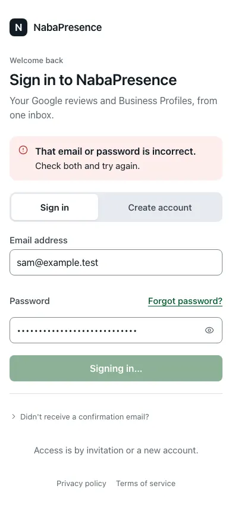       | 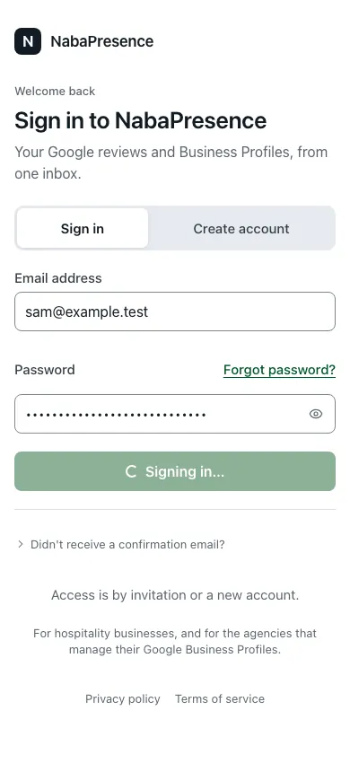       | [before dark](evidence/before/f01-04-retry-pending-chromium-dark-390.webp) · [after dark](evidence/after/f01-04-retry-pending-chromium-dark-390.webp) · [before 1280](evidence/before/f01-04-retry-pending-chromium-light-1280.webp) · [after 1280](evidence/after/f01-04-retry-pending-chromium-light-1280.webp)                         |
| F01 dropped connection                                                 | 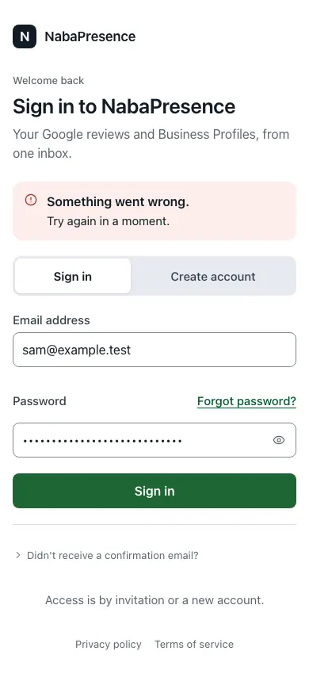             | 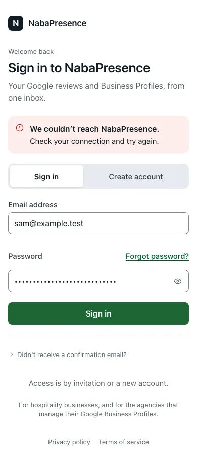             | [before dark](evidence/before/f01-05-network-chromium-dark-390.webp) · [after dark](evidence/after/f01-05-network-chromium-dark-390.webp) · [before 1280](evidence/before/f01-05-network-chromium-light-1280.webp) · [after 1280](evidence/after/f01-05-network-chromium-light-1280.webp)                                                 |
| F01 failed email link                                                  | 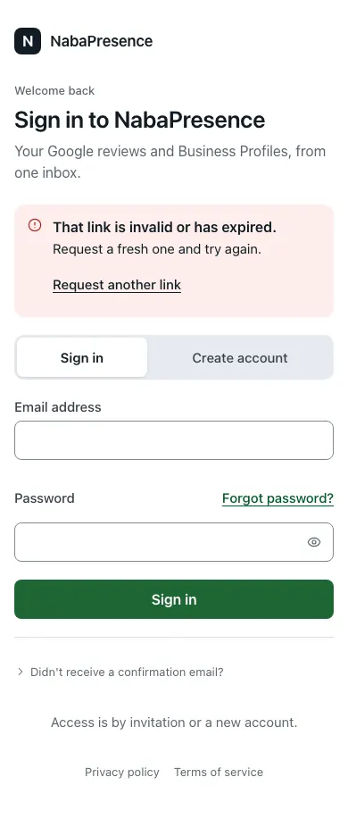   | 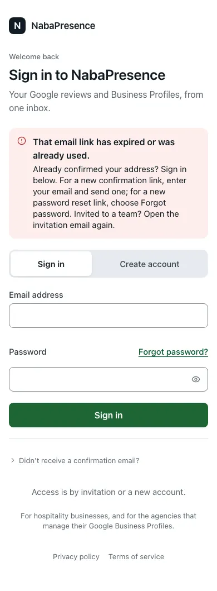   | [before dark](evidence/before/f01-07-email-link-failed-chromium-dark-390.webp) · [after dark](evidence/after/f01-07-email-link-failed-chromium-dark-390.webp) · [before 1280](evidence/before/f01-07-email-link-failed-chromium-light-1280.webp) · [after 1280](evidence/after/f01-07-email-link-failed-chromium-light-1280.webp)         |
| F02 check your email                                                   | 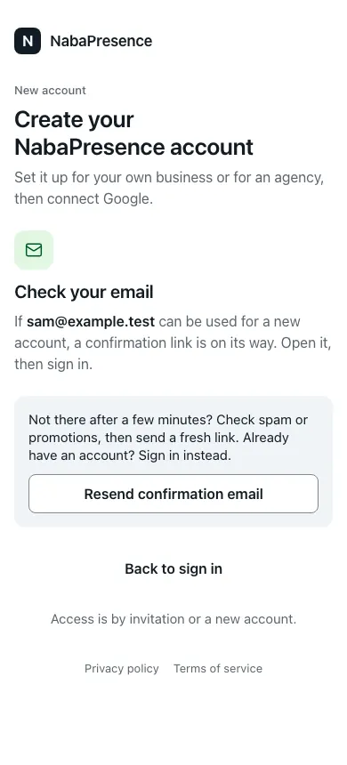        | 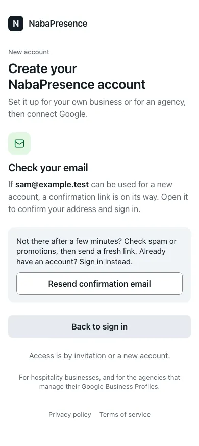        | [before dark](evidence/before/f02-04-confirm-sent-chromium-dark-390.webp) · [after dark](evidence/after/f02-04-confirm-sent-chromium-dark-390.webp) · [before 1280](evidence/before/f02-04-confirm-sent-chromium-light-1280.webp) · [after 1280](evidence/after/f02-04-confirm-sent-chromium-light-1280.webp)                             |
| F03 resend with no address                                             | 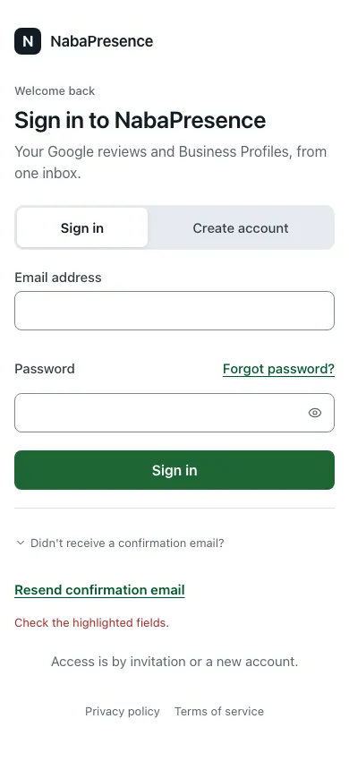         | 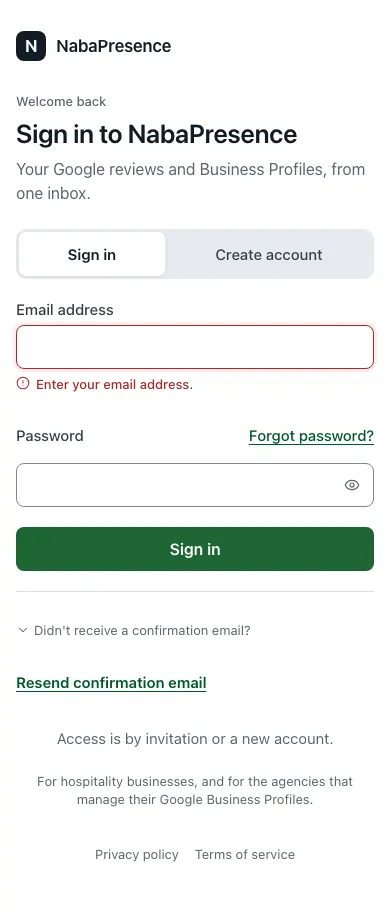         | [before dark](evidence/before/f03-01-empty-email-chromium-dark-390.webp) · [after dark](evidence/after/f03-01-empty-email-chromium-dark-390.webp) · [before 1280](evidence/before/f03-01-empty-email-chromium-light-1280.webp) · [after 1280](evidence/after/f03-01-empty-email-chromium-light-1280.webp)                                 |
| F03 resend sent                                                        | 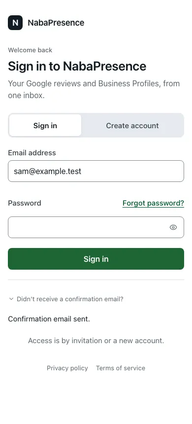                | 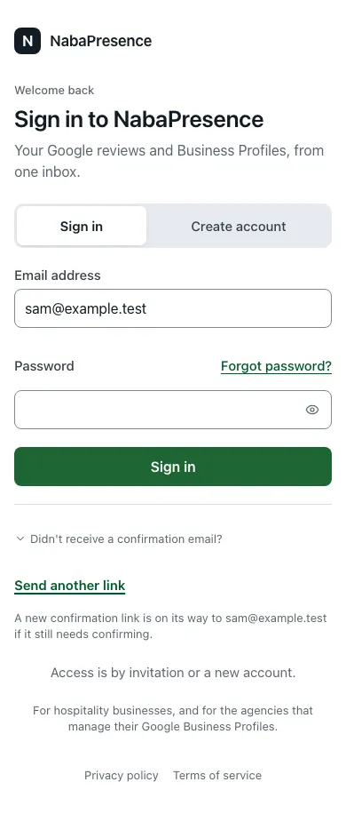                | [before dark](evidence/before/f03-02-sent-chromium-dark-390.webp) · [after dark](evidence/after/f03-02-sent-chromium-dark-390.webp) · [before 1280](evidence/before/f03-02-sent-chromium-light-1280.webp) · [after 1280](evidence/after/f03-02-sent-chromium-light-1280.webp)                                                             |
| F04 incomplete link                                                    | 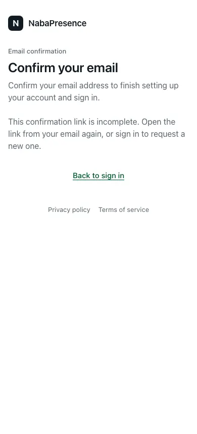          | 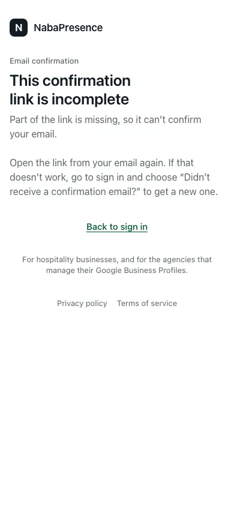          | [before dark](evidence/before/f04-03-incomplete-chromium-dark-390.webp) · [after dark](evidence/after/f04-03-incomplete-chromium-dark-390.webp) · [before 1280](evidence/before/f04-03-incomplete-chromium-light-1280.webp) · [after 1280](evidence/after/f04-03-incomplete-chromium-light-1280.webp)                                     |
| F04 confirming (AFTER only; BEFORE had no pending state, see Baseline) | 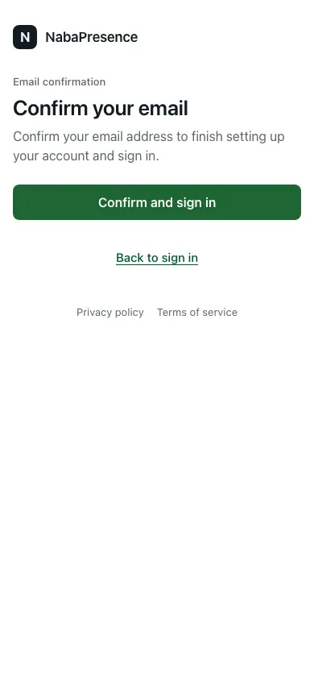             | 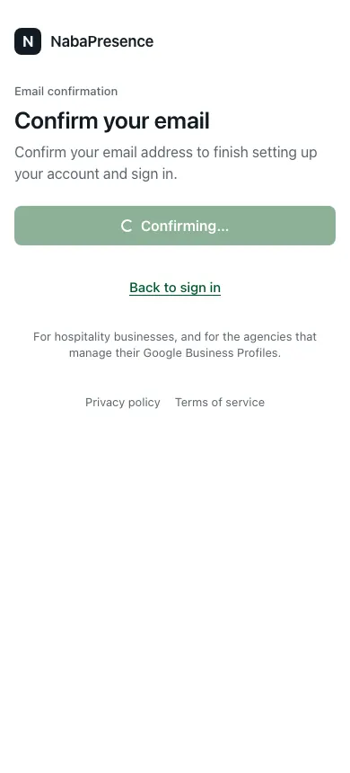          | [after dark](evidence/after/f04-04-submitting-chromium-dark-390.webp) · [after 1280](evidence/after/f04-04-submitting-chromium-light-1280.webp)                                                                                                                                                                                           |
| F05 expired                                                            | 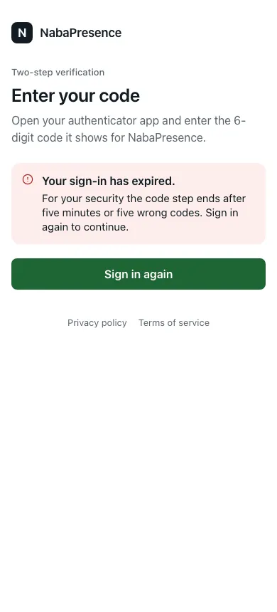             |              | [before dark](evidence/before/f05-04-expired-chromium-dark-390.webp) · [after dark](evidence/after/f05-04-expired-chromium-dark-390.webp) · [before 1280](evidence/before/f05-04-expired-chromium-light-1280.webp) · [after 1280](evidence/after/f05-04-expired-chromium-light-1280.webp)                                                 |
| F05 apps failed to load                                                | 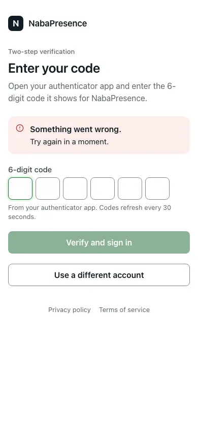         | 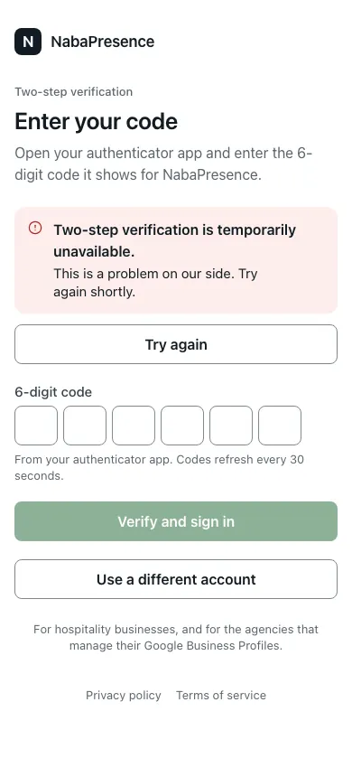         | [before dark](evidence/before/f05-05-load-failed-chromium-dark-390.webp) · [after dark](evidence/after/f05-05-load-failed-chromium-dark-390.webp) · [before 1280](evidence/before/f05-05-load-failed-chromium-light-1280.webp) · [after 1280](evidence/after/f05-05-load-failed-chromium-light-1280.webp)                                 |
| F05 rate limited                                                       | 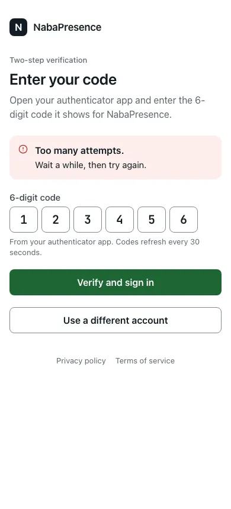        | 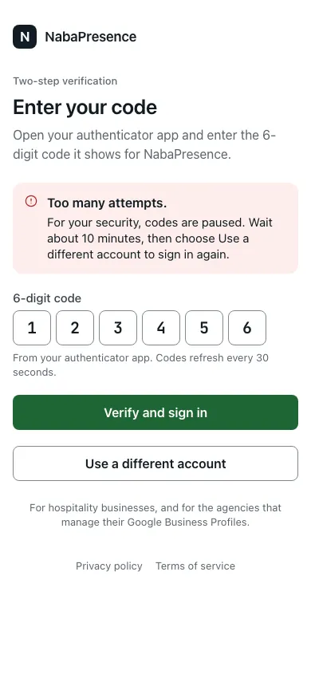        | [before dark](evidence/before/f05-06-rate-limited-chromium-dark-390.webp) · [after dark](evidence/after/f05-06-rate-limited-chromium-dark-390.webp) · [before 1280](evidence/before/f05-06-rate-limited-chromium-light-1280.webp) · [after 1280](evidence/after/f05-06-rate-limited-chromium-light-1280.webp)                             |
| F06 reset link sent                                                    | 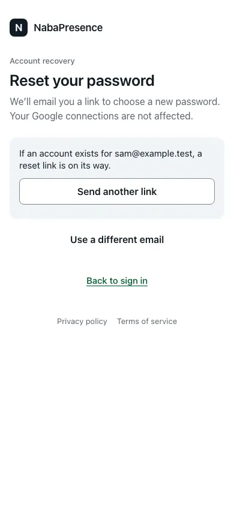                | 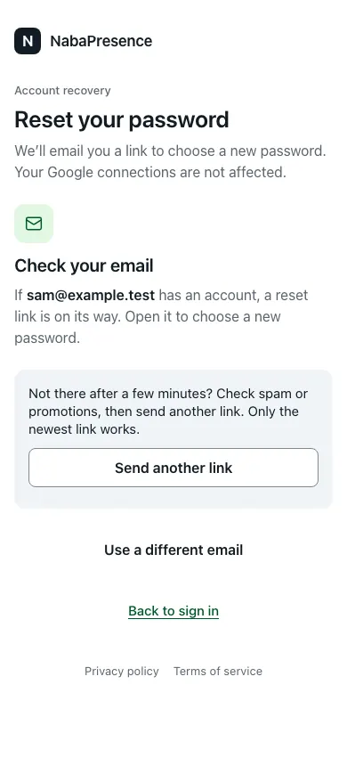                | [before dark](evidence/before/f06-03-sent-chromium-dark-390.webp) · [after dark](evidence/after/f06-03-sent-chromium-dark-390.webp) · [before 1280](evidence/before/f06-03-sent-chromium-light-1280.webp) · [after 1280](evidence/after/f06-03-sent-chromium-light-1280.webp)                                                             |
| F06 use a different email                                              | 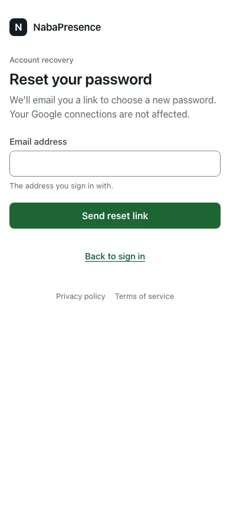     | 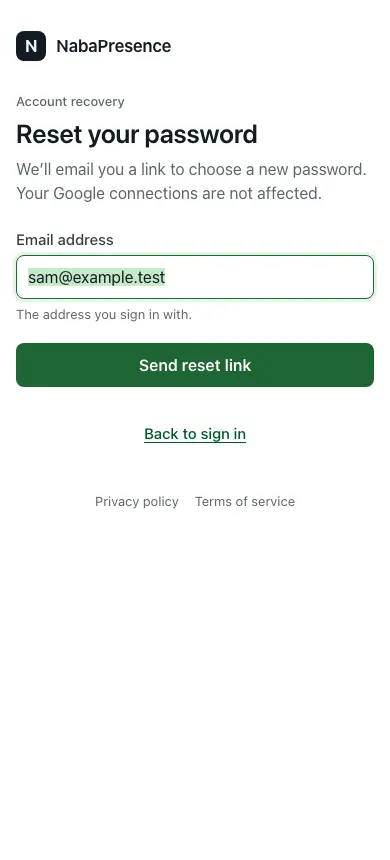     | [before dark](evidence/before/f06-05-different-email-chromium-dark-390.webp) · [after dark](evidence/after/f06-05-different-email-chromium-dark-390.webp) · [before 1280](evidence/before/f06-05-different-email-chromium-light-1280.webp) · [after 1280](evidence/after/f06-05-different-email-chromium-light-1280.webp)                 |
| F07 unconfirmed save                                                   | 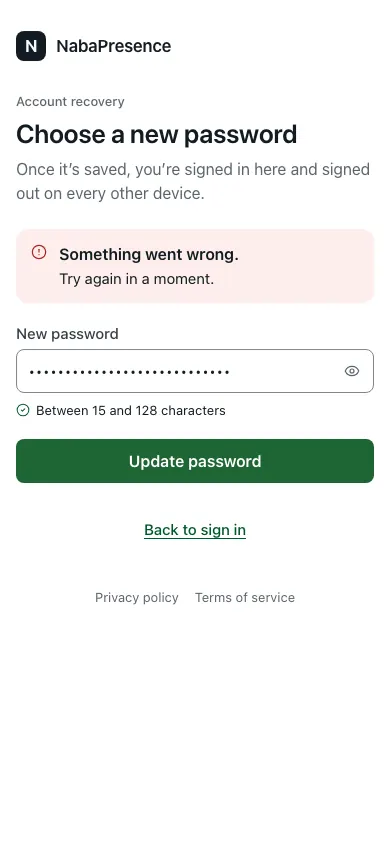     | 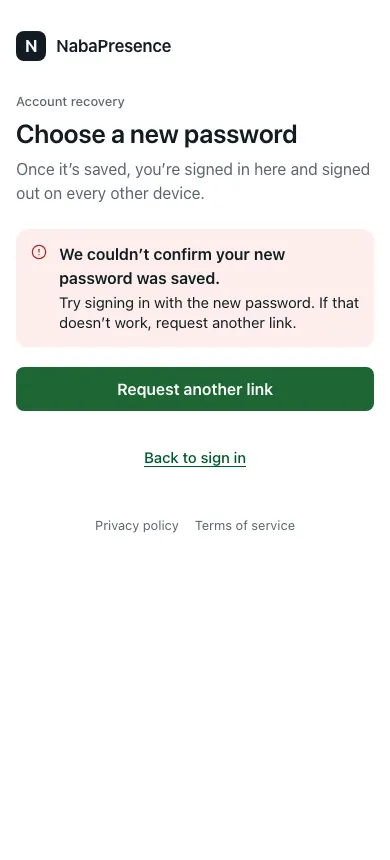     | [before dark](evidence/before/f07-06-outcome-unknown-chromium-dark-390.webp) · [after dark](evidence/after/f07-06-outcome-unknown-chromium-dark-390.webp) · [before 1280](evidence/before/f07-06-outcome-unknown-chromium-light-1280.webp) · [after 1280](evidence/after/f07-06-outcome-unknown-chromium-light-1280.webp)                 |
| F07 stale length error                                                 | 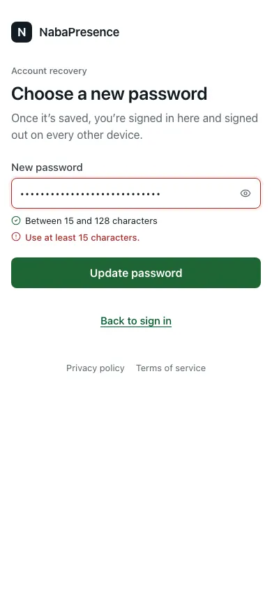         | 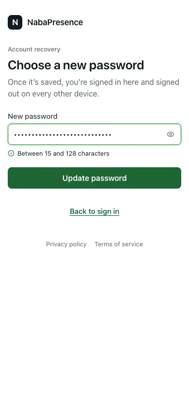         | [before dark](evidence/before/f07-03-stale-error-chromium-dark-390.webp) · [after dark](evidence/after/f07-03-stale-error-chromium-dark-390.webp) · [before 1280](evidence/before/f07-03-stale-error-chromium-light-1280.webp) · [after 1280](evidence/after/f07-03-stale-error-chromium-light-1280.webp)                                 |
| F07 expired link                                                       | 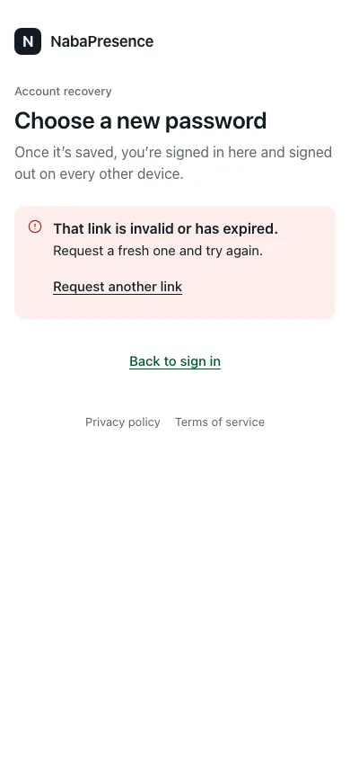        | 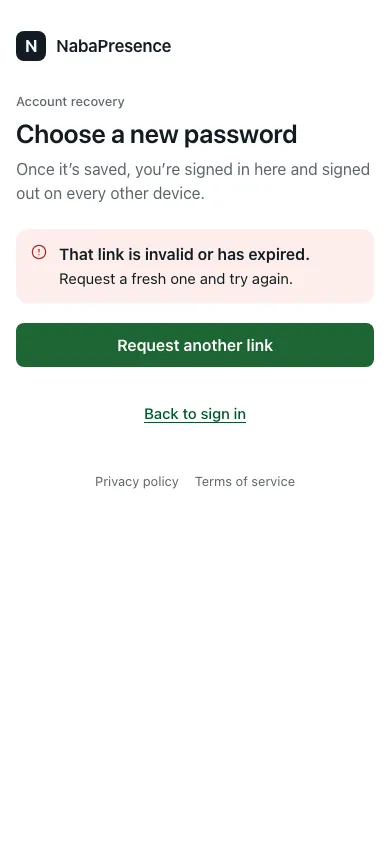        | [before dark](evidence/before/f07-05-expired-link-chromium-dark-390.webp) · [after dark](evidence/after/f07-05-expired-link-chromium-dark-390.webp) · [before 1280](evidence/before/f07-05-expired-link-chromium-light-1280.webp) · [after 1280](evidence/after/f07-05-expired-link-chromium-light-1280.webp)                             |
| F08 toggled to sign in                                                 | 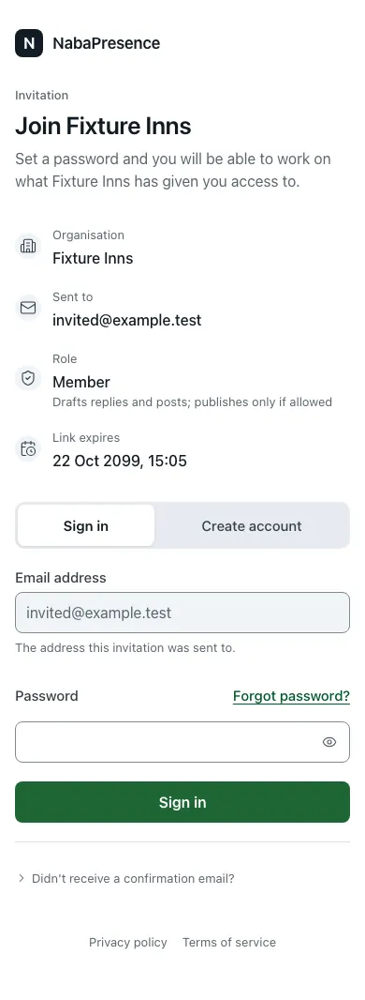     | 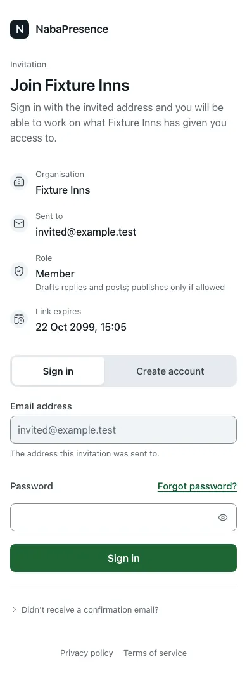     | [before dark](evidence/before/f08-03-toggled-sign-in-chromium-dark-390.webp) · [after dark](evidence/after/f08-03-toggled-sign-in-chromium-dark-390.webp) · [before 1280](evidence/before/f08-03-toggled-sign-in-chromium-light-1280.webp) · [after 1280](evidence/after/f08-03-toggled-sign-in-chromium-light-1280.webp)                 |
| F08 signed in, same address                                            | 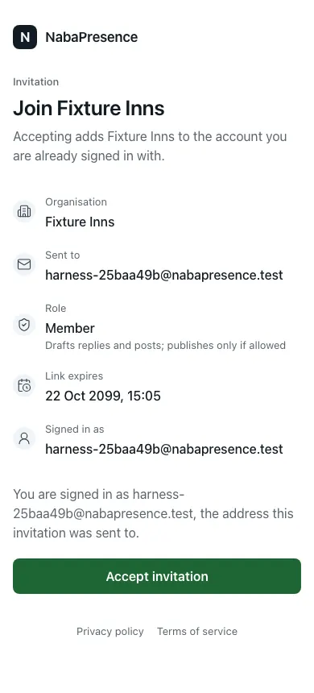               | 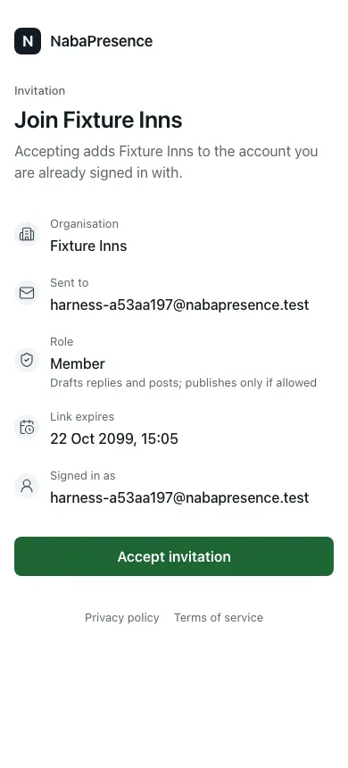               | [before dark](evidence/before/f08-07-match-chromium-dark-390.webp) · [after dark](evidence/after/f08-07-match-chromium-dark-390.webp) · [before 1280](evidence/before/f08-07-match-chromium-light-1280.webp) · [after 1280](evidence/after/f08-07-match-chromium-light-1280.webp)                                                         |
| F08 wrong account                                                      | 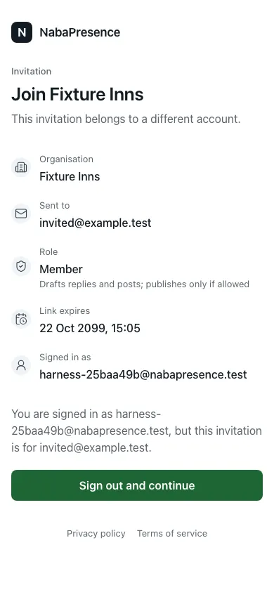            | 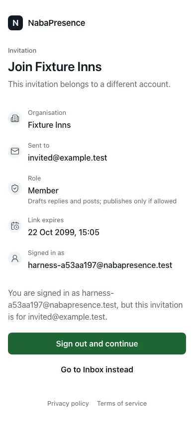            | [before dark](evidence/before/f08-09-mismatch-chromium-dark-390.webp) · [after dark](evidence/after/f08-09-mismatch-chromium-dark-390.webp) · [before 1280](evidence/before/f08-09-mismatch-chromium-light-1280.webp) · [after 1280](evidence/after/f08-09-mismatch-chromium-light-1280.webp)                                             |
| F08 already accepted, signed in                                        |       | 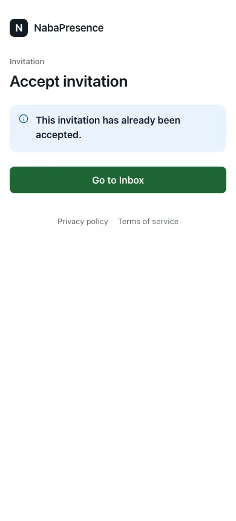      | [before dark](evidence/before/f08-06-used-signed-in-chromium-dark-390.webp) · [after dark](evidence/after/f08-06-used-signed-in-chromium-dark-390.webp) · [before 1280](evidence/before/f08-06-used-signed-in-chromium-light-1280.webp) · [after 1280](evidence/after/f08-06-used-signed-in-chromium-light-1280.webp)                     |
| F09 sign-in on a phone                                                 | 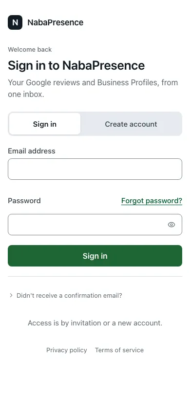             | 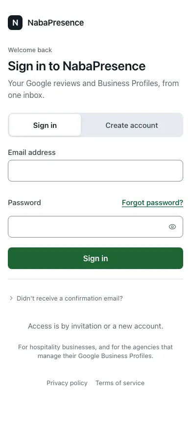             | [before dark](evidence/before/f01-01-initial-chromium-dark-390.webp) · [after dark](evidence/after/f01-01-initial-chromium-dark-390.webp) · [before 1280](evidence/before/f01-01-initial-chromium-light-1280.webp) · [after 1280](evidence/after/f01-01-initial-chromium-light-1280.webp)                                                 |
| F10 privacy (first screen)                                             | 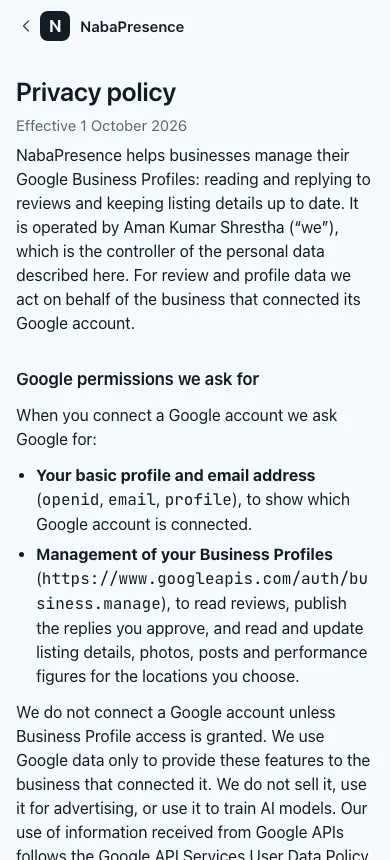             | 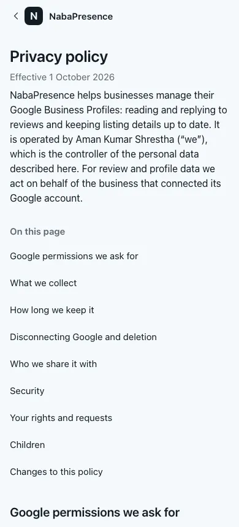             | [before dark](evidence/before/f10-01-privacy-chromium-dark-390.webp) · [after dark](evidence/after/f10-01-privacy-chromium-dark-390.webp) · [before 1280](evidence/before/f10-01-privacy-chromium-light-1280.webp) · [after 1280](evidence/after/f10-01-privacy-chromium-light-1280.webp)                                                 |
| F11 report                                                             | 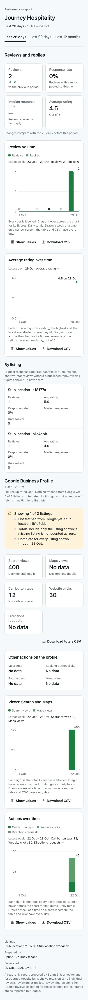              | 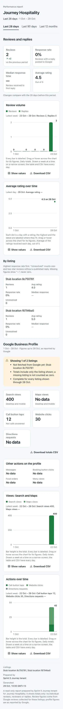              | [before dark](evidence/before/f11-01-report-chromium-dark-390.webp) · [after dark](evidence/after/f11-01-report-chromium-dark-390.webp) · [before 1280](evidence/before/f11-01-report-chromium-light-1280.webp) · [after 1280](evidence/after/f11-01-report-chromium-light-1280.webp)                                                     |
| F11 after a period switch (viewport)                                   | 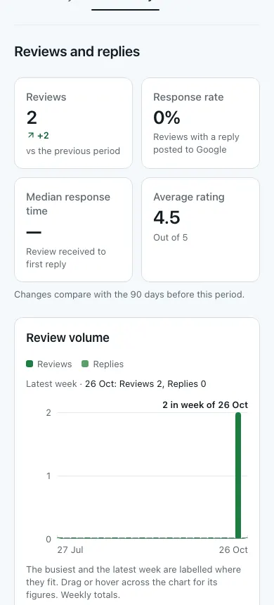 | 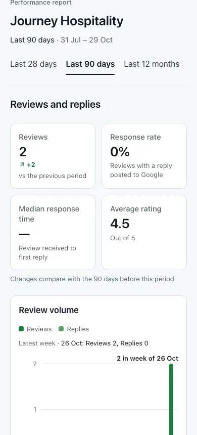 | [before dark](evidence/before/f11-02-after-period-switch-chromium-dark-390.webp) · [after dark](evidence/after/f11-02-after-period-switch-chromium-dark-390.webp) · [before 1280](evidence/before/f11-02-after-period-switch-chromium-light-1280.webp) · [after 1280](evidence/after/f11-02-after-period-switch-chromium-light-1280.webp) |

All 55 states (54 paired, plus the AFTER-only F04 confirming frame) are in
`evidence/before/` and `evidence/after/` under the same names. States
expected to look the same on both sides (for example `f02-01-initial`,
`f04-01-confirm`, `f11-03-not-found`) are included as controls.

### What did not change on screen

Step counts and required inputs per flow are unchanged: sign-in is still two
fields and one press; create account three fields and one press; reset one
field; invite accept one press. The only flow that gains an on-screen element
in its main path is F10 (the contents list, about 9 × 44 px on a phone, above
the first section).

## Change log

| Change                          | Before                                                                                               | After                                                                                                                                                                 | Reason                  | Relevant principle                                     | Affected files                                                                                               |
| ------------------------------- | ---------------------------------------------------------------------------------------------------- | --------------------------------------------------------------------------------------------------------------------------------------------------------------------- | ----------------------- | ------------------------------------------------------ | ------------------------------------------------------------------------------------------------------------ |
| Fresh answer per attempt        | Old banner kept and re-focused on resubmit                                                           | Banner cleared at submit; reply mounts and is announced                                                                                                               | B1                      | Nielsen 1; HIG consistent feedback; WCAG 4.1.3, 2.4.3  | `components/auth/sign-in-form.tsx`, `forgot-password-form.tsx`, `reset-password-form.tsx`                    |
| Errors in words                 | Generic for connection loss, unnamed 5xx; "Wait a while"                                             | Network, outage-of-surface and "Try again in about N minutes" copy                                                                                                    | B2, B3                  | Nielsen 9; WCAG 3.3.3                                  | `lib/api/auth-errors.ts` (`NETWORK`, `retryAfterWords`, 5xx fallback, `password_reset_outcome_unknown`)      |
| Email-link failure copy         | Reset-link action on a confirmation failure                                                          | Confirmation-first copy and resend action, keyed on `email=error`                                                                                                     | B4                      | Nielsen 9, 2; HIG preserved context                    | `lib/api/auth-errors.ts` (`FROM_EMAIL_LINK`, `confirmStatusMessage(…, from)`), `app/(auth)/sign-in/page.tsx` |
| Invite banner by mode           | Shown in create-account mode                                                                         | Sign-in mode only                                                                                                                                                     | B5                      | Nielsen 4                                              | `components/auth/sign-in-panel.tsx`                                                                          |
| Check-your-email stage (create) | Focus lost; live field shown; "Open it, then sign in."                                               | Focused h2; submitted address; "Open it to confirm your address and sign in."; focus back to email                                                                    | B6                      | WCAG 2.4.3, 4.1.3; Nielsen 2                           | `components/auth/sign-in-form.tsx`                                                                           |
| `next` note by mode             | Shown when creating an account                                                                       | Sign-in mode only                                                                                                                                                     | B7                      | Nielsen 2 (no false promise)                           | `components/auth/sign-in-form.tsx`                                                                           |
| Resend control                  | Sent without an address; "Confirmation email sent."; button removed; title-only errors               | Address checked on the form's field; neutral note in a live region; "Send another link"; full errors; invite token carried                                            | B8                      | Nielsen 1, 5, 9; WCAG 3.3.1, 4.1.3, 2.4.3              | `components/auth/resend-confirmation-button.tsx`, `auth-error-alert.tsx`, `sign-in-form.tsx`                 |
| Confirm interstitial            | No pending state; second press posts                                                                 | "Confirming…"; only the first press posts; bfcache reset; same no-JS POST                                                                                             | B9                      | Nielsen 1, 5; WCAG 4.1.2                               | `components/auth/confirm-email-form.tsx` (new), `app/(auth)/confirm-email/page.tsx`                          |
| Incomplete confirmation link    | Titled "Confirm your email", no way on named                                                         | Titled for what happened; way on named (invitees: the invitation email)                                                                                               | B9                      | Nielsen 4, 9; WCAG 2.4.6                               | `app/(auth)/confirm-email/page.tsx`                                                                          |
| Two-step states                 | Mismatched expired heading; dead-end load failure; shared pending; vague limit copy                  | Expired card with focus and `next`; "Try again"; separate leaving state; named wait and control; picker named once                                                    | B10                     | Nielsen 1, 3, 9; WCAG 2.4.3, 2.4.6, 1.3.1              | `components/auth/mfa-verify-form.tsx`, `app/(auth)/sign-in/verify/page.tsx`                                  |
| Reset-link request              | Headless success box; muted title-only resend errors; address lost                                   | Check-your-email stage with guidance; full resend errors as alerts, keyed to the address; address kept and selected                                                   | B11; review 2           | Nielsen 1, 9; HIG preserved context; WCAG 2.4.3, 4.1.3 | `components/auth/forgot-password-form.tsx`                                                                   |
| New password                    | Generic error for an unconfirmed save; stale errors; double alerts; inline-only dead link            | Outcome-unknown dead end; "may already be saved" after a dropped connection; errors clear on typing; one field error; block "Request another link"                    | B12                     | Nielsen 9, 1, 4; WCAG 3.3.1, 3.3.3, 2.5.8              | `components/auth/reset-password-form.tsx`                                                                    |
| Invitation states               | Stale description; repeated address; one action on wrong account; session-blind exits; double accept | Live-mode description; invite panel; "Go to Inbox instead"; session-aware exits; neutral used copy; no re-enable while leaving; focus after retry and finished accept | B13; review 5           | Nielsen 1, 3, 4, 8; WCAG 2.4.3, 2.4.4                  | `components/auth/invitation-view.tsx`, `invitation-actions.tsx`                                              |
| One pending treatment           | `disabled` + label swap                                                                              | Shared `Button` `pending`/`pendingLabel` (no change to `Button`)                                                                                                      | Consistency; focus kept | HIG consistency; WCAG 2.4.3                            | all auth forms above                                                                                         |
| Phone audience line             | Panel copy unseen below `lg`                                                                         | The panel's footnote under product screens, below `lg`                                                                                                                | B14                     | Nielsen 2; HIG clarity                                 | `components/auth/auth-card.tsx`                                                                              |
| Reset footnote                  | "request another from the sign-in page"                                                              | "request another from Forgot password on the sign-in page"                                                                                                            | Accuracy                | Nielsen 2                                              | `components/auth/auth-card.tsx`                                                                              |
| Error-page retry                | `unstable_retry ?? reset` (re-render only); share page no pending; `disabled` dropped focus          | `retry ?? unstable_retry ?? reset`; "Trying again…"; `aria-disabled` with a guard                                                                                     | B15; review 6           | Nielsen 1, 9; WCAG 2.4.3, 4.1.3                        | `app/(auth)/error.tsx`, `app/share/report/[token]/error.tsx`                                                 |
| Legal presentation              | No contents; small headings; plain-text contact; no print rules                                      | "On this page"; `text-section` h2 with scroll margin; `mailto:`; print rules                                                                                          | B16                     | HIG hierarchy; Nielsen 6, 7; WCAG 2.4.6, 1.3.1         | `components/legal/legal-document.tsx`, `app/(legal)/privacy/page.tsx`, `app/(legal)/terms/page.tsx`          |
| Public report                   | Operator sync caption; lands below the tabs; silent empty states                                     | One public caption; `#period`; empty-state lines                                                                                                                      | B17; review 3           | Nielsen 2, 8, 1; HIG preserved context                 | `components/share/shared-client-report.tsx`                                                                  |
| Regression coverage             | None for these behaviours; no axe on legal, confirm or new stages                                    | Component tests per behaviour (four new files); an e2e axe sweep of the changed states in both themes; updated period assertions                                      | Guard the behaviour     | n/a                                                    | `tests/components/*` (see Verification), `tests/e2e/auth.spec.ts`, `tests/e2e/reports.spec.ts`               |

### Design note: keeping the confirmation form a plain POST

The interstitial could have posted through `fetch`, but then it would stop
working without JavaScript, and the route answers with a 303 that a document
navigation follows for free. The client component only observes the native
submit: the first is never prevented, later ones are, and a page restored
from the back-forward cache is ready again. Without JavaScript the
server-rendered form is byte-for-byte the same form.

## Core preservation

- **No route handler, server module, schema, migration, dependency, flag or
  env var changed.** `git diff origin/ux/all-flows-presence...HEAD --stat`
  touches `app/(auth)/**` pages, `app/(legal)/**`, `app/share/report/[token]/error.tsx`,
  `components/auth/*`, `components/legal/*`, `components/share/*`,
  `lib/api/auth-errors.ts` and tests. `lib/api/auth.ts`, `lib/server/**`,
  `app/api/**` and `app/auth/**` are untouched.
- **Requests are the same.** Every form calls the same `lib/api/auth.ts`
  function with the same arguments. The resend now skips a request only when
  the address is empty or has no `@` part; the server would have refused it.
- **Enumeration resistance holds and is stronger.** All success copy stays
  conditional; the resend's "sent" claim is gone; the D3 disclosure is
  unconditional; the 429 wait quotes only `details.retryAfter`, the same
  figure as the `retry-after` header.
- **Confirmation link.** Same `method`, `action` and hidden fields; the
  component test reads the posted `FormData`.
- **Server authority and duplicate protection.** Outcomes are set only after
  `await`; navigation paths keep (or now use) a never-resolving wait so a
  pending button cannot re-enable; the confirm form lets one press through;
  `Button pending` refuses activation.
- **Invitations.** Dead ends still show no organisation, role or address;
  role and expiry only for a live invitation; the token only reaches the API.
- **Shared report.** Read-only; no links added (tests assert none); not-found
  and the page's token handling untouched; period links still plain anchors.
- **Legal.** Still static; the 18 section ids and titles are pinned by test;
  the only text change is wrapping the contact address in a `mailto:` link.
- The independent reviewer checked each item above against the diff and
  found no protected-behaviour change (see [Review response](#review-response)).

## Verification

Environment: macOS, Node 24, pnpm 10.34.5, worktree `/tmp/naba-presence-p1`.
Results are on the final head after the review fixes unless noted.

| Check                                                                               | Type                          | What it exercised                                                                                                                                                                                                                             | Result                                                                                                     |
| ----------------------------------------------------------------------------------- | ----------------------------- | --------------------------------------------------------------------------------------------------------------------------------------------------------------------------------------------------------------------------------------------- | ---------------------------------------------------------------------------------------------------------- |
| `pnpm verify` (typecheck, lint, format, unit + component, `check:design --ratchet`) | Gate                          | Whole repo                                                                                                                                                                                                                                    | **Passed**: 626 files, 8,522 tests passed, 1 skipped; design ratchet passed (no file or rule count rose)   |
| `pnpm check:contrast`                                                               | Gate                          | Token pairs, both themes                                                                                                                                                                                                                      | **Passed**: 212/212                                                                                        |
| `pnpm test:e2e:touch` (port 3510)                                                   | Fixture browser, throwaway DB | Critical journeys at 390 touch                                                                                                                                                                                                                | **Passed**: 23/23                                                                                          |
| `pnpm test:a11y` (port 3510)                                                        | Fixture browser, throwaway DB | axe across the app                                                                                                                                                                                                                            | **Passed**: 64/64                                                                                          |
| `tests/e2e/auth.spec.ts`, `reports.spec.ts`, `routing.spec.ts`                      | Fixture browser, throwaway DB | Auth surfaces, the new axe sweep of the changed states (legal, confirm, incomplete link, email-link failure, both check-your-email stages; light and dark), sharing incl. `#period`                                                           | **Passed**: 55/55                                                                                          |
| Component tests changed or added                                                    | Unit / component              | `auth-api`, `sign-in-form`, `sign-in-recovery` (new), `auth-error`, `confirm-email-page`, `mfa-verify-form`, `password-reset`, `password-reset-recovery` (new), `invitation`, `invitation-leaving` (new), `legal-pages`, `shared-report-page` | **Passed**: 181/181 in the 12 files (plus the stale-note test, 12/12 in its file)                          |
| Mutation check: stale resend note                                                   | Unit                          | The keyed note removed                                                                                                                                                                                                                        | Failed as expected; fix restored                                                                           |
| Mutation check: invitation leaving                                                  | Unit                          | `return` after `hardNavigate`                                                                                                                                                                                                                 | Failed as expected (reported by the F08 implementer); fix restored                                         |
| BEFORE capture                                                                      | Fixture browser, throwaway DB | 55 states × 3 viewports on the baseline build                                                                                                                                                                                                 | Passed (165 images, two of them blank and dropped, see Baseline)                                           |
| AFTER capture                                                                       | Fixture browser, throwaway DB | Same states on the final build; F04 confirming retaken                                                                                                                                                                                        | Passed (165 images)                                                                                        |
| Live Supabase Auth, mailer, authenticator app                                       | Provider-backed               | Real sign-in, confirmation, reset, MFA codes                                                                                                                                                                                                  | **Not run**: no authorised provider target; every auth call was stubbed                                    |
| No-JavaScript run of `/confirm-email`                                               | Fixture browser               | Pre-hydration POST                                                                                                                                                                                                                            | **Not run** as a browser run; covered by the component test of the server-rendered form's fields           |
| `/` redirect in production                                                          | Fixture browser               | Anonymous `/` → `/sign-in`                                                                                                                                                                                                                    | **Not run** (harness bootstraps a session); source only                                                    |
| `(auth)` and share error pages in a browser                                         | Fixture browser               | A real render failure                                                                                                                                                                                                                         | **Not run** (needs an injected failure); component tests assert `retry` is called                          |
| Print output of legal and share pages                                               | Manual                        | Print styles                                                                                                                                                                                                                                  | **Not run**                                                                                                |
| Real-device VoiceOver / TalkBack                                                    | Manual                        | Announcements, focus                                                                                                                                                                                                                          | **Not run**                                                                                                |
| `audit:mobile`, perf-lab, `route-js`                                                | Measurement                   | Taps, bundles                                                                                                                                                                                                                                 | **Not run**: no loading or bundle change intended; F10 adds markup only and F04 one small client component |
| `lci`                                                                               | CI                            | Combined head                                                                                                                                                                                                                                 | Not run by design: the integrator runs it once on the combined branch                                      |

## Shared-file edits

- **`lib/api/auth-errors.ts`** (area file, listed for P19a). Its new copy also
  reaches two callers outside this area, by design, through the same
  function: `components/settings/two-step-verification-card.tsx` and
  `components/auth/mfa-step-up-prompt.tsx` now show the network,
  outage-of-surface and stated-wait copy. No caller's signature changed;
  `confirmStatusMessage`'s new third argument is optional.
- **`tests/e2e/reports.spec.ts`** (Reports area spec): only the period-switch
  assertion block (`#main` → `#period`, plus "period line in viewport").
- **`tests/e2e/auth.spec.ts`**: one new `describe` block.
- **No edits** to `components/ui/*`, `components/app-shell/*`,
  `components/reporting/*`, `components/clients/*`, layouts, `app/globals.css`
  or `lib/server/*`. The shared `Button` is used through its existing
  `pending` API.

## Review response

An independent reviewer with fresh context reviewed the diff against the
protected list: **no P0, P1 or P2 findings**. All eight P3 items and both
polish notes were fixed in `4e97b63b`:

| #   | Finding                                                                                                                | Fix                                                                |
| --- | ---------------------------------------------------------------------------------------------------------------------- | ------------------------------------------------------------------ |
| 1   | The email-link copy assumed a confirmation link, but a malformed reset link's GET lands there too                      | Copy names both ways on (new confirmation link; Forgot password)   |
| 2   | A resend still in flight when going back could show its note, naming the old address, on the stage for a corrected one | Notes keyed to their address; regression test, mutation-checked    |
| 3   | "No Google profile figures for this period" is untrue when a client has no linked listings                             | "No Google Business Profile figures to show."                      |
| 4   | Two-step rate-limit copy said "sign in again" with no such control                                                     | "…then choose Use a different account to sign in again."           |
| 5   | Accepting a finished invitation unmounted the focused button                                                           | The view focuses the dead end's title; test added                  |
| 6   | Error pages' `disabled` dropped focus while retrying                                                                   | `aria-disabled` plus a guard, both pages                           |
| 7   | Malformed address in the alert resend said "Enter your email address above first."                                     | "Enter an email address like name@example.co.uk."                  |
| 8   | Every `TypeError` counted as a dropped connection                                                                      | Only fetch's own failure messages; test for a bug-type `TypeError` |
| —   | An invitee's incomplete link pointed at the sign-in resend, which carries no token                                     | Invitees are sent back to the invitation email                     |
| —   | A stopped confirm navigation leaves "Confirming…" until reload                                                         | Left as is: the token is unspent and a reload or back recovers     |

## Outcome and follow-ups

Every flow in the area got a coherent set of small changes, each tied to an
observed problem, with server behaviour unchanged. Verification is at the
fixture-browser level; provider-backed journeys were not run.

**Follow-ups (not done here):**

1. **Other teams' error boundaries never re-fetch.** `app/(dashboard)/error.tsx:60`
   and `app/global-error.tsx:96` still call `unstable_retry ?? reset`, which in
   Next 16.4.1 is always `reset`. The same one-token fix applies (`retry ??`
   first). Owner: Platform / shell. Severity: their "Try again" does not
   recover from a transient server failure.
2. **Public wording for `PartialCoverageAlert`** on the shared report
   ("Not fetched from Google yet", "Could not be refreshed"): an opt-in
   `audience="public"` in `components/reporting/partial-coverage-alert.tsx`.
   Owner: Reports.
3. **Reset → two-step context.** After a reset, people with two-step land on
   the generic "Enter your code"; a `?from=reset` description was proposed
   (F07 C5) but needs the server's exact save order confirmed first.
4. **Resend cooldown** (F06 C4): the provider's per-user email interval may
   refuse a quick second send; unconfirmed, so no client timer was added.
5. **Lost authenticator app** line on the two-step page waits on D10 (support
   channel).
6. **Carry the invitation through a failed confirmation redirect** needs a
   route change (`app/auth/confirm/route.ts`); owner decision.
7. **`apiFetch` network errors for reads.** GETs rethrow a bare `TypeError`;
   wrapping them as `network_error` in `lib/api/client.ts` (shared) would let
   the mapper drop its message test.
8. **Dark-mode printing** of legal and share pages may print light text;
   needs print emulation and a global fix.
9. **Rate deltas** on the shared report ("+12.5%") are percentage points; the
   fix belongs in the shared formatter.
10. **The phone legal contents list** adds about 400 px before the first
    section at 390 px; if that proves too long, collapse it into a
    `
` on phones.
