# p4: listings content and operations, before and after

Status: **implemented and partially verified.** The evidence is source, unit,
fixture-browser (throwaway PostgreSQL and the Google stub) and e2e evidence.
Nothing was published to Google; no provider-backed journey was run. Revised
after an independent review (see [Review response](#review-response)).

## Scope and baseline

**Area.** Photos, posts, suggested updates, Review & publish, verification and
bulk changes on a listing, plus the retired flat routes:
`/listings/[id]/{photos,posts,suggestions,changes,verification}`,
`/listings/bulk`, `/listings/bulk/[operationId]`, `/photos`, `/posts`,
`/profile`, `/profile/[...section]` and `/settings/listing`.

**Branch.** `ux/flows-presence-p4`, cut from `origin/ux/all-flows-presence` at
`e4123d25` (after the responsive pass #258), in the isolated worktree
`/tmp/naba-presence-p4`.

**Flows.** There was no catalogue for this area, so the flows were enumerated
from the routes and components. One subagent mapped each flow (start, end,
roles, steps, states, protected rules, friction, proposals). Their maps are kept
in [`flows/`](flows/), with the index in [`flows/FLOWS.md`](flows/FLOWS.md).

| ID     | Flow                                                        | Starts                                                               | Ends (server-confirmed)                                                                |
| ------ | ----------------------------------------------------------- | -------------------------------------------------------------------- | -------------------------------------------------------------------------------------- |
| p4-F01 | Browse and inspect the photo library                        | `/listings/{id}/photos`                                              | Photo opened in the lightbox, or a filtered view                                       |
| p4-F02 | Add photos                                                  | "Add photos"                                                         | Each file "Live on Google", "Sent to Google" or "Not confirmed", as the server answers |
| p4-F03 | Delete a photo                                              | Bin on a tile or in the lightbox                                     | "Photo deleted from Google" after Google's 404 readback                                |
| p4-F04 | Browse posts                                                | `/listings/{id}/posts`                                               | The post row, its status and History                                                   |
| p4-F05 | Write a post, publish or ask for approval from the composer | "New post" or a draft                                                | Saved draft, parked for approval, or published per the server                          |
| p4-F06 | Act on a post from the list                                 | Row actions                                                          | Published, approved, sent back, deleted or retried per the server                      |
| p4-F07 | Schedule a post and manage schedules                        | "Schedule publication" (feature `post_scheduling`)                   | Schedule awaiting approval, approved, paused or cancelled                              |
| p4-F08 | Review Google's suggested updates                           | `/listings/{id}/suggestions`                                         | Each suggestion accepted, kept or ignored (local only, never written to Google)        |
| p4-F09 | Review and publish saved changes                            | `/listings/{id}/changes`                                             | Each step's outcome from the publish flow                                              |
| p4-F10 | Check verification status                                   | `/listings/{id}/verification`                                        | Google's own answer, or "couldn't be read"                                             |
| p4-F11 | Start a verification                                        | "Verification tools", then "Check available methods"                 | Request sent after review and approval, or refused by the server                       |
| p4-F12 | Complete a verification with a PIN                          | A pending request, or saved PIN work                                 | Completion sent after review, confirmed by an independent read                         |
| p4-F13 | Compose a bulk change                                       | Listings board, "Prepare bulk change" (feature `bulk_actions`)       | A previewed operation at `/listings/bulk/{id}`                                         |
| p4-F14 | Track a bulk operation                                      | `/listings/bulk/{id}`                                                | Approved, started, cancelled or retried; per-listing receipts                          |
| p4-F15 | Follow an old flat link                                     | `/photos`, `/posts`, `/profile`, `/profile/<s>`, `/settings/listing` | The one listing's area, Clients, or sign-in                                            |

**15 Oct audit, for these routes** (checked against the code at `e4123d25`):

| Finding                                                       | Status before this pass                                                                           | Now                                                                                          |
| ------------------------------------------------------------- | ------------------------------------------------------------------------------------------------- | -------------------------------------------------------------------------------------------- |
| LST-09 verification jargon                                    | Fixed by L12, except "merchant standing" in `verification-attempt-status.tsx` (results.md item 9) | Wording removed (F10 C6)                                                                     |
| LST-11, LST-12 publish and photo from the composer            | Fixed (L10, D4)                                                                                   | Unchanged; consent preserved                                                                 |
| LST-15 photo sheet                                            | Fixed (L15)                                                                                       | Unchanged                                                                                    |
| LST-19 raw zone IDs                                           | Partly fixed; Posts still printed `Europe/London` (results.md item 10)                            | Fixed in the schedule sheet, schedule list, old post times and the post row (F04 C1, F07 C1) |
| LST-22 "Where suggested updates changes go"                   | Fixed                                                                                             | Unchanged                                                                                    |
| LST-24, LST-25, DSK-14 posts copy                             | Fixed (L09)                                                                                       | Unchanged; LST-25 footer note now names the real button (F05 C4)                             |
| Phase 2 item 1, Review & publish for roles that can't publish | Partly fixed                                                                                      | The page is read-only for them (F09 C3); the header link is p3's (`area-nav.ts`)             |
| L10 carried notes (second draft after a lost save, false 409) | Open                                                                                              | Still open: server work (follow-ups)                                                         |
| L02 carried note: the activity cursor regex lacks `bulk:`     | Open                                                                                              | Still open: `lib/contracts`, not this area (follow-ups)                                      |

**Environment.**

- The designated visual harness (`tests/visual/shoot.mjs` with `visual-fixtures`
  and `visual-app`) could not start: the local `naba_visual` database does not
  exist on the shared local Supabase, and creating and migrating one there is
  outside this brief. **Shooting through that harness is Blocked.** Instead, the
  screenshots come from a Playwright capture spec run by the repo's own e2e
  harness (`scripts/run-test-command.mjs e2e`). That harness brings up a
  throwaway PostgreSQL 17 cluster, migrates it, seeds the same "Sprint 5 Journey"
  fixture tenants through `stub-bridge.ts`, and serves a production build
  (`pnpm build`, `pnpm start`) on `PLAYWRIGHT_PORT=3540`, with the Google stub on 3541. The bulk and scheduling states use the operations backend
  (`tests/e2e/helpers/operations-backend.ts`), which turns `bulk_actions` and
  `post_scheduling` on for its own disposable tenant only, as
  `operations-features.spec.ts` does. The visual lock was taken briefly and then
  released, because its ports were not used.
- The CI placeholder secrets from `.github/workflows/ci.yml` were used. No
  `.env*` file was read.
- Viewports: the same rules as `shoot.mjs`. Chromium, 390 × 860 and 1280 × 860,
  with reduced motion, and touch plus `isMobile` below 768. Every state is
  shot at 390 light, 390 dark and 1280 light, as full-page captures (dialogs
  are viewport captures).
- The capture spec is kept as reference text,
  [`capture/p4-capture.spec.ts.txt`](capture/p4-capture.spec.ts.txt). To rerun
  it, copy it to `tests/e2e/p4-capture.spec.ts`, then run
  `P4_OUT=<dir> PLAYWRIGHT_PORT=3540 node scripts/run-test-command.mjs e2e pnpm exec playwright test tests/e2e/p4-capture.spec.ts`.
  BEFORE ran against a build of `e4123d25` and AFTER against a build of the
  final working tree. The script, fixtures, steps and file names were the same
  for both.
- Each state also writes `evidence/{before,after}/data/<state>-<variant>.json`:
  the URL, h1, active element, `role=alert` and `role=status` text, disabled
  buttons, horizontal overflow, and axe (WCAG 2.2 AA tags) violations.
- Fixture data only: "Fixture Inn 1/2", "Stub location …" and the
  disposable UUIDs. There are no real people, numbers, emails, tokens or OTPs.

**States reachable in the fixture, and states that aren't.** The journey stub
returns no photos and no suggestions, and always reports the primary listing as
verified. So the photo grid, lightbox and delete dialog, the suggestion rows,
and the unverified and pending verification states were verified with
component tests only, not on screen. A publish, a bulk start and a verification
send were never pressed in a capture: the stub would answer, but nothing is
published from tests.

### Protected rules derived from the code

These come from the flow maps' section 5, which give file and line for each.

1. **No Undo for any Google write** (D5): `post-publish.ts:72-82`. Publish,
   approve and a live delete keep their consent dialog.
2. **Post publish consent (D4):** the composer's
   `data-slot="publish-consent"` line is drawn by the same gate as Publish and
   is Publish's `aria-describedby`. Publish is bound to the saved
   `contentRevision`, and the server refuses a mismatch with 409
   `post_changed_since_saved` (`posts.ts:1733-1741`).
3. **Two-person approval:**
   - Posts: `qualifyingApproval` excludes the author, and 403
     `second_approver_required` refuses an own request (`posts.ts:1389-1427,1689-1696`).
   - Bulk: the creator can't approve under the policy (route, server and DB).
   - Verification team review: `gbp-change-sets.ts:50-51`. Approving requires
     MFA step-up.
4. **Idempotency:**
   - Photo uploads: an intent UUID per file is sent as `Idempotency-Key`, with a
     duplicate-create advisory lock and `media_create_in_progress` /
     `media_needs_resolution` (`lib/server/media.ts:447-463,794-829`).
   - Photo deletes: the intent is reused on an uncertain retry
     (`use-resource-mutation.ts:136-145`).
   - Posts: intents are keyed by post and revision.
   - Bulk: row locks and the state machine (`bulk-listings.ts:446,540-545,656,699-706,760-788`).
   - Verification: one durable claim per approved review, and no second
     provider request (`google-verification-execution.ts:123-147,183-187`).
5. **Concurrency pins:**
   - Photo delete: `expectedGoogleHash`.
   - Suggestions: `expectedCanonicalRevision`, a server claim before acting,
     and the overwrite acknowledgement (`import-review.ts:739-798`).
   - Review & publish: pinned to the revision and hashes read for the page
     (`review-publish-reads.ts:107-109,173-176`).
   - Bulk: `expectedPreviewHash`.
   - Verification: `expectedPayloadHash` and the baseline hash.
6. **Role, MFA and feature gates:**
   - Suggestions: decisions and refresh are owner and admin only.
   - Bulk: the page is owner and admin only; cancel and retry allow a member
     for their own review batch (`requireBatchControl`); approve and execute
     need step-up MFA.
   - Photo upload and delete need step-up MFA.
   - Scheduling sits behind `post_scheduling` (`publication-schedules.ts:111-156`).
   - Bulk sits behind `bulk_actions`.
7. **Server authority:**
   - "Live on Google" only for `confirmed_applied`.
   - A delete counts only on Google's 404 readback (`media.ts:1672-1686`).
   - Toasts fire only in `onSuccess`.
   - A suggestion leaves the list only on refetch.
   - Bulk counts come only from the server.
   - A verification is "confirmed" only by an independent read.
8. **The PIN is never stored or restored** (`verification-pin-binding.ts:20-25`),
   and a lost send is held until its outcome is checked.
9. **Suggestions never write to Google:** a decision changes NabaPresence's
   own copy only.
10. **Deep links:** the five flat routes are shims outside `(dashboard)`, so the
    redirect fires before any HTML streams. The query is forwarded, and
    `?next=` is sanitised by `sanitiseNextPath` (no open redirect).

## Before

The 15 Oct pass had already fixed most of the copy in this area. The friction
that remained was in the states around the happy path: errors, waiting,
partial outcomes, read-only roles and first views. These are the main
observations; the full list, with file and line for each, is in each flow map's
section 7.

| #   | Flow     | Observation                                                                                                                                                                                                                                                                        | Evidence                                                                                                                                                                       |
| --- | -------- | ---------------------------------------------------------------------------------------------------------------------------------------------------------------------------------------------------------------------------------------------------------------------------------- | ------------------------------------------------------------------------------------------------------------------------------------------------------------------------------ |
| B1  | F07      | Raw database time zones and ISO dates: "Thu 29 Oct, 09:00 · venue time (Europe/London)", "Once on 2026-10-29 at 09:00 (Europe/London, UTC+00:00)", "2026-10-29 09:00"                                                                                                              | [`before/f07-schedule-sheet-390-light.png`](evidence/before/f07-schedule-sheet-390-light.png)                                                                                  |
| B2  | F04      | Post row: "Scheduled publication awaiting approval: 2026-10-20 at 09:00 (Europe/London, UTC+01:00)"                                                                                                                                                                                | `posts-tab.tsx` `scheduleSummary` (code)                                                                                                                                       |
| B3  | F07      | "Cancel schedule" can't be undone but was one tap; clearing a number field showed zod's "Too small: expected number to be >=1"                                                                                                                                                     | `post-schedules.tsx`, `schedule-post-sheet.tsx:258` (code)                                                                                                                     |
| B4  | F10–F12  | When Google can't be read, three warnings stack up ("Verification changes are paused", "Current Google state could not be read", "could not be refreshed"), with no retry beside them, and the PIN section still says "Google has no PIN request waiting for this listing"         | [`before/f10-verification-loc2-390-light.png`](evidence/before/f10-verification-loc2-390-light.png); `data/f10-verification-loc2-*.json` statuses                              |
| B5  | F11      | On a listing Google already verifies, the start form gives no warning; the server refuses only at Send                                                                                                                                                                             | [`before/f11-verification-tools-390-light.png`](evidence/before/f11-verification-tools-390-light.png); `execution.ts:136-137`                                                  |
| B6  | F13      | First view says "Invalid ISO date"; Preview and Add are disabled, unfocusable and give no reason; with no selection the whole form still renders                                                                                                                                   | [`before/f13-bulk-initial-390-light.png`](evidence/before/f13-bulk-initial-390-light.png), [`before/f13-bulk-none-390-light.png`](evidence/before/f13-bulk-none-390-light.png) |
| B7  | F14      | A failed refresh replaced a running batch with "could not be loaded"; "Cancel remaining listings" is irreversible with no confirmation; polling stopped while a listing was still sending                                                                                          | `bulk-operation-view.tsx:195-196,278-288,371` (code)                                                                                                                           |
| B8  | F09      | A publish parked for a second publisher, or not yet confirmed, still ended with a green tick and "Google accepted every change…"; viewers got working include and acknowledgement checkboxes and the full publish bar; the reason Publish was off was a hover tooltip only         | `review-publish.tsx:532-548,761` (code); [`before/f09-changes-viewer-390-light.png`](evidence/before/f09-changes-viewer-390-light.png)                                         |
| B9  | F08      | Members and viewers could press "Check Google now" and get "You do not have permission"; the check's toast ignored what it found; a decided row kept live buttons until the refetch                                                                                                | [`before/f08-suggestions-viewer-390-light.png`](evidence/before/f08-suggestions-viewer-390-light.png) (no disabled buttons in `data/`)                                         |
| B10 | F06      | The publish dialog promised "Customers see it…" even when the organisation parks it for a second approver; a member saw a disabled Approve with no explanation; "Reject" clashed with Google's "rejected"                                                                          | [`before/f06-publish-confirm-390-light.png`](evidence/before/f06-publish-confirm-390-light.png)                                                                                |
| B11 | F05      | A step-up refusal on publish read "You do not have permission to do that"; a conflicting save read "Refresh and try again" without raising the existing "Load theirs / Keep mine" notice; when editing, the footer said "Save draft…" beside a "Save changes" button               | `post-composer-sheet.tsx:412-500,1218-1222` (code)                                                                                                                             |
| B12 | F02      | Failed or unconfirmed files offered only Remove, and picking again minted a new intent; a step-up refusal repeated "You do not have permission" on every file; after an all-unconfirmed run the toast said "No photos were uploaded"; the end state was a disabled "Upload photos" | `add-photo-dialog.tsx:259-282,575-589` (code)                                                                                                                                  |
| B13 | F01, F03 | An expired thumbnail showed the browser's broken-image glyph; every tile was "Preview Additional photo"; the old grid stayed clickable while a new filter loaded; a stale delete error was only a toast, with Refresh behind the dialog                                            | `media-card.tsx`, `photos-library.tsx`, `delete-photo-dialog.tsx` (code)                                                                                                       |
| B14 | F15      | A signed-out visitor was sent to `/clients` and then to `/sign-in?next=/clients?moved=…`, so even someone with one listing ended up on Clients after signing in                                                                                                                    | `flat-route-redirect.ts:28-40`, `app/(dashboard)/layout.tsx:38-46` (code)                                                                                                      |

axe (WCAG 2.2 AA tags) found **0 violations** in every BEFORE state at all
three variants, and no capture scrolled horizontally.

## After

Representative pairs: same fixture, state and viewport; BEFORE on the left.

| State                                      | Before                                                    | After                                                    |
| ------------------------------------------ | --------------------------------------------------------- | -------------------------------------------------------- |
| F07 schedule sheet, 390 light              | 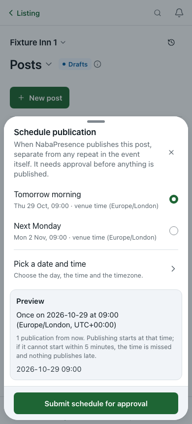     | 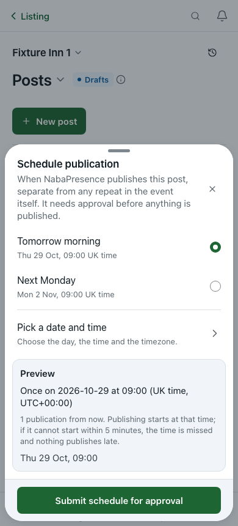     |
| F10 Google unreadable, 390 light           | 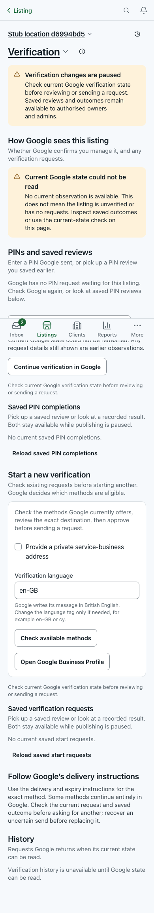  | 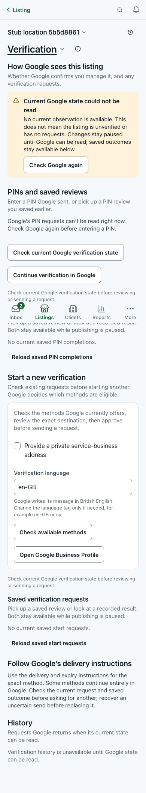  |
| F13 no selection, 390 light                | 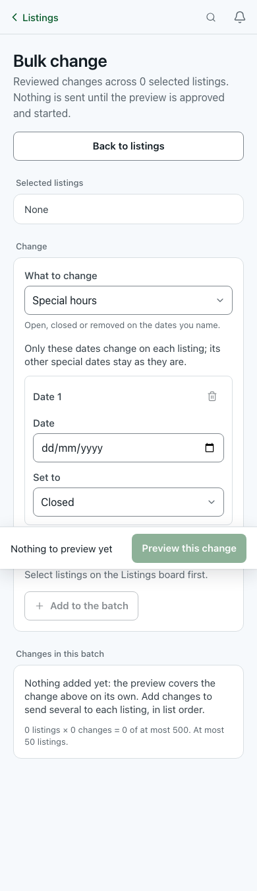          | 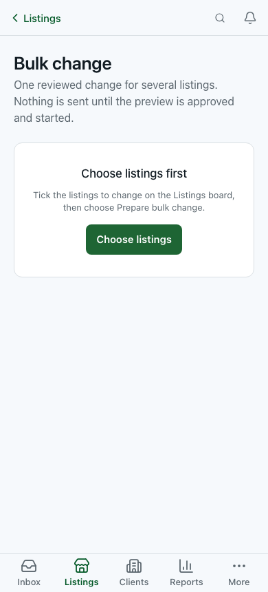          |
| F13 first view, 1280                       | 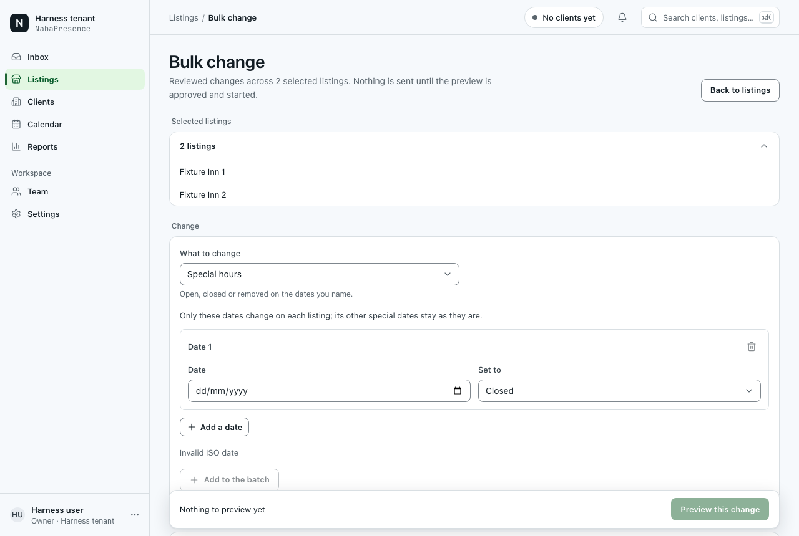      | 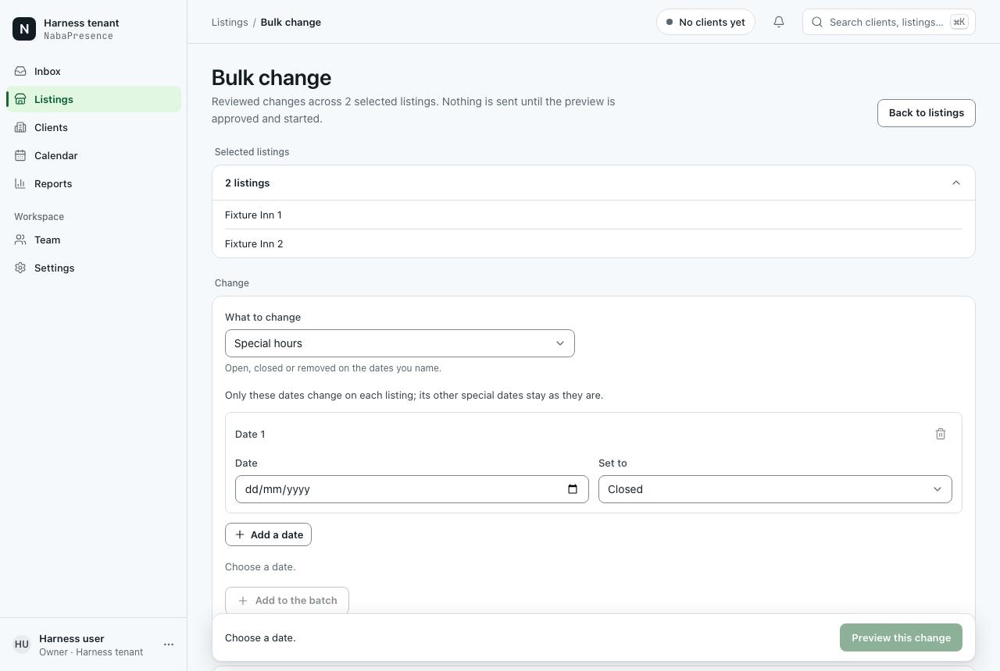      |
| F06 publish consent, 390 light             | 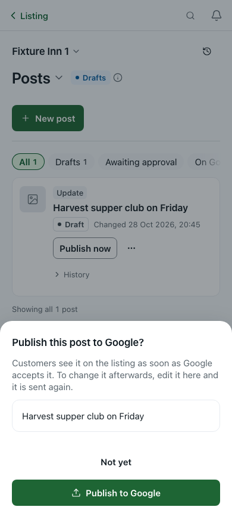    | 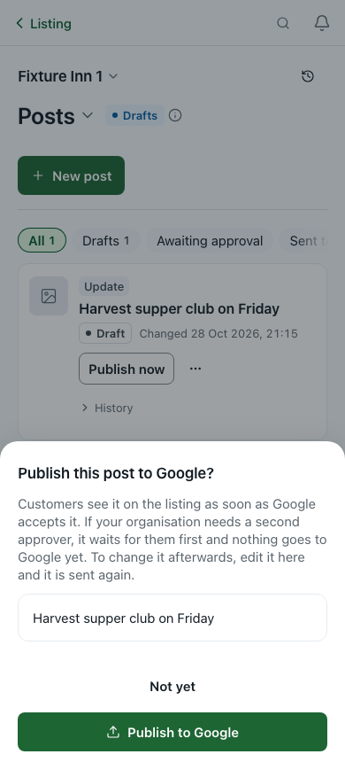    |
| F08 viewer, 390 dark                       | 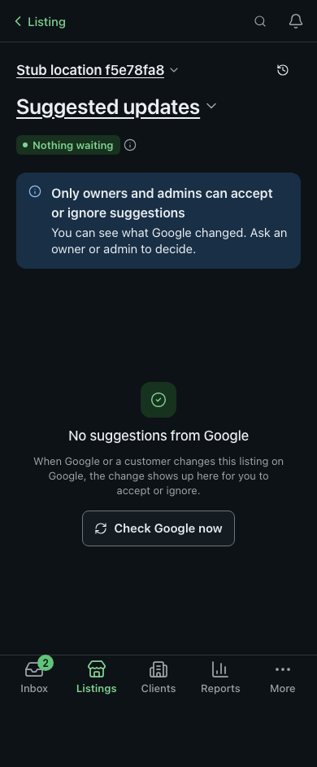  | 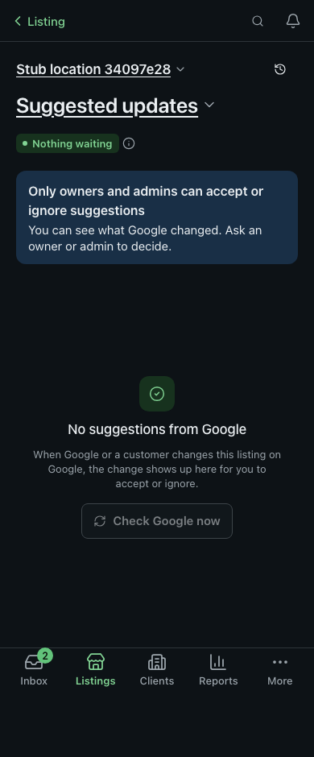  |
| F09 viewer, 1280                           |     | 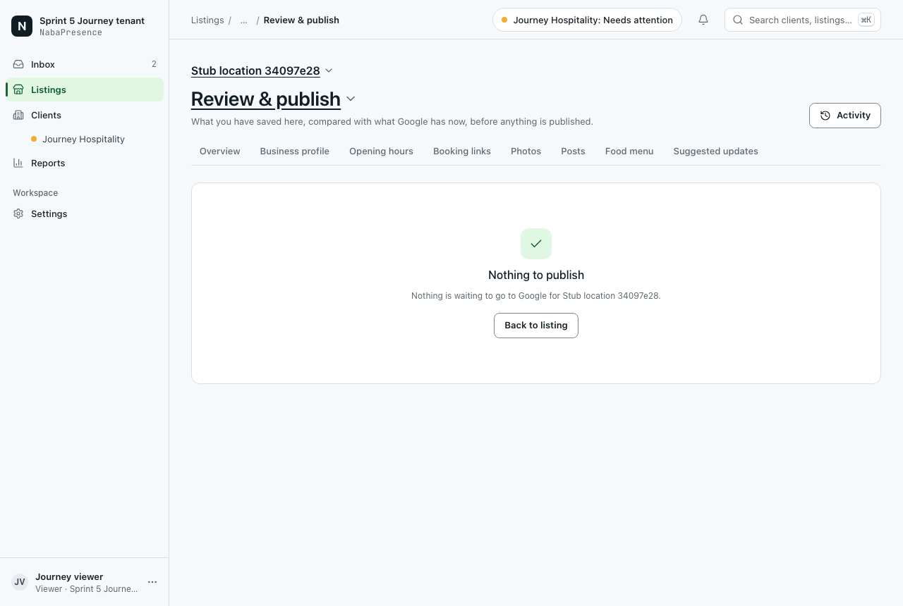    |
| F11 tools on a verified listing, 390 light | 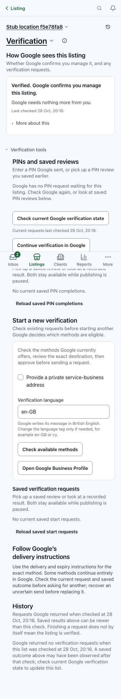 | 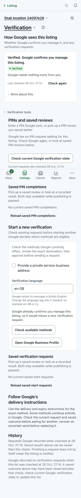 |
| F07 custom date, 390 dark                  | 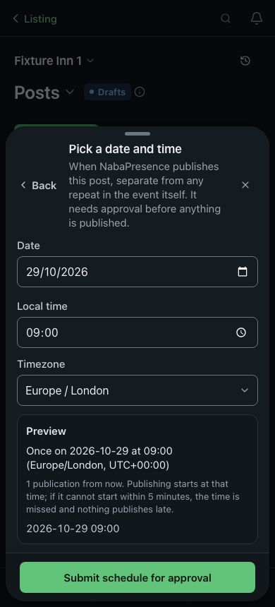     | 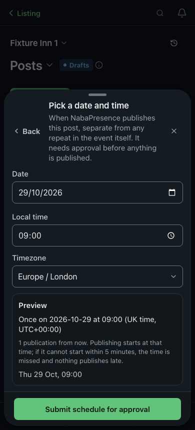     |
| F04 post with a draft, 1280                | 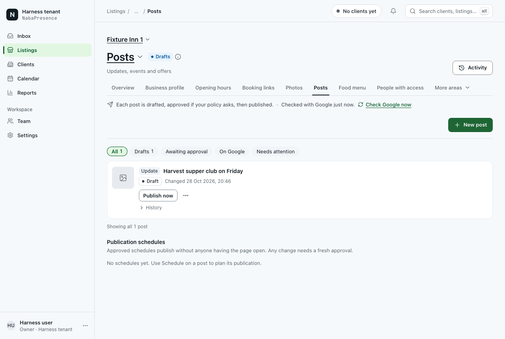       | 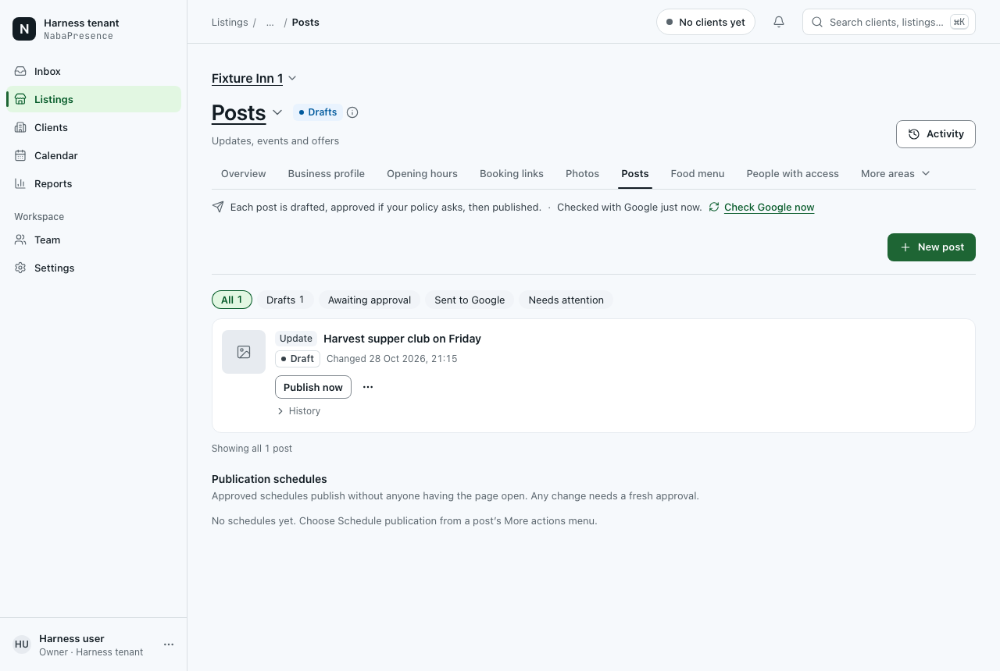       |

Every state has all three variants in `evidence/before/` and `evidence/after/`
under the same file name: 24 states × 3 = 72 images per side. Changes visible
in the capture:

- **F07:** "Thu 29 Oct, 09:00 UK time" and "(UK time, UTC+00:00)"; the list
  says "Thu 29 Oct, 09:00".
- **F10:** one warning carrying "Check Google again", and "Google’s PIN
  requests can’t be read right now" instead of claiming that no request is
  waiting.
- **F11:** a status line on a verified listing: "Google already confirms you
  manage this listing, so it would refuse a new verification request."
- **F13:**
  - "Choose a date." instead of "Invalid ISO date".
  - Preview and Add stay focusable and carry the reason.
  - "Choose listings first" with one action when nothing is selected.
- **F08:** for a viewer, "Check Google now" is disabled and says why.
- **F06:** the consent also covers a second approver.

Changes not visible in the fixture are covered by component tests; see
[Verification](#verification).

axe found **0 violations** in every AFTER state, and no capture scrolled
horizontally.

## Change log

| Change                                   | Before                                                                                                                                                          | After                                                                                                                                                                                                                                              | Reason                                                                                          | Relevant principle                 | Affected files                                                                                                                        |
| ---------------------------------------- | --------------------------------------------------------------------------------------------------------------------------------------------------------------- | -------------------------------------------------------------------------------------------------------------------------------------------------------------------------------------------------------------------------------------------------- | ----------------------------------------------------------------------------------------------- | ---------------------------------- | ------------------------------------------------------------------------------------------------------------------------------------- |
| F01 C1 thumbnail fallback                | Broken-image glyph                                                                                                                                              | Icon and "Photo unavailable"; the lightbox points at the original                                                                                                                                                                                  | Expired Google links read as a known state                                                      | Nielsen 1; WCAG 1.1.1              | `photos/media-card.tsx`, `photos/photo-preview.tsx`                                                                                   |
| F01 C2 tile names                        | Every tile "Preview Additional photo"                                                                                                                           | "Preview Interior photo from a customer, added 1 Jul 2026". The date joins the name only after hydration (`useHydrated`)                                                                                                                           | Tiles can be told apart                                                                         | WCAG 2.5.3, 2.4.6, 1.3.1           | `photos/media-card.tsx`                                                                                                               |
| F01 C3 stale grid                        | The old grid stays live while a new filter loads                                                                                                                | Dimmed, `inert`, `aria-busy`, "Loading matching photos…"                                                                                                                                                                                           | Can't act on a list the filter no longer describes                                              | Nielsen 1; WCAG 4.1.3              | `photos/photos-library.tsx`                                                                                                           |
| F01 C4 empty copy                        | "Add the first ones above…" for every role                                                                                                                      | Role-aware copy; the filtered empty state is `role=status`                                                                                                                                                                                         | No spatial instruction, and true for viewers                                                    | Nielsen 2, 9                       | `photos/photos-library.tsx`                                                                                                           |
| F01 C5 position                          | "12 of 12"                                                                                                                                                      | "12 of 12 loaded · 40 in all"                                                                                                                                                                                                                      | A disabled Next no longer implies "the end"                                                     | Nielsen 1                          | `photos/photo-preview.tsx`, `photos/photos-grid.tsx`                                                                                  |
| F01 C6 refresh                           | Silent                                                                                                                                                          | A toast after Google answers, for the manual refresh only                                                                                                                                                                                          | The person sees that it ran; writes don't toast twice                                           | Nielsen 1                          | `photos/photos-library.tsx`                                                                                                           |
| F02 C1 per-file retry                    | Remove only; picking again mints a new intent                                                                                                                   | "Try again" resends the kept intent and its category. Not offered for `media_create_in_progress` or `media_needs_resolution`                                                                                                                       | One-tap recovery that can't duplicate on Google (`media.ts` `runMediaWrite` replays the intent) | Nielsen 9                          | `photos/add-photo-dialog.tsx`                                                                                                         |
| F02 C2 honest summary                    | "No photos were uploaded" after unconfirmed uploads; "0 sent · …"                                                                                               | Re-reads the library when anything may have landed; "Google hasn’t confirmed this photo"; zero counts left out                                                                                                                                     | No claim that contradicts the pill                                                              | Nielsen 1; WCAG 4.1.3              | `photos/add-photo-dialog.tsx`                                                                                                         |
| F02 C3 refusals that apply to every file | N identical "permission" errors                                                                                                                                 | Stops at the first file, keeps its intent, shows one warning with the next step, and dispatches the existing `MFA_STEP_UP_EVENT`                                                                                                                   | One explanation; nothing more is sent                                                           | Nielsen 9; WCAG 3.3.3              | `photos/add-photo-dialog.tsx`                                                                                                         |
| F02 C4 end state                         | A disabled "Upload photos", which drops focus                                                                                                                   | The same button becomes "Done"; "Keep this open until the uploads finish." while uploading                                                                                                                                                         | A clear finish; focus kept                                                                      | WCAG 2.4.3; HIG modality           | `photos/add-photo-dialog.tsx`                                                                                                         |
| F02 C5, C6                               | Both verdicts inert while saving; the URL error only in a toast                                                                                                 | "Saving…" on the tapped verdict; copy for non-publishers; the URL error under its field                                                                                                                                                            | Feedback where the person acted                                                                 | WCAG 3.3.1, 4.1.2                  | `photos/unresolved-creates.tsx`, `photos/add-photo-dialog.tsx`                                                                        |
| F03 C1 focus                             | Focus lost after a delete                                                                                                                                       | The next tile (or the previous one), else Add photos                                                                                                                                                                                               | Keeps the person's place                                                                        | WCAG 2.4.3                         | `photos/delete-photo-dialog.tsx`, `photos/photos-grid.tsx`                                                                            |
| F03 C2 inline error                      | A passing toast only                                                                                                                                            | The error inside the dialog (`live={false}`). Unconfirmed: "Trying again is safe: it won’t delete twice." Stale: "Refresh from Google", then confirm against Google's version, or say the photo isn't on the re-read first page and disable Delete | Recovery where the person is looking; a stale copy is never resent                              | Nielsen 9; WCAG 3.3.1, 3.3.3       | `photos/delete-photo-dialog.tsx`, `photos/photos-grid.tsx`                                                                            |
| F03 C4, C5                               | "Delete this photo from Google?"; "Delete sent to Google"                                                                                                       | "Delete this interior photo from Google?"; the toast says when customers stop seeing it                                                                                                                                                            | Recognition; outcome meaning                                                                    | Nielsen 6, 1                       | `photos/delete-photo-dialog.tsx`                                                                                                      |
| F04 C1 schedule line                     | "Scheduled publication active: 2026-10-20 at 09:00 (Europe/London, UTC+01:00)"                                                                                  | "Scheduled for Tue 20 Oct, 09:00 BST", with " · Awaiting approval" and so on                                                                                                                                                                       | One name for one schedule (LST-19)                                                              | Nielsen 2, 4                       | `posts-tab.tsx`                                                                                                                       |
| F04 C2 view name                         | "On Google"                                                                                                                                                     | "Sent to Google" (a local label; the server filter is unchanged)                                                                                                                                                                                   | That view also holds posts that are not live                                                    | Nielsen 1                          | `posts-tab.tsx`                                                                                                                       |
| F04 C4–C6                                | Every disclosure is "History"; "Not confirmed" in the danger tint; a silent view switch                                                                         | "History of {title}" for screen readers; the warning tint for not confirmed; "Loading drafts…" status                                                                                                                                              | Distinct names, one tone per state, visible waiting                                             | WCAG 2.4.6, 4.1.3; Nielsen 4       | `posts-tab.tsx`, `posts/post-card.tsx`                                                                                                |
| F05 C1 step-up copy                      | "You do not have permission to do that"                                                                                                                         | "Publishing needs you to confirm it’s you first, so nothing was sent to Google…" (and an enrolment variant)                                                                                                                                        | True error and a next step; the MFA gate runs before the handler                                | Nielsen 9; WCAG 3.3.3              | `posts/post-composer-sheet.tsx`                                                                                                       |
| F05 C2 conflicting save                  | "Refresh and try again"                                                                                                                                         | "Someone else saved this post while you were editing. Your edits are still here…"; the posts list is refetched so "Load theirs / Keep mine" appears. `expectSave()` moved to after a successful save so the notice can't be swallowed              | No blind refresh; edits kept                                                                    | Nielsen 1, 9                       | `posts/post-composer-sheet.tsx`                                                                                                       |
| F05 C4–C6                                | "Save draft…" beside "Save changes"; the error above the fields; "Preview" announced three times                                                                | The footer names the real button; the error sits at the footer; Publish describes the consent first, then the reason; one "Preview"                                                                                                                | Consistency; error next to the action                                                           | WCAG 3.2.4, 3.3.1, 1.3.1           | `posts/post-composer-sheet.tsx`                                                                                                       |
| F06 C1 consent                           | "Customers see it…" only                                                                                                                                        | Adds "If your organisation needs a second approver, it waits for them first and nothing goes to Google yet."                                                                                                                                       | Consent matches every outcome                                                                   | Nielsen 1; WCAG 3.3.4              | `posts-action-bar.tsx`                                                                                                                |
| F06 C3                                   | "Reject"                                                                                                                                                        | "Send back to draft" (matches its toast); "Approving…"                                                                                                                                                                                             | No clash with Google's "rejected"                                                               | Nielsen 2; WCAG 4.1.3              | `posts-action-bar.tsx`                                                                                                                |
| F06 C4 focus                             | Lost after an action                                                                                                                                            | The post's heading; after a delete, the next heading or the filter chip                                                                                                                                                                            | Keeps the person's place                                                                        | WCAG 2.4.3                         | `posts-action-bar.tsx`, `posts-tab.tsx`, `posts/post-card.tsx`                                                                        |
| F06 C5 waiting                           | A disabled Approve with no reason                                                                                                                               | "Waiting for an approver. Only someone who can publish this location can approve it." (pause and billing keep the disabled button with its reason)                                                                                                 | Status reads as status                                                                          | Nielsen 1                          | `posts-action-bar.tsx`                                                                                                                |
| F06 C6                                   | Generic retry dialog; delete errors only in a toast                                                                                                             | "Publish this post to Google again?" plus why it won't duplicate; the delete error stays in the dialog (not a second live region)                                                                                                                  | Recovery explained in place                                                                     | Nielsen 9; WCAG 3.3.1              | `posts-action-bar.tsx`                                                                                                                |
| F07 C1, C2 zone names and dates          | "venue time (Europe/London)"; "2026-10-29 09:00"                                                                                                                | "UK time"; "Thu 29 Oct, 09:00" (`zoneName` = `formatTimeZoneLabel` ∘ fallback). The Timezone select is unchanged                                                                                                                                   | One vocabulary with Hours and Calendar (LST-19)                                                 | Nielsen 2, 4                       | `posts/schedule-dates.ts`, `posts/schedule-post-sheet.tsx`, `posts/post-schedules.tsx`, `posts/legacy-post-schedules.tsx`             |
| F07 C3 validation                        | "Too small: expected number to be >=1"                                                                                                                          | "Enter how many times, from 1 to 366." and so on, also under the field (the schema is unchanged)                                                                                                                                                   | Plain, field-level errors                                                                       | WCAG 3.3.1, 3.3.3                  | `posts/schedule-post-sheet.tsx`                                                                                                       |
| F07 C4 cancel                            | One tap, irreversible                                                                                                                                           | "Cancel this schedule?" dialog; per-row pending; Pause stays one tap                                                                                                                                                                               | Error prevention for an irreversible step (+1 tap, by design)                                   | Nielsen 5; HIG destructive actions | `posts/post-schedules.tsx`                                                                                                            |
| F07 C5, C6                               | Silent when scheduling is off; no confirmations; "EVENT"                                                                                                        | An off notice; toasts after the server answers; plain count labels                                                                                                                                                                                 | System status                                                                                   | Nielsen 1; WCAG 4.1.3              | `posts/post-schedules.tsx`, `posts/legacy-post-schedules.tsx`, `posts/schedule-post-sheet.tsx`                                        |
| F08 C2 gates                             | A check offered to roles the server refuses; "only owners and admins" even on a billing hold                                                                    | `disabledReason` on both check buttons; the billing banner says billing                                                                                                                                                                            | No dead-end 403; an honest reason                                                               | Nielsen 5; WCAG 3.3.2              | `suggestions/suggestions-page.tsx`, `suggestions/suggestion-list.tsx`                                                                 |
| F08 C3 check result                      | One toast for any result                                                                                                                                        | "Nothing new since the last check." / "{n} new suggestions to review." from the response                                                                                                                                                           | System status                                                                                   | Nielsen 1                          | `suggestions/suggestions-page.tsx`                                                                                                    |
| F08 C4 settled rows                      | Decided rows stay live until the refetch                                                                                                                        | Disabled ("Already decided. The list is updating.") after `onSuccess`; failure toasts name the suggestion; no toast when the inline alert stays                                                                                                    | No second decision                                                                              | Nielsen 1, 9                       | `suggestions/suggestion-list.tsx`                                                                                                     |
| F08 C5, C6                               | "Refresh from Google" and "Check Google now" for one action; help on every row; silent loading                                                                  | One name; help once per group; zero counts left out; loading `role=status`; error `role=alert`; pending labels                                                                                                                                     | Simplicity; status messages                                                                     | Nielsen 8; WCAG 4.1.3              | both suggestions files                                                                                                                |
| F09 C1 outcome                           | A green tick and "Google accepted every change…" for every outcome                                                                                              | That sentence only for `confirmed_applied`; parked, sent and mixed outcomes use `lib/editors/outcome.ts` copy and a neutral clock                                                                                                                  | Never claim more than the server confirmed                                                      | Nielsen 1                          | `listings/review-publish.tsx`                                                                                                         |
| F09 C2 unreadable area                   | An area Google failed to read blocked the whole publish                                                                                                         | It can be left out (not queued; consent and hash pins unchanged)                                                                                                                                                                                   | User control                                                                                    | Nielsen 3                          | `listings/review-publish.tsx`                                                                                                         |
| F09 C3 read-only                         | Dead checkboxes and a publish bar for viewers                                                                                                                   | No include or acknowledgement checkboxes and no bar; "Ask an owner or admin to publish these changes."; "View" links                                                                                                                               | Controls match capability                                                                       | Nielsen 8; WCAG 3.3.2              | `listings/review-publish.tsx`                                                                                                         |
| F09 C4–C6                                | The reason in a tooltip; no focus on success; no next step from the hours-blocked alert                                                                         | The reason shown in the bar; focus on the result; "Open hours editor"                                                                                                                                                                              | Touch-visible reasons; feedback; recognition                                                    | WCAG 3.3.2, 2.4.3; Nielsen 6       | `listings/review-publish.tsx`                                                                                                         |
| F10 C1, C2                               | Three warnings, no retry, and a "no PIN request" claim while loading or unreadable                                                                              | One alert with "Check Google again" (and "Reconnect Google" for an expired login); the paused banner only for a permissions cause; neutral loading. Sends stay blocked exactly as before (`writeReason` unchanged)                                 | One message, recovery in place                                                                  | Nielsen 8, 9; WCAG 3.3.1           | `administration/verification-tab.tsx`, `verification-completion.tsx`                                                                  |
| F10 C3, C4                               | No pill; tools before the start form for an unverified listing                                                                                                  | A pill from Google's fields only ("Unknown", never "Not verified", without an answer); "Check again"; start before PIN when Google asks for verification                                                                                           | Scannable, truthful status; next step first                                                     | Nielsen 1, 7                       | `verification-observation.tsx`, `verification-tab.tsx`                                                                                |
| F10 C6                                   | "merchant standing", "independently observed"                                                                                                                   | "Google confirms you manage it" and plain sentences                                                                                                                                                                                                | LST-09 residue                                                                                  | Nielsen 2                          | `verification-attempt-status.tsx`                                                                                                     |
| F11 C2 (modified)                        | No warning on a verified or pending listing                                                                                                                     | A `role=status` line above "Check available methods". Review is **not** disabled; the server stays the authority                                                                                                                                   | Prevents a wasted review, approve and MFA sequence                                              | Nielsen 5                          | `verification-start.tsx`, `verification-start-form.tsx`, `verification-tab.tsx`                                                       |
| F11 C3, F12 C5                           | Generic errors for 7 codes, MFA included                                                                                                                        | Plain messages per code (`verificationActionMessage`); uncertain-send logic unchanged                                                                                                                                                              | Recovery                                                                                        | Nielsen 9                          | `use-verification-action.ts`                                                                                                          |
| F11 C4                                   | One catch-all line; Review disabled without a reason                                                                                                            | Field errors after blur; the reason under Review via `aria-describedby` (disabled in the same cases)                                                                                                                                               | Error identification                                                                            | WCAG 3.3.1, 4.1.2                  | `verification-start-form.tsx`, `verification-context-fields.tsx`                                                                      |
| F12 C1–C4, C6                            | "No PIN request" without an observation; one hint for every method; "Refresh exact PIN review"; "Check Google, then review a corrected PIN" didn't check Google | Truthful empty state; a hint per delivery method; plainer review copy (tested strings kept); "Refresh this review"; that button now calls the existing read-only `checkState()`; "Waiting for another manager" stage                               | Truthfulness, recognition, consistency                                                          | Nielsen 1, 2, 6                    | `verification-completion.tsx`, `verification-pin-field.tsx`, `verification-completion-review.tsx`, `verification-saved-workflows.tsx` |
| F13 C1, C2                               | "Invalid ISO date"; a regex; dead buttons                                                                                                                       | "Choose a date." (a muted instruction); `disabledReason` on Preview and Add; the reason in the bar                                                                                                                                                 | Plain language; focusable reasons                                                               | Nielsen 9; WCAG 3.3.2, 4.1.2       | `bulk/bulk-compose.tsx`                                                                                                               |
| F13 C3                                   | The full form above "None"                                                                                                                                      | "Choose listings first", with "Choose listings"                                                                                                                                                                                                    | One clear next step                                                                             | Nielsen 6; HIG empty states        | `bulk/bulk-compose.tsx`                                                                                                               |
| F13 C4                                   | The button live again between preview success and navigation                                                                                                    | Busy until the route changes (request and idempotency key unchanged)                                                                                                                                                                               | Strengthens double-submit protection                                                            | Nielsen 5                          | `bulk/bulk-compose.tsx`                                                                                                               |
| F13 C5, C6                               | Bare server text that outlives edits; two batch models                                                                                                          | Specific copy for unavailable targets and the rate limit (from `details.retryAfter`), cleared on edit; one "batch" wording ("Preview the batch (1 change)")                                                                                        | Recovery; consistency                                                                           | Nielsen 9, 4                       | `bulk/bulk-compose.tsx`                                                                                                               |
| F14 C1, C3                               | A failed refresh replaced the batch; polling stopped while a child was still sending                                                                            | Last known state kept, with "Couldn’t refresh at HH:MM…"; polls while anything is queued or running                                                                                                                                                | Truthful progress                                                                               | Nielsen 1; WCAG 4.1.3              | `bulk/bulk-operation-view.tsx`                                                                                                        |
| F14 C2                                   | Irreversible one-tap cancel                                                                                                                                     | "Discard this preview" / "Stop listings not yet sent" with a dialog using server counts                                                                                                                                                            | Error prevention (+1 tap, by design)                                                            | Nielsen 5; WCAG 3.3.4              | `bulk/bulk-operation-view.tsx`                                                                                                        |
| F14 C4–C6                                | Stale buttons after a 409; "Retry N unsettled"; a retry on 404; a member's own batch shown as manager-only                                                      | Refetch on 409; errors and blocked reasons in the bar; "Retry N unconfirmed …" plus an honest nothing-requeued note; a real not-found state; Cancel and Retry for a member's own review batch, matching `requireBatchControl`                      | The UI agrees with the server                                                                   | Nielsen 4, 9                       | `bulk/bulk-operation-view.tsx`                                                                                                        |
| F15 signed-out deep link                 | Signed out → Clients → `sign-in?next=/clients?moved=…`                                                                                                          | In production, signed out → `sign-in?next=<the old path and query>`, sanitised; the old path then resolves after sign-in. The anonymous dev and local-bootstrap fallback is unchanged                                                              | The bookmark keeps its meaning                                                                  | Nielsen 3; HIG preserve context    | `lib/server/flat-route-redirect.ts`                                                                                                   |

Tap changes, counted from code, not measured in a browser:

- F07 Cancel schedule: 1 → 2, a deliberate confirmation.
- F14 Cancel: 1 → 2, a deliberate confirmation.
- F03 stale delete recovery: 5 or more → 2 (Refresh, then Delete).
- F02 retrying one failed file: re-pick and Upload → 1 (Try again).
- No other flow's step count changed.

## Core preservation

- **No server, contract, schema or provider change.**
  `git diff origin/ux/all-flows-presence --stat -- app lib supabase` shows only
  `lib/server/flat-route-redirect.ts`. No route handler, API module, migration
  or dependency changed. There are no flags or settings.
- **Requests are unchanged.** Every request body and endpoint is the same.
  `lib/api/client.ts`, `lib/server/media.ts` and the other server modules were
  only imported, never edited. The review checked this item by item (see
  below).
- **Idempotency:**
  - **Upload retry** resends the kept intent with the category it was first
    sent with, so the server replays its earlier answer.
  - **Run-wide refusals** (MFA, paused, permission, approval mode) happen
    before the server claims anything. The file keeps its intent and goes back
    to Ready.
  - **Delete retry** resends the same intent. After a stale refusal it never
    resends the stale hash: the dialog follows Google's version, or disables
    Delete when that version isn't loaded.
  - **Bulk:** the busy state is held through navigation, and the keys are
    unchanged.
- **Approval and consent:**
  - The composer consent line, its gate, `data-slot` and `aria-describedby` are
    unchanged; `post-composer-publish.test.tsx` passes unedited, including the
    exact consent text.
  - The publish dialog keeps consent and has no Undo.
  - Approve stays server-gated. The waiting caption only replaces a button the
    server would refuse.
  - The verification Review button is never disabled by the new warning.
- **Server authority:**
  - Every new toast fires in `onSuccess`.
  - Bulk counts are read from the server.
  - Review & publish's success sentence now requires `confirmed_applied`.
  - The verification pill never says "Not verified" without Google's answer.
- **Deep links:** the five shims still resolve as before for signed-in users
  (`tests/flat-route-redirect.test.ts`, `tests/next-config.test.ts`, and
  `routing.spec.ts` in the e2e run). The new sign-in branch uses `signInPathFor`;
  an off-site `//…` path gives a bare `/sign-in` (unit test).
- **Core defect found and not fixed (F08):**
  - Food-menu suggestion decisions send the **profile's** revision
    (`suggestions-page.tsx:47`, passed to the menu list at `:301`). The server
    compares it with the **food menu's** revision (`lib/server/import-review.ts:1028-1047`).
  - Once the two counters differ, every menu Accept and Remove here fails with
    `canonical_resource_stale`, and Retry can't succeed. Keep here and Ignore
    are not affected (`mark_only`).
  - Per the brief this is recorded as a follow-up, not silently fixed.

## Verification

| Check                                                                                   | Kind                                   | Result                                                                                                                                                                                                                                                                                                                 |
| --------------------------------------------------------------------------------------- | -------------------------------------- | ---------------------------------------------------------------------------------------------------------------------------------------------------------------------------------------------------------------------------------------------------------------------------------------------------------------------- |
| `pnpm verify` (typecheck, lint, format:check, unit, design ratchet) on the final tree   | source and unit                        | **Passed.** 635 test files passed and 1 skipped; 8,618 tests passed and 1 skipped. Design ratchet: "no file/rule count rose"                                                                                                                                                                                           |
| `pnpm check:design` totals                                                              | source                                 | **Passed.** 103 findings before (`origin/ux/all-flows-presence`) and 103 after. Area files: 1 → 1 (the existing `max-h-[min(58dvh,40rem)]` in `photo-preview.tsx`)                                                                                                                                                     |
| `pnpm check:contrast`                                                                   | source                                 | **Passed.** All 212 pairs clear their target in both themes                                                                                                                                                                                                                                                            |
| New and updated component tests                                                         | unit                                   | **Passed.** 13 new test files (photos 23, posts browse 9, posts actions 13, composer feedback 10, schedule UX 12, schedule dates 4, suggestions page 7, review & publish UX 9, verification status 15, verification flows 24, bulk compose 9, bulk operation 13, flat-route redirect +3), plus updated existing suites |
| `pnpm test:e2e:touch` (port 3540)                                                       | fixture browser                        | **Passed.** 23 passed                                                                                                                                                                                                                                                                                                  |
| `pnpm test:a11y` (port 3540)                                                            | fixture browser                        | **Passed.** 64 passed                                                                                                                                                                                                                                                                                                  |
| `listings.spec.ts`, `routing.spec.ts`, `verification-workspace.spec.ts`                 | fixture browser                        | **Passed.** 60 passed                                                                                                                                                                                                                                                                                                  |
| `operations-features.spec.ts` (bulk, schedules, posts)                                  | fixture browser and throwaway database | **Passed.** 18 passed                                                                                                                                                                                                                                                                                                  |
| `verification-pin-backend`, `-pin-drift`, `-pin-recovery`, `verification-start-backend` | fixture browser and throwaway database | **Passed.** 48 passed                                                                                                                                                                                                                                                                                                  |
| BEFORE and AFTER capture, 24 states × 3 variants, with axe on each                      | fixture browser                        | **Passed.** 0 axe violations and no horizontal overflow on either side                                                                                                                                                                                                                                                 |
| `tests/visual/shoot.mjs` under the visual lock                                          | fixture browser                        | **Blocked.** `naba_visual` is missing on the local Supabase; replaced by the e2e-harness capture above                                                                                                                                                                                                                 |
| `audit:mobile`, perf-lab                                                                | measurement                            | **Not run.** No loading or bundle work in this area; no measured-improvement claims are made                                                                                                                                                                                                                           |
| Provider-backed journeys (a real Google publish, upload, delete or verification)        | provider                               | **Not run.** Out of scope; nothing was published                                                                                                                                                                                                                                                                       |
| Hosted CI and `lci`                                                                     | CI                                     | **Not run.** The integrator runs them once on the combined branch                                                                                                                                                                                                                                                      |

e2e assertion updates (copy that changed on purpose), in
`tests/e2e/operations-features.spec.ts`:

- `/Scheduled publication awaiting approval:/` → `/Scheduled for .+ · Awaiting approval/`.
- "Cancel schedule" now confirms in the "Cancel this schedule?" dialog.

The BEFORE gates were not re-run separately; the AFTER e2e results above are on
the final build.

### Review response

An independent review subagent, with fresh context, got the diff and the
protected-behaviour list. It reported **no P0**, 1 P1, 3 P2 and 6 P3. It ran
`tsc` (exit 0) and 313 tests across the changed files (all passed).

| #   | Finding                                                                                                                                                 | Action                                                                                                                                                   |
| --- | ------------------------------------------------------------------------------------------------------------------------------------------------------- | -------------------------------------------------------------------------------------------------------------------------------------------------------- |
| P1  | A stale delete of a photo loaded through Load more: after Refresh, the photo isn't on the re-read first page, so the stale hash would be resent forever | **Fixed.** The dialog says the photo isn't on Google's first page any more, and disables Delete for that stale case. New test in `photos-flows.test.tsx` |
| P2  | The tile name's date (browser zone) could mismatch the server render (hydration)                                                                        | **Fixed.** The date joins the name only after hydration (`useHydrated`)                                                                                  |
| P2  | "Made on Google" History inferred from a missing audit row, which is wrong for scheduled posts and purged audits                                        | **Fixed by reverting** F04 C3; the track is as before. Recorded as a follow-up needing a real provenance field                                           |
| P2  | "Retry N failed" counted not-confirmed listings as failed                                                                                               | **Fixed.** "Retry N unconfirmed …"                                                                                                                       |
| P3  | Post delete error announced twice (toast and `role=alert`)                                                                                              | **Fixed.** Not live in the dialog                                                                                                                        |
| P3  | Delete body "straight away" against the toast's "a few minutes"                                                                                         | **Fixed.** "usually within a few minutes"                                                                                                                |
| P3  | Stale grid not inert for the keyboard                                                                                                                   | **Fixed.** `inert` while settling                                                                                                                        |
| P3  | The retry notice's noun                                                                                                                                 | **Fixed.** "these listings"                                                                                                                              |
| P3  | Verification field errors announced by both the field and the form line                                                                                 | Left; recorded as a follow-up (polite, not alerts)                                                                                                       |
| P3  | A delete dialog's `finalFocus` may not run if a fast refetch unmounts the row                                                                           | Left; unconfirmed without a browser timing test. Follow-up                                                                                               |

## Shared-file edits

- `lib/server/flat-route-redirect.ts`: a signed-out branch in `flatRouteTarget`
  for production. It is this area's own helper, but it sits in `lib/`. Its only
  callers are the five flat-route shims in this area.
- `tests/e2e/operations-features.spec.ts`: two assertion updates for copy this
  area changed on purpose (above).
- No edits to `components/ui`, `components/editors`, `components/reviewed-write`,
  layouts, `app/globals.css` or another area's components. Shared components
  are only used as they are: `Alert`, `AlertDialog` with `finalFocus`, `Button`
  with `disabledReason`, `Empty`, `StatusPill` and `useHydrated`.

## Outcome and follow-ups

**Outcome.** All 15 flows have a smaller, more truthful set of states: plainer
errors, recovery next to the failure, read-only views without dead controls,
confirmations on irreversible steps, and no success copy before the server
confirms. The protected behaviour is unchanged, and the change set is covered by
unit and fixture-browser tests. This area is **partially verified**: the shoot
harness is Blocked, and the states the stub can't produce are verified by
component tests only.

**Follow-ups** (not done here):

1. **Core defect, F08:** food-menu decisions send the profile's revision. Pass
   `useFoodMenus(locationId).data.canonicalResource.revision` to the menu list,
   with a focused test first.
2. **F06 C2:** a server-computed `canApprove` and two-person flag on post rows,
   so a requester never sees Approve on their own post. This is a contract
   change (`lib/contracts/location-posts.ts`, `lib/server/posts.ts`).
3. **F04:** post provenance (made on Google versus here) needs a real field;
   the History change was reverted.
4. **F05:**
   - Require dates before publishing an event or offer, after confirming what
     Google requires (a hypothesis, not tested).
   - The second draft after a lost save needs server dedupe (L10 note).
   - The consent wording under the two-person policy needs an owner decision.
5. **F11 C1:** an unknown business type forces a private address the server
   then rejects. This needs an owner decision, because the unit test
   `verification-start-form.test.tsx:48` pins current behaviour.
6. **F11 C5:** collapse the extra address codes behind "More address details".
7. **F12:** adopt a PIN typed before hydration (needs an e2e repro first). A
   typo on re-entry forces a new review (owner decision).
8. **F15, shared with p2 and p3:**
   - `/clients` has no `moved=listing` copy, and shows the banner above empty
     states.
   - Business mode with several locations drops `moved` and the query on the
     bounce to `/listings`.
9. **F13 F7:** the Listings board should seed its selection from `?ids=` so
   "Back" keeps it (`listings-board.tsx`, p3).
10. **Copy in `lib/`:**
    - `lib/errors/action-errors.ts` `proposal_patch_invalid` says "Refresh from
      Google"; the page's button is now "Check Google now".
    - `lib/server/google-verification-execution.ts:137` still says "merchant
      standing" (mapped to plain copy in the UI).
11. **L02 note:** the activity cursor regex lacks `bulk:` and `schedule:`
    (`lib/contracts/location-activity.ts`).
12. **Review P3s left open:**
    - Double polite announcements on verification field errors.
    - A possible missed `finalFocus` after a fast refetch on post delete.
13. **Visual harness:** recreate `naba_visual` on the local Supabase (owner
    action) so `shoot.mjs` can run again.
