# p5 Reviews and reporting: inbox, notifications, calendar and reports, before and after

Status: **implemented and partially verified**, revised after an independent
review (see [Review response](#review-response)). The evidence is source,
unit and component tests, fixture-browser e2e with a stubbed Google, and
matched fixture screenshots. Nothing here is provider-backed: no live Google
account, no real device and no hosted CI result. See
[Verification](#verification).

## Scope and baseline

**Area.** Reviews and reporting: the reply inbox (queue, filters, detail,
reply, two-person approval, triage, bulk, sync), notifications, the
scheduled-publications calendar and Reports. **Routes:** `/inbox`,
`/notifications`, `/calendar`, `/reports`, with their URL parameters.

**Flows** (`FLOWS.md`):

| ID     | Flow                                                                                         | Starts                                   | Ends                                                                             |
| ------ | -------------------------------------------------------------------------------------------- | ---------------------------------------- | -------------------------------------------------------------------------------- |
| p5-F01 | Work the reply queue: tabs and counts, sort, loading/empty/error, load more                  | `/inbox` (default queue)                 | a review chosen, or the queue shown empty ("all caught up")                      |
| p5-F02 | Narrow the list: search, quick filters, Filters sheet, chips, clear                          | inbox toolbar                            | list filtered (URL updated) or cleared back to the queue                         |
| p5-F03 | Read a review: detail pane or page, prev/next, metadata, media, history, shortcuts, back     | row tap / `?selected=`                   | detail read; back to the same list position                                      |
| p5-F04 | Reply: write or generate, publish, reply status, edit/delete live reply, failures            | detail composer                          | server-confirmed reply status, or an error with recovery                         |
| p5-F05 | Two-person approval: submit, approve, send back (copy and presentation only)                 | composer in a workspace needing approval | server-confirmed approved/sent or sent back                                      |
| p5-F06 | Triage one review: "No reply needed" (+ Undo), assign                                        | detail menu / row actions                | server-confirmed state, list updated                                             |
| p5-F07 | Bulk act: approve, template reply, no reply needed, assign; partial failures                 | Select mode                              | server-confirmed summary of outcomes                                             |
| p5-F08 | Sync reviews from Google: button, freshness, progress, error                                 | inbox toolbar / bottom toolbar           | sync finished (list refreshed) or error with retry                               |
| p5-F09 | Check notifications: filters, read/unread, mark read, follow, load more, errors, empty       | `/notifications`                         | notifications read or followed to their target                                   |
| p5-F10 | Resolve a notification (owner/admin; closes for everyone, no reopen)                         | Resolve on a row                         | server-confirmed resolved, or refused with rollback                              |
| p5-F11 | Browse scheduled publications: month/week/agenda, filters, day, empty period                 | `/calendar`                              | publication found or followed to its listing                                     |
| p5-F12 | Calendar unavailable: scheduling off (role-aware) and load errors                            | `/calendar` with `post_scheduling` off   | way back to Listings                                                             |
| p5-F13 | Read the reply report: KPIs, charts, per-listing table, empty/collecting                     | `/reports`                               | figures understood                                                               |
| p5-F14 | Change report scope and period: client, listing, period, tabs, single-listing, stale params  | report toolbar / app-bar scope chip      | the requested report, with scope and period said                                 |
| p5-F15 | Google performance and Keywords: figures, provenance, partial coverage, unavailable, Refresh | `/reports?tab=google\|keywords`          | figures, or an honest unavailable/partial state; refresh confirmed by the server |
| p5-F16 | Export and share: CSV, report actions menu, "Share a client's report" entry                  | report actions menu                      | file downloaded / share dialog opened (the dialog is p2's)                       |

**Baseline.** Branch `ux/flows-presence-p5`, cut from
`origin/ux/all-flows-presence` at `e4123d25`. Commits: `0218aa35` (change
set), `8da8cae2` (review fixes R1–R9), then a final commit with the
search-chip curly quotes, tests for review fixes R1 and R9, and this report
(the branch head is recorded in `status/p5.done`). Code
references in [Before](#before) are to `e4123d25`, from the per-flow files.

**Environment.**

- Screenshots: `next dev --turbopack --port 3200` (Next.js 16.4.1), Node
  24.16.0, Chromium via Playwright, Europe/London. The repo harness
  `tests/visual/shoot.mjs`, driven by [`evidence/shoot-p5.sh`](evidence/shoot-p5.sh)
  under `/tmp/naba-presence-visual.lock`, with Google stubbed by
  `tests/visual/fixture-server.ts` (no `googleapis` traffic).
- **Recipe deviation:** a disposable PostgreSQL 17 cluster
  (`scripts/ci/postgres.mjs`) instead of the local Supabase `naba_visual`, on
  both sides. See [`evidence/before/CAPTURE-NOTES.md`](evidence/before/CAPTURE-NOTES.md)
  and [`evidence/after/CAPTURE-NOTES.md`](evidence/after/CAPTURE-NOTES.md).
- Fixture tenant "Sprint 5 Journey tenant" (agency): 1 client, 2 listings,
  2 reviews needing a reply, no notifications, scheduling off, Google data for
  1 of 2 listings. Only seed location-name suffixes differ between runs.
- Viewports: 390 light, 1280 light, 390 dark. Desktop shots are 1280×860
  because the shell scrolls inside its main pane, so `--full` cannot extend them.
- e2e: `PLAYWRIGHT_PORT=3550`, a throwaway PostgreSQL per run, the CI
  placeholder env from `.github/workflows/ci.yml`, no `.env.local`, Google
  stubbed.

**Captured states** (14 × 3 = 42 PNGs per side; same script, fixtures and
file names):

| #   | Route                                                    | Role   | What it shows                                          |
| --- | -------------------------------------------------------- | ------ | ------------------------------------------------------ |
| 01  | `/inbox`                                                 | owner  | Needs reply queue (desk auto-selects the first review) |
| 02  | `/inbox?selected={review}`                               | owner  | Review detail with a photo tile and an empty composer  |
| 03  | `/inbox?queue=failed&sort=rating_asc`                    | owner  | Empty Failed queue with a non-default sort             |
| 04  | `/inbox?search=zzqx`                                     | owner  | Search with no match                                   |
| 05  | `/inbox?selected={review}`                               | viewer | Review detail for a view-only role                     |
| 06  | `/notifications`                                         | owner  | Empty notifications                                    |
| 07  | `/notifications?filter=open`                             | owner  | Open filter, empty                                     |
| 08  | `/calendar`                                              | owner  | Scheduled publishing off, manager copy                 |
| 09  | `/calendar`                                              | viewer | Scheduled publishing off, non-manager copy             |
| 10  | `/reports`                                               | owner  | Reply performance                                      |
| 11  | `/reports?tab=google`                                    | owner  | Google performance, 1 of 2 listings                    |
| 12  | `/reports?tab=keywords`                                  | owner  | Keywords                                               |
| 13  | `/reports?locationId={loc}`                              | owner  | Single-listing report                                  |
| 14  | `/reports?clientId=00000000-0000-4000-8000-000000000000` | owner  | Unknown client id                                      |

**Protected core rules** (condensed from `PROTECTED.md`, derived from code):

- **General.** Server actions, routes, API contracts, schema, providers,
  roles, rate limits, audit writes, two-person approval and publish workflows
  (D1/D2), bulk idempotency, notification kinds, and server authority: no
  completed outcome before the server confirms it.
- **Inbox queue and filters.** Read-only `GET /api/reviews` and `/counts`,
  same query keys and filter shapes. The URL is the state (`replace` for queue
  and filter, `push` for phone open). The dirty-reply guard gates queue,
  selection, back and scope. Client scope is not a filter (INB-07). Server
  counts only. Viewers get no bulk tools. `/inbox` JS budget 520 KB (INB-23).
- **Detail, reply and approval.** Publish is `POST …/publish` with
  `draftId` and `expectedReviewUpdateTime`, MFA step-up and `PUBLISH_ENABLED`.
  "Live on Google" only when published and not pending. Approve sends
  `{decision:"approve", draftId, expectedReviewUpdateTime}` for the shown
  draft; reject is unbound, confirmed, note ≤2,000 characters. The server
  decides who may approve (`canApprove`, `second_approver_required`). `a` and
  ⌘↵ never bypass `disabled`/`aria-busy`.
- **Triage and bulk.** `POST /api/reviews/bulk`, per-row outcomes. Triage for
  `role !== "viewer"`. Undo is compare-and-clear on `triagedAt`. Retry intents
  are never re-minted or re-sent. Approvals are bound to
  `pendingDraftId ?? draftId` and `reviewUpdateTime`. `queued` is never shown as sent.
- **Sync.** Owner/admin only. `sync_manual` 10/user, 30/org per 10 min; no
  client retry loops. One toast per result (R09). No Undo on a Google read.
- **Notifications.** Read state is per person. Read and resolve commit only on
  success. Count and bell are one number. Kinds and recipients unchanged.
  Resolve: owner/admin (`canResolve` from the server), confirmed, for
  everyone, no reopen.
- **Calendar.** The server decides `post_scheduling`; the off latch never
  retries. Filters only narrow. Window ±1 day, ≤45 days, UUID params.
  Read-only. Statuses as given. No invented support channel (D10).
- **Reports.** Read-only, same keys and window. Missing is "—", never 0.
  Share and Refresh are owner/admin; the refresh request is unchanged (empty
  POST, both D7 labels). An unknown id never shows others' figures. Business
  mode never says "client". CSV from on-screen rows. `ReplyFigures` and
  `CsvDownloadButton` also render the public shared report.

**15 Oct audit status for this area** (`docs/audits/2026-10-15-ux-flows/`,
checked per flow file against `e4123d25`):

| Finding / follow-up                                                                                         | At `e4123d25`    | This pass                                                                                                 |
| ----------------------------------------------------------------------------------------------------------- | ---------------- | --------------------------------------------------------------------------------------------------------- |
| Follow-up 24 (INB-21 remainder): "Mark N shown as read"                                                     | Open             | **Closed**: "Mark N read" (F09-C1); INB-21's misplaced load-more error also fixed (F09-C3)                |
| Follow-up 8 (CLR-05 remainder): "this window", "Impressions counted from"                                   | Open             | **Closed**: "this period" (F13-C1); "Times shown in search, counted from …" (F15-C2)                      |
| Follow-up 28 (CLR-06 remainder): "locations" in business Reports                                            | Open             | **Closed within Reports components** (F14-C1); shared items remain (see [Needs](#outcome-and-follow-ups)) |
| Follow-up 25 (INB-19 remainder): pull-to-refresh                                                            | Open             | **Deferred**, owner decision (F08-C6)                                                                     |
| LST-28 (with DSK-08's Calendar part): "Contact support" when off                                            | Partly fixed     | Copy corrected (F12-C1); **still waits on D10**                                                           |
| Follow-up 29: Reports first-load JS 521.32 KB at `400accd4` vs 520 KB                                       | Open             | **Not re-measured** (perf-lab not run)                                                                    |
| `results.md:367`: approver's count vs "Nothing needs a reply"                                               | Partly addressed | F05-C5                                                                                                    |
| R13 note (`results.md:544`): "Refreshing…" up to 90 s after a finished sync                                 | Open             | F15-C1 (amended by R1)                                                                                    |
| CLR-24 gap in the single-listing report                                                                     | Open             | F14-C3                                                                                                    |
| DSK-22 remainder: failed-photo text only in `title`                                                         | Open             | F03-C3                                                                                                    |
| INB-04 (R02): parked edit cannot be finished                                                                | Partly fixed     | F05-C1                                                                                                    |
| INB-01, INB-14, INB-15, INB-05 residues                                                                     | Residue open     | F04-C2, F04-C5, F05-C2, F09-C5                                                                            |
| `findings.md:425`: bulk approve and template judged from code only                                          | Open             | Still true: no fixture rows                                                                               |
| INB-02, -03, -06 to -13, -16 to -18, -22, -23; DSK-12; MEA-03; CLR-01 to -04, -07 to -10; LST-19 (Calendar) | Fixed            | Not touched                                                                                               |

## Before

The flows were already server-honest in most places. Most friction is in what
a screen says after a refresh, an empty result, a slow request or a partial
failure. Evidence is a BEFORE screenshot, or a code path at `e4123d25` from the
per-flow files. Items marked _hypothesis_ were inferred, not observed.

### Inbox queue and filters (F01–F02)

| #               | Observation                                                                                                                                                            | Evidence                                                                    |
| --------------- | ---------------------------------------------------------------------------------------------------------------------------------------------------------------------- | --------------------------------------------------------------------------- |
| F01-F1          | A failed refresh or "Load more" swaps 50+ loaded rows for "We could not load your reviews." and the header reads "Queue unavailable".                                  | `inbox-view.tsx:539-543,745-748`; TanStack `isError` is also true with data |
| F01-F2          | The load-more button is `disabled` while fetching, so focus falls to `<body>`; "Loading more reviews…" and "Loading…" show together; "Load more" names no object.      | `inbox-view.tsx:834-837`, `review-list.tsx:595-602`                         |
| F01-F3          | Switching from an empty queue draws the new queue's empty state from placeholder data before the server answers.                                                       | `inbox-view.tsx:559-611`                                                    |
| F01-F4 / F02-F1 | A sort counts as a filter: an empty Failed queue reads "No reviews match these filters." with "Clear filters", which brings nothing back.                              | `03-inbox-empty-sorted-*`; `url-state.ts:163`, `inbox-view.tsx:567`         |
| F01-F5          | The next-queue offer wraps round the strip and can prefer "Go to Done (500)" over work; Needs reply's copy says "Choose another queue above" even when none has work.  | `inbox-view.tsx:582-590`, `empty-states.tsx:47`                             |
| F01-F6          | The desk pane says "Pick a review from the list, or press J to open the first one" beside an empty list; J with nothing selected opens nothing, or page 2's first row. | `03-*-1280`; `queue-nav.ts:9`, `inbox-view.tsx:377-385,936-947`             |
| F02-F2          | One sentence for every filtered-empty case; a search that runs inside the queue never names the queue.                                                                 | `04-inbox-search-empty-*`                                                   |
| F02-F3          | Three names for clearing: "Clear all filters" (strip, sheet) and "Clear filters" (empty state).                                                                        | `03-*`; `filter-labels.ts:31`, `empty-states.tsx:448`                       |
| F02-F4          | Removing the last chip unmounts the focused control and focus falls to `<body>`. _Hypothesis (high confidence, from code)._                                            | `active-filter-chips.tsx:136`, `chip.tsx:418-424`                           |
| F02-F5          | The Filters sheet does not say rating moved to the chips, and its Clear shows when nothing is on.                                                                      | `more-filters.tsx:168-170`                                                  |

### Review detail, reply and approval (F03–F05)

| #            | Observation                                                                                                                                                                                        | Evidence                                                                                  |
| ------------ | -------------------------------------------------------------------------------------------------------------------------------------------------------------------------------------------------- | ----------------------------------------------------------------------------------------- |
| F03-F1       | "Draft last saved by" always reads "Not recorded": the lookup uses audit keys nothing writes.                                                                                                      | `review-metadata.tsx:52-55` vs `lib/server/review-drafts.ts:577`                          |
| F03-F2/F3    | Details say "Google profile · verified" and a developer footnote; History shows humanised keys ("Approval approved", "Triaged") under a second heading, with no stated order.                      | `review-metadata.tsx:65-72,108-112`; `activity-timeline.tsx:43,59-69`                     |
| F03-F4       | A failed photo is an icon tile; "Photo unavailable" is only a `title` tooltip.                                                                                                                     | `02-inbox-review-*`; `review-detail.tsx:779,857-861`                                      |
| F03-F6       | A deleted review offers a "Try again" that repeats the 404.                                                                                                                                        | `review-detail.tsx:1358-1363`                                                             |
| F04-F1       | During Generate the status strip says "Saving and checking the draft" beside "Writing…".                                                                                                           | `review-detail.tsx:1001-1002`                                                             |
| F04-F2       | A Google-pending publish is announced "Reply published." while the toast says "Reply submitted".                                                                                                   | `action-bar.tsx:224`, `inbox-view.tsx:467-470`, `actions.ts:245-249`                      |
| F04-F3       | The docked bar says "No reply yet" or "Publish failed" with no next step; the cause sits off-screen on a phone.                                                                                    | `02-*-390`; `reply-state.ts:396-398`                                                      |
| F04-F4       | A delete error is a toast behind the open confirm. _Hypothesis: may sit under the backdrop._                                                                                                       | `action-bar.tsx:272-280`                                                                  |
| F04-F5       | Placeholder offers "generate" when AI is off; a viewer reads "view-only" twice, once in an amber warning banner; "Private until you publish" shows to people who cannot publish.                   | `02-*`, `05-inbox-review-viewer-*`; `reply-composer.tsx:672`, `review-detail.tsx:1066`    |
| F05-F1       | After ⋯ › Edit reply on a parked reply there is no Save, and ⌘↵ presses Approve, publishing the parked draft while different text is on screen. _Derived from code; asserted by an existing test._ | `action-bar.tsx:242,314,359`; `reply-composer.tsx:664-671`; `action-bar.test.tsx:589-598` |
| F05-F2/F3/F4 | The parked state is said 3–4 times; "Approval required" means two things; "Reject reply" (danger red) and "sent back" name one action; "Approving…" shows during a reject.                         | `reply-state.ts:367,475-476`; `reply-exception.tsx:148,204`; `action-bar.tsx:384`         |
| F05-F5       | An approver's title says "Inbox 1" while Needs reply says "Nothing needs a reply."; the offer counts every parked reply.                                                                           | `inbox-view.tsx:584-603`                                                                  |
| F05-F6       | `review_changed` on Approve says "Re-verify the draft", a control that does not exist here.                                                                                                        | `action-errors.ts:239-240`                                                                |

### Triage and bulk (F06–F07)

| #            | Observation                                                                                                                                                   | Evidence                                                                     |
| ------------ | ------------------------------------------------------------------------------------------------------------------------------------------------------------- | ---------------------------------------------------------------------------- |
| F06-F1       | A review marked "No reply needed" sits in Done reading bold "Needs reply" with the unread dot.                                                                | `review-list.tsx:295,313-314`                                                |
| F06-F3       | Assign says "1 review updated"; a single failed row says "The bar lists which, and why." with no bar; `assignee_not_eligible` reads "Something went wrong".   | `bulk-outcome.ts:85-88`, `action-errors.ts:581`                              |
| F06-F4       | "No reply needed" is offered on a published review and in Done; a second press during a slow request is possible.                                             | `review-detail.tsx:490-512`, `review-list.tsx:352`                           |
| F06-F5       | Focus falls to `<body>` when a triaged row leaves the list. _Hypothesis on timing._                                                                           | `review-list.tsx` row ⋯                                                      |
| F07-F1/F2    | An old bulk outcome reappears above the next selection; a fully queued engine approve ends select mode and its only "Follow this batch" link unmounts unseen. | `bulk-action-bar.tsx:227,382,385,455-474`                                    |
| F07-F3       | After a partial result every row stays ticked, so "Approve 0 of 3" mixes with the failure list.                                                               | `bulk-action-bar.tsx:383-384`                                                |
| F07-F4/F5/F6 | No feedback while a request of up to 120 s runs; the engine's "starting" state is an empty modal; the one-press engine reuses two-step copy and "Reply to N". | `route.ts:32,68-73`; `template-reply-dialog.tsx:124-125,327-330,409,486-488` |
| F07-F7/F8    | "Select every review in this view" covers loaded rows only; the skip note gives no reasons. _Value of reasons is a hypothesis._                               | `list-header.tsx:120-122`; `bulk-action-bar.tsx:458-461`                     |

### Sync (F08)

| #         | Observation                                                                                                                | Evidence                                                               |
| --------- | -------------------------------------------------------------------------------------------------------------------------- | ---------------------------------------------------------------------- |
| F08-F1    | A 5–45 s Google walk shows only a spinner inside an icon; nothing is announced until the result.                           | `sync-reviews-button.tsx:103-110`                                      |
| F08-F2/F3 | "Already running" is an error "Could not sync reviews"; one unverified listing fails the whole sync with a reply sentence. | `:54-57`; `lib/server/reviews.ts:716,842-843`; `lib/api/sync.ts:16-19` |
| F08-F4/F5 | 429 says "a few minutes" though `retryAfter` is known; a 504 reads "unavailable"; no retry in the toast.                   | `abuse-limits.ts:418`; `toast.tsx:449`                                 |
| F08-F6    | Freshness shows reconnect/permission problems as neutral text, and "Google checked Just now" mid-sentence.                 | `google-freshness.tsx:35,43-44`; `relative-time.tsx:42`                |
| F08-F7    | The desk Sync icon has no visible label. _Hypothesis; not changed._                                                        | `desktop-after/inbox.webp`                                             |

### Notifications (F09–F10)

| #            | Observation                                                                                                                                                           | Evidence                                                               |
| ------------ | --------------------------------------------------------------------------------------------------------------------------------------------------------------------- | ---------------------------------------------------------------------- |
| F09-F1       | "Mark N shown as read" (follow-up 24).                                                                                                                                | `notifications-view.tsx:278-280`                                       |
| F09-F2       | Reconnect and AI-credit notifications have no link and do not name the Google login.                                                                                  | `:433-485,534-550`; `messages.ts:41,69,131`                            |
| F09-F3/F4    | A failed Load more is reported at the top of the list with a second Try again; Load more uses `disabled` and unmounts while focused. _Browser blur behaviour varies._ | `:286-309,390-394`                                                     |
| F09-F5/F6    | The Unread hint does not say resolved rows count; the all-empty copy predates approval and review kinds.                                                              | `06-notifications-*`; `:70,332`                                        |
| F10-F1       | A pending resolve renders "Resolved" and "resolved just now", the same as a confirmed one; a test locks this in.                                                      | `pending-changes.ts:256-262`; `operational-notifications.test.tsx:408` |
| F10-F2/F3    | The "can't be reopened" caption is not tied to the focused "Yes, resolve"; Escape does nothing. _Auto-repeat risk is a hypothesis._                                   | `:449-451,502-507`                                                     |
| F10-F4/F5/F6 | Nothing announces a confirmed resolve; refusals are generic (409 "changed since you loaded it"); open rows without Resolve give no reason.                            | `use-notification-changes.ts:153,175-177`; `:486-493`                  |

### Calendar (F11–F12)

| #               | Observation                                                                                                                         | Evidence                                                                |
| --------------- | ----------------------------------------------------------------------------------------------------------------------------------- | ----------------------------------------------------------------------- |
| F11-F1/F2       | An empty month or week is a blank grid with no message or count; agenda empty copy ignores filters.                                 | `publication-calendar.tsx:311-332`; `calendar-grid.tsx:438-443,466-467` |
| F11-F3/F4       | "+N more" is plain text on desktop; Missed or Rejected runs look like Scheduled ones.                                               | `calendar-grid.tsx:79-81,324-329,370-374`                               |
| F11-F5          | Every period change swaps the grid for list skeletons.                                                                              | `query-states.tsx:57`                                                   |
| F11-F6/F7       | Rows do not say where they lead; the header names the workspace zone even on the same clock.                                        | `calendar-grid.tsx:97-101,425-436`                                      |
| F11-F8          | A non-UUID filter id shows "could not be loaded" forever; an unpickable id filters silently while the select reads "Every listing". | `scope-select.tsx:54-57`; `publication-schedules.ts:143-144`            |
| F12-F1/F2/F3    | Owner copy says to "ask" support with no channel; non-manager copy implies an owner can switch it on; the body restates the title.  | `08-calendar-off-owner-*`, `09-calendar-off-viewer-*`                   |
| F12-F4/F5/F6/F7 | Role branches untested; a 5xx blames Google; the calendar retries every 4xx once; the route-answered off state arrives silently.    | `publication-calendar.test.tsx:241-307`; `action-errors.ts:577`; `:127` |

The calendar's on state and load errors are not in the screenshots: the fixture
has scheduling off.

### Reports (F13–F16)

| #            | Observation                                                                                                                                                                              | Evidence                                                                              |
| ------------ | ---------------------------------------------------------------------------------------------------------------------------------------------------------------------------------------- | ------------------------------------------------------------------------------------- |
| F13-F1       | A failed background refetch replaces server-confirmed figures with "We could not load this report".                                                                                      | `reply-performance-tab.tsx:118`                                                       |
| F13-F3       | A failed previous-period request removes the deltas silently.                                                                                                                            | `reply-performance-tab.tsx:145`                                                       |
| F13-F4/F5    | "this window" (follow-up 8); "Unresolved" never explained, the description spent on a design rule.                                                                                       | `10-reports-reply-390`; `reporting-states.tsx:20,29`; `reply-performance-tab.tsx:184` |
| F13-F6/F7    | The no-listings panel says "Add one" but offers only "Open {client}" to every role; the phone route skeleton draws a description the page hides. _Layout shift is a hypothesis._         | `performance-view.tsx:117-126`; `reports-skeleton.tsx:157`                            |
| F14-F1       | Business Reports mixes "locations" and "listings" (follow-up 28).                                                                                                                        | `performance-view.tsx:85-91,285-286`; `location-report.tsx:134-135`                   |
| F14-F2/F3    | "Whole client" drops tab and period; arriving from Keywords the single-listing report says "This tab counts in days…" on a phone and changes period silently on a desk.                  | `location-report.tsx:129-133,213-222`; `ranges.ts:190-191`                            |
| F14-F6       | Not-found copy says "isn't in your directory".                                                                                                                                           | `report-scope.tsx:38-51`                                                              |
| F15-F1       | Every refresh says "Refresh started…" then "Refreshing…" for up to 90 s even when the sync has finished; at the timeout the status vanishes.                                             | `refresh-google-button.tsx:116-144`; `lib/api/sync.ts:8-14`                           |
| F15-F2       | Keywords say "Impressions counted from 1 Mar 2026" on monthly data, also above panels with no figures.                                                                                   | `12-reports-keywords-*`; `keywords-tab.tsx:89-97`                                     |
| F15-F4/F5/F6 | "Some figures could not be refreshed" above "Nothing could be refreshed"; the off state tells admins to ask an admin, with Refresh still offered; a quiet Keywords period is a dead end. | `google-performance-tab.tsx:160,203,218`; `keywords-tab.tsx:208`                      |
| F16-F1/F2    | CSV names carry no client, listing or dates; a download gives no feedback and an exception is silent. _Announcement gap is a hypothesis._                                                | `csv-download-button.tsx:47`; `presence-figures.tsx:150,171`                          |
| F16-F4       | The share picker shows health instead of listing counts; its error says "Close this and try again".                                                                                      | `report-actions-menu.tsx:231-233`                                                     |

### Hypotheses (not measured)

- H1: Keeping loaded rows and figures after a failed refresh helps people keep
  their place.
- H2: A period summary line on the calendar reduces blind stepping between
  months.
- H3: "Times shown" reads more clearly than "Impressions".
- H4: A progress toast during sync reduces repeated presses.

None was tested with users. No completion, timing or error-rate figures were
measured.

## After

Steps, routes, required inputs and server calls are unchanged. What changed is
what each screen says and offers after a refresh, an empty result, a slow
request or a partial failure. The [Change log](#change-log) has the detail;
in short:

- **Inbox queue and filters.** Rows stay after a failed refresh or page, with
  "Couldn’t refresh this list…" and Try again; an empty list whose refresh
  failed is the error state (R2). "Load more reviews" keeps focus; the end of
  the list is said, taking focus only if focus was lost (R3). A sort is not a
  filter; the next-queue offer is the next piece of work, never Done. The desk
  pane matches the list, without the J promise. Search and filter empty states
  name the term and queue, with **Clear search** or **Clear all filters**.
- **Review detail, reply and approval.** Real draft authorship; plain history
  labels ("Publishing started", R5); visible "Photo unavailable"; no retry on a
  deleted review. The strip says "Generating a draft"; a Google-pending
  publish reads "sent", not "published". The bar names a next step, including
  "submit it for approval again" for a submit-only role (R7). An edited parked
  reply has one action, **Save and take out of approval**, and can no longer be
  approved while other text is on screen. "Reject" became **Send back**; its
  note "is shown on this review, with your name" (R6). A parked reply reads
  "Not sent to Google until it’s approved" (R8).
- **Triage and bulk.** Triaged rows in Done read "No reply needed"; the action
  is not offered where it does not fit. Assign toasts name the person. Bulk
  shows progress, counted skip reasons and a receipt with **Follow batch**;
  after a partial result only rows that did not take effect stay ticked,
  including client-skipped rows, and a cancelled selection stays cancelled
  (R9).
- **Sync.** A progress toast is replaced in place by the result. "Already
  checking" is info; listings that failed while others were checked, 429
  waits and lost answers are worded apart; Try again appears only for
  transient failures. Freshness warns when a login needs attention. A listing
  the server reports as `partial` (Google had more pages than the sync read)
  is worded as partial ("No new reviews so far" or "Reviews partly synced",
  info), never "Up to date"; "Up to date" now reads "Google has no newer
  reviews for the listings checked." **Not handled:** a sync that stops at
  its time budget leaves the listings it never reached out of the answer, so
  the client cannot see them or say they were skipped. API follow-up: the
  session reconcile needs a `truncated` flag.
- **Notifications.** "Mark N read"; account kinds link to their settings; a
  failed Load more is reported at the bottom; focus is kept. A resolve reads
  "Resolving…" until the server confirms, then "Resolved" and a polite
  announcement; refusals say why; rows without Resolve say who closes them.
- **Calendar.** A count or "Nothing scheduled in …" line with a next step;
  "+N more" opens Agenda at that day; problem statuses are visible; a period
  change keeps an inert grid; a dropped filter id is said, and checked before
  the first request (R4). Off-state copy says only support can switch it on.
- **Reports.** "this period"; figures kept and labelled after a failed
  refetch; a failed comparison is said; "Unresolved" explained; owner-only
  **Add listings from Google**; "listings" throughout; ways back keep tab and
  period; "We can’t find this client". **Refresh** reports the server's
  counts, but a truncated or cap-reached walk (25 performance, 10 keywords)
  stays "Refresh started" (R1). Keywords say "Times shown". CSV names carry
  scope and dates (opt-in), downloads are announced, and the share picker
  shows listing counts and a retry.

### Screenshot pairs

All paths are relative to this file. Light 390 unless stated.

| State                        | Before                                                                               | After                                                                              | Difference                                                                                                  |
| ---------------------------- | ------------------------------------------------------------------------------------ | ---------------------------------------------------------------------------------- | ----------------------------------------------------------------------------------------------------------- |
| 01 Inbox queue, 1280         | 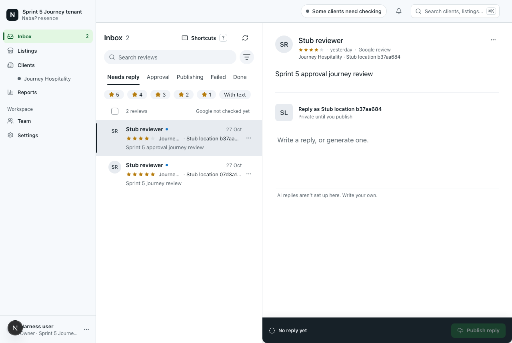            | 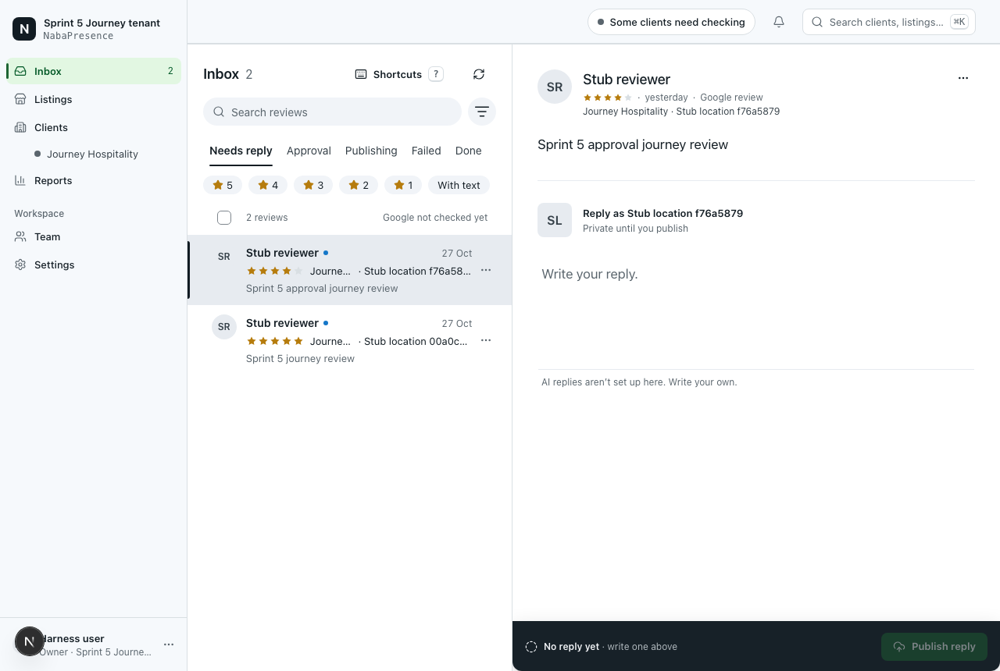            | Placeholder "Write your reply."; footer "No reply yet · write one above"                                    |
| 02 Review detail             | 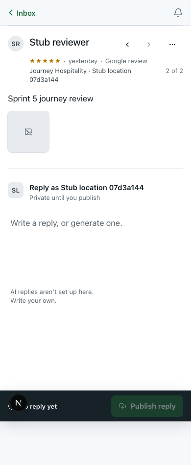                 | 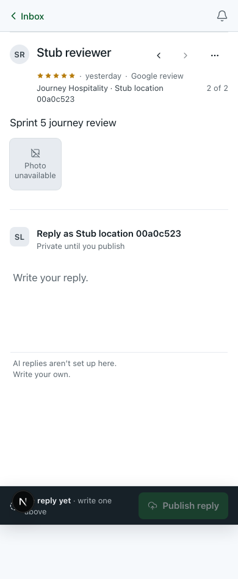                 | Tile reads "Photo unavailable"; new placeholder; footer note wraps to two lines, partly under the dev badge |
| 03 Empty Failed + sort       | 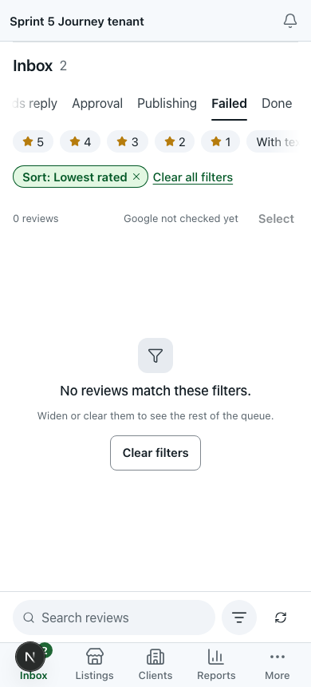           | 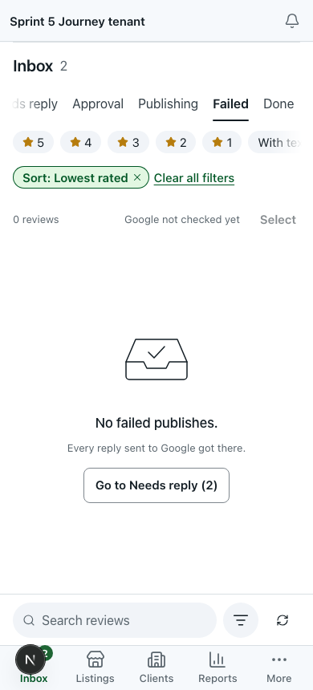           | "No failed publishes." with "Go to Needs reply (2)" instead of "No reviews match these filters."            |
| 03 Empty Failed + sort, 1280 | 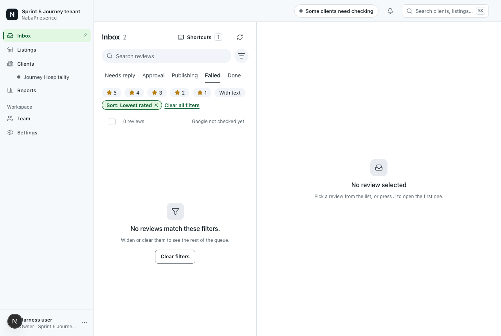     | 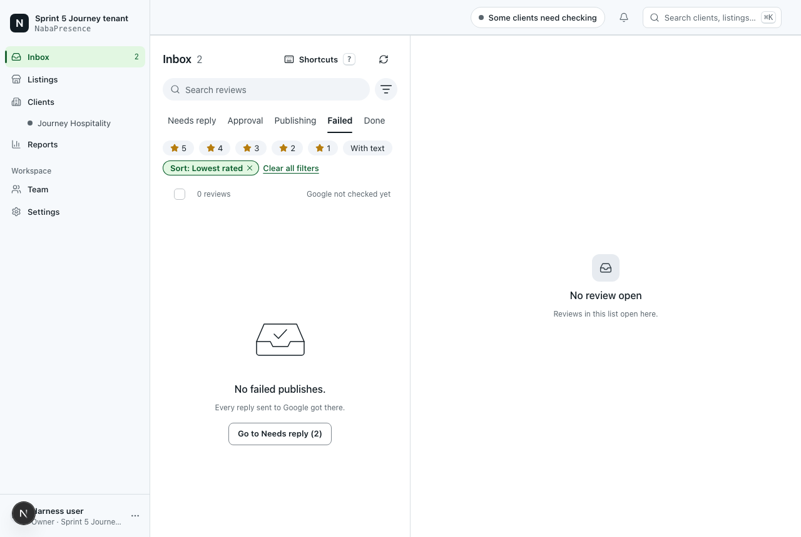     | As above; pane "No review open / Reviews in this list open here." with no J hint                            |
| 04 Search, no match          |            | 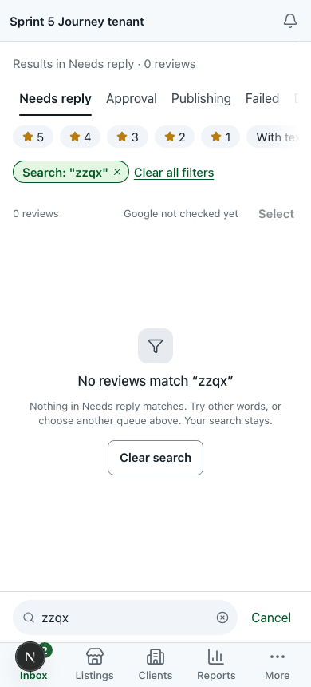           | Names the search and the queue; "Clear search" instead of "Clear filters"                                   |
| 04 Search, no match, 1280    |      | 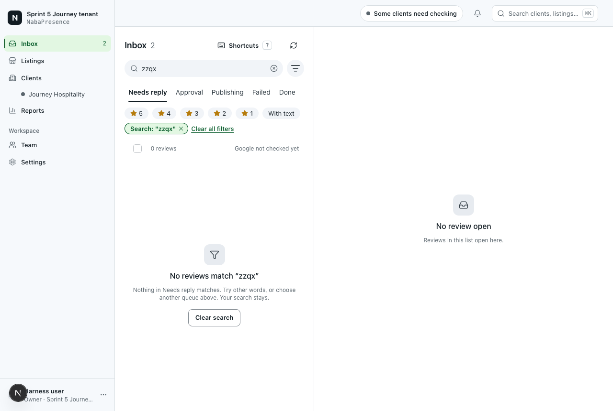     | As above, plus "No review open"; the chip still shows straight quotes (fixed after capture)                 |
| 05 Viewer detail             | 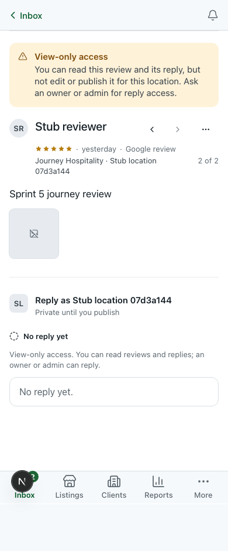          | 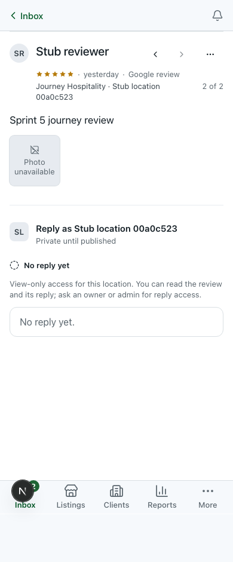          | Amber banner gone; one inline view-only line; "Private until published"; content about 110 px higher        |
| 05 Viewer detail, 390 dark   | 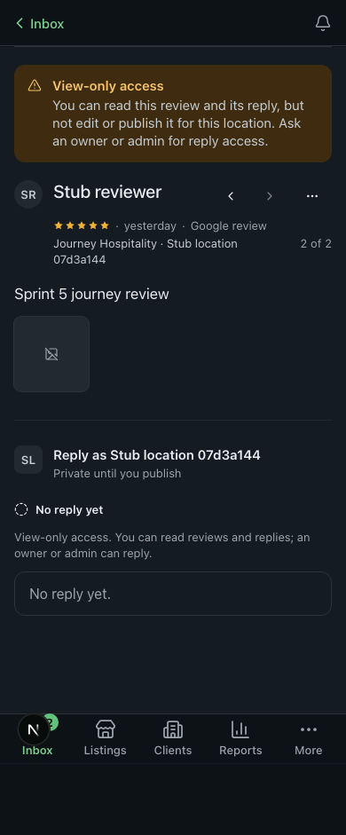 | 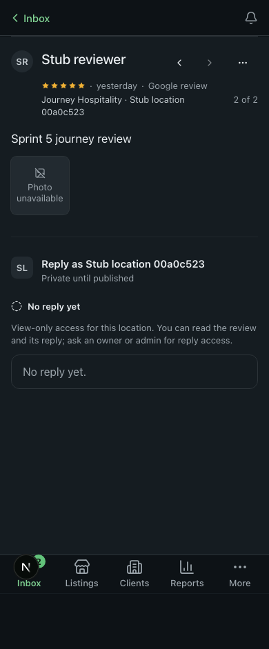 | Same change in dark                                                                                         |
| 06 Notifications, empty      |                 | 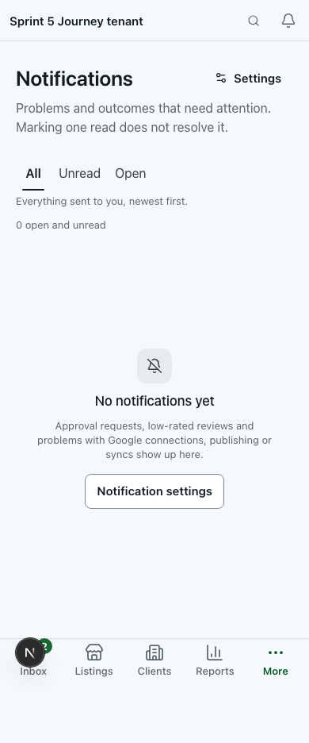                | Empty copy names approval requests and low-rated reviews; duplicate "Notification settings" remains         |
| 08 Calendar off, owner       | 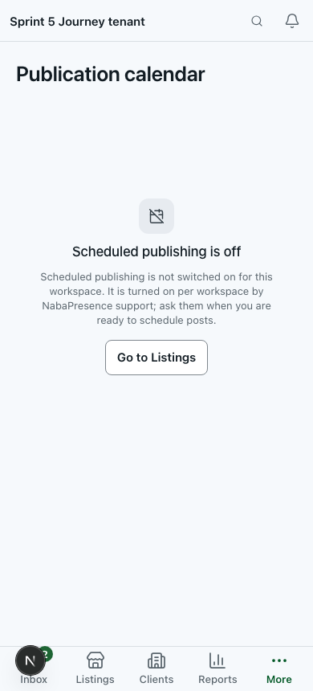           | 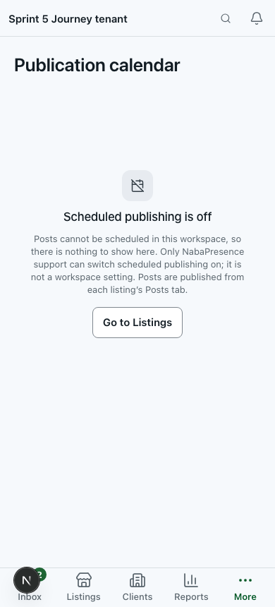           | Says only support can switch it on and it is not a workspace setting                                        |
| 09 Calendar off, viewer      | 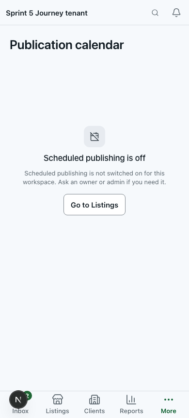          | 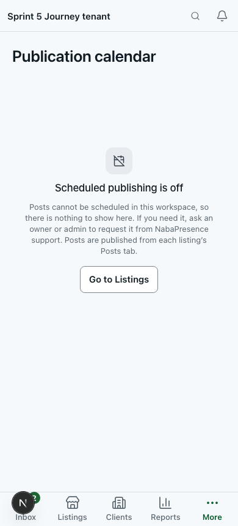          | Asks an owner or admin to request it from support, instead of implying they can switch it on                |
| 10 Reply report              |                 | 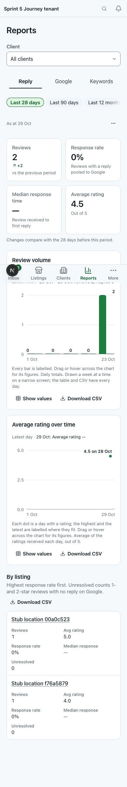                | By-listing description explains "Unresolved"                                                                |
| 12 Keywords                  | 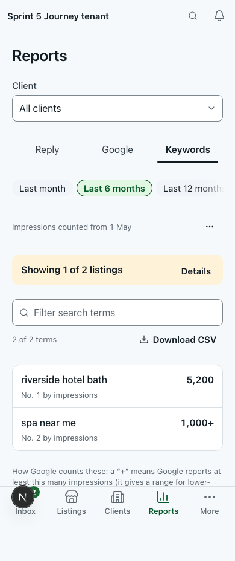             | 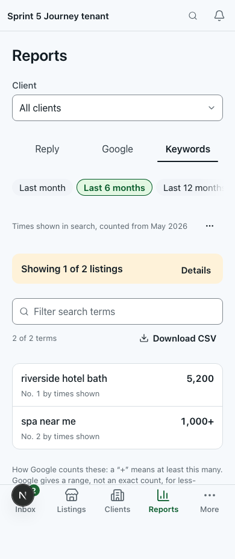             | "Times shown in search, counted from May 2026", "Times shown", "No. n by times shown", shorter footnote     |
| 13 Single listing            |               | 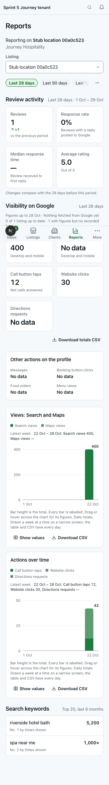              | Keyword ranks "No. n by times shown"; date labels unchanged                                                 |

**Unchanged.** Pixel-identical (ImageMagick `compare -metric AE -fuzz 2%`):
all three shots of 07 (Open filter, empty) and 11 (Google performance), and 10
and 14 at 1280. State 14 at 390 (light and dark) differs from BEFORE only as
state 10 does: the unknown client id still lands silently on All clients. 01
at 390 (light and dark) differs only in seed location suffixes. The dark 390
twins of 02–04, 06, 08–10, 12 and 13 carry the same copy changes as their light
pairs.

Capture artefacts: the dev-only Next "N" badge overlaps the user chip on
desktop and the Inbox tab or composer footer on mobile; at 390 the fixed bottom
nav is painted mid-page in tall Reports captures (same on both sides).

### Measured before and after

| Check                               | Before (`e4123d25`) | After (`8da8cae2`)              | Source                                 |
| ----------------------------------- | ------------------- | ------------------------------- | -------------------------------------- |
| route-js `/inbox`, gzip upper bound | 468.3 KB            | 470.7 KB (+2.4)                 | `evidence/{before,after}/route-js.txt` |
| route-js `/reports`                 | 490.7 KB            | 492.3 KB (+1.6)                 | same                                   |
| route-js `/calendar`                | 457.1 KB            | 460.4 KB (+3.3)                 | same                                   |
| route-js `/notifications`           | 416.7 KB            | 417.6 KB (+0.9)                 | same                                   |
| route-js dashboard shell            | 378.9 KB            | 378.9 KB                        | same                                   |
| `pnpm check:design` token bypasses  | 103                 | 103 (ratchet passed)            | `check:design`                         |
| `pnpm check:contrast`               | all 212 pairs pass  | all 212 pairs pass, both themes | `check:contrast`                       |

Command, both runs exit 0:
`node tests/perf/route-js.mjs --max-chunk 70 --max-shared 400 --max-route 560`.
These are upper bounds from the build, not transfer sizes.

## Change log

R1–R9 are the review fixes in `8da8cae2`; they are folded into the rows they
amend. Files are under `components/` unless a path says otherwise.

| Change                                                   | Before                                                              | After                                                                                                                                                                                                                    | Reason                      | Relevant principle              | Affected files                                                                                                                                                            |
| -------------------------------------------------------- | ------------------------------------------------------------------- | ------------------------------------------------------------------------------------------------------------------------------------------------------------------------------------------------------------------------ | --------------------------- | ------------------------------- | ------------------------------------------------------------------------------------------------------------------------------------------------------------------------- |
| F01-C1 Keep rows on a failed refresh or page (+R2)       | Any error replaced loaded rows; "Queue unavailable"                 | Rows kept; "Couldn’t refresh this list…" + Try again; foot alert for a failed page; an empty list with a failed refresh is the error state (R2)                                                                          | F01-F1; review R2           | Nielsen 9; HIG feedback         | `inbox/inbox-view.tsx`                                                                                                                                                    |
| F01-C2 Load-more focus and end (+R3)                     | `disabled` button, focus lost, two loading signals                  | `aria-disabled` "Load more reviews"; sr-only list line; "That’s every review in {Queue}." takes focus only if lost (R3)                                                                                                  | F01-F2; review R3           | WCAG 2.4.3, 4.1.3               | `inbox/inbox-view.tsx`, `inbox/review-list.tsx`                                                                                                                           |
| F01-C3 / F02-C1 Sort is not a filter; next queue is work | "No reviews match these filters."; offer could be Done              | Empty-reason ignores sort and scope; first queue with work, never Done; honest "all caught up"                                                                                                                           | F01-F4, F01-F5              | Nielsen 1, 2                    | `inbox/inbox-view.tsx`, `inbox/empty-states.tsx`                                                                                                                          |
| F01-C4 / F03-C4 Desk pane matches the list               | "No review selected … or press J" beside an empty list              | "Loading reviews" / "No review open" / "No review selected"; J hint removed                                                                                                                                              | F01-F6                      | Nielsen 1, 5                    | `inbox/inbox-view.tsx`                                                                                                                                                    |
| F01-C5 No false empty on queue switch                    | New queue's empty state from placeholder data                       | Row skeleton and "Loading reviews…" until the server answers                                                                                                                                                             | F01-F3                      | Server authority; Nielsen 1     | `inbox/inbox-view.tsx`                                                                                                                                                    |
| F02-C2 Search and filter empty states                    | One sentence; "Clear filters"                                       | Search: names term and queue, **Clear search** (search only); filters: queue total, **Clear all filters**                                                                                                                | F02-F2, F02-F3              | Nielsen 4, 9                    | `inbox/empty-states.tsx`, `inbox/inbox-view.tsx`                                                                                                                          |
| F02-C3 Focus after clearing                              | Focus to `<body>`; URL `/inbox?`                                    | `onEmpty` sends focus to Filters; URL `/inbox`                                                                                                                                                                           | F02-F4                      | WCAG 2.4.3, 2.4.7               | `inbox/active-filter-chips.tsx`, `inbox/inbox-view.tsx`                                                                                                                   |
| F02-C4 Filters sheet                                     | Rating's location unstated; Clear always shown                      | "Star ratings are the chips above the list."; Clear only when something is on; focus to "Show N reviews"                                                                                                                 | F02-F5                      | Nielsen 6                       | `inbox/more-filters.tsx`                                                                                                                                                  |
| Search chip quotes (final commit)                        | `Search: "zzqx"`                                                    | `Search: “zzqx”`, matching the empty-state heading                                                                                                                                                                       | Consistency                 | Nielsen 4                       | `inbox/active-filter-chips.tsx`                                                                                                                                           |
| F03-C1 Review details                                    | "Not recorded"; "Google profile · verified"; dev footnote           | Reads `review.draft.edited/generated`; "Listing: … · verified on Google"; footnote removed                                                                                                                               | F03-F1, F03-F2              | Nielsen 2, 4                    | `inbox/detail/review-metadata.tsx`, `inbox/review-detail.tsx`                                                                                                             |
| F03-C2 + F06-C6 History labels (+R5)                     | Humanised keys; second heading; "newest last" comment               | Label map with fallback; "N events, newest first"; `publish_requested` = "Publishing started", `delete_requested` = "Deletion started" (R5)                                                                              | F03-F3, F06-F6; review R5   | Nielsen 2; WCAG 1.3.1           | `inbox/activity-timeline.tsx`                                                                                                                                             |
| F03-C3 Failed photo                                      | Icon only; text in `title`                                          | Visible "Photo unavailable" with `aria-describedby`; lightbox explains, links to Google when known                                                                                                                       | F03-F4; DSK-22              | WCAG 1.1.1, 4.1.2               | `inbox/review-detail.tsx`                                                                                                                                                 |
| F03-C5 Gone review                                       | Try again repeats the 404                                           | "This review is no longer available.", no Try again                                                                                                                                                                      | F03-F6                      | Nielsen 9                       | `inbox/review-detail.tsx`                                                                                                                                                 |
| F04-C1 Generate status                                   | "Saving and checking the draft"                                     | "Generating a draft" for a tone-only draft mutation                                                                                                                                                                      | F04-F1                      | Nielsen 1                       | `inbox/review-detail.tsx`                                                                                                                                                 |
| F04-C2 Google-pending wording                            | "Reply published." / "Reply submitted"                              | Announced as pending ("Reply sent to Google."); toast "Reply sent · Google hasn’t confirmed it yet…"                                                                                                                     | F04-F2; INB-01 residue      | Consistency; server authority   | `inbox/action-bar.tsx`, `lib/inbox/actions.ts`                                                                                                                            |
| F04-C3 Next step on the bar (+R7)                        | "No reply yet" / "Publish failed" alone                             | Note by cause and role; submit-only role: "submit it for approval again" (R7); "write one above"                                                                                                                         | F04-F3; review R7           | HIG feedback; WCAG 3.3.1, 3.3.3 | `inbox/review-detail.tsx`                                                                                                                                                 |
| F04-C4 Delete error                                      | Toast behind the modal                                              | `role="alert"` inside the confirm                                                                                                                                                                                        | F04-F4                      | WCAG 4.1.3                      | `inbox/action-bar.tsx`                                                                                                                                                    |
| F04-C5 Contradicting copy                                | "…or generate one" with AI off; viewer banner + line; "you publish" | "Write your reply."; one view-only line; "Private until published"; discard body no longer repeats title                                                                                                                 | F04-F5; INB-14 residue      | Nielsen 2, 8                    | `inbox/reply-composer.tsx`, `inbox/detail/reply-exception.tsx`, `inbox/review-detail.tsx`, `inbox/dirty-context.tsx`                                                      |
| F05-C1 Save and take out of approval                     | No Save; ⌘↵ approved off-screen text                                | Edited parked reply: no Approve/Send back; one primary **Save and take out of approval** via the composer's existing save; local toast after success                                                                     | F05-F1; INB-04              | Error prevention; user control  | `inbox/action-bar.tsx`, `inbox/review-detail.tsx`, `inbox/reply-composer.tsx`                                                                                             |
| F05-C2 Parked state said once (+R8)                      | Said 3–4 times; hidden ⋯ instruction                                | Subline "Not sent to Google until it’s approved" (R8); visible "Edit reply" button                                                                                                                                       | F05-F2; INB-15; review R8   | HIG clarity; Nielsen 6          | `inbox/review-detail.tsx`, `inbox/reply-composer.tsx`                                                                                                                     |
| F05-C3 Send back (+R6)                                   | "Reject reply", danger fill; "Approving…" during reject             | **Send back**, default fill, same confirm and note cap; dialog "Your note is shown on this review, with your name." (R6)                                                                                                 | F05-F4; review R6           | Nielsen 4                       | `inbox/action-bar.tsx`, `inbox/detail/reply-exception.tsx`, `lib/inbox/reply-state.ts`                                                                                    |
| F05-C4 One meaning per phrase                            | "Approval required" for both sides                                  | "Waiting for your approval" / "Ready to submit for approval"                                                                                                                                                             | F05-F3                      | Nielsen 2                       | `lib/inbox/reply-state.ts`, `inbox/detail/reply-exception.tsx`                                                                                                            |
| F05-C5 Approver's empty Needs reply                      | "Nothing needs a reply." beside "Inbox 1"                           | "{n} replies are waiting for your approval." + **Review your approvals (n)**                                                                                                                                             | F05-F5; `results.md:367`    | Nielsen 1, 2                    | `inbox/inbox-view.tsx`, `inbox/empty-states.tsx`                                                                                                                          |
| F05-C6 `review_changed` on Approve                       | "Re-verify the draft…"                                              | "…It has been reloaded. Read it, then approve or send back." (local override)                                                                                                                                            | F05-F6                      | Nielsen 9                       | `inbox/action-bar.tsx`                                                                                                                                                    |
| F06-C1 Done row label                                    | Bold "Needs reply" with dot                                         | "No reply needed", neutral, no dot                                                                                                                                                                                       | F06-F1                      | Nielsen 1                       | `inbox/review-list.tsx`                                                                                                                                                   |
| F06-C2 Assign outcome                                    | "1 review updated"; "The bar lists…"                                | Names assignee; per-code reason for a failed row                                                                                                                                                                         | F06-F3                      | Nielsen 1, 9                    | `inbox/review-triage.tsx`, `inbox/review-detail.tsx`                                                                                                                      |
| F06-C4 Offer only what fits                              | Offered on published reviews and in Done                            | Hidden there; disabled while in flight                                                                                                                                                                                   | F06-F4                      | Nielsen 5                       | `inbox/review-list.tsx`, `inbox/review-detail.tsx`                                                                                                                        |
| F06-C5 Focus after a row leaves                          | Focus to `<body>`                                                   | Row now at that index takes focus, only if focus was lost                                                                                                                                                                | F06-F5                      | WCAG 2.4.3                      | `inbox/review-list.tsx`                                                                                                                                                   |
| F07-C1 Stale outcome and receipt                         | Old notes reappear; batch link lost                                 | Outcome cleared on each run; inline receipt with **Follow batch** for a fully queued run                                                                                                                                 | F07-F1, F07-F2              | Nielsen 1, 6                    | `inbox/bulk-action-bar.tsx`, `inbox/lazy-bulk-action-bar.tsx`                                                                                                             |
| F07-C2 Narrow the selection (+R9)                        | Every row stayed ticked                                             | Only rows not `ok`/`queued` stay ticked, including client-skipped rows; a selection cancelled during the run stays cancelled (R9)                                                                                        | F07-F3; review R9           | Nielsen 1, 9                    | `inbox/bulk-action-bar.tsx`                                                                                                                                               |
| F07-C3 Progress and titles                               | Tiles only go grey; "N reviews updated"                             | "Approving…"/"Marking…" + status region; "N replies approved and sent to Google" only when every row is `ok`                                                                                                             | F07-F4                      | Nielsen 1; WCAG 4.1.3           | `inbox/bulk-action-bar.tsx`, `inbox/review-triage.tsx`                                                                                                                    |
| F07-C4 Engine template dialog                            | Two-step copy; "Reply to N"; empty "starting"                       | One-press copy; "Send N replies"; "Queuing N replies…" with pending button; setup failure wording                                                                                                                        | F07-F5, F07-F6              | Nielsen 1, 5                    | `inbox/template-reply-dialog.tsx`                                                                                                                                         |
| F07-C5 Select-all scope                                  | "Select every review in this view"                                  | "Select all loaded reviews"; note when more exist (`hasMore`)                                                                                                                                                            | F07-F7                      | Nielsen 2                       | `inbox/list-header.tsx`, `inbox/inbox-view.tsx`, `inbox/bulk-action-bar.tsx`, `inbox/lazy-bulk-action-bar.tsx`                                                            |
| F07-C6 Skip reasons                                      | Count only                                                          | Counted reasons; same four predicates                                                                                                                                                                                    | F07-F8                      | Nielsen 2, 9                    | `inbox/bulk-action-bar.tsx`                                                                                                                                               |
| F08-C1 Sync progress                                     | Spinner in an icon                                                  | Loading toast replaced in place by the result                                                                                                                                                                            | F08-F1                      | WCAG 4.1.3; HIG feedback        | `inbox/sync-reviews-button.tsx`                                                                                                                                           |
| F08-C2 Sync result copy                                  | Skipped as error; all-or-nothing; vague 429/504                     | Info for skipped; partial warning; wait in minutes; "may still be finishing"                                                                                                                                             | F08-F2–F4                   | Nielsen 2, 9                    | `inbox/sync-reviews-button.tsx`                                                                                                                                           |
| F08-C3 Retry in the toast                                | None                                                                | Try again on transient failures only, on tap                                                                                                                                                                             | F08-F5                      | Nielsen 9                       | `inbox/sync-reviews-button.tsx`                                                                                                                                           |
| F08-C4 Freshness                                         | Neutral text; "Just now"                                            | " · reconnect needed" etc. in warning ink; "just now"                                                                                                                                                                    | F08-F6                      | Nielsen 1                       | `inbox/google-freshness.tsx`                                                                                                                                              |
| F09-C1 Mark read                                         | "Mark N shown as read"                                              | "Mark N read"                                                                                                                                                                                                            | F09-F1; follow-up 24        | Nielsen 2                       | `notifications/notifications-view.tsx`                                                                                                                                    |
| F09-C2 Account links                                     | No link, no login named                                             | "Open Google connections" / "See AI credits"; Google login as subtitle                                                                                                                                                   | F09-F2                      | Nielsen 6                       | `notifications/notifications-view.tsx`, `app/(dashboard)/notifications/page.tsx`                                                                                          |
| F09-C3 Load-more error placement                         | Top banner, second Try again                                        | Bottom alert with one Try again                                                                                                                                                                                          | F09-F3                      | WCAG 3.3.1; Nielsen 9           | `notifications/notifications-view.tsx`                                                                                                                                    |
| F09-C4 Focus and busy                                    | `disabled`; focus lost                                              | `pending` buttons; focus restored only when lost                                                                                                                                                                         | F09-F4                      | WCAG 2.4.3, 4.1.3               | `notifications/notifications-view.tsx`                                                                                                                                    |
| F09-C5 Empty and Unread copy                             | Out of date                                                         | Names approvals and low-rated reviews; Unread "resolved ones included"                                                                                                                                                   | F09-F5, F09-F6; INB-05      | Nielsen 1, 2                    | `notifications/notifications-view.tsx`                                                                                                                                    |
| F10-C1 Resolving…                                        | "Resolved" while pending                                            | Dashed "Resolving…", no time; "Resolved" after the server confirms                                                                                                                                                       | F10-F1                      | Server authority; HIG feedback  | `notifications/notifications-view.tsx`                                                                                                                                    |
| F10-C2 Confirm semantics (partial)                       | Caption untied; no Escape                                           | Caption described on both buttons; Escape cancels; initial focus unchanged                                                                                                                                               | F10-F2, F10-F3              | WCAG 1.3.1, 2.1.1               | `notifications/notifications-view.tsx`                                                                                                                                    |
| F10-C3 Announce resolve                                  | Silent                                                              | Polite "{label} resolved for everyone." after acceptance                                                                                                                                                                 | F10-F4                      | WCAG 4.1.3                      | `notifications/use-notification-changes.ts`, `notifications/notifications-view.tsx`                                                                                       |
| F10-C4 Refusal copy                                      | Generic; untrue 409                                                 | Names the item and the real cause per code                                                                                                                                                                               | F10-F5                      | Nielsen 9                       | `notifications/use-notification-changes.ts`, `notifications/notifications-view.tsx`                                                                                       |
| F10-C5 Who resolves                                      | Silent "Open"                                                       | "Clears on its own…" / "An owner or admin can resolve this."                                                                                                                                                             | F10-F6                      | Nielsen 1, 6                    | `notifications/notifications-view.tsx`                                                                                                                                    |
| F11-C1 Period summary                                    | Blank grid; filter-blind agenda copy                                | Count line or "Nothing scheduled in …" with a next step                                                                                                                                                                  | F11-F1, F11-F2              | Nielsen 1, 3; WCAG 4.1.3        | `calendar/publication-calendar.tsx`, `calendar/calendar-grid.tsx`                                                                                                         |
| F11-C2 "+N more"                                         | Plain text                                                          | Button to Agenda at that day; label-in-name kept                                                                                                                                                                         | F11-F3                      | WCAG 2.1.1, 2.5.3, 2.5.8        | `calendar/calendar-grid.tsx`, `calendar/publication-calendar.tsx`                                                                                                         |
| F11-C3 Visible problem statuses                          | sr-only status; info badge                                          | Second line for problem statuses; attention badge with icon                                                                                                                                                              | F11-F4                      | Nielsen 1; WCAG 1.4.1           | `calendar/calendar-grid.tsx`                                                                                                                                              |
| F11-C4 Loading in place                                  | List skeletons on each step                                         | Inert grid of the new period behind a status; no old entries                                                                                                                                                             | F11-F5                      | HIG preserve context            | `calendar/publication-calendar.tsx`                                                                                                                                       |
| F11-C5 Header and destination                            | Long header; zone always named                                      | Says where rows lead; zone only when it differs                                                                                                                                                                          | F11-F6, F11-F7              | WCAG 2.4.4, 3.3.2               | `calendar/publication-calendar.tsx`, `calendar/calendar-grid.tsx`                                                                                                         |
| F11-C6 Stale filter ids (+R4)                            | 400 forever; silent filtering                                       | Ids checked before the first request; one request; a dropped id is said (R4)                                                                                                                                             | F11-F8; review R4           | Nielsen 5, 9                    | `calendar/publication-calendar.tsx`                                                                                                                                       |
| F12-C1 Off-state copy                                    | "ask them"; owner can switch it on                                  | Only support can; not a workspace setting; no channel invented                                                                                                                                                           | F12-F1–F3; LST-28           | Nielsen 2, 10                   | `calendar/publication-calendar.tsx`                                                                                                                                       |
| F12-C2 Role tests                                        | Owner only; session stub did not parse                              | Admin, member, viewer, scoped and business hrefs                                                                                                                                                                         | F12-F4                      | —                               | `tests/components/publication-calendar.test.tsx`                                                                                                                          |
| F12-C3 Load errors                                       | 5xx blamed Google; every 4xx retried once                           | Own-service 5xx copy; `shouldRetryQuery` rule                                                                                                                                                                            | F12-F5, F12-F6              | Nielsen 9                       | `calendar/publication-calendar.tsx`                                                                                                                                       |
| F12-C4 Announced off state                               | Silent swap                                                         | `role="status"` only on the route-answered swap                                                                                                                                                                          | F12-F7                      | WCAG 4.1.3                      | `calendar/publication-calendar.tsx`                                                                                                                                       |
| F13-C1 / F15-C3 "period"                                 | "this window"                                                       | "this period"                                                                                                                                                                                                            | F13-F4; follow-up 8         | Nielsen 2, 4                    | `reporting/reporting-states.tsx`, `performance/keywords-tab.tsx`, `performance/location-performance.tsx`                                                                  |
| F13-C2 Keep figures on refetch failure                   | Full error panel                                                    | Figures kept with a labelled warning and Try again                                                                                                                                                                       | F13-F1                      | HIG preserve context; Nielsen 9 | `reporting/reporting-states.tsx`, `performance/reply-performance-tab.tsx`, `performance/google-performance-tab.tsx`                                                       |
| F13-C3 Comparison failure                                | Deltas vanish                                                       | Note + Try again via opt-in `comparisonNote`                                                                                                                                                                             | F13-F3                      | Nielsen 1, 9                    | `performance/reply-performance-tab.tsx`, `reporting/reply-figures.tsx`                                                                                                    |
| F13-C4 "Unresolved"                                      | Unexplained                                                         | Explained in the table description                                                                                                                                                                                       | F13-F5                      | Nielsen 2, 6                    | `performance/reply-performance-tab.tsx`                                                                                                                                   |
| F13-C5 No-listings panel                                 | "Add one" with "Open {client}" for all                              | Owner/admin: **Add listings from Google**; others told who can                                                                                                                                                           | F13-F6                      | Nielsen 3, 9                    | `performance/performance-view.tsx`                                                                                                                                        |
| F13-C6 Phone skeleton                                    | Description line, no chips                                          | Description desk-only; 4 chip placeholders on phone                                                                                                                                                                      | F13-F7                      | CLR-08 rule                     | `reporting/reports-skeleton.tsx`                                                                                                                                          |
| F14-C1 One noun                                          | "locations" in business                                             | "listing(s)" throughout Reports components                                                                                                                                                                               | F14-F1; follow-up 28        | Nielsen 4                       | `performance/performance-view.tsx`, `performance/location-report.tsx`, `performance/report-scope.tsx`                                                                     |
| F14-C2 Ways back keep context                            | Fixed hrefs lose tab and period                                     | Keep params except `locationId`/`selected`                                                                                                                                                                               | F14-F2                      | HIG; Nielsen 3                  | `performance/location-report.tsx`, `performance/report-scope.tsx`                                                                                                         |
| F14-C3 Period note                                       | "This tab…", phone only                                             | "This report counts in days: …", every width                                                                                                                                                                             | F14-F3; CLR-24              | Nielsen 1, 2                    | `performance/location-report.tsx`                                                                                                                                         |
| F14-C5 Not-found copy                                    | "isn’t in your directory"                                           | "We can’t find this client/listing"; "Show all …"                                                                                                                                                                        | F14-F6                      | Nielsen 2, 9                    | `performance/report-scope.tsx`                                                                                                                                            |
| F15-C1 Refresh result (+R1)                              | Always "Refresh started" + up to 90 s "Refreshing…"                 | Envelope read: "Refreshed…" (figures "include this check"), "Nothing to refresh yet" or partial warning; truncated, cap reached (R1) or unreadable → "Refresh started" + polling; "Still waiting for Google…" at timeout | F15-F1; R13 note; review R1 | HIG feedback; Nielsen 1         | `performance/refresh-google-button.tsx`, `lib/api/sync.ts`, `reporting/report-actions-menu.tsx`, `performance/google-performance-tab.tsx`, `performance/keywords-tab.tsx` |
| F15-C2 Keywords wording                                  | "Impressions counted from 1 Mar 2026"                               | "Times shown in search, counted from March 2026" (ready/empty only); "Times shown"; CSV headers unchanged                                                                                                                | F15-F2; follow-up 8         | Nielsen 2                       | `performance/keywords-tab.tsx`, `performance/keywords-table.tsx`                                                                                                          |
| F15-C4 Unavailable and off                               | "Some…" above "Nothing…"; "Ask an admin"; dead Refresh              | "…could not be refreshed"; off is not an org setting; Refresh hidden when ingestion is off                                                                                                                               | F15-F4, F15-F5              | Nielsen 1, 2                    | `performance/google-performance-tab.tsx`, `performance/keywords-tab.tsx`                                                                                                  |
| F15-C5 Quiet Keywords period                             | Dead end                                                            | "Show the last 12 months" for 1m/6m                                                                                                                                                                                      | F15-F6                      | Nielsen 3                       | `performance/keywords-tab.tsx`, `performance/performance-view.tsx`                                                                                                        |
| F16-C1 CSV names                                         | No scope or dates                                                   | Opt-in `ReportExportScope` adds scope and dates                                                                                                                                                                          | F16-F1                      | HIG clarity; Nielsen 6          | `reporting/csv-download-button.tsx`, `performance/*` tabs and views                                                                                                       |
| F16-C2 Download feedback                                 | Silent; uncaught exception                                          | "Downloading {file}" status; visible failure alert (inside a scope only)                                                                                                                                                 | F16-F2                      | Nielsen 1, 9; WCAG 4.1.3        | `reporting/csv-download-button.tsx`                                                                                                                                       |
| F16-C4 Share picker                                      | Health; dead-end error                                              | Listing counts; "No listings yet…"; loading status; Try again                                                                                                                                                            | F16-F4                      | Nielsen 9                       | `reporting/report-actions-menu.tsx`                                                                                                                                       |

## Core preservation

| Protected rule                            | How it stays intact                                                                                                                                                                                                                                                                                                                                                                                                                                                                                                                        | Evidence                                                                                                                                                                                                                                             |
| ----------------------------------------- | ------------------------------------------------------------------------------------------------------------------------------------------------------------------------------------------------------------------------------------------------------------------------------------------------------------------------------------------------------------------------------------------------------------------------------------------------------------------------------------------------------------------------------------------ | ---------------------------------------------------------------------------------------------------------------------------------------------------------------------------------------------------------------------------------------------------- |
| Server code, contracts, schema, providers | Nothing changed under `app/api`, `lib/server` or migrations. The only `lib/` edits are additive types and copy (see [Shared-file edits](#shared-file-edits)); `app/(dashboard)/notifications/page.tsx` only passes the existing billing flag for a link.                                                                                                                                                                                                                                                                                   | `git diff e4123d25..8da8cae2 --stat` (74 files)                                                                                                                                                                                                      |
| Roles and gates                           | `canBatch`, `role !== "viewer"` triage, `canTriggerSync`, `canShare` and server-derived `canResolve` unchanged. New links (Add listings, account links) appear only for roles the target route already admits.                                                                                                                                                                                                                                                                                                                             | Component tests; `business-mode.spec.ts`, `journeys.spec.ts`                                                                                                                                                                                         |
| **F05-C1** two-person approval            | Approve still sends `{decision, draftId: shownDraft.id, expectedReviewUpdateTime}`; Send back is still unbound, confirmed, ≤2,000 characters. Save only hides Approve and Send back while the on-screen text differs from the parked draft. It calls the composer's existing drafts save, which the server already allows from `awaiting_approval` to `drafted`. No new endpoint, permission or call. `a`/⌘↵ still click the primary through the disabled/`aria-busy` guard. Toast is local and only after a successful, non-failing save. | `action-bar.test.tsx` "replaces Approve with Save while a parked reply is edited" (approval never called), Approve kept with no edits, binding assertions kept; the approval journeys in `inbox.spec.ts` and `journeys.spec.ts` (e2e, unedited flow) |
| Publish and server authority              | One-press save → check → publish, stale re-verify-once and MFA step-up unchanged. Toasts come only from resolved statuses. Google-pending is announced as pending, so auto-advance still follows `isAdvancingOutcome`.                                                                                                                                                                                                                                                                                                                     | `inbox-actions.test.ts`, `action-bar.test.tsx`, `review-detail.test.tsx`; `inbox.spec.ts`, `journeys.spec.ts`                                                                                                                                        |
| **F07** bulk selection and idempotency    | `useRetryIntents`, template intents and the `pendingDraftId ?? draftId` binding are untouched; `skipReason` keeps the same four predicates. A thrown or uncertain batch returns before any selection change. Narrowing happens only after per-row server answers; client-skipped rows stay ticked; a cancelled selection stays cancelled (R9). `queued` is never called sent.                                                                                                                                                              | `bulk-action-bar.test.tsx` (partial narrows to the failed row, receipt, pending; R9: "leaves a selection cancelled while the run was out")                                                                                                           |
| Sync budget and authority                 | Same owner/admin gate, same empty POST, one toast id (progress shares it). Try again runs only on tap and is withheld for 429, pause, 403 and reconnect, so it cannot drain `sync_manual`.                                                                                                                                                                                                                                                                                                                                                 | `sync-reviews-button.test.tsx` (single toast, Try again sends a second request only on tap); `touch-critical.spec.ts` waits for the result toast                                                                                                     |
| **F10-C1** resolve                        | "Resolving…" only reads the existing pending list; `PendingChange` and `lib/notifications/*` untouched. "Resolved" and the announcement wait for `onSuccess`; a refusal rolls back to "Open". Confirm-before-request, role gate and no reopen unchanged.                                                                                                                                                                                                                                                                                   | `operational-notifications.test.tsx` (held resolve shows "Resolving…", never "Resolved" before release; no announcement on refusal); `operations-features.spec.ts` waits for "Resolved"                                                              |
| Notification kinds                        | Kinds, labels, recipients and links unchanged; account links only on account-scoped kinds that only owners and admins receive.                                                                                                                                                                                                                                                                                                                                                                                                             | `notifications-review-links.test.tsx`                                                                                                                                                                                                                |
| **F15-C1** refresh result                 | Same request, endpoints and D7 labels. A result is said only after the POST resolves and `invalidateQueries` has awaited the re-read. Counts are the server's `outcomes`. Truncated, cap-reached (R1) or unreadable answers fall back to "Refresh started" with polling. "Refreshed" no longer claims the figures are "the latest".                                                                                                                                                                                                        | `refresh-google-button.test.tsx` (envelope toasts, truncated → "Refresh started"; R1: "refreshResultToast at the per-request listing cap", 25 performance and 10 keywords listings), `report-loading-refresh.test.tsx`                               |
| Calendar authority                        | Off latch, `enabled: !off` and the 404 short-circuit unchanged. Ids are checked before the first request, so one request goes out (R4); visibility stays server-side. Still read-only.                                                                                                                                                                                                                                                                                                                                                     | `publication-calendar.test.tsx` (off latch, unpickable id never sent and said)                                                                                                                                                                       |
| Reports honesty and shared report         | "—" never 0; CSV rows, formula guard, BOM and object URL untouched. `ReportExportScope` and `comparisonNote` are opt-in and absent in `components/share/*`.                                                                                                                                                                                                                                                                                                                                                                                | `reporting-honesty.test.tsx`, `csv-download-button.test.tsx`; `reports.spec.ts`                                                                                                                                                                      |
| URL state and dirty guard                 | `replaceUrl`/`push` as before; Clear keeps `clientId` and a dirty review; "Clear search" uses `onFilterChange`.                                                                                                                                                                                                                                                                                                                                                                                                                            | `inbox-view.test.tsx`; `inbox-shallow-url.spec.ts`, `inbox-history.spec.ts`                                                                                                                                                                          |
| First-load JS                             | No new heavy eager imports.                                                                                                                                                                                                                                                                                                                                                                                                                                                                                                                | route-js above                                                                                                                                                                                                                                       |

## Verification

All gates ran on 28 Oct 2026 on `8da8cae2` unless noted.

| Check                                                                                                                       | Type                      | Result                                                                                                                                                                                                                                                                              |
| --------------------------------------------------------------------------------------------------------------------------- | ------------------------- | ----------------------------------------------------------------------------------------------------------------------------------------------------------------------------------------------------------------------------------------------------------------------------------- |
| `pnpm verify`                                                                                                               | Source + unit + component | **Passed** (exit 0): typecheck clean; eslint 0 warnings; format check clean (74 changed files); Vitest 625 files passed / 1 skipped, 8,601 tests passed / 1 skipped on `8da8cae2`, and 8,605 passed / 1 skipped on the final head (with the R1 and R9 tests); design ratchet passed |
| `pnpm check:design`                                                                                                         | Source                    | **Passed**: 103 token bypasses before and after                                                                                                                                                                                                                                     |
| `pnpm check:contrast`                                                                                                       | Source                    | **Passed**: all 212 pairs, both themes                                                                                                                                                                                                                                              |
| `pnpm build` (webpack)                                                                                                      | Build                     | **Passed**                                                                                                                                                                                                                                                                          |
| `pnpm test:e2e:touch`                                                                                                       | Fixture-browser e2e       | **Passed**: 23                                                                                                                                                                                                                                                                      |
| `pnpm test:a11y`                                                                                                            | Fixture-browser e2e (axe) | **Passed**: 64                                                                                                                                                                                                                                                                      |
| `inbox.spec.ts`, `inbox-shallow-url.spec.ts`, `inbox-history.spec.ts`, `journeys.spec.ts`, `approval-notifications.spec.ts` | Fixture-browser e2e       | **Passed**: 40                                                                                                                                                                                                                                                                      |
| `operations-features.spec.ts`, `reports.spec.ts`, `business-mode.spec.ts`, `routing.spec.ts`                                | Fixture-browser e2e       | **Passed**: 72                                                                                                                                                                                                                                                                      |
| BEFORE capture (`e4123d25`) and AFTER capture (`8da8cae2`)                                                                  | Screenshots               | **Passed**: 42 + 42, all HTTP 200, no horizontal overflow, no console errors                                                                                                                                                                                                        |
| route-js before and after                                                                                                   | Build analysis            | **Passed**: both exit 0                                                                                                                                                                                                                                                             |
| Search-chip curly quotes (final commit)                                                                                     | Source + unit test        | **Passed**: `active-filter-chips.test.tsx` 14 passed, and in the final `pnpm verify`; not in the e2e runs or the screenshots                                                                                                                                                        |
| Independent review                                                                                                          | Read-only review          | 0 P0, 2 P1, 7 P2, 12 P3; all P1–P2 fixed (below)                                                                                                                                                                                                                                    |
| Full e2e suite                                                                                                              | Fixture-browser e2e       | **Not run** (the integrator runs CI on the combined head)                                                                                                                                                                                                                           |
| Integration tests                                                                                                           | DB-backed                 | **Not run** (no server code changed)                                                                                                                                                                                                                                                |
| perf-lab                                                                                                                    | Performance               | **Not run**: follow-up 29 not re-measured                                                                                                                                                                                                                                           |
| `audit:mobile`                                                                                                              | Audit                     | **Not run**                                                                                                                                                                                                                                                                         |
| Real devices, VoiceOver, TalkBack                                                                                           | Manual                    | **Not run**                                                                                                                                                                                                                                                                         |
| Live Google journey                                                                                                         | Provider-backed           | **Not run**: every e2e and capture used stubbed Google                                                                                                                                                                                                                              |

All e2e results are fixture-browser tests with stubbed Google. They are not
proof of the live journey. Populated notifications, the calendar's on state,
approval, bulk, sync and refresh states are evidenced by component and e2e
tests, not by screenshots.

`next dev` rewrote the tracked `AGENTS.md` agent-rules block when it started.
It was reverted and not committed.

### Review response

The independent review (fresh context, given only the diff of `0218aa35` and
the protected list) found 0 P0, 2 P1, 7 P2 and 12 P3. All P1 and P2 findings
were fixed in `8da8cae2`.

| Finding                                                                                                   | Severity | Fix                                                                                                                 | Evidence                                                                      |
| --------------------------------------------------------------------------------------------------------- | -------- | ------------------------------------------------------------------------------------------------------------------- | ----------------------------------------------------------------------------- |
| R1 refresh says "Refreshed … latest" when the server stopped at its 25/10 listing cap without `truncated` | P1       | Reaching the cap is "Refresh started" and polling continues; no "latest" claim; `lib/api/sync.ts` comment corrected | Unit: `refresh-google-button.test.tsx` cap cases                              |
| R2 empty list + failed refresh shows "all caught up"                                                      | P1       | Error state when a refetch fails over an empty list                                                                 | Source only                                                                   |
| R3 load-more focus can jump out of the composer                                                           | P2       | Flag spent when the page settles; focus moves only if lost                                                          | Source only                                                                   |
| R4 calendar sends an id, then widens silently once lists load                                             | P2       | Ids checked before the first request; a dropped filter is said                                                      | `publication-calendar.test.tsx`                                               |
| R5 history states a send that may not have happened                                                       | P2       | "Publishing started", "Deletion started"                                                                            | Source only                                                                   |
| R6 send-back note audience overstated as private                                                          | P2       | "Your note is shown on this review, with your name."                                                                | Source only                                                                   |
| R7 submit-only role told to retry or publish                                                              | P2       | "submit it for approval again" (or edit first for content)                                                          | `review-detail.test.tsx`                                                      |
| R8 parked edit claims privacy while the old reply is live                                                 | P2       | "Not sent to Google until it’s approved"                                                                            | `review-detail.test.tsx`                                                      |
| R9 client-skipped rows unticked; Cancel overridden                                                        | P2       | Skipped rows stay ticked; a cancelled selection stays cancelled                                                     | Component: `bulk-action-bar.test.tsx` (the cancel case fails without the fix) |
| R10–R21                                                                                                   | P3       | Left as follow-ups                                                                                                  | See [Follow-ups](#outcome-and-follow-ups)                                     |

The R1–R9 fixes passed the gate runs above, which were on `8da8cae2`. Four of
them (R2, R3, R5 and R6) have no assertion of their own yet.

## Shared-file edits

- `lib/api/sync.ts`: additive `ManualSyncResult` return type and comment;
  `triggerReviewSync` unchanged.
- `lib/inbox/actions.ts` and `lib/inbox/reply-state.ts`: copy and a "sent"
  toast; only inbox components import them.
- No edits to `components/ui/*`, `components/app-shell/*`, layouts,
  `app/globals.css`, `lib/workspace/terms.ts` or `lib/errors/action-errors.ts`.
- Shared e2e specs touched only on the lines for this area's strings:
  `journeys.spec.ts` (1 line), `touch-critical.spec.ts` (1 line, waits for the
  sync result toast), `operations-features.spec.ts` (calendar agenda empty copy
  and a comment).
- Components also rendered by the public shared report
  (`components/reporting/*`): only the "this period" wording reaches it. CSV
  naming is opt-in via `ReportExportScope`, which the shared report does not
  use.

## Outcome and follow-ups

**Demonstrated** (matched fixture screenshots, component tests and
fixture-browser e2e): the inbox's empty, search and sorted states say what is
true and offer the next piece of work; a viewer reads "view-only" once; failed
refreshes keep rows and figures and say so; an edited parked reply can be
saved and cannot be approved unseen; resolve and Google refresh are not shown
as finished before the server says so; calendar off-state and Reports wording
match what the product does; server calls, gates, approval binding,
idempotency and notification kinds are unchanged. No completion-rate, timing
or error-rate effect is claimed; H1–H4 remain hypotheses.

**Deferred owner decisions.**

- F04-C6 save path for edit-only users; F06-C3 auto-advance after "No reply needed".
- F08-C5 visible desk "Sync" label (hypothesis).
- F08-C6 pull-to-refresh (follow-up 25): needs shared shell/CSS changes and spends the 10-per-10-min manual sync limit.
- F10-C2 initial focus to Cancel on the resolve confirm; F16-C3 a visible Share button.
- F14-C4 phone scope/period caption; F13-C7 rating readout and "—" tile reasons; F15-C6 provenance sheet as a list.
- F03-C6 hotkey dialog and making J open the first review (the false hint was removed instead).
- F11-C5(c) `#post-schedules` deep link, untested in a browser.
- D10 support channel for LST-28 ("Contact support").
- **Blocked:** wording an auto-retried publish honestly needs an API field (F04).

**Needs from other areas (not done).** Business `terms.reportsDescription`
says "locations" (`lib/workspace/terms.ts`). The business app-bar scope chip
says "All locations" (`components/app-shell/scope-sheet-model.tsx`).
`lib/reporting/unavailable-reasons.ts` says "This location…". The bulk bar
could pass the assignee name for "3 reviews assigned to Priya".

**Review P3s left as follow-ups** (`REVIEW.md`):

- R10 "Nothing to refresh yet" usually means already up to date; name failed listings.
- R11 `nextStepNote` branches on the display text "No reply yet".
- R12 freshness names the first `action_needed` listing, not the worst.
- R13 the resolve announcement is never cleared; a repeat may be silent.
- R14 "once the problem is fixed" also shows on approval kinds.
- R15 the sheet's Clear counts sort as a filter; the empty state does not.
- R16 a failed check on "Save and take out of approval" does not say the reply left approval.
- R17 the `review_changed` toast says "reloaded" before the refetch lands.
- R18 `leavingRow` can linger and move focus on a later removal.
- R19 "Review your approvals" opens the legacy `awaiting_my_approval` queue.
- R20 the table description no longer says "—" is never zero.
- R21 the bulk receipt can read "0 replies are queued".

**Observed, not changed.** `/reports?clientId=<unknown uuid>` silently drops to
All clients (state 14, identical before and after), so the new not-found copy
(F14-C5) is covered by component tests only. Reports date labels disagree ("As
at 29 Oct" beside "30 Sept – 28 Oct"). Empty Notifications shows "Notification
settings" twice. The desk inbox auto-selects the first review.

**Limitations.**

- Fixture coverage: no notifications, scheduling off, no replies, bulk or
  approval rows, so those states have no screenshots.
- The dev-only Next "N" badge appears in every shot and overlaps parts of the UI.
- Desktop shots are 1280×860 crops; lower Reports sections are cut off.
- AFTER 04 still shows straight quotes in the search chip (fixed after capture).
- perf-lab not run: follow-up 29 (520 KB Reports transfer budget; 521.32 KB at
  `400accd4`) is not re-measured, and these changes add about 1.6 KB gzip upper
  bound to `/reports`. That is a risk to the budget.
