# p6 Settings, Team, Billing and Design system: before and after

Status: **implemented and partially verified**. The evidence is source,
unit/component tests (the repo's own gate, `pnpm verify`) and fixture-browser
runs against a local throwaway database: BEFORE and AFTER captures, the touch
and accessibility suites and the area's e2e specs. There is no
provider-backed verification (Stripe, Google, email). Hosted/local CI (`lci`)
is run once by the integrator on the combined branch, not by this area. See
[Verification](#verification).

## Scope and baseline

**Area.** The settings area, Team and the internal design-system page:

- `/settings` (phone index; desk lands on Reply policy), `/settings/policy`,
  `/settings/notifications`, `/settings/connections`, `/settings/operations`,
  `/settings/privacy`, `/settings/security`;
- `/settings/billing`, `/settings/billing/confirming`, `/settings/usage`;
- `/team` (and `/team#invite`);
- `/design-system`.

**Baseline.** Base commit `e4123d25` (`origin/ux/all-flows-presence`). Work
branch `ux/flows-presence-p6` in the worktree `/tmp/naba-presence-p6`. The
per-flow analyses were read-only and cite line numbers on the base.

**Environment (BEFORE and AFTER capture).**

- BEFORE: a base checkout at `e4123d25` in `/tmp/naba-presence-p6-base`.
  AFTER: this worktree, `/tmp/naba-presence-p6`. Both
  `pnpm install --frozen-lockfile`, then a production build (`pnpm build`)
  served with `pnpm start` on port 3562; Google API to a local stub on 3563.
- Each run used a throwaway PostgreSQL cluster, started, migrated and stopped
  by `node scripts/run-test-command.mjs e2e sh capture/run-throwaway.sh <out> AB`.
  The shared local `naba_visual` database was not used (it was missing on the
  day); see
  [`evidence/before/CAPTURE-NOTES.md`](evidence/before/CAPTURE-NOTES.md).
- The fixture tenant is the repo's **"Sprint 5 Journey tenant"**, seeded by the
  e2e stub bridge (`tests/e2e/helpers/stub-bridge.ts` via
  [`capture/throwaway-fixtures.ts`](capture/throwaway-fixtures.ts)). It has no
  `uxp-p6-` prefix because the harness's seeding is fixed. The cluster was
  destroyed after each run.
- `shots.mjs` visits every route once at both widths (warm-up), then shoots.
  BEFORE: 93/93 shots ok. AFTER: 93/93 ok. Both logs record 0 console errors
  and 0 horizontal overflow
  ([`evidence/before/shots.jsonl`](evidence/before/shots.jsonl),
  [`evidence/after/shots.jsonl`](evidence/after/shots.jsonl)).
- After the last fixes, the AFTER shots of three states were re-shot with the
  same harness (`ONLY=…`): `policy-dirty`, `billing-admin-denied` and
  `design-system-settings`.
- **Config A:** billing off, MFA off. **Config B:** `BILLING_ENABLED=true` and
  `MFA_ENABLED=true` on the app process only (security, billing,
  billing-canceled, billing-admin-denied, billing-confirming, usage,
  usage-member, settings-index-billing-on); A covers every other state.
- Both configs: org features `privacy_settings` and `workspace_mode_change`
  switched on for the fixture organisation only. Stripe keys blank,
  `EMAIL_PROVIDER=none`, `OPENAI_API_KEY` blank, requests to other hosts
  aborted in the browser. No setup presses a final confirm.
- Viewports: 390 × 844 light and dark (touch, mobile), 1280 × 800 light.
  Chromium, reduced motion. Harness and rerun steps:
  [`capture/README.md`](capture/README.md), states:
  [`capture/states.md`](capture/states.md).

**Capture caveats.**

- At 1280 the app shell scrolls inside its own container, so "full-page" desk
  shots show the first 800 px only. Content below the fold (for example
  Retention on Data and privacy) is evidenced at 390.
- An earlier BEFORE pass on `next dev` looped Fast Refresh reloads under config
  B and was discarded; every BEFORE image is from the production-build run.
- Setups open sheets and dialogs, pick a role or type a name; none presses a
  final confirm. `billing-confirming` shows the plain "confirming" state.
- `design-system-settings` scrolls to the new block's title
  (`#ds-settings-title`) in AFTER. BEFORE has no such block, so it frames the
  old "Settings group" demo instead. That pair compares positions, not the
  same element.

### Flow catalogue

| ID     | Flow                                | Start                                                                        | End (server-confirmed where it writes)                                                           | Roles                                         |
| ------ | ----------------------------------- | ---------------------------------------------------------------------------- | ------------------------------------------------------------------------------------------------ | --------------------------------------------- |
| p6-F01 | Settings home, moving between areas | More → Settings (phone); sidebar Settings (desk); deep links                 | The chosen area's h1 on screen; no server write                                                  | All; rows by role and flag                    |
| p6-F02 | Edit the reply policy               | `/settings/policy` (desk: `/settings`)                                       | Every sent `PATCH /api/settings` / `PATCH /api/organisations` fulfilled; "Settings saved"        | Owner, admin edit; member, viewer read        |
| p6-F03 | Change the workspace type           | Reply policy › "Workspace type"                                              | `PATCH /api/organisations {workspaceMode}` 200, then a full reload                               | Owner, with `workspace_mode_change`           |
| p6-F04 | Notification preferences            | `/settings/notifications`                                                    | `PUT /api/notifications/preferences` returns the re-read list                                    | Every member                                  |
| p6-F05 | Connect Google, return from OAuth   | `/settings/connections` (empty state, "Connect another account")             | Callback redirect `google=connected`; the return panel                                           | Owner, admin                                  |
| p6-F06 | Manage an existing connection       | `/settings/connections`, `?reconnect=`, links from other pages               | Disconnect returns `{status:"disconnected"}`; reconnect returns `google=connected&reconnected=1` | Owner, admin                                  |
| p6-F07 | Check background health             | `/settings/operations`                                                       | Server figures; Retry `{requeued}`; Replay 202                                                   | Owner, admin                                  |
| p6-F08 | Data and privacy                    | `/settings/privacy`                                                          | Toasts in `onSuccess`; export "ready" after the last page                                        | Owner manages; admin reads and logs           |
| p6-F09 | Two-step verification               | `/settings/security`; step-up "Set up now"                                   | `POST /api/auth/mfa/verify` `{verified:true}`, then a reload                                     | Every role, when `MFA_ENABLED`                |
| p6-F10 | Billing                             | `/settings/billing`; billing banner; Stripe returns                          | Re-fetched overview shows the new state                                                          | Owner, when `BILLING_ENABLED`                 |
| p6-F11 | Confirming a subscription           | Stripe `success_url` → `?checkout=returned` → `/settings/billing/confirming` | `data-phase="confirmed"` from a provider-synced record                                           | Owner                                         |
| p6-F12 | Check usage                         | `/settings/usage` (billing off: card on Reply policy)                        | Read only: the GETs have answered                                                                | Every member                                  |
| p6-F13 | See the team                        | `/team` (More, sidebar, Settings index, palette)                             | Members and invitations drawn from server data                                                   | Owner, admin                                  |
| p6-F14 | Invite, manage invitations          | `/team` "Invite a teammate", `/team#invite`                                  | `POST /api/invitations` 201; revoke and resend confirmed                                         | Owner, admin                                  |
| p6-F15 | Change an existing member           | `/team` role chip, member sheet, ⋯                                           | PATCH / PUT / DELETE resolved, refetch, then toast                                               | Owner, admin                                  |
| p6-F16 | Find a pattern on `/design-system`  | `/design-system` (no in-app link)                                            | Reader on the right specimen, knowing the export                                                 | Anyone, when `DESIGN_SYSTEM_EVIDENCE_ENABLED` |

### Protected rules

From section 4 of each flow file. Line numbers are on the base.

- **Settings capability projection and gates.** `lib/server/capabilities.ts:376-389`
  (`canEditSettings = managerial && canWrite`); client mirrors
  `lib/settings/gating.ts:9-59`, `components/settings/settings-areas.tsx:91-123`;
  per-page gates `connections/page.tsx:9-10`, `operations/page.tsx:15-17`,
  `privacy/page.tsx:20-27`, `security/page.tsx:13-14`, `billing/page.tsx:34-37`,
  `confirming/page.tsx:20-23`, `team/page.tsx:20-22`.
- **Flags.** `BILLING_ENABLED` (`billing-disabled.tsx:20-22`,
  `settings/layout.tsx:32`, `reply-policy-content.tsx:60`), `MFA_ENABLED`
  (`lib/server/mfa.ts:52-60`), `workspace_mode_change`
  (`reply-policy-content.tsx:35-46`), `privacy_settings`
  (`lib/contracts/org-features.ts:26`), `DESIGN_SYSTEM_EVIDENCE_ENABLED`
  (`app/design-system/page.tsx:486-494`). The billing-off 404 is decided before
  any session read (`billing/page.tsx:33-34`).
- **Reply policy.** `PATCH /api/settings` roles, step-up and consent rule
  (`app/api/settings/route.ts:20-23,50-59`); payload `lib/contracts/settings.ts:15-37`;
  rename `app/api/organisations/route.ts:47-50`; success only when every write
  is fulfilled, refresh after writes settle (`policy-form.tsx:433-447`).
- **Workspace type.** Owner-only route with step-up and feature check
  (`app/api/organisations/route.ts:47-66`); payload `{workspaceMode}` plus
  `confirmReportShares` only on the second confirmation
  (`workspace-mode-card.tsx:94-97`); mode rules `lib/server/workspace-mode.ts:135-272`;
  reload only in `onSuccess` (`workspace-mode-card.tsx:98-104`).
- **Notifications.** PUT contract (1–40 changes, no in-app digest)
  `lib/contracts/operational-notifications.ts:91-107`; server read/write
  `lib/server/notifications/inbox.ts:223-277`; serial scope and bulk Undo
  (`notification-preferences.tsx:87,137-161`); Operations link gate (`:168`).
- **Google connections.** Connect start (`app/api/google/connect/start/route.ts:19-71`);
  callback order, scope check, `completeAuthorisation` and redirect parameters
  (`app/api/auth/callback/google/route.ts:106-381`); disconnect route, ordering,
  7-day purge and audit (`disconnect/route.ts:28-33`,
  `lib/server/google/connections.ts:816-905,947-960`); toasts only in
  `onSuccess` (`use-connection-workspace.ts:42`); typed confirmation
  (`typed-confirmation.tsx:42-61`).
- **Operations.** Role gates and the cron branch (`health/route.ts:199-213`);
  replay kill switch, guarded claim and audit (`replay/route.ts:14-75`);
  retry window (`lib/server/notifications/retry.ts:21-38`); toasts only in
  `onSuccess` (`operations-view.tsx:142-160`); never resend an unresolved write.
- **Data and privacy.** Request, preview, export and legal-hold routes with
  their roles, step-up and audit (`app/api/privacy/requests/route.ts:114-497`,
  `export/route.ts:45-57`, `legal-holds/route.ts:14-128`); erasure only with the
  preview's `confirmation` (`privacy-requests-panel.tsx:360-370`).
- **Two-step verification.** Enrol and verify routes, attempts, TTL and
  exactly-once consume (`enroll/route.ts:35-127`, `verify/route.ts:49-238`,
  `lib/server/mfa.ts:43-48`); client `otpauth://` allow-list, no auto-submit,
  full reload after verify (`two-step-verification-card.tsx:66-68,260-263,402-404`);
  recovery stays operator-only (`scripts/mfa-recover.mjs`).
- **Billing.** Owner roles, step-up and entitlement exemption on the four
  mutation routes (`app/api/billing/{checkout,portal,cancel,plan-change}/route.ts`);
  checkout input, idempotency keys, audit and return URLs
  (`lib/server/billing/checkout.ts:87,289-505`); confirmation needs a synced
  subscribed record (`lib/billing/presentation.ts:283-296`); polling stop rule
  (`billing-confirming.tsx:37-48`); cancel dialog copy (`billing-card.tsx:276-310`).
- **Usage.** Figures only from the ledger and overview
  (`lib/server/ai-credits.ts:284-296`, `overview.ts:44,93,96`);
  `aiCreditsBlocked` and `describeCreditsLeft` shared with the composer
  (`lib/contracts/ai-credits-format.ts:25-50`); hydration guard
  (`plan-usage-card.tsx:28-29`).
- **Team.** Member and invitation routes, step-up, owner and last-owner rules
  (`app/api/members/route.ts:29-219`, `lib/server/member-roles.ts:8-19`,
  migration `0031`); one open invitation per address (`0008…sql:20-22`);
  invite payload `canPublish: role==="viewer" ? false : canPublish`
  (`invitations-panel.tsx:565`) and role payload (`members-table.tsx:676`);
  gate mirrors `gating.ts:99-152`; role copy pinned by `tests/role-copy.test.ts`.
- **Design system.** Serve-time gate (`page.tsx:486-494`); six top-level
  sections (`page.tsx:160-175`, `accessibility.spec.ts:39-48`); demo test hooks;
  demos make no real calls.

### Prior audit status (15 Oct audit)

| Finding                                                                | Status at base                                                                                                                                                          | This pass                                                             |
| ---------------------------------------------------------------------- | ----------------------------------------------------------------------------------------------------------------------------------------------------------------------- | --------------------------------------------------------------------- |
| SET-04, SET-08, SET-20, SET-22, SET-26, MEA-02, MEA-03                 | Fixed (`settings-nav.tsx:64`, `destinations.ts:185`, `not-found-content.tsx:47`, `layout.tsx:27`, `appearance.tsx:25-70`, `billing-disabled.tsx:20-37`, `tabs.tsx:175`) | Not touched                                                           |
| SET-05, SET-06, SET-13, SET-15, SET-16, SET-29                         | Fixed (`notification-preferences.tsx:77-294`, `policy-form.tsx:553,642-683`, `select.tsx:124`)                                                                          | Not touched                                                           |
| SET-21, SET-30, Phase 2 items 5 and 6                                  | Fixed (`scheduled-jobs-panel.tsx:32-145`, `operations-view.tsx:122,230`, `zoned-time.ts:30`)                                                                            | Residual figure labels relabelled (F07-C2)                            |
| SET-24, SET-25, SET-28, INB-06                                         | Fixed (`typed-confirmation.tsx:69-79`, `connections-workspace.tsx:57-67`, `connection-card.tsx:546-590`, `empty-states.tsx:467`)                                        | Not touched                                                           |
| SET-01, SET-02, SET-03, SET-09, SET-10, SET-14, SET-17, SET-19, DSK-08 | Fixed (`roles.ts:27`, `members-table.tsx:385-467`, `invitations-panel.tsx:239-253,604-694`, `team-list.tsx:54-129`, `access-denied.tsx:164-184`)                        | Not touched                                                           |
| Phase 2 item 9: billing-off tab title "Page not found"                 | **Remained** (`billing-disabled.tsx:29`)                                                                                                                                | Fixed (F01): title is `NOT_FOUND_TITLE · NabaPresence`                |
| Phase 2 item 9: "Raw review content kept for"                          | **Remained** (`retention-status-card.tsx:75`)                                                                                                                           | Fixed (F08-1): "Review text kept for" with a link to Reply policy     |
| Item 13: email breaks mid-word on the Google account card              | **Partly fixed** by `2c16d0da` (`EmailWithBreak`); still squeezed beside pill and buttons                                                                               | F06-1: 11rem basis on the phone card; `<wbr>` in the dialog titles    |
| Item 13: email breaks mid-word in the invitation row                   | **Remained** (`invitations-panel.tsx:1043`)                                                                                                                             | F14-2: break before "@", `break-word` on desk and in the revoke title |
| Item 13: invite sheet "Can publish" off with Admin                     | **Remained** (`invitations-panel.tsx:667-673`)                                                                                                                          | F14-1: on and disabled for Owner and Admin; payload unchanged         |
| Item 13: action-bar status clamped (named the editors)                 | Same clamp on the Reply policy bar                                                                                                                                      | F02-C2: the status always has its own row on a phone                  |
| WebKit #418 on the Team loading screen                                 | Unverified for Team                                                                                                                                                     | Not addressed; follow-up                                              |
| SET-27 / D10 (help channel)                                            | Deferred by owner decision                                                                                                                                              | **Still deferred.** No channel added; copy names none                 |

## Before

All screenshot paths are relative to this file. Line numbers are on the base.
"Acted" names the change in the [Change log](#change-log); "Open" means
explicitly left, with the reason.

### p6-F01 Settings home and navigation

Phone: More → Settings → a row (3 taps); the index has "You" and "Workspace"
groups. Desk: sidebar Settings lands on Reply policy with the tab row; 1 click
per area. Billing off: `/settings/billing`, `/confirming` and `/usage` draw the
in-page 404.

| #   | Observation                                                                                                                | Evidence                                                                                                               |
| --- | -------------------------------------------------------------------------------------------------------------------------- | ---------------------------------------------------------------------------------------------------------------------- |
| 1   | Billing-off tab title "Page not found · NabaPresence"; the h1 and the root 404 say "This page doesn't exist". Acted (F01). | `billing-disabled.tsx:29`; `shots.jsonl` title for `billing-off-404`; `evidence/before/billing-off-404-390-light.webp` |
| 2   | The settings error boundary offers only "Go to Inbox", though it says other settings are unaffected. Acted (F01).          | `settings/error.tsx:15-18`                                                                                             |
| 3   | The index can omit "View only" for an owner whose workspace is billing read-only. Open: dormant until enforcement.         | `settings-index.tsx:57` vs `capabilities.ts:385`                                                                       |
| 4   | The More sheet's Settings description names Google connections to members. Open: shared shell file.                        | `destinations.ts:180-183`                                                                                              |
| 5   | Security and privacy still use the slow `notFound()` path when off. Open: cross-flow.                                      | `security/page.tsx:13`, `privacy/page.tsx:27`                                                                          |

Hypothesis (not measured): the phone loading skeleton doesn't match the index
(`loading.tsx:18-40`). Open: the skeleton is shared.

### p6-F02 Edit the reply policy

Owner changes retention: Reply policy → retention select → bar "1 unsaved
change · Retention" → Save changes → "Settings saved". About 5–6 taps on a
phone, 3–4 clicks on desk. Members and viewers get a read-only view.

| #   | Observation                                                                                                                                                            | Evidence                                                                                   |
| --- | ---------------------------------------------------------------------------------------------------------------------------------------------------------------------- | ------------------------------------------------------------------------------------------ |
| 1   | Billing read-only: owners get the role reason "Only owners and admins…" and "Ask one of them". The owner can type a name that can't be saved or discarded. Acted (C1). | `gating.ts:67-74`; `policy-form.tsx:526-528,543,463`                                       |
| 2   | The docked phone bar clamps its status to two lines beside two buttons; the change list is cut to "1 unsaved change ·…". Acted (C2).                                   | `action-bar.tsx:162-172`; `evidence/before/policy-dirty-390-light.webp`                    |
| 3   | A stored zone missing from this engine's list blocks every save with "Fix the marked fields to save." and marks nothing. Acted (C3).                                   | `settings-policy.ts:3-17,27-32`; `policy-form.tsx:166-182`; V8 list checked with `node -e` |
| 4   | The bar is charcoal with `ghost-dark` Discard: the tone the primitive reserves for a Google write. Acted (C4).                                                         | `policy-form.tsx:736-788`; `action-bar.tsx:58-61`; `policy-dirty-390-light.webp`           |
| 5   | The change list says "Name", "Retention", "Two-person rule", words not on the page. Acted (C4).                                                                        | `policy-form.tsx:134-141`                                                                  |
| 6   | An admin turning approval off sees a checkbox they can never tick. Open: not approved.                                                                                 | `policy-form.tsx:613-630`                                                                  |
| 7   | Partial success (name saved, policy refused) doesn't say the name saved. Open.                                                                                         | `policy-form.tsx:433-447`                                                                  |

Hypotheses: friction 3 was reasoned from code and an engine check, not
reproduced in a browser. The workspace name is hard to find from the index
(`lib/settings/areas.ts:50`); open, shared file.

### p6-F03 Change the workspace type

Scroll past the whole policy form to "Workspace type", tap "Switch to …",
confirm in the dialog. 2 taps (3 when report shares widen). A 200 reloads to
the top of `/settings/policy` with no message.

| #   | Observation                                                                                                                                       | Evidence                                                                                   |
| --- | ------------------------------------------------------------------------------------------------------------------------------------------------- | ------------------------------------------------------------------------------------------ |
| 1   | A step-up 403 shows "You do not have permission to do that." while the step-up prompt opens. Acted (F03-1).                                       | `action-errors.ts:570`; `workspace-mode-card.tsx:112-113`                                  |
| 2   | Refusals name Clients and Billing with no link; the share warning says "Revoke the links in Reports", where links are not revoked. Acted (F03-2). | `action-errors.ts:43,47`; `workspace-mode-card.tsx:158`; `share-report-dialog.tsx:494-502` |
| 3   | No acknowledgement after the server switches; `changed` and `refiledLocations` are discarded. Acted (F03-3).                                      | `workspace-mode-card.tsx:98-104`; `app/api/organisations/route.ts:76-83`                   |
| 4   | The agency→business body is four sentences with its condition last; "no client layer" is internal wording. Acted (F03-4).                         | `workspace-mode-card.tsx:35,46-47`; `evidence/before/policy-workspace-type-390-light.webp` |
| 5   | "Keep it as it is" looks live while switching but does nothing. Acted (F03-5).                                                                    | `workspace-mode-card.tsx:148-149,163-165`                                                  |
| 6   | The type is hard to find: the page header and index don't mention it. Open: not approved, shared `areas.ts`.                                      | `reply-policy-content.tsx:51`; `areas.ts:50`                                               |

Hypothesis: with a dirty policy form, the browser's "Leave site?" fires after
the server has switched (`use-dirty-guard.ts:117-127`). Open.

### p6-F04 Notification preferences

"In the app" switches (one PUT per change, optimistic) and "By email" cadence
sheets. With no provider (the fixture), "By email" is a caption, and owners and
admins read "Set up email in Operations."

| #   | Observation                                                                                                           | Evidence                                                                                                              |
| --- | --------------------------------------------------------------------------------------------------------------------- | --------------------------------------------------------------------------------------------------------------------- |
| 1   | "Set up email in Operations." is false: Operations can't set up email; the provider is install config. Acted (F04-1). | `notification-preferences.tsx:228-239`; `operations-view.tsx:360-404`; `evidence/before/notifications-390-light.webp` |
| 2   | The header promises a daily summary on every visit, including when email can't be used. Acted (F04-2).                | `notifications/page.tsx:20`; `notifications-390-light.webp`                                                           |
| 3   | No bulk control for email: stopping it takes about 20 taps for an owner. Open: follow-up F04-3.                       | `notification-preferences.ts:79-92`                                                                                   |
| 4   | Long page in domain order with a provider (audit item 11, accepted). Open.                                            | `notification-preferences.tsx:194-296`                                                                                |
| 5   | The save-error toast doesn't say which choice failed. Open: needs the shared hook.                                    | `notification-preferences.tsx:91`; `use-optimistic-mutation.ts:43`                                                    |
| 6   | `emailConfigured()` ignores `TENANT_EMAIL_ENABLED`. Open: server, protected.                                          | `lib/server/notifications/email.ts:81-87` vs `:93-95`                                                                 |

Hypothesis: in-app switches don't name their channel to a screen reader
(`settings-row.tsx:586-592`). Open.

### p6-F05 Connect Google and come back from OAuth

More → Settings → Google connections → "Connect Google Business Profile" →
Google → callback → return panel "Google Business Profile connected" with "Set
up a client with it". 4 in-app taps plus about 2 on Google. Setup continues in
`/setup`.

| #   | Observation                                                                                                                            | Evidence                                                                                                             |
| --- | -------------------------------------------------------------------------------------------------------------------------------------- | -------------------------------------------------------------------------------------------------------------------- |
| 1   | The next-step link shows after Reconnected, different-account and plan-limit results too. Acted (F05-1).                               | `oauth-return.tsx:217-224`                                                                                           |
| 2   | Business copy " Link its locations from setup." is false when the callback auto-linked the only listing. Acted (F05-1).                | `oauth-return.tsx:214`; callback `route.ts:211-275`                                                                  |
| 3   | Settings strips and hides the request id that setup shows. Acted (F05-2).                                                              | `oauth-return.tsx:26,192-193`; `step-connect.tsx:268-275`; `evidence/before/connections-error-return-390-light.webp` |
| 4   | Two error-copy sources have drifted; Settings appends "Nothing was changed." to messages that already say it. Acted (F05-2).           | `oauth-return.tsx:37-59,232`; `lib/setup/oauth-status.ts:10-30`                                                      |
| 5   | No pre-consent guidance on the Settings first-connect path, though the callback has a scope-missing failure. Acted (F05-3).            | `connection-card.tsx:422-426`; callback `route.ts:170`                                                               |
| 6   | Setup cards: truncated listing names, no bulk-link summary, silent backfill cancel failure, dead-end account picker. Open: setup area. | `import-card.tsx:273-339`; `backfill-card.tsx:60-61,265`; `account-picker-card.tsx:107-110`                          |
| 7   | A lapsed session during consent goes to `/sign-in` with no way back. Open: auth owner.                                                 | callback `route.ts:365-368`                                                                                          |
| 8   | The 403 copy is also what someone who switched account mid-consent sees. Open: shared `oauth-status.ts`.                               | callback `route.ts:143-152`                                                                                          |

Hypothesis: the return panel, live on first render, may not be announced
(`oauth-return.tsx:202-207`). Open: needs a device check.

### p6-F06 Manage an existing connection

Read status in the table (phone: record cards). Reconnect a broken login: 2
taps plus Google. Disconnect: ⋯ → "Disconnect…" → type the email →
"Disconnect" → toast "Disconnected {email}", no Undo.

| #   | Observation                                                                                                                                            | Evidence                                                                                        |
| --- | ------------------------------------------------------------------------------------------------------------------------------------------------------ | ----------------------------------------------------------------------------------------------- |
| 1   | On a phone the email grows from a 1 px basis beside the pill and ⋯; "stub @example.test" wraps. On a broken row it falls to about 0 px. Acted (F06-1). | `table.tsx:92,101-102`; `connection-card.tsx:486`; `evidence/before/connections-390-light.webp` |
| 2   | A disconnected login has no action on its row, though the dialog says data is kept "unless this login is reconnected first". Left open; follow-up.     | `connection-card.tsx:299-305,534,546`                                                           |
| 3   | The disconnect toast ignores `googleRevocation: "failed"`. Acted (F06-3).                                                                              | `connection-card.tsx:627`; `disconnect/route.ts:58`                                             |
| 4   | Disconnect errors appear only as a toast outside the modal, and with step-up due, beside the MFA prompt. Acted (F06-4).                                | `use-connection-workspace.ts:43`; `lib/api/client.ts:255-261`                                   |

Hypotheses: focus falls to `<body>` after a successful disconnect, because the
⋯ it returns to has unmounted (`connection-card.tsx:617`,
`use-connection-workspace.ts:42`); acted (F06-4). "Last refresh: Never" beside
"Connected" may read as "never synced" (`connections-390-light.webp`); open.

### p6-F07 Check background health

3 taps on a phone, then scrolling: summary alert, Scheduler, Sync freshness,
Queued work, Unresolved Google writes, Notification email (Retry), Review
notification failures (Replay).

| #   | Observation                                                                                                                            | Evidence                                                                                      |
| --- | -------------------------------------------------------------------------------------------------------------------------------------- | --------------------------------------------------------------------------------------------- |
| 1   | The one-line answer covers the scheduler only; a green summary can sit above failed syncs, lost listings or failed events. Acted (C1). | `operations-view.tsx:270-273`                                                                 |
| 2   | Figure labels in internal words ("tick", "checkpoints", "Worst reconcile age" as "0 h", "Tokens"). Acted (C2).                         | `operations-view.tsx:312-332`; `evidence/before/operations-390-light.webp`                    |
| 3   | After a Replay the row still reads "Failed" with Replay enabled; "Failed" doesn't say it retries on its own. Acted (C3).               | `replay/route.ts:33-40`; `operations-health.ts:451`; migration `0048_fleet_queue.sql:161-163` |
| 4   | Retry is disabled with no stated reason; 7-day states are alphabetical. Acted (C4).                                                    | `operations-view.tsx:380-394`; `operations-health.ts:393`                                     |
| 5   | "Review notification failures" can be read as failed emails. Open: an e2e heading assertion pins it.                                   | `operations-view.tsx:189`                                                                     |
| 6   | "Contact support" points nowhere. Open: D10.                                                                                           | `job-labels.ts:225,245`                                                                       |

Hypothesis: the stacked figures make the phone page long (`settings-section.tsx:143`).
Open: shared `SettingsFacts` (F07-C5).

### p6-F08 Data and privacy

Log a request (dialog, 2–4 taps). Answer an access request: export, re-type the
subject, download, then Fulfil with a note. Erasure needs the preview counts.
Legal hold needs a review UUID. Retention is a read-only fact list.

| #   | Observation                                                                                                                         | Evidence                                                                                           |
| --- | ----------------------------------------------------------------------------------------------------------------------------------- | -------------------------------------------------------------------------------------------------- |
| 1   | "Raw review content kept for" here; "How long we keep review text" on Reply policy; nothing says where to change it. Acted (F08-1). | `retention-status-card.tsx:41,75`; `policy-form.tsx:647`; `evidence/before/privacy-390-light.webp` |
| 2   | Run pills "Retained" (reads as "data kept") and "Not retained (internal_error)"; caption repeats an ISO date. Acted (F08-2).        | `lib/settings/privacy.ts:195-209`; `retention-status-card.tsx:20-22`                               |
| 3   | The admin's owner-only note is a bare caption below the request table. Acted (F08-4).                                               | `privacy-settings.tsx:20-30`                                                                       |
| 4   | Export says "Fetched in one page."; the fulfil note has no hint and doesn't say it's audited. Acted (F08-5).                        | `privacy-export-form.tsx:196-200`; `privacy-requests-panel.tsx:397,444-456`                        |
| 5   | The subject is typed twice for an access request. Open: follow-up F08-3.                                                            | `lib/settings/privacy.ts:133`; `privacy-export-form.tsx:64`                                        |
| 6   | A legal hold needs a raw UUID from the export file. Open: needs a picker or contract change.                                        | `legal-holds-panel.tsx:156-181,298-301`                                                            |
| 7   | "Rectification" vs "correction"; resolve-note and export errors don't move focus. Open.                                             | `privacy-request.ts:8`; `privacy-requests-panel.tsx:354-356`                                       |

Hypothesis: re-typing the subject risks matching another reviewer. Not
measured. The fixture has no retention cycle, so only "Not yet reached" shows.

### p6-F09 Two-step verification

Idle "Off. Signing in needs only your password." → Set up → password → scan or
open in the app → 6-digit code → Turn on → silent reload. 4 in-app taps.

| #   | Observation                                                                                                                        | Evidence                                                                |
| --- | ---------------------------------------------------------------------------------------------------------------------------------- | ----------------------------------------------------------------------- |
| 1   | The On/Off state is the least prominent text: a muted caption under a muted label. Acted (F09-1).                                  | `settings-section.tsx:62-71`; `evidence/before/security-390-light.webp` |
| 2   | No success state after the server confirms; the session line then says "You entered a code when you signed in". Acted (F09-1, -2). | `two-step-verification-card.tsx:260-263,304`                            |
| 3   | The aal1 line "Sign in again to use one." suggests signing out. Acted (F09-1).                                                     | `two-step-verification-card.tsx:305`                                    |
| 4   | "Setup timed out." also after 5 wrong codes; `attemptsRemaining` unused; the 5-minute window never stated. Acted (F09-3).          | `verify/route.ts:98-105`; `two-step-verification-card.tsx:283`          |
| 5   | `support_session_forbidden` and `mfa_password_account_required` get wrong or generic copy. Acted (F09-4).                          | `lib/api/auth-errors.ts:37-40,114-116`                                  |
| 6   | Owners and admins aren't told it's required for them. Acted (F09-1).                                                               | `mfa-step-up-prompt.tsx:182-184`                                        |
| 7   | No way to remove or replace an app, and the page doesn't say so. Acted on copy (F09-5); removal itself open.                       | `two-step-verification-card.tsx:44`; `scripts/mfa-recover.mjs:16-19`    |

Hypothesis: the password re-ask with no reason causes hesitation. Acted
(F09-5), not measured.

### p6-F10 Billing

Subscription facts, optional pending-change band, Portal and Resume, the plan
list, Cancel at the bottom. Plan change is one tap with no confirmation. The
fixture is Pilot with no Stripe key.

| #   | Observation                                                                                                                                                             | Evidence                                                                                                   |
| --- | ----------------------------------------------------------------------------------------------------------------------------------------------------------------------- | ---------------------------------------------------------------------------------------------------------- |
| 1   | P1. Past-due and read-only recovery is a muted section caption; the fix is an outline "Payment details and invoices"; plans say "Fix the payment first." Acted (F10-1). | `billing-banner.tsx:32-34`; `settings-section.tsx:69-71`; `billing-card.tsx:209-224`; `plan-picker.tsx:75` |
| 2   | Access denied names "an owner or admin" to an admin; the gate is owner only. Acted (F10-2).                                                                             | `access-denied.tsx:43`; `billing/page.tsx:36`; `evidence/before/billing-admin-denied-390-light.webp`       |
| 3   | Block reasons that apply to every plan print under each row. Acted (F10-3).                                                                                             | `plan-picker.tsx:128-138,160-162`                                                                          |
| 4   | Change, cancel and resume re-render silently; after cancelling, the focus target unmounts. Acted (F10-4).                                                               | `use-billing.ts:92-105`; `billing-card.tsx:255`                                                            |
| 5   | The checkout-cancelled notice is URL-driven and can't be dismissed. Acted (F10-5).                                                                                      | `billing/page.tsx:48-56`; `evidence/before/billing-canceled-390-light.webp`                                |
| 6   | The loading skeleton doesn't match the page. Open: not trivial.                                                                                                         | `billing-card.tsx:69-77`                                                                                   |
| 7   | A disabled "Current plan" beside the "Current" badge; "Renews on" repeats the description. Open.                                                                        | `plan-picker.tsx:121,154`                                                                                  |

Note: the fixture's catalog shows "Subscriptions are not available yet…" once
with no plan rows (`evidence/before/billing-390-light.webp`), so friction 3 is
not visible there. Hypothesis: after step-up, the 403 text stays under the
button until the next tap (`mfa-step-up-prompt.tsx:55`); open.

### p6-F11 Confirming a subscription

Stripe → `?checkout=returned` → `/settings/billing/confirming`: "Confirming
subscription", spinner "Checking with Stripe…", polling every 2 s. Confirmed:
"Subscription confirmed". After 3 minutes, the delayed copy. 0 taps to the
outcome.

| #   | Observation                                                                                                                              | Evidence                                            |
| --- | ---------------------------------------------------------------------------------------------------------------------------------------- | --------------------------------------------------- |
| 1   | Access denied names the wrong audience (as F10-2). Acted (F10-2).                                                                        | `confirming/page.tsx:22`; `access-denied.tsx:43,60` |
| 2   | Only `describeBilling` is announced; the heading change to "Subscription confirmed" is not. Acted (F11-2).                               | `billing-confirming.tsx:103`                        |
| 3   | Delayed: the spinner goes though polling continues; the heading repeats; "nothing was charged" confuses someone who paid. Acted (F11-3). | `billing-confirming.tsx:40-47,106-112`              |
| 4   | With a load failure, the delayed copy blames Stripe beside "Billing could not be loaded". Acted (F11-3).                                 | `billing-confirming.tsx:106,120-124`                |
| 5   | Confirmed doesn't name the plan. Acted (F11-4).                                                                                          | `billing-confirming.tsx:96`                         |
| 6   | The tab title never changes after confirmation. Open: not approved.                                                                      | `confirming/page.tsx:13-15`                         |

Hypothesis: the `?checkout=returned` redirect may flash the settings skeleton
(`billing-disabled.tsx:12-16`). Open: protected routing.

### p6-F12 Check usage

Usage: card "Usage" (credits used, bar, reset date, daily strip) and card
"Plan" (pill, name, `describeBilling`, locations bar). No actions or links.
Billing off: the credits card sits on Reply policy.

| #   | Observation                                                                                       | Evidence                                                                         |
| --- | ------------------------------------------------------------------------------------------------- | -------------------------------------------------------------------------------- |
| 1   | "The plan could not be loaded." has no retry; the credits card beside it has one. Acted (F12-1).  | `plan-usage-card.tsx:73-76`; `usage-card.tsx:90-99`                              |
| 2   | The bar turns red at exactly full with no words or next step. Acted (F12-2).                      | `plan-usage-card.tsx:66`                                                         |
| 3   | No route from Usage to changing the plan; non-owners aren't told who can. Acted (F12-3).          | `plan-usage-card.tsx:20`; `billing-banner.tsx:45`                                |
| 4   | Two headings "Usage" (h1 and card h2). Acted (F12-4).                                             | `usage/page.tsx:28`; `usage-card.tsx:48`; `evidence/before/usage-390-light.webp` |
| 5   | Loading is an `aria-hidden` skeleton with no status. Acted (F12-5).                               | `usage-card.tsx:53`; `plan-usage-card.tsx:43`                                    |
| 6   | "Pilot" pill beside the name "Pilot". Acted (F12-6).                                              | `presentation.ts:38`; `plan-usage-card.tsx:49-50`; `usage-390-light.webp`        |
| 7   | AI not configured isn't stated; a daily-strip failure is silent. Open: owner decision, low value. | `usage-card.tsx:102,107`                                                         |

Hypothesis: "used" here vs "left" in the composer costs a subtraction. Acted
(F12-4), not measured.

### p6-F13 See the team

More → Team (2 taps; desk 1). Members as `ListRow`s with a role chip and a
summary; tap for the member sheet. Invitations as a responsive table. The role
matrix last.

| #   | Observation                                                                                                              | Evidence                                                                       |
| --- | ------------------------------------------------------------------------------------------------------------------------ | ------------------------------------------------------------------------------ |
| 1   | A member who sees nothing reads like any other phone row; the warning shows only on desk, muted. Acted (F13-A).          | `members-table.tsx:454-459,541-545`                                            |
| 2   | Invitations on a phone are tall record cards under compact member rows. Acted (F13-B).                                   | `invitations-panel.tsx:1011-1123`                                              |
| 3   | "Expired" pill plus "Expired 21 Oct 2026". Acted (F13-D).                                                                | `invitations-panel.tsx:1085-1094`                                              |
| 4   | The member sheet files "Joined" under "Access". Acted (F13-E).                                                           | `member-sheet.tsx:110-165`; `evidence/before/team-member-sheet-390-light.webp` |
| 5   | The palette's "Invite a teammate" goes to `/team` without opening the sheet. Open: shared `command-palette.tsx` (F13-C). | `command-palette.tsx:66-69`; `team-view.tsx:81-88`                             |
| 6   | WebKit #418 on the Team loading screen was never rechecked. Open.                                                        | results.md:365, :486                                                           |

Hypotheses: invitation card height (8–10 lines) and the 9-card role matrix on a
phone are estimates. The fixture seeds no invitation and no zero-access member,
so friction 1–3 are not visible in BEFORE.

### p6-F14 Invite a teammate and manage invitations

"Invite a teammate" → sheet: email, role (Member default), client access, "Can
publish" → "Create invite link" → "Invitation ready" with Share or Copy link. 6
taps plus typing on a phone. Rows: Copy link, ⋯ Share and Revoke.

| #   | Observation                                                                                                                      | Evidence                                                                                          |
| --- | -------------------------------------------------------------------------------------------------------------------------------- | ------------------------------------------------------------------------------------------------- |
| 1   | With Admin or Owner chosen, "Can publish" is off and enabled beside "Owners and admins can always publish." Acted (F14-1).       | `invitations-panel.tsx:192-194,667-673`; `evidence/before/team-invite-admin-390-light.webp`       |
| 2   | The invitation email breaks mid-word (`overflow-wrap:anywhere`); on desk it squeezes the column to one character. Acted (F14-2). | `invitations-panel.tsx:1043,1131-1132`                                                            |
| 3   | Re-inviting after expiry says "There's already a pending invitation…" while the list says "Expired". Acted (F14-3).              | `0008_product_completeness.sql:20-22`; `action-errors.ts:435-436`                                 |
| 4   | The Member hint says "their replies wait…"; the member sheet says "Off: drafts only…". Acted (F14-4).                            | `invitations-panel.tsx:195`; `member-sheet.tsx:146`; `evidence/before/team-invite-390-light.webp` |

### p6-F15 Change an existing member

Role chip → "Change role" → pick → "Make Ben a viewer" → "Team updated" (3
taps). Access dialog → "Save access". Publishing switch (optimistic, rollback).
Remove → "Remove Ben" → "Member removed".

| #   | Observation                                                                                                                            | Evidence                                                       |
| --- | -------------------------------------------------------------------------------------------------------------------------------------- | -------------------------------------------------------------- |
| 1   | No warning before lowering your own role ("Make Aman a member"); afterwards the list says "We couldn't load your team". Acted (F15-1). | `member-dialogs.tsx:209,250`; `members-table.tsx:152-155`      |
| 2   | "Team updated" / "Member removed" don't say who or what the server set. Acted (F15-2).                                                 | `members-table.tsx:236,275`; `lib/contracts/members.ts:94-101` |
| 3   | `RemoveMemberDialog` has no `finalFocus`; the opener goes with the row. Acted (F15-3).                                                 | `member-dialogs.tsx:258-276`; `members-table.tsx:688-700`      |
| 4   | A step-up 403 reads "You do not have permission to do that."; a role error stays after picking another role. Acted (F15-4).            | `mfa-step-up-prompt.tsx:203-207`; `members-table.tsx:302,667`  |
| 5   | Business mode gets no widen/narrow warning. Open: needs `lib/settings/client-access.ts`.                                               | `location-access-form.tsx:101-106`                             |

Hypothesis: the post-self-demotion screen was inferred from code, not run.

### p6-F16 Find a pattern on /design-system

Header, 12 TOC chips ("Mail patterns" is the 11th, off-screen at 390), then 11
demos with no sub-navigation. No specimen shows a gate-reason footnote, a link
row or a disabled destructive action with a reason; the reader greps for
`SettingsRow`.

| #   | Observation                                                                                                     | Evidence                                                                                     |
| --- | --------------------------------------------------------------------------------------------------------------- | -------------------------------------------------------------------------------------------- |
| 1   | No way in to settings patterns; the gate-reason variant exists only in a doc comment. Acted (C1).               | `page.tsx:177-190`; `settings-row.tsx:14-45`; `evidence/before/design-system-390-light.webp` |
| 2   | A stray h2 "Notifications per event" under an h3. Acted (C2).                                                   | `nm-lists-1b-demo.tsx:156`; `settings-row.tsx:134`                                           |
| 3   | The lead says "Every token and component" is rendered; at least 11 `components/ui` exports are not. Acted (C3). | `page.tsx:515`                                                                               |
| 4   | A test comment says the page has no theme toggle and hard-coded colours. Acted (C4).                            | `accessibility.spec.ts:429-436`; `page.tsx:520,585-595`                                      |
| 5   | Demo headings use six styles. Open: would collide with parallel threads.                                        | `nm-list-demo.tsx:57`, `nm-drop3-demo.tsx:31`, others                                        |

## After

The journeys, step counts, inputs, endpoints and success destinations are
unchanged. What changed is what each screen says, where the way out is, and
what is announced once the server answers. States the fixture can't reach are
covered by component tests only; they are listed per flow.

- **F01.** The billing-off tab title now matches the h1. A settings sub-page
  error offers "Back to Settings"; `/settings` itself still offers Inbox
  (component test only).
- **F02.** The dirty bar is the light surface bar with a ghost Discard, and its
  list reads "Agency name", "Review text", "Second approver". On a phone the
  status (the change list, a disabled-Save reason or a refused-save error)
  always gets its own row above the buttons. Under billing
  read-only, owners and admins read the subscription reason and the name locks
  with a hint (component test only). An unlisted stored zone no longer blocks
  saving other fields; the zone is checked on the client only when it changes,
  and the server's refusal still lands on the field.
- **F03.** A step-up refusal shows an info note, not a permission error; it
  says "Set up two-step verification…" when the prompt asks the owner to enrol.
  Refusals link to Clients, and to Billing only when billing is on. A
  confirmed switch lands on `#settings-workspace-type` with a one-off note
  built from the server's answer. The business→agency body puts the condition
  first; Cancel is disabled while switching.
- **F04.** The no-provider caption says the administrator switches email on;
  the Operations link stays. The daily-summary explanation moved to the "By
  email" group, shown only when email is available.
- **F05.** The next-step link shows after a plain new connection or a
  different-login result, not after Reconnected or a plan limit. Error copy
  comes from setup's source; "Nothing was changed." is no longer doubled, and
  is kept for 401, 403 and 429; the request id sits under "Details for
  support". The empty state says what Google will ask.
- **F06.** On a phone the email keeps an 11rem basis, so the pill and buttons
  wrap below it. Dialog titles break before "@". Disconnected rows behave as on
  base: no new action. The disconnect toast says when Google didn't confirm the
  revoke and that reviews are kept for 7 days, and that connecting the same
  Google login again before then keeps them. Errors show inside the dialog.
  After a disconnect, focus goes to the "Google accounts" heading (with the
  focus halo) when the row's ⋯ is gone.
- **F07.** A "Needs attention" list appears under the summary when any count is
  above zero (the fixture is all zeros, so it is absent there). Listings that
  lost manager access point to `/listings?health=attention` and to restoring
  manager access on Google; a full list of failed events reads "100+". Figures
  use plain labels and "Under 1 hour". A replayed row says "Queued for the next
  sync run." (announced once, no toast) and disables its Replay until a later
  list shows it failed again; failed rows due to retry say so. Retry states why
  it is disabled.
- **F08.** Retention reads "Review text kept for" with a link to Reply policy.
  Run pills read "Done", "Failed", "Not reached yet", with the code in the
  caption. Admins see the owner-only note above the requests. Export and fulfil
  copy says what to do next.
- **F09.** An "Off"/"On" pill with a sentence leads the card; owners and admins
  at 0 apps are told it's required. Session lines are accurate. A confirmed
  setup shows a one-off success alert after the reload. Limits are stated up
  front; wrong codes show tries left; "Setup stopped." replaces "timed out".
  The removal note is honest and names no channel.
- **F10.** Grace and read-only states lead with a recovery alert and one primary
  action; the read-only title follows `access.reason` (payment needed,
  subscription ended, or renewal awaiting confirmation). Access denied says
  "the owner" and its "Who can give you access" card says "Owners". A shared
  block reason prints once. Plan change, keep, cancel and resume confirm with a
  toast from the server's answer; after a confirmed cancel focus goes to the
  Subscription block, while "Keep subscription" or Escape returns it to the
  Cancel trigger. The checkout-cancelled notice can be dismissed.
- **F11.** The outcome is announced. The delayed state has its own heading and a
  live "Still checking…". A load failure is no longer called a Stripe delay and
  is announced once, in the status region. Confirmed names the plan.
- **F12.** The plan card has "Try again", a limit sentence at exactly full (red
  only above it), and "Change plan" for the owner or an owner-only caption for
  others. The credits card is "AI reply credits" with ", N left". Loading is
  announced; a credits load error says "AI reply credits could not be loaded."
  "Pilot" shows once.
- **F13.** Zero-access members carry a warning line on the phone row and in
  warning ink on desk. Phone invitations are `ListRow`s. Expired invites say
  "Since …". "Joined" moved to a "Details" group.
- **F14.** "Can publish" is on and disabled for Owner and Admin. Emails break
  before "@". An expired duplicate gets revoke-first guidance. The Member hint
  matches the member sheet.
- **F15.** Lowering your own role warns first and the button says "Make myself
  …"; an owner moving to any lower role is told they will no longer be an
  owner, and that only another owner can change the role back. After the
  server confirms, the page re-renders under the new role. Toasts name the
  person and what the server set ("They see nothing until given access." when
  nothing is assigned). Focus goes to the Members heading after a removal.
  Step-up refusals say "Confirm it's you with your two-step code…" or, when
  enrolment is required, "Set up two-step verification first…"; a stale role
  error clears on a new pick.
- **F16.** A "Settings patterns" block (`#ds-settings`) with seven sub-patterns
  and a 13th TOC chip. The stray h2 is an h3. The lead no longer overclaims and
  states the "demo before use" rule; the demo claims a typed confirmation only
  for a Google disconnect. A stale test comment is corrected.

## Change log

| Change                                              | Before                                                                                                                | After                                                                                                                                                                                                                                                                                             | Reason                                                                                             | Relevant principle                 | Affected files                                                                                                                                                                                                                         |
| --------------------------------------------------- | --------------------------------------------------------------------------------------------------------------------- | ------------------------------------------------------------------------------------------------------------------------------------------------------------------------------------------------------------------------------------------------------------------------------------------------- | -------------------------------------------------------------------------------------------------- | ---------------------------------- | -------------------------------------------------------------------------------------------------------------------------------------------------------------------------------------------------------------------------------------- |
| F01 Billing-off tab title                           | "Page not found · NabaPresence"                                                                                       | `${NOT_FOUND_TITLE} · NabaPresence` ("This page doesn't exist · NabaPresence"); constant imported, not edited                                                                                                                                                                                     | Title disagreed with the h1 and root 404                                                           | Nielsen #4; WCAG 2.4.2             | `app/(dashboard)/settings/billing-disabled.tsx`                                                                                                                                                                                        |
| F01 Settings error boundary way out                 | Always "Go to Inbox"                                                                                                  | Sub-pages: "Back to Settings" → `/settings` and matching copy; `/settings` or unknown path: Inbox                                                                                                                                                                                                 | Copy promised other settings but gave no path                                                      | Nielsen #3, #4                     | `app/(dashboard)/settings/error.tsx`                                                                                                                                                                                                   |
| F02 Billing read-only reason                        | Owner/admin saw the role reason and "Ask one of them"                                                                 | "This workspace's subscription is read-only, so these settings can't be changed right now."; members keep the role copy                                                                                                                                                                           | The real reason                                                                                    | Nielsen #1, #9; WCAG 3.3.1         | `components/settings/policy-form.tsx`                                                                                                                                                                                                  |
| F02 Name locks with the rest                        | Owner could type an unsavable name; leave guard armed                                                                 | `readOnly` while read-only, `nameDirty` needs `!readOnly`, hint                                                                                                                                                                                                                                   | No edit nobody can save                                                                            | Nielsen #3, #9                     | `policy-form.tsx`                                                                                                                                                                                                                      |
| F02 Status row                                      | Reason and error clamped beside the buttons                                                                           | First pass: `statusRow` only while a blocked-save reason or refused-save error shows. Final: always on a phone (lead fix below)                                                                                                                                                                   | Readable at 390 and zoom                                                                           | Nielsen #9; WCAG 1.4.4, 1.4.10     | `policy-form.tsx`                                                                                                                                                                                                                      |
| F02 Timezone validation                             | Unlisted stored zone blocked all saves, nothing marked                                                                | List check only when the zone changed; "Choose a valid timezone." at the field; the server still validates and its refusal shows on the field (test added). Intentional client-side behaviour change                                                                                              | Unblocks other fields; marks the field when it is the cause                                        | Nielsen #5, #9; WCAG 3.3.1         | `policy-form.tsx`                                                                                                                                                                                                                      |
| F02 Bar tone                                        | Charcoal bar, `ghost-dark` Discard                                                                                    | `tone="surface"`, `ghost` Discard                                                                                                                                                                                                                                                                 | Local save, not a Google write                                                                     | Nielsen #4                         | `policy-form.tsx`                                                                                                                                                                                                                      |
| F02 Change-list words                               | "Name", "Retention", "Two-person rule"                                                                                | `terms.orgName`, "Review text", "Second approver"                                                                                                                                                                                                                                                 | The page's own words                                                                               | Nielsen #2, #4                     | `policy-form.tsx`                                                                                                                                                                                                                      |
| F03 Step-up wording                                 | "You do not have permission to do that."                                                                              | Dialog closes; info note "Confirm it's you in the window that opened, then switch again." or, for `mfa_enrollment_required`, "Set up two-step verification in the window that opened, then switch again."                                                                                         | Correct reason                                                                                     | Nielsen #9; WCAG 3.3.1             | `components/settings/workspace-mode-card.tsx`                                                                                                                                                                                          |
| F03 Recovery links                                  | No links                                                                                                              | "Open Clients" on too-many-clients; "Open Billing" only when billing is on                                                                                                                                                                                                                        | One tap to the fix; no link to a 404                                                               | Nielsen #7, #9                     | `workspace-mode-card.tsx`, `app/(dashboard)/settings/reply-policy-content.tsx`                                                                                                                                                         |
| F03 Share warning                                   | "Revoke the links in Reports first"                                                                                   | "…revoke the links from the client's Share report first." plus "Open Clients"                                                                                                                                                                                                                     | Points to where links are revoked                                                                  | Nielsen #2, #7                     | `workspace-mode-card.tsx`                                                                                                                                                                                                              |
| F03 Success acknowledgement                         | Silent reload to the top; `changed`/`refiledLocations` discarded                                                      | In `onSuccess`, the 200 body goes to `sessionStorage`, reload to `#settings-workspace-type` (same-path reload handled); one-off success note                                                                                                                                                      | Server-sourced completion where the owner looks                                                    | Nielsen #1; WCAG 4.1.3             | `workspace-mode-card.tsx`                                                                                                                                                                                                              |
| F03 Copy                                            | "…with no client layer."; condition last                                                                              | Plain caption; body opens "This needs one active client or none."                                                                                                                                                                                                                                 | Condition first                                                                                    | Nielsen #2, #8                     | `workspace-mode-card.tsx`                                                                                                                                                                                                              |
| F03 Cancel while pending                            | Looked live, did nothing                                                                                              | `disabled={change.isPending}`                                                                                                                                                                                                                                                                     | Inert controls look disabled                                                                       | Nielsen #1                         | `workspace-mode-card.tsx`                                                                                                                                                                                                              |
| F04 Missing-email copy                              | "Set up email in Operations."                                                                                         | "Email is switched on for the whole install by your NabaPresence administrator. Once it's on, you can check its delivery in Operations." Link unchanged                                                                                                                                           | Truthful instruction                                                                               | Nielsen #2, #9                     | `components/settings/notification-preferences.tsx`                                                                                                                                                                                     |
| F04 Daily-summary explanation                       | In the header on every visit                                                                                          | Header shortened; caption on "By email" only when email is configured                                                                                                                                                                                                                             | Explained where chosen; no promise when email is off                                               | Nielsen #1, #6; WCAG 3.3.2         | `app/(dashboard)/settings/notifications/page.tsx`, `notification-preferences.tsx`                                                                                                                                                      |
| F05 Next-step link                                  | Shown after every success outcome                                                                                     | After a plain new connection or a different-login result; hidden after Reconnected and plan limit                                                                                                                                                                                                 | Wrong next step for reconnect and limit outcomes                                                   | Nielsen #1, #2                     | `components/settings/oauth-return.tsx`                                                                                                                                                                                                 |
| F05 Business success line                           | " Link its locations from setup." (false after auto-link)                                                             | "Setup shows which of its listings are linked, and lets you link the rest."                                                                                                                                                                                                                       | True in both cases without a new redirect flag                                                     | Nielsen #2                         | `oauth-return.tsx`                                                                                                                                                                                                                     |
| F05 One error-copy source                           | Local map, drifted from setup                                                                                         | `describeGoogleConnectStatus` (import only); local branch only for offline access                                                                                                                                                                                                                 | Settings and setup said different things                                                           | Nielsen #9; WCAG 3.3.3             | `oauth-return.tsx`                                                                                                                                                                                                                     |
| F05 No doubled "Nothing was changed."               | Appended to every message                                                                                             | Message only; " Nothing was changed." kept for 401, 403 and 429 (not for scope-missing)                                                                                                                                                                                                           | Redundant where the message already says it                                                        | Nielsen #8                         | `oauth-return.tsx`                                                                                                                                                                                                                     |
| F05 Request id                                      | Stripped, never shown                                                                                                 | Read before the strip; "Details for support"                                                                                                                                                                                                                                                      | Quotable reference, as setup                                                                       | Nielsen #9                         | `oauth-return.tsx`                                                                                                                                                                                                                     |
| F05 Pre-consent line                                | None on the empty state                                                                                               | "Google opens next: sign in with that login and leave the Business Profile permission ticked."                                                                                                                                                                                                    | Prevents scope-missing failures                                                                    | Nielsen #5                         | `components/settings/connection-card.tsx`                                                                                                                                                                                              |
| F06 Email keeps width on the phone card             | 1 px basis; email crushed on broken rows                                                                              | `@max-3xl/table:basis-44!` on the primary cell; pill and buttons wrap                                                                                                                                                                                                                             | Login identifiable in the state that needs it                                                      | WCAG 1.4.10, 1.4.4                 | `connection-card.tsx`                                                                                                                                                                                                                  |
| F06 "@" break in dialog titles                      | Plain email in titles                                                                                                 | `EmailWithBreak` in Reconnect and Disconnect titles                                                                                                                                                                                                                                               | Mid-word breaks                                                                                    | WCAG 1.4.10                        | `connection-card.tsx`                                                                                                                                                                                                                  |
| F06 Revoke result in the toast                      | Title only                                                                                                            | Adds "Google didn't confirm removing access…" when `failed`, then "Its reviews are kept for 7 days; connect the same Google login again before then to keep them."                                                                                                                                | Honest outcome; window stated; promises reviews only, not relinking                                | Nielsen #1, #9                     | `connection-card.tsx`                                                                                                                                                                                                                  |
| F06 Disconnect error inside the dialog              | Toast outside the modal; doubled with the MFA prompt                                                                  | Inline `role="alert"` (none for step-up); reset on open; refetch on `connection_not_found`; hook toast removed                                                                                                                                                                                    | Error where focus is                                                                               | WCAG 3.3.1, 4.1.3                  | `connection-card.tsx`, `lib/queries/use-connection-workspace.ts`                                                                                                                                                                       |
| F06 Focus after disconnect                          | Pointed at an unmounted ⋯                                                                                             | ⋯ if still mounted, else the "Google accounts" heading (`tabIndex=-1`, `focus-halo`); Cancel still returns to the ⋯                                                                                                                                                                               | Focus not lost, and visible                                                                        | WCAG 2.4.3, 2.4.7                  | `connection-card.tsx`                                                                                                                                                                                                                  |
| F07 "Needs attention" list                          | Scheduler summary only                                                                                                | `ListRow` links for non-zero counts (failed syncs, unreachable listings, expiring sign-ins, unconfirmed Google changes, retryable emails, failed events); lost listing access links to `/listings?health=attention`; "100+" for a full failed-event list                                          | Green summary could hide problems                                                                  | Nielsen #1, #6                     | `components/settings/operations-view.tsx`                                                                                                                                                                                              |
| F07 Plain figure labels                             | "tick", "checkpoints", "Worst reconcile age" = "0 h", "Tokens…"                                                       | "Total waiting", "Data refreshes waiting", "Longest since a review check" = "Under 1 hour" etc.; heading kept for e2e                                                                                                                                                                             | Internal vocabulary                                                                                | Nielsen #2                         | `operations-view.tsx`                                                                                                                                                                                                                  |
| F07 Replay outcome on the row                       | Row unchanged, Replay enabled                                                                                         | After 2xx: "Queued for the next sync run." in the row's polite region (no toast), Replay disabled and described until a later list shows a new failure; "Failed · retrying automatically" with next try                                                                                           | Stops repeat presses                                                                               | Nielsen #1, #5; WCAG 4.1.3         | `operations-view.tsx`                                                                                                                                                                                                                  |
| F07 Retry reason, labels, order                     | Disabled with no reason; alphabetical states                                                                          | "No failed emails to retry." as description; "Waiting to send now"; states good→bad                                                                                                                                                                                                               | Disabled controls say why                                                                          | Nielsen #8; DS principle 6         | `operations-view.tsx`                                                                                                                                                                                                                  |
| F08 Retention wording and path                      | "Raw review content kept for"                                                                                         | "Review text kept for" + "Change it in Reply policy" link to `#settings-retention`; plain description                                                                                                                                                                                             | Same setting, one name; a way to change it                                                         | Nielsen #2, #4                     | `components/settings/retention-status-card.tsx`                                                                                                                                                                                        |
| F08 Plain run status                                | "Retained", "Not retained (internal_error)", ISO date repeated                                                        | "Done", "Failed", "Not reached yet", "Waiting"; code in the caption                                                                                                                                                                                                                               | Ambiguous labels; raw code in a pill                                                               | Nielsen #9                         | `lib/settings/privacy.ts`, `retention-status-card.tsx`                                                                                                                                                                                 |
| F08 Admin owner-only note                           | Bare caption below the table                                                                                          | Info alert above Privacy requests                                                                                                                                                                                                                                                                 | Reason before the missing buttons                                                                  | Nielsen #1                         | `components/settings/privacy-settings.tsx`                                                                                                                                                                                             |
| F08 Next-step copy                                  | "Fetched in one page."; fulfil note with no hint                                                                      | "Download the file and send it to the person who asked."; "Kept in the audit log. Say what you did…"                                                                                                                                                                                              | Technical or missing next step                                                                     | Nielsen #10; WCAG 3.3.2            | `privacy-export-form.tsx`, `privacy-requests-panel.tsx`                                                                                                                                                                                |
| F09 On/Off pill, honest session and role copy       | Muted caption; "Sign in again to use one."; wrong aal2 line                                                           | `StatusPill` + sentence; accurate session lines; owners/admins at 0 apps told it's required (display prop from `isManagerialRole`)                                                                                                                                                                | State was the least prominent text                                                                 | Nielsen #1, #2; WCAG 1.4.1         | `components/settings/two-step-verification-card.tsx`, `app/(dashboard)/settings/security/page.tsx`                                                                                                                                     |
| F09 Success after confirmed setup                   | Silent reload                                                                                                         | Flag set after `verifyMfaCode` resolves; one-off success alert after reload                                                                                                                                                                                                                       | The task had no end                                                                                | Nielsen #1; WCAG 4.1.3             | `two-step-verification-card.tsx`                                                                                                                                                                                                       |
| F09 Stop and attempts copy                          | "Setup timed out." for every stop                                                                                     | "Setup stopped." with both limits; "2 tries left"; limits in the scan intro; parity test                                                                                                                                                                                                          | Misleading "timed out"                                                                             | Nielsen #5, #9                     | `two-step-verification-card.tsx`                                                                                                                                                                                                       |
| F09 Two mis-mapped errors                           | Invitation copy; "Something went wrong."                                                                              | Card-specific titles for both codes                                                                                                                                                                                                                                                               | Wrong copy                                                                                         | Nielsen #9                         | `two-step-verification-card.tsx`                                                                                                                                                                                                       |
| F09 Why the password; can't remove                  | No reason; nothing about removal                                                                                      | Password reason as description; removal note, no channel named                                                                                                                                                                                                                                    | Honest about operator-only recovery                                                                | Nielsen #1, #10                    | `two-step-verification-card.tsx`                                                                                                                                                                                                       |
| F10 Recovery alert                                  | Muted caption; outline Portal button                                                                                  | Grace: warning + primary "Update payment method" (same mutation). Read-only: destructive alert, Portal or "See plans". No action for missing records                                                                                                                                              | Recovery under-signposted                                                                          | Nielsen #1, #9; WCAG 1.4.3         | `components/settings/billing-card.tsx`                                                                                                                                                                                                 |
| F10 Plan block copy                                 | "Fix the payment first."                                                                                              | "Update the payment method first."                                                                                                                                                                                                                                                                | Names the control                                                                                  | Nielsen #9                         | `components/settings/plan-picker.tsx`                                                                                                                                                                                                  |
| F10 Access-denied audience                          | "an owner or admin"; card "Owners and admins"                                                                         | `whoCanHelp="the owner"` and `whoCanGrant="Owners"` on both billing pages                                                                                                                                                                                                                         | Gate is owner only                                                                                 | Nielsen #2                         | `app/(dashboard)/settings/billing/page.tsx`, `billing/confirming/page.tsx`, `components/app-shell/access-denied.tsx`                                                                                                                   |
| F10 Shared block reason once                        | Repeated under every row                                                                                              | Once above the list; each button keeps its own description                                                                                                                                                                                                                                        | Repetition                                                                                         | Nielsen #8                         | `plan-picker.tsx`                                                                                                                                                                                                                      |
| F10 Success toasts                                  | Silent re-render                                                                                                      | Toasts in `onSuccess` from the result (scheduled, cleared, cancelled, resumed)                                                                                                                                                                                                                    | Status messages                                                                                    | Nielsen #1; WCAG 4.1.3             | `billing-card.tsx`, `plan-picker.tsx`                                                                                                                                                                                                  |
| F10 Cancel dialog focus                             | Trigger unmounted; no target                                                                                          | Confirmed cancel: the Subscription block (`focus-halo`); "Keep subscription" or Escape: the Cancel trigger                                                                                                                                                                                        | Focus not lost, and visible                                                                        | WCAG 2.4.3, 2.4.7                  | `billing-card.tsx`                                                                                                                                                                                                                     |
| F10 Dismiss checkout-cancelled notice               | No dismiss                                                                                                            | Client notice with "Dismiss" → `router.replace("/settings/billing")`; copy unchanged                                                                                                                                                                                                              | User control                                                                                       | Nielsen #3                         | `billing/page.tsx`, `billing-card.tsx`                                                                                                                                                                                                 |
| F11 Announce the outcome                            | Heading change not announced                                                                                          | sr-only "Subscription confirmed." / "Subscription needs attention." in the status region                                                                                                                                                                                                          | Screen readers missed the result                                                                   | WCAG 4.1.3                         | `components/settings/billing-confirming.tsx`                                                                                                                                                                                           |
| F11 Delayed state                                   | Same heading; spinner gone; charge sentence                                                                           | "Still waiting for Stripe", shorter body, "Still checking…" spinner; charge sentence removed                                                                                                                                                                                                      | Looked stopped; claim about charges                                                                | Nielsen #1, #9                     | `billing-confirming.tsx`                                                                                                                                                                                                               |
| F11 Load failure not a Stripe delay                 | Delayed copy beside "could not be loaded"                                                                             | Heading stays; "Trying again…"; existing alert kept                                                                                                                                                                                                                                               | Can't speak for Stripe without data                                                                | Nielsen #9                         | `billing-confirming.tsx`                                                                                                                                                                                                               |
| F11 Plan named on confirmed                         | "Stripe has confirmed the subscription."                                                                              | "Stripe has confirmed the {plan} plan." only when confirmed and a plan exists                                                                                                                                                                                                                     | Recognition                                                                                        | Nielsen #6                         | `billing-confirming.tsx`                                                                                                                                                                                                               |
| F12 Retry on the plan error                         | No retry                                                                                                              | Alert + "Try again" → `billing.refetch()`                                                                                                                                                                                                                                                         | Parity, recovery                                                                                   | Nielsen #4, #9                     | `components/settings/plan-usage-card.tsx`                                                                                                                                                                                              |
| F12 At-limit copy and tone                          | Red at `>= limit`, no words                                                                                           | Red only above the limit; at the limit (writable) a sentence on unlinking or changing plan                                                                                                                                                                                                        | Meaning not by colour                                                                              | WCAG 1.4.1; Nielsen #5             | `plan-usage-card.tsx`                                                                                                                                                                                                                  |
| F12 Route to the plan by role                       | No link; nobody told who can                                                                                          | Server `canManage`: "Change plan" link; otherwise "Only the workspace owner can change the plan."                                                                                                                                                                                                 | Recognition, control                                                                               | Nielsen #3, #6                     | `plan-usage-card.tsx`                                                                                                                                                                                                                  |
| F12 Credits card name and "left"                    | h2 "Usage"; "12 of 100 credits used this month"                                                                       | h2 "AI reply credits"; "…used {period}, 88 left" (omitted when exhausted or unknown)                                                                                                                                                                                                              | Distinct headings; same figure as the composer                                                     | WCAG 2.4.6; Nielsen #4             | `components/settings/usage-card.tsx`                                                                                                                                                                                                   |
| F12 Loading announced                               | `aria-hidden` skeleton only                                                                                           | `role="status"` `aria-busy` with sr-only label                                                                                                                                                                                                                                                    | Silent loading                                                                                     | WCAG 4.1.3                         | `usage-card.tsx`, `plan-usage-card.tsx`                                                                                                                                                                                                |
| F12 No duplicate "Pilot"                            | Pill and name both "Pilot"                                                                                            | Name only when a plan exists                                                                                                                                                                                                                                                                      | Repetition                                                                                         | Nielsen #8                         | `plan-usage-card.tsx`                                                                                                                                                                                                                  |
| F13 Zero-access warning                             | Phone: plain footer; desk: muted                                                                                      | Separate warning line on phone; warning ink on desk                                                                                                                                                                                                                                               | The one state to act on                                                                            | Nielsen #1; WCAG 1.4.1             | `components/settings/members-table.tsx`                                                                                                                                                                                                |
| F13 Invitations as ListRows on a phone              | Responsive-table record cards                                                                                         | `ListRows` below md with the same actions; table from md                                                                                                                                                                                                                                          | One row shape; shorter                                                                             | Nielsen #4                         | `components/settings/invitations-panel.tsx`                                                                                                                                                                                            |
| F13 "Expired" said once                             | "Expired" + "Expired 21 Oct 2026"                                                                                     | "Expired" + "Since 21 Oct 2026"                                                                                                                                                                                                                                                                   | Repetition                                                                                         | Nielsen #8                         | `invitations-panel.tsx`                                                                                                                                                                                                                |
| F13 "Joined" out of Access                          | Under "Access"                                                                                                        | Own "Details" group before Remove                                                                                                                                                                                                                                                                 | Accurate grouping                                                                                  | Nielsen #4                         | `components/settings/member-sheet.tsx`                                                                                                                                                                                                 |
| F14 Can publish for Owner/Admin                     | Off and enabled beside "always publish"                                                                               | On and disabled for Owner/Admin, disabled for Viewer; state and payload unchanged                                                                                                                                                                                                                 | Control contradicted its label                                                                     | Nielsen #1, #4; WCAG 4.1.2         | `invitations-panel.tsx`                                                                                                                                                                                                                |
| F14 Email breaks at "@"                             | `overflow-wrap:anywhere`                                                                                              | `local<wbr>@domain` in the row and revoke title; `break-word` on desk                                                                                                                                                                                                                             | Readability; desk column not squeezed                                                              | WCAG 1.4.10; Nielsen #8            | `invitations-panel.tsx`                                                                                                                                                                                                                |
| F14 Expired duplicate guidance                      | "There's already a pending invitation…"                                                                               | In `onError` only, with an expired match in the list: revoke-first guidance at the field                                                                                                                                                                                                          | Recovery guidance                                                                                  | Nielsen #9; WCAG 3.3.3             | `invitations-panel.tsx`                                                                                                                                                                                                                |
| F14 Member publish hint                             | "Without this, their replies wait…"                                                                                   | "Off: drafts only, for someone else to publish."                                                                                                                                                                                                                                                  | Invite and member sheet read the same                                                              | Nielsen #4                         | `invitations-panel.tsx`                                                                                                                                                                                                                |
| F15 Self role-change warning                        | No notice; "Make Aman a member"                                                                                       | Warning alert on your own row; "Make myself a member/viewer/an admin"; owner warning for any lower role; "Only another owner can change your role back." for an owner                                                                                                                             | Prevent accidental lock-out                                                                        | Nielsen #5                         | `components/settings/member-dialogs.tsx`                                                                                                                                                                                               |
| F15 Refresh after a confirmed self change           | List said "We couldn't load your team"                                                                                | In `onSuccess` after the PATCH: `router.refresh()`                                                                                                                                                                                                                                                | Page shows the real state                                                                          | Nielsen #1                         | `members-table.tsx`, `components/settings/team-view.tsx`                                                                                                                                                                               |
| F15 Specific success toasts                         | "Team updated" / "Member removed"                                                                                     | From the PATCH response: "Ben Member is now a member" + scope and publishing; "Ben Member was removed from the team"                                                                                                                                                                              | Names person and result                                                                            | Nielsen #1                         | `members-table.tsx`                                                                                                                                                                                                                    |
| F15 Focus after removal                             | No `finalFocus`                                                                                                       | Confirmed: Members heading; "Keep them": opener or the sheet's row                                                                                                                                                                                                                                | Keep the reader's place                                                                            | WCAG 2.4.3                         | `member-dialogs.tsx`, `members-table.tsx`, `team-view.tsx`                                                                                                                                                                             |
| F15 Step-up wording                                 | "You do not have permission to do that."                                                                              | "Confirm it's you with your two-step code, then try again. Nothing was changed." or, for `mfa_enrollment_required`, "Set up two-step verification first, then try again. Nothing was changed."                                                                                                    | Accurate recovery copy                                                                             | Nielsen #9                         | `member-dialogs.tsx`, `members-table.tsx`, `components/settings/client-access-dialog.tsx`, `components/settings/location-access-form.tsx`                                                                                              |
| F15 Clear stale role error                          | Refusal stayed after a new pick                                                                                       | `mutation.reset()` on pick                                                                                                                                                                                                                                                                        | Stale error                                                                                        | Nielsen #9                         | `member-dialogs.tsx`, `members-table.tsx`                                                                                                                                                                                              |
| F16 "Settings patterns" block                       | No settings specimen with a gate reason                                                                               | `section#ds-settings`: disabled row with reason, link row, disabled destructive action, locked-on switch, pills with sentences, "Needs attention" list, onSuccess-only outcome                                                                                                                    | No way in; gate reason unshown                                                                     | Nielsen #6, #10; WCAG 1.3.1, 4.1.3 | `app/design-system/settings-patterns-demo.tsx` (new), `app/design-system/page.tsx`                                                                                                                                                     |
| F16 "Settings" TOC chip                             | 12 chips                                                                                                              | 13th chip after "Mail patterns"                                                                                                                                                                                                                                                                   | Direct way in                                                                                      | Nielsen #6                         | `app/design-system/page.tsx`                                                                                                                                                                                                           |
| F16 Stray h2                                        | h2 inside an h3 demo                                                                                                  | `headingAs="h3"`                                                                                                                                                                                                                                                                                  | Heading outline                                                                                    | WCAG 1.3.1, 2.4.6                  | `app/design-system/nm-lists-1b-demo.tsx`                                                                                                                                                                                               |
| F16 Accurate lead                                   | "Every token and component…"                                                                                          | "Tokens and components … in components/ui…"; adds the demo-first rule                                                                                                                                                                                                                             | Overclaim; rule not visible                                                                        | Nielsen #2, #10                    | `app/design-system/page.tsx`                                                                                                                                                                                                           |
| F16 Stale test comment                              | Said no theme toggle, hard-coded colours                                                                              | Describes `ThemeToggleDemo` and the live "Both themes" specimen                                                                                                                                                                                                                                   | Maintainability                                                                                    | —                                  | `tests/e2e/accessibility.spec.ts` (comment only)                                                                                                                                                                                       |
| Review P1-1: Reconnect on disconnected rows removed | First pass: a secondary Reconnect on disconnected rows, with copy implying the connection "picks up where it stopped" | Removed (lead's decision): Reconnect only when `reconnectRequired`, as on base; dialog branch and focus map removed                                                                                                                                                                               | Reconnecting reactivates the row but doesn't relink listings, and the row outlives the 7-day purge | Nielsen #2; DS principle 6         | `connection-card.tsx`                                                                                                                                                                                                                  |
| Review P1-1: toast and focus                        | First pass: "Reconnect it within 7 days…"; focus on the row's Reconnect                                               | Toast promises reviews only (same-login connect reactivates the row and cancels the purge; listings stay unlinked, checked in code); focus to the "Google accounts" heading                                                                                                                       | No promise the server doesn't keep; focus not lost                                                 | Nielsen #1; WCAG 2.4.3             | `connection-card.tsx`                                                                                                                                                                                                                  |
| Review P1-1 / P3-1, P3-2: return panel              | First pass: next-step link hidden for different-login results; "Nothing was changed." dropped everywhere              | Link restored for different-login results; " Nothing was changed." restored on 401, 403, 429                                                                                                                                                                                                      | The callback leaves a different login active as its own connection                                 | Nielsen #1, #9                     | `oauth-return.tsx`                                                                                                                                                                                                                     |
| Review P1-2: lost listing access                    | First pass: linked to Google connections, "Reconnect the Google account…"                                             | "The Google login works, but it no longer manages these listings. Someone at the business has to restore manager access on Google." → `/listings?health=attention`                                                                                                                                | `access_lost` marks the listing, not the connection; reconnecting can't fix it                     | Nielsen #9                         | `operations-view.tsx`                                                                                                                                                                                                                  |
| Review P2-1: cancel-dialog focus                    | First pass: `finalFocus` on every close, to an unstyled `div`                                                         | Function: Subscription block only after a confirmed cancel, with `focus-halo`; otherwise the trigger                                                                                                                                                                                              | Wrong target after Keep/Escape; invisible focus                                                    | WCAG 2.4.3, 2.4.7                  | `billing-card.tsx`                                                                                                                                                                                                                     |
| Review P2-2: step-up vs enrolment                   | First pass: "Confirm it's you…" for both codes                                                                        | Branch on `mfa_step_up_required` vs `mfa_enrollment_required`                                                                                                                                                                                                                                     | The prompt that opens asks an unenrolled owner/admin to enrol                                      | Nielsen #9                         | `member-dialogs.tsx`, `workspace-mode-card.tsx`                                                                                                                                                                                        |
| Review P2-3: self-demotion warnings                 | First pass: owner told "an owner or admin" can change it back; owner warning only for owner → admin                   | "Only another owner can change your role back." for an owner; owner warning for any lower role. Display only                                                                                                                                                                                      | Admins can't grant owner                                                                           | Nielsen #5                         | `member-dialogs.tsx`                                                                                                                                                                                                                   |
| Review P2-4: replay announced once                  | First pass: toast plus the row's live region                                                                          | Toast removed; the row's polite region is the one announcement                                                                                                                                                                                                                                    | Double announcement                                                                                | WCAG 4.1.3                         | `operations-view.tsx`                                                                                                                                                                                                                  |
| Review P2-5: read-only billing title                | First pass: "Payment needed to restore full access" for every read-only reason                                        | Title and action from `access.reason`: payment reasons; "Your subscription has ended" (See plans); "Waiting for the renewal payment to be confirmed" ("Check payment details")                                                                                                                    | Title contradicted the description for 2 reasons                                                   | Nielsen #2, #9                     | `billing-card.tsx`                                                                                                                                                                                                                     |
| Review P3s fixed                                    | First pass as reviewed                                                                                                | P3-3 "100+"; P3-4 Replay re-offered after a new failure; P3-5 "They see nothing until given access."; P3-7 typed confirmation only for Google disconnect; P3-8 load failure announced once; P3-9 "AI reply credits could not be loaded."; P3-10 billing focus halo; P3-11 `naba:mfa-enrolled` key | Accuracy, single announcements, consistent keys                                                    | Nielsen #2, #9; WCAG 4.1.3         | `operations-view.tsx`, `members-table.tsx`, `app/design-system/settings-patterns-demo.tsx`, `billing-confirming.tsx`, `usage-card.tsx`, `billing-card.tsx`, `two-step-verification-card.tsx`, `tests/components/rc3-settings.test.tsx` |
| Lead fix: Billing access-denied card                | AFTER capture: top "limited to the owner", bottom card "Owners and admins in …"                                       | Opt-in `whoCanGrant` prop (default "Owners and admins", every other caller unchanged); both Billing pages pass "Owners"                                                                                                                                                                           | The page contradicted itself                                                                       | Nielsen #2, #4                     | `components/app-shell/access-denied.tsx`, `billing/page.tsx`, `billing/confirming/page.tsx`, `tests/components/access-denied.test.tsx`                                                                                                 |
| Lead fix: Reply policy status row at 390            | AFTER capture: "1 unsaved change · Agency name" still clipped beside the buttons                                      | ActionBar's existing `statusRow` option always on: the status gets its own row on a phone; test updated                                                                                                                                                                                           | Readable change list at 390                                                                        | Nielsen #1; WCAG 1.4.10            | `policy-form.tsx`, `tests/components/policy-form.test.tsx`                                                                                                                                                                             |

Tests added or updated for these changes are listed in each implementation log
(section 4).

### Screenshot pairs

All paths are relative to this file. AFTER is the production-build capture
described under [Scope and baseline](#scope-and-baseline); `policy-dirty`,
`billing-admin-denied` and `design-system-settings` were re-shot after the last
fixes. States that show no p6 change by design are regression controls.

| State                               | Viewport   | Before                                                                  | After                                                                 | Visible change?                                                                                                                                                                                               |
| ----------------------------------- | ---------- | ----------------------------------------------------------------------- | --------------------------------------------------------------------- | ------------------------------------------------------------------------------------------------------------------------------------------------------------------------------------------------------------- |
| settings-index (F01)                | 390 light  | [before](evidence/before/settings-index-390-light.webp)                 | [after](evidence/after/settings-index-390-light.webp)                 | No product change: only the seeded harness email's random suffix differs                                                                                                                                      |
| settings-index (F01)                | 390 dark   | [before](evidence/before/settings-index-390-dark.webp)                  | [after](evidence/after/settings-index-390-dark.webp)                  | No product change: only the seeded harness email's random suffix differs                                                                                                                                      |
| settings-index (F01)                | 1280 light | [before](evidence/before/settings-index-1280-light.webp)                | [after](evidence/after/settings-index-1280-light.webp)                | No (identical): desk lands on Reply policy; the credits card is below the 800 px fold                                                                                                                         |
| settings-index-viewer (F01)         | 390 light  | [before](evidence/before/settings-index-viewer-390-light.webp)          | [after](evidence/after/settings-index-viewer-390-light.webp)          | No product change: only the seeded harness email's random suffix differs                                                                                                                                      |
| settings-index-viewer (F01)         | 390 dark   | [before](evidence/before/settings-index-viewer-390-dark.webp)           | [after](evidence/after/settings-index-viewer-390-dark.webp)           | No product change: only the seeded harness email's random suffix differs                                                                                                                                      |
| settings-index-viewer (F01)         | 1280 light | [before](evidence/before/settings-index-viewer-1280-light.webp)         | [after](evidence/after/settings-index-viewer-1280-light.webp)         | No (identical): desk lands on read-only Reply policy; credits card below the fold                                                                                                                             |
| billing-off-404 (F01)               | 390 light  | [before](evidence/before/billing-off-404-390-light.webp)                | [after](evidence/after/billing-off-404-390-light.webp)                | No (identical): F01 changes the tab title only                                                                                                                                                                |
| billing-off-404 (F01)               | 390 dark   | [before](evidence/before/billing-off-404-390-dark.webp)                 | [after](evidence/after/billing-off-404-390-dark.webp)                 | No (identical): F01 changes the tab title only                                                                                                                                                                |
| billing-off-404 (F01)               | 1280 light | [before](evidence/before/billing-off-404-1280-light.webp)               | [after](evidence/after/billing-off-404-1280-light.webp)               | No (identical): F01 changes the tab title only                                                                                                                                                                |
| settings-index-billing-on (F01)     | 390 light  | [before](evidence/before/settings-index-billing-on-390-light.webp)      | [after](evidence/after/settings-index-billing-on-390-light.webp)      | No product change: only the seeded harness email's random suffix differs                                                                                                                                      |
| settings-index-billing-on (F01)     | 390 dark   | [before](evidence/before/settings-index-billing-on-390-dark.webp)       | [after](evidence/after/settings-index-billing-on-390-dark.webp)       | No product change: only the seeded harness email's random suffix differs                                                                                                                                      |
| settings-index-billing-on (F01)     | 1280 light | [before](evidence/before/settings-index-billing-on-1280-light.webp)     | [after](evidence/after/settings-index-billing-on-1280-light.webp)     | No (identical): desk lands on Reply policy; credits card below the fold                                                                                                                                       |
| policy (F02)                        | 390 light  | [before](evidence/before/policy-390-light.webp)                         | [after](evidence/after/policy-390-light.webp)                         | Credits card heading "Usage" → "AI reply credits"; figure adds ", 100 left"                                                                                                                                   |
| policy (F02)                        | 390 dark   | [before](evidence/before/policy-390-dark.webp)                          | [after](evidence/after/policy-390-dark.webp)                          | Credits card heading "Usage" → "AI reply credits"; figure adds ", 100 left"                                                                                                                                   |
| policy (F02)                        | 1280 light | [before](evidence/before/policy-1280-light.webp)                        | [after](evidence/after/policy-1280-light.webp)                        | No (identical): the credits card is below the 800 px fold                                                                                                                                                     |
| policy-dirty (F02)                  | 390 light  | [before](evidence/before/policy-dirty-390-light.webp)                   | [after](evidence/after/policy-dirty-390-light.webp)                   | Charcoal save bar with outlined Discard → light surface bar with ghost Discard; the status line now has its own row and reads "1 unsaved change · Agency name" in full (was clipped to "1 unsaved change ·…") |
| policy-dirty (F02)                  | 390 dark   | [before](evidence/before/policy-dirty-390-dark.webp)                    | [after](evidence/after/policy-dirty-390-dark.webp)                    | Discard loses its outline (bar stays dark in dark theme); the status line has its own row, "1 unsaved change · Agency name" in full                                                                           |
| policy-dirty (F02)                  | 1280 light | [before](evidence/before/policy-dirty-1280-light.webp)                  | [after](evidence/after/policy-dirty-1280-light.webp)                  | Light surface bar with ghost Discard; change list reads "Agency name", not "Name"                                                                                                                             |
| policy-viewer (F02)                 | 390 light  | [before](evidence/before/policy-viewer-390-light.webp)                  | [after](evidence/after/policy-viewer-390-light.webp)                  | Credits card heading "Usage" → "AI reply credits"; figure adds ", 100 left"                                                                                                                                   |
| policy-viewer (F02)                 | 390 dark   | [before](evidence/before/policy-viewer-390-dark.webp)                   | [after](evidence/after/policy-viewer-390-dark.webp)                   | Credits card heading "Usage" → "AI reply credits"; figure adds ", 100 left"                                                                                                                                   |
| policy-viewer (F02)                 | 1280 light | [before](evidence/before/policy-viewer-1280-light.webp)                 | [after](evidence/after/policy-viewer-1280-light.webp)                 | No (identical): the credits card is below the fold                                                                                                                                                            |
| policy-workspace-type (F03)         | 390 light  | [before](evidence/before/policy-workspace-type-390-light.webp)          | [after](evidence/after/policy-workspace-type-390-light.webp)          | Workspace type unchanged (agency fixture); credits card below it renamed "AI reply credits", ", 100 left"                                                                                                     |
| policy-workspace-type (F03)         | 390 dark   | [before](evidence/before/policy-workspace-type-390-dark.webp)           | [after](evidence/after/policy-workspace-type-390-dark.webp)           | As 390 light                                                                                                                                                                                                  |
| policy-workspace-type (F03)         | 1280 light | [before](evidence/before/policy-workspace-type-1280-light.webp)         | [after](evidence/after/policy-workspace-type-1280-light.webp)         | As 390 light: only the credits card heading and ", 100 left"                                                                                                                                                  |
| notifications (F04)                 | 390 light  | [before](evidence/before/notifications-390-light.webp)                  | [after](evidence/after/notifications-390-light.webp)                  | Shorter header (daily-summary sentence gone); "By email" caption now says the NabaPresence administrator switches email on, delivery checked in Operations                                                    |
| notifications (F04)                 | 390 dark   | [before](evidence/before/notifications-390-dark.webp)                   | [after](evidence/after/notifications-390-dark.webp)                   | As 390 light                                                                                                                                                                                                  |
| notifications (F04)                 | 1280 light | [before](evidence/before/notifications-1280-light.webp)                 | [after](evidence/after/notifications-1280-light.webp)                 | Shorter header; the list moves up                                                                                                                                                                             |
| notifications-member (F04)          | 390 light  | [before](evidence/before/notifications-member-390-light.webp)           | [after](evidence/after/notifications-member-390-light.webp)           | Shorter header only                                                                                                                                                                                           |
| notifications-member (F04)          | 390 dark   | [before](evidence/before/notifications-member-390-dark.webp)            | [after](evidence/after/notifications-member-390-dark.webp)            | Shorter header only                                                                                                                                                                                           |
| notifications-member (F04)          | 1280 light | [before](evidence/before/notifications-member-1280-light.webp)          | [after](evidence/after/notifications-member-1280-light.webp)          | Shorter header; the list moves up                                                                                                                                                                             |
| connections (F05/F06)               | 390 light  | [before](evidence/before/connections-390-light.webp)                    | [after](evidence/after/connections-390-light.webp)                    | No (identical): one healthy login; F06 changes are on broken rows, dialog errors and toasts (disconnected-row Reconnect removed in review)                                                                    |
| connections (F05/F06)               | 390 dark   | [before](evidence/before/connections-390-dark.webp)                     | [after](evidence/after/connections-390-dark.webp)                     | No (identical): one healthy login; F06 changes are on broken rows, dialog errors and toasts (disconnected-row Reconnect removed in review)                                                                    |
| connections (F05/F06)               | 1280 light | [before](evidence/before/connections-1280-light.webp)                   | [after](evidence/after/connections-1280-light.webp)                   | No (identical): one healthy login; F06 changes are on broken rows, dialog errors and toasts (disconnected-row Reconnect removed in review)                                                                    |
| connections-error-return (F05)      | 390 light  | [before](evidence/before/connections-error-return-390-light.webp)       | [after](evidence/after/connections-error-return-390-light.webp)       | Trailing "Nothing was changed." gone; "Details for support" fold above Try again                                                                                                                              |
| connections-error-return (F05)      | 390 dark   | [before](evidence/before/connections-error-return-390-dark.webp)        | [after](evidence/after/connections-error-return-390-dark.webp)        | As 390 light                                                                                                                                                                                                  |
| connections-error-return (F05)      | 1280 light | [before](evidence/before/connections-error-return-1280-light.webp)      | [after](evidence/after/connections-error-return-1280-light.webp)      | As 390 light; the page below moves down                                                                                                                                                                       |
| connections-disconnect-dialog (F06) | 390 light  | [before](evidence/before/connections-disconnect-dialog-390-light.webp)  | [after](evidence/after/connections-disconnect-dialog-390-light.webp)  | No (identical): the title fits, so the "@" break doesn't show; the in-dialog error appears only on failure                                                                                                    |
| connections-disconnect-dialog (F06) | 390 dark   | [before](evidence/before/connections-disconnect-dialog-390-dark.webp)   | [after](evidence/after/connections-disconnect-dialog-390-dark.webp)   | No (identical): the title fits, so the "@" break doesn't show; the in-dialog error appears only on failure                                                                                                    |
| connections-disconnect-dialog (F06) | 1280 light | [before](evidence/before/connections-disconnect-dialog-1280-light.webp) | [after](evidence/after/connections-disconnect-dialog-1280-light.webp) | No (identical): the title fits, so the "@" break doesn't show; the in-dialog error appears only on failure                                                                                                    |
| operations (F07)                    | 390 light  | [before](evidence/before/operations-390-light.webp)                     | [after](evidence/after/operations-390-light.webp)                     | Relabelled figures ("Longest since a review check: Under 1 hour", "Total waiting", "Waiting to send now"…); Retry caption starts "No failed emails to retry."; new Review notification failures description   |
| operations (F07)                    | 390 dark   | [before](evidence/before/operations-390-dark.webp)                      | [after](evidence/after/operations-390-dark.webp)                      | As 390 light                                                                                                                                                                                                  |
| operations (F07)                    | 1280 light | [before](evidence/before/operations-1280-light.webp)                    | [after](evidence/after/operations-1280-light.webp)                    | No (identical): changes are below the 800 px fold; the summary alert is unchanged                                                                                                                             |
| privacy (F08)                       | 390 light  | [before](evidence/before/privacy-390-light.webp)                        | [after](evidence/after/privacy-390-light.webp)                        | Retention: new description; "Raw review content kept for" → "Review text kept for" with a caption linking to Reply policy                                                                                     |
| privacy (F08)                       | 390 dark   | [before](evidence/before/privacy-390-dark.webp)                         | [after](evidence/after/privacy-390-dark.webp)                         | As 390 light                                                                                                                                                                                                  |
| privacy (F08)                       | 1280 light | [before](evidence/before/privacy-1280-light.webp)                       | [after](evidence/after/privacy-1280-light.webp)                       | No (identical): Retention is below the 800 px fold                                                                                                                                                            |
| security (F09)                      | 390 light  | [before](evidence/before/security-390-light.webp)                       | [after](evidence/after/security-390-light.webp)                       | Muted "Off." caption → "Off" pill + sentence; new owner/admin requirement line                                                                                                                                |
| security (F09)                      | 390 dark   | [before](evidence/before/security-390-dark.webp)                        | [after](evidence/after/security-390-dark.webp)                        | As 390 light                                                                                                                                                                                                  |
| security (F09)                      | 1280 light | [before](evidence/before/security-1280-light.webp)                      | [after](evidence/after/security-1280-light.webp)                      | As 390 light, inside the card                                                                                                                                                                                 |
| billing (F10)                       | 390 light  | [before](evidence/before/billing-390-light.webp)                        | [after](evidence/after/billing-390-light.webp)                        | No (identical): fixture is Pilot with no Stripe key: one "not available" line, no plan rows, no past-due alert                                                                                                |
| billing (F10)                       | 390 dark   | [before](evidence/before/billing-390-dark.webp)                         | [after](evidence/after/billing-390-dark.webp)                         | No (identical): fixture is Pilot with no Stripe key: one "not available" line, no plan rows, no past-due alert                                                                                                |
| billing (F10)                       | 1280 light | [before](evidence/before/billing-1280-light.webp)                       | [after](evidence/after/billing-1280-light.webp)                       | No (identical): fixture is Pilot with no Stripe key: one "not available" line, no plan rows, no past-due alert                                                                                                |
| billing-canceled (F10)              | 390 light  | [before](evidence/before/billing-canceled-390-light.webp)               | [after](evidence/after/billing-canceled-390-light.webp)               | Dismiss (X) on the "Checkout was not completed" notice; its text rewraps                                                                                                                                      |
| billing-canceled (F10)              | 390 dark   | [before](evidence/before/billing-canceled-390-dark.webp)                | [after](evidence/after/billing-canceled-390-dark.webp)                | As 390 light                                                                                                                                                                                                  |
| billing-canceled (F10)              | 1280 light | [before](evidence/before/billing-canceled-1280-light.webp)              | [after](evidence/after/billing-canceled-1280-light.webp)              | Dismiss (X) at the notice's top right                                                                                                                                                                         |
| billing-admin-denied (F10)          | 390 light  | [before](evidence/before/billing-admin-denied-390-light.webp)           | [after](evidence/after/billing-admin-denied-390-light.webp)           | "Billing is limited to the owner… Ask the owner"; "Who can open it: The owner" (was "Owner or admin"); bottom card "Owners in Sprint 5 Journey tenant" (was "Owners and admins in …")                         |
| billing-admin-denied (F10)          | 390 dark   | [before](evidence/before/billing-admin-denied-390-dark.webp)            | [after](evidence/after/billing-admin-denied-390-dark.webp)            | As 390 light                                                                                                                                                                                                  |
| billing-admin-denied (F10)          | 1280 light | [before](evidence/before/billing-admin-denied-1280-light.webp)          | [after](evidence/after/billing-admin-denied-1280-light.webp)          | As 390 light                                                                                                                                                                                                  |
| billing-confirming (F11)            | 390 light  | [before](evidence/before/billing-confirming-390-light.webp)             | [after](evidence/after/billing-confirming-390-light.webp)             | No (identical): plain confirming state; changes are in delayed, confirmed and load-failure states and a screen-reader-only lead                                                                               |
| billing-confirming (F11)            | 390 dark   | [before](evidence/before/billing-confirming-390-dark.webp)              | [after](evidence/after/billing-confirming-390-dark.webp)              | No (identical): plain confirming state; changes are in delayed, confirmed and load-failure states and a screen-reader-only lead                                                                               |
| billing-confirming (F11)            | 1280 light | [before](evidence/before/billing-confirming-1280-light.webp)            | [after](evidence/after/billing-confirming-1280-light.webp)            | No (identical): plain confirming state; changes are in delayed, confirmed and load-failure states and a screen-reader-only lead                                                                               |
| usage (F12)                         | 390 light  | [before](evidence/before/usage-390-light.webp)                          | [after](evidence/after/usage-390-light.webp)                          | "AI reply credits" heading with ", 100 left"; duplicate "Pilot" name gone; "Change plan" link in Plan                                                                                                         |
| usage (F12)                         | 390 dark   | [before](evidence/before/usage-390-dark.webp)                           | [after](evidence/after/usage-390-dark.webp)                           | As 390 light                                                                                                                                                                                                  |
| usage (F12)                         | 1280 light | [before](evidence/before/usage-1280-light.webp)                         | [after](evidence/after/usage-1280-light.webp)                         | As 390 light; "Change plan" at the right of the Plan header                                                                                                                                                   |
| usage-member (F12)                  | 390 light  | [before](evidence/before/usage-member-390-light.webp)                   | [after](evidence/after/usage-member-390-light.webp)                   | "AI reply credits", ", 100 left"; duplicate "Pilot" gone; "Only the workspace owner can change the plan."                                                                                                     |
| usage-member (F12)                  | 390 dark   | [before](evidence/before/usage-member-390-dark.webp)                    | [after](evidence/after/usage-member-390-dark.webp)                    | As 390 light                                                                                                                                                                                                  |
| usage-member (F12)                  | 1280 light | [before](evidence/before/usage-member-1280-light.webp)                  | [after](evidence/after/usage-member-1280-light.webp)                  | As 390 light                                                                                                                                                                                                  |
| team (F13)                          | 390 light  | [before](evidence/before/team-390-light.webp)                           | [after](evidence/after/team-390-light.webp)                           | No product change: only seeded member emails differ                                                                                                                                                           |
| team (F13)                          | 390 dark   | [before](evidence/before/team-390-dark.webp)                            | [after](evidence/after/team-390-dark.webp)                            | No product change: only seeded member emails differ                                                                                                                                                           |
| team (F13)                          | 1280 light | [before](evidence/before/team-1280-light.webp)                          | [after](evidence/after/team-1280-light.webp)                          | No product change: only seeded member emails differ                                                                                                                                                           |
| team-member-sheet (F13)             | 390 light  | [before](evidence/before/team-member-sheet-390-light.webp)              | [after](evidence/after/team-member-sheet-390-light.webp)              | "Joined" moves from Access to a new "Details" group; the sheet is taller                                                                                                                                      |
| team-member-sheet (F13)             | 390 dark   | [before](evidence/before/team-member-sheet-390-dark.webp)               | [after](evidence/after/team-member-sheet-390-dark.webp)               | As 390 light                                                                                                                                                                                                  |
| team-member-sheet (F13)             | 1280 light | [before](evidence/before/team-member-sheet-1280-light.webp)             | [after](evidence/after/team-member-sheet-1280-light.webp)             | No product change: the ⋯ menu is the same; only seeded emails differ                                                                                                                                          |
| team-denied (F13)                   | 390 light  | [before](evidence/before/team-denied-390-light.webp)                    | [after](evidence/after/team-denied-390-light.webp)                    | No product change: only seeded member emails differ                                                                                                                                                           |
| team-denied (F13)                   | 390 dark   | [before](evidence/before/team-denied-390-dark.webp)                     | [after](evidence/after/team-denied-390-dark.webp)                     | No product change: only seeded member emails differ                                                                                                                                                           |
| team-denied (F13)                   | 1280 light | [before](evidence/before/team-denied-1280-light.webp)                   | [after](evidence/after/team-denied-1280-light.webp)                   | No product change: only seeded member emails differ                                                                                                                                                           |
| team-invite (F14)                   | 390 light  | [before](evidence/before/team-invite-390-light.webp)                    | [after](evidence/after/team-invite-390-light.webp)                    | "Can publish" hint → "Off: drafts only, for someone else to publish."                                                                                                                                         |
| team-invite (F14)                   | 390 dark   | [before](evidence/before/team-invite-390-dark.webp)                     | [after](evidence/after/team-invite-390-dark.webp)                     | As 390 light                                                                                                                                                                                                  |
| team-invite (F14)                   | 1280 light | [before](evidence/before/team-invite-1280-light.webp)                   | [after](evidence/after/team-invite-1280-light.webp)                   | As 390 light                                                                                                                                                                                                  |
| team-invite-admin (F14)             | 390 light  | [before](evidence/before/team-invite-admin-390-light.webp)              | [after](evidence/after/team-invite-admin-390-light.webp)              | "Can publish" on and disabled with Admin chosen (was off and enabled)                                                                                                                                         |
| team-invite-admin (F14)             | 390 dark   | [before](evidence/before/team-invite-admin-390-dark.webp)               | [after](evidence/after/team-invite-admin-390-dark.webp)               | As 390 light                                                                                                                                                                                                  |
| team-invite-admin (F14)             | 1280 light | [before](evidence/before/team-invite-admin-1280-light.webp)             | [after](evidence/after/team-invite-admin-1280-light.webp)             | As 390 light                                                                                                                                                                                                  |
| team-change-role (F15)              | 390 light  | [before](evidence/before/team-change-role-390-light.webp)               | [after](evidence/after/team-change-role-390-light.webp)               | No visible change (pixel noise)                                                                                                                                                                               |
| team-change-role (F15)              | 390 dark   | [before](evidence/before/team-change-role-390-dark.webp)                | [after](evidence/after/team-change-role-390-dark.webp)                | No visible change (pixel noise)                                                                                                                                                                               |
| team-change-role (F15)              | 1280 light | [before](evidence/before/team-change-role-1280-light.webp)              | [after](evidence/after/team-change-role-1280-light.webp)              | No product change: only seeded emails behind the dialog differ                                                                                                                                                |
| team-remove-dialog (F15)            | 390 light  | [before](evidence/before/team-remove-dialog-390-light.webp)             | [after](evidence/after/team-remove-dialog-390-light.webp)             | No product change: only seeded emails behind the dialog differ                                                                                                                                                |
| team-remove-dialog (F15)            | 390 dark   | [before](evidence/before/team-remove-dialog-390-dark.webp)              | [after](evidence/after/team-remove-dialog-390-dark.webp)              | No product change: only seeded emails behind the dialog differ                                                                                                                                                |
| team-remove-dialog (F15)            | 1280 light | [before](evidence/before/team-remove-dialog-1280-light.webp)            | [after](evidence/after/team-remove-dialog-1280-light.webp)            | No product change: only seeded emails behind the dialog differ                                                                                                                                                |
| design-system (F16)                 | 390 light  | [before](evidence/before/design-system-390-light.webp)                  | [after](evidence/after/design-system-390-light.webp)                  | New lead ("…in components/ui… A new pattern gets its own demo here…"); the page moves down                                                                                                                    |
| design-system (F16)                 | 390 dark   | [before](evidence/before/design-system-390-dark.webp)                   | [after](evidence/after/design-system-390-dark.webp)                   | As 390 light                                                                                                                                                                                                  |
| design-system (F16)                 | 1280 light | [before](evidence/before/design-system-1280-light.webp)                 | [after](evidence/after/design-system-1280-light.webp)                 | New lead; "Settings" chip after "Mail patterns"                                                                                                                                                               |
| design-system-settings (F16)        | 390 light  | [before](evidence/before/design-system-settings-390-light.webp)         | [after](evidence/after/design-system-settings-390-light.webp)         | Different framing by design: AFTER starts at the new "Settings patterns" block title (`#ds-settings-title`); BEFORE, with no such block, frames the old "Settings group" demo                                 |
| design-system-settings (F16)        | 390 dark   | [before](evidence/before/design-system-settings-390-dark.webp)          | [after](evidence/after/design-system-settings-390-dark.webp)          | As 390 light                                                                                                                                                                                                  |
| design-system-settings (F16)        | 1280 light | [before](evidence/before/design-system-settings-1280-light.webp)        | [after](evidence/after/design-system-settings-1280-light.webp)        | As 390 light                                                                                                                                                                                                  |

#### Representative pairs

| Before                                                                                                                                                                       | After                                                                                     |
| ---------------------------------------------------------------------------------------------------------------------------------------------------------------------------- | ----------------------------------------------------------------------------------------- |
| 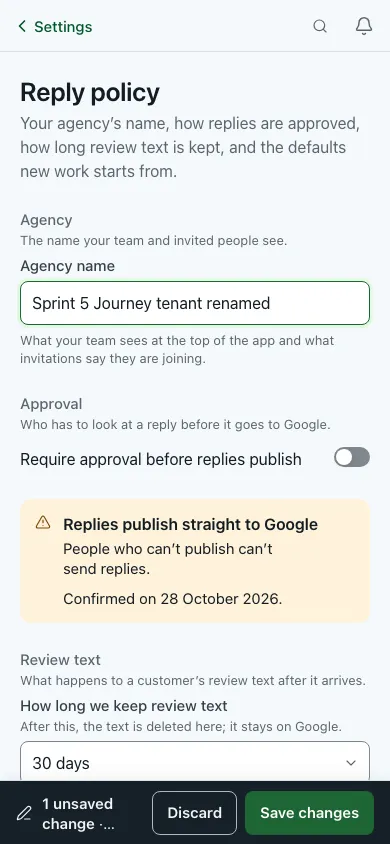                                                                                                          | 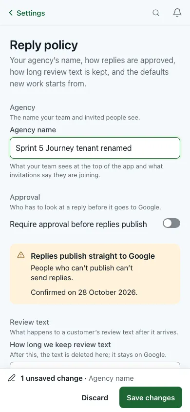                         |
| F02: the save bar is a light surface with a ghost Discard, not the charcoal Google-write tone, and the status has its own row with "1 unsaved change · Agency name" in full. |                                                                                           |
| 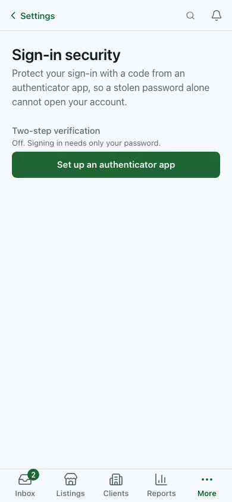                                                                                                                  | 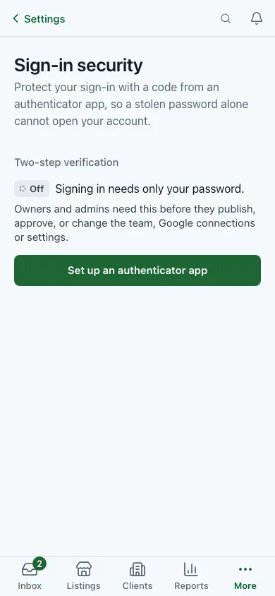                                 |
| F09: the On/Off state is a pill and a sentence, with the owner/admin requirement stated.                                                                                     |                                                                                           |
| 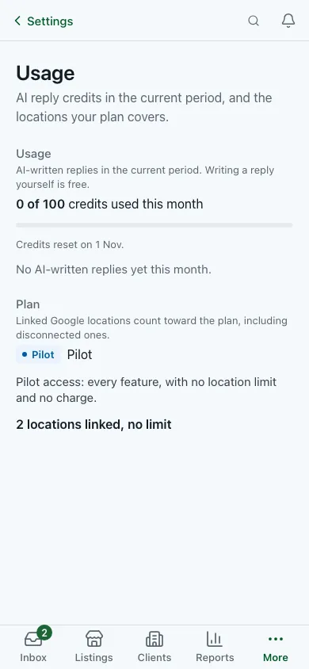                                                                                                                        | 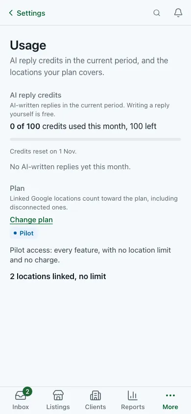                                       |
| F12: "AI reply credits" with the figure left, no duplicate "Pilot", and a "Change plan" link for the owner.                                                                  |                                                                                           |
| 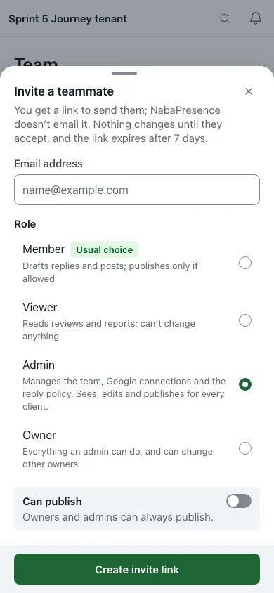                                                                                                | 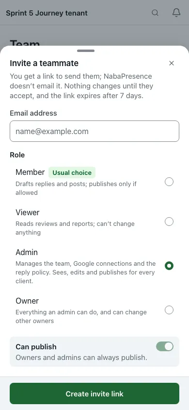               |
| F14: with Admin chosen, "Can publish" is shown on and disabled beside its reason.                                                                                            |                                                                                           |
| 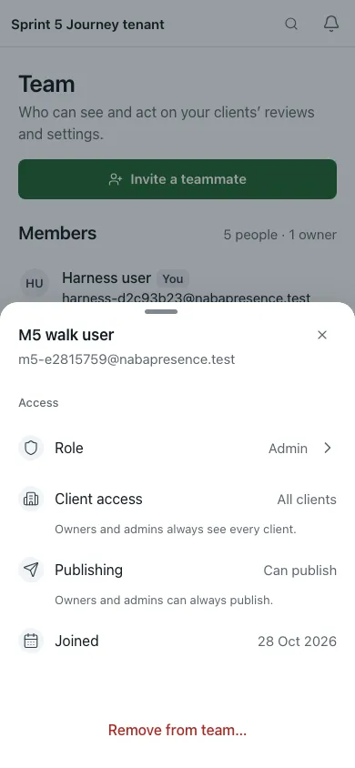                                                                                                | 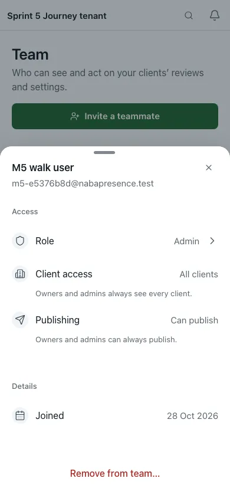               |
| F13: "Joined" moves out of Access into its own Details group.                                                                                                                |                                                                                           |
| 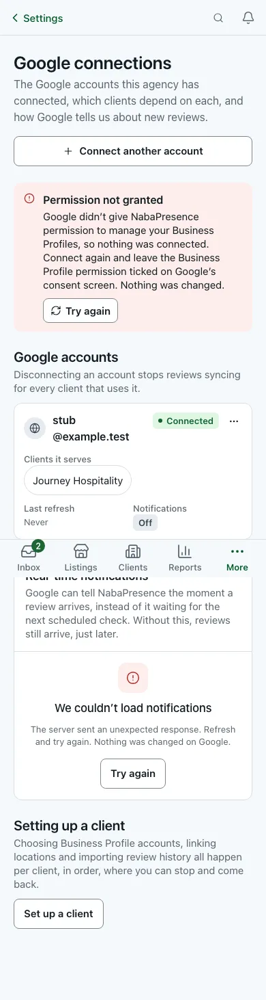                                                                                  | 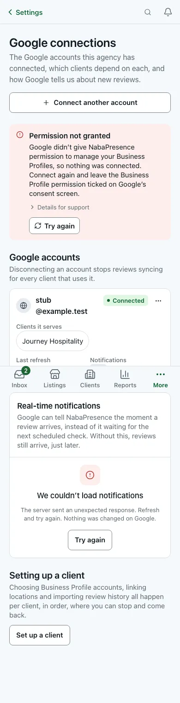 |
| F05: the scope error no longer repeats "Nothing was changed." and keeps the request id under "Details for support".                                                          |                                                                                           |

Changed states the fixture can't show (component tests only): F01 error
boundary; F02 billing read-only; F03 success, refusals and step-up notes; F04
with a provider; F06 broken rows, toasts and heading focus after a disconnect; F07 non-zero
attention list and replayed rows; F08 run pills, dialogs; F09 success alert and
setup steps; F10 grace and read-only alerts, toasts; F11 delayed and confirmed;
F12 at-limit and errors; F13 invitations and zero-access rows; F15 self change,
toasts and focus.

## Core preservation

| Protected rule                            | Evidence it is unchanged                                                                                                                                                                                                                                                                                                                                                                                                                                                                                                                                                                                                                                                                                                                                                                       |
| ----------------------------------------- | ---------------------------------------------------------------------------------------------------------------------------------------------------------------------------------------------------------------------------------------------------------------------------------------------------------------------------------------------------------------------------------------------------------------------------------------------------------------------------------------------------------------------------------------------------------------------------------------------------------------------------------------------------------------------------------------------------------------------------------------------------------------------------------------------- |
| Capability projection, page and nav gates | No edit to `lib/server/capabilities.ts`, `lib/settings/gating.ts`, `settings-areas.tsx` or `settings/layout.tsx`. Page gates unchanged: billing flag, session and owner gate `billing/page.tsx:35-38`, confirming `:19-22` (impl-billing §3); security `notFound()` `:14`, `requireSession()` `:15` (impl-ops §3); team `page.tsx:20-21` (impl-team §3); connections, operations and privacy pages not edited (impl-connections §3, impl-ops §3).                                                                                                                                                                                                                                                                                                                                              |
| Flags                                     | No flag default or read changed. `billingRoutesEnabled()` `billing-disabled.tsx:22` and noindex `:34` unchanged; only the title string changed. `BILLING_ENABLED` read once in `reply-policy-content.tsx:33`, same outcome at `:63`; owner + `workspace_mode_change` gate `:36-47` unchanged (impl-policy §3). Design-system gate at `page.tsx:493,496` (impl-design-system §3).                                                                                                                                                                                                                                                                                                                                                                                                               |
| Request payloads, endpoints, query keys   | **No request payload, endpoint or query key changed.** The diff touches no `app/api`, `lib/api`, `lib/contracts` or `lib/server` file. Call sites keep their arguments: policy PATCH keys `policy-form.tsx:465-472`; `changeWorkspaceMode` `workspace-mode-card.tsx:213-214`; notification `save.mutate` `:204,:265`; `connect.mutate` and `disconnect.mutate` in `connection-card.tsx`; billing `keep`/`cancel` `billing-card.tsx:305,337,422` and `change`/`checkout` `plan-picker.tsx:225,229`; members `updateMember` `:297,:322`, `removeMember` `:345`, role payload `:789`; MFA `startMfaEnrollment` `:279`, `verifyMfaCode` `:343`; operations mutations `:185,:197`; privacy `:106`, `:287-295`.                                                                                      |
| Invite payload                            | `canPublish: role === "viewer" ? false : canPublish` untouched (`invitations-panel.tsx:603`). A new test asserts the exact payload with `toStrictEqual` for seven role/switch states; each equals the old formula (impl-team §3, §4). The F14-1 switch change is presentation only.                                                                                                                                                                                                                                                                                                                                                                                                                                                                                                            |
| Server authority                          | Every new message appears in `onSuccess` or after server confirmation: billing toasts `billing-card.tsx:340,426` read `result` fields; plan-change toast from `PlanChangeResult`; team toasts after the awaited invalidate `members-table.tsx:305,348`; `router.refresh()` only in `onSuccess` after a 2xx; operations `replayed` set only in replay `onSuccess`; disconnect toast in `onSuccess` after the refetch; F14-3 guidance only in `onError` after a refusal; "confirmed" copy still needs `phase === "confirmed"`.                                                                                                                                                                                                                                                                   |
| sessionStorage flags                      | Workspace switch: `storeResult(response)` runs inside `onSuccess` with the parsed 200 body (`workspace-mode-card.tsx:99`, `:215-222`). 2FA: `np:mfa-enrolled` is set only after `verifyMfaCode` resolves, before `hardNavigate` (`two-step-verification-card.tsx:343-354`). Blocked storage gives the old behaviour. Neither flag grants anything.                                                                                                                                                                                                                                                                                                                                                                                                                                             |
| Google connect, disconnect and reconnect  | **No new action ships.** The first pass added a Reconnect to disconnected rows; it was removed after review (P1-1), so rows behave as on base: Reconnect only when `reconnectRequired`, sending the unchanged `connect.mutate({ reconnectConnectionId })`. Disconnect and reconnect semantics are unchanged: `disconnect.mutate(id)`, endpoints, query keys and gates are the same (impl-connections, Review fixes). The toast's 7-day line was checked in code: any connect of the same Google login upserts on `(organisation_id, google_subject)` with `status='active'` and `purge_due_at=null` (`lib/server/google/connections.ts`), and the purge selects only `status='disconnected'` rows (`lib/server/retention/purge.ts`); listings stay unlinked. **Not exercised against Google.** |
| Gate mirrors and role rules               | `roleOptionsFor` `:73` and `memberRowGate` `:363` untouched; the self-change dialog only warns and rewords. `lib/settings/roles.ts` unchanged. F02 name lock mirrors `canWrite`; the server still returns 402. Billing "Change plan" shows on the server's `canManage` and Billing keeps its own owner gate.                                                                                                                                                                                                                                                                                                                                                                                                                                                                                   |
| Billing and Stripe                        | `?checkout=returned` redirect `billing/page.tsx:41` unchanged; `lib/queries/use-billing.ts` not edited (Stripe-URL allow-list, keys, invalidation); cancel dialog copy unchanged; polling stop rule `billing-confirming.tsx:39-48` and `confirmationPhase` `:56` unchanged.                                                                                                                                                                                                                                                                                                                                                                                                                                                                                                                    |
| Two-step security behaviour               | `otpauth://` allow-list `:110`, raw-secret copy, no autofocus or auto-submit, hidden username never sent, `cancelMfa` `:548`; limits read, not changed (parity test against `lib/server/mfa.ts:43-44`).                                                                                                                                                                                                                                                                                                                                                                                                                                                                                                                                                                                        |
| Privacy safeguards                        | Erasure `confirmation` and gating `privacy-requests-panel.tsx:368,374` untouched; export paging `:108,:180` untouched; export form still owner-only `privacy-settings.tsx:32`.                                                                                                                                                                                                                                                                                                                                                                                                                                                                                                                                                                                                                 |
| Operations                                | Queries `operations-view.tsx:169,174`, invalidate `:178`, Retry disabled still mirrors `retryable === 0`, "never resent automatically" copy unchanged.                                                                                                                                                                                                                                                                                                                                                                                                                                                                                                                                                                                                                                         |
| Design system                             | Six `<Section>`s and `SECTION_IDS` unchanged; new demo is client-only, no fetch; test hooks untouched.                                                                                                                                                                                                                                                                                                                                                                                                                                                                                                                                                                                                                                                                                         |
| Out of bounds                             | No migrations, no dependency or lockfile changes, no flag or provider changes, no D1–D12 items (D10 untouched).                                                                                                                                                                                                                                                                                                                                                                                                                                                                                                                                                                                                                                                                                |

## Verification

Environment: macOS, the p6 worktree on `ux/flows-presence-p6`, on the final
working tree after the review and lead fixes. Fixture-browser runs use the
repo's e2e harness (`scripts/run-test-command.mjs e2e`), which starts, migrates
and destroys a throwaway local PostgreSQL cluster; Google calls go to the local
stub.

| Check                                                                                                                                                                                                                                         | Level                  | Status                   | Notes                                                                                                                                                             |
| --------------------------------------------------------------------------------------------------------------------------------------------------------------------------------------------------------------------------------------------- | ---------------------- | ------------------------ | ----------------------------------------------------------------------------------------------------------------------------------------------------------------- |
| `pnpm verify` (typecheck, lint, format:check, tests, design ratchet)                                                                                                                                                                          | Source, unit/component | **Passed**               | Typecheck and lint clean; format:check clean (59 changed files formatted); 626 test files passed, 1 skipped; 8606 tests passed, 1 skipped; design ratchet passed. |
| `pnpm check:design` totals                                                                                                                                                                                                                    | Source                 | **Passed**               | 103 on base and 103 on this branch: no rise, and none in touched files.                                                                                           |
| `pnpm check:contrast`                                                                                                                                                                                                                         | Source                 | **Passed**               | All 212 pairs clear their target in both themes.                                                                                                                  |
| `PLAYWRIGHT_PORT=3560 pnpm test:e2e:touch`                                                                                                                                                                                                    | Fixture-browser        | **Passed**               | 23 passed (`touch-390` project).                                                                                                                                  |
| `PLAYWRIGHT_PORT=3560 pnpm test:a11y`                                                                                                                                                                                                         | Fixture-browser        | **Passed**               | 64 passed, including "design-system proof" at desktop and mobile.                                                                                                 |
| Area specs in one run: `PLAYWRIGHT_PORT=3560 node scripts/run-test-command.mjs e2e pnpm exec playwright test tests/e2e/{settings,billing,connections-oauth,operations-features,business-mode,foundation,routing,forced-colors-focus}.spec.ts` | Fixture-browser        | **Passed**               | 99 passed: settings 14, billing 8, connections-oauth 5, operations-features 18, business-mode 19, foundation 14, routing 14, forced-colors-focus 7.               |
| BEFORE capture, 31 states × 3 variants (`node scripts/run-test-command.mjs e2e sh capture/run-throwaway.sh <out> AB`, base checkout)                                                                                                          | Fixture-browser        | **Passed**               | 93/93; 0 console errors; 0 horizontal overflow.                                                                                                                   |
| AFTER capture (same command, this worktree; three states re-shot with `ONLY=…`)                                                                                                                                                               | Fixture-browser        | **Passed**               | 93/93; 0 console errors; 0 horizontal overflow.                                                                                                                   |
| `tests/agentic/settings.e2e.ts` (LLM-driven agentic test)                                                                                                                                                                                     | Fixture-browser        | **Not run**              | Needs a model provider.                                                                                                                                           |
| Same-path reload after a workspace switch                                                                                                                                                                                                     | Fixture-browser        | Not run                  | Not unit-testable in jsdom; needs a manual or e2e check.                                                                                                          |
| Database checks                                                                                                                                                                                                                               | Database               | Not run                  | No schema, SQL or migration change.                                                                                                                               |
| Stripe Checkout, Portal and webhook; Google consent, reconnect and revoke; email delivery                                                                                                                                                     | Provider               | **Not run**              | Out of scope. No provider-backed verification was done.                                                                                                           |
| Local CI (`lci`)                                                                                                                                                                                                                              | CI                     | **Not run by this area** | The integrator runs it once on `ux/all-flows-presence`.                                                                                                           |

## Shared-file edits

Checked against `git status --short` and `git diff origin/ux/all-flows-presence`.

| File                                                                                                                                | Edit                                                                                                                                                                          | Callers checked                                                                                                                                                        |
| ----------------------------------------------------------------------------------------------------------------------------------- | ----------------------------------------------------------------------------------------------------------------------------------------------------------------------------- | ---------------------------------------------------------------------------------------------------------------------------------------------------------------------- |
| `components/app-shell/access-denied.tsx`                                                                                            | Opt-in `whoCanGrant` prop for the "Who can give you access" card (lead fix). The default, "Owners and admins", is the old literal, so every existing caller renders as before | `grep -rn whoCanGrant app components lib tests`: only the two Billing pages pass it; test in `tests/components/access-denied.test.tsx` covers the default and "Owners" |
| `app/(dashboard)/settings/billing/page.tsx`, `app/(dashboard)/settings/billing/confirming/page.tsx`                                 | Callers of the above: `whoCanHelp="the owner"`, `whoCanGrant="Owners"`; owner gate unchanged                                                                                  | —                                                                                                                                                                      |
| `lib/queries/use-connection-workspace.ts`                                                                                           | Disconnect `onError` toast removed; the rest is Prettier reflow. Query key, `refetchInterval`, `mutationFn`s, connect toast and disconnect `onSuccess` unchanged              | Eight modules import the hook; only `connection-card.tsx` uses `disconnect`                                                                                            |
| `lib/settings/privacy.ts`                                                                                                           | `retentionOrganisationLabel` labels; adds `code`; tones unchanged                                                                                                             | `retention-status-card.tsx` and `tests/components/privacy-settings.test.tsx`                                                                                           |
| `app/design-system/page.tsx`                                                                                                        | Import, one demo line, one TOC entry, **and the lead paragraph copy** (F16-C3). Not purely append-only                                                                        | Page only                                                                                                                                                              |
| `app/design-system/nm-lists-1b-demo.tsx`                                                                                            | `headingAs="h3"`                                                                                                                                                              | Page only                                                                                                                                                              |
| `tests/components/rc3-settings.test.tsx`                                                                                            | Copy update: "Usage could not be loaded." → "AI reply credits could not be loaded." (P3-9)                                                                                    | —                                                                                                                                                                      |
| `tests/e2e/accessibility.spec.ts`                                                                                                   | Comment only                                                                                                                                                                  | —                                                                                                                                                                      |
| `tests/e2e/connections-oauth.spec.ts`                                                                                               | One text assertion (`/temporarily unavailable/` → `/didn’t answer/`)                                                                                                          | —                                                                                                                                                                      |
| `docs/audits/2026-10-28-all-flows/p6/capture/` (`README.md`, `run-throwaway.sh`, `shots.mjs`, `states.md`, `throwaway-fixtures.ts`) | Capture harness for this report (new, docs only); not imported by the app or the test suites                                                                                  | —                                                                                                                                                                      |

No `components/ui` or layout file was edited; the only `components/app-shell`
edit is the opt-in prop above. Every other changed file is in the area
(`app/(dashboard)/settings/*`, `components/settings/*`,
`app/design-system/settings-patterns-demo.tsx`) or a component test for it.
`docs/audits/2026-10-28-all-flows/p6/` is this report, its evidence and the
capture harness.

## Outcome and follow-ups

**What changed (qualitative).** Settings screens now give the real reason when
something is blocked, a way to the fix, and a server-sourced confirmation
where there was silence: billing recovery, workspace switch, 2FA setup, role
changes, replays and disconnects. Copy that was false or internal is gone
("Set up email in Operations", "Raw review content", "timed out", "Retained",
"tick", "checkpoints"). Controls no longer contradict their labels (invite
"Can publish"). Focus no longer falls to `<body>` after cancel, disconnect or
removal. These are observations from the screens and tests. **No task-time,
tap-count, completion or error-rate measurements were taken**, so no measured
improvement is claimed; step counts in [Before](#before) are walkthrough
estimates.

**Partial verification.** Source, unit/component and the repo gate pass. The
fixture-browser evidence (local throwaway database) is the BEFORE and AFTER
captures, the touch and accessibility suites and eight area specs, all passed.
Many changed states are not reachable in the fixture and are covered by
component tests only. Provider paths and the LLM-driven agentic test were not
run. `lci` is the integrator's, once, on the combined branch.

**Remaining AFTER observations.**

- `connections` at 390: the healthy row's email still wraps "stub" /
  "@example.test". The F06-1 basis has no visible effect on that row; it was
  aimed at broken rows, which the fixture doesn't show.
- `usage` on a phone: "Change plan" wraps under the Plan card's description,
  above the "Pilot" pill, so it reads before the plan it changes (on desk it
  sits at the header's right). Placement to revisit.
- `design-system`: the TOC chip row's edge fade at 390 can hide that the 13th
  chip ("Settings") exists.

**Follow-ups (not in this pass):**

1. **Reconnect from a disconnected row, with relinking guidance and
   purge-aware visibility** (review P1-1; removed from this pass).
2. **Command palette `/team#invite`** (F13-C, `command-palette.tsx:66-69`),
   together with a same-page open: Next 16.4.1 fires no `hashchange` on a
   hash-only push, so the palette must dispatch one or use a small registry.
3. **F04-3** bulk "Turn all email off" with Undo.
4. **F08-3** carry the subject from an access request into the export form.
5. **F05-4..6** setup cards: listing names wrap and a bulk-link summary,
   backfill cancel error and reconnect link, account-picker empty state.
6. **Setup and other-area items:** 403 session-switch wording
   (`lib/setup/oauth-status.ts:23-24`); app-wide MFA code mapping
   (`lib/errors/action-errors.ts`); `lib/settings/areas.ts:50` description
   (name, workspace type); `billing_subscription_active` says "Cancel it from
   Billing" with billing off; More sheet description (`destinations.ts:180-183`);
   `SettingsFacts` phone layout (F07-C5); "View only" from the server
   capability (F01 P3); Security and Privacy `notFound()` path; F15
   business-mode widen/narrow warning; F02 admin consent checkbox; F11 tab
   title; F10 skeleton.
7. **Team Members heading focus style** (review P3-10, team half): the
   programmatic focus target after a removal still has no visible focus ring.
8. **`emailConfigured()` ignores `TENANT_EMAIL_ENABLED`**
   (`lib/server/notifications/email.ts:81-87` vs `:93-95`).
9. **Session lapse during OAuth** goes to `/sign-in` with no way back
   (callback `route.ts:365-368`).
10. **MFA remove or replace** is not available in-app; a product and security
    decision.
11. **Legal hold needs a review UUID**; needs a picker or contract change.
12. **WebKit #418** recheck on the Team loading screen.
13. **D10** help channel stays deferred; "Contact support" and the 2FA removal
    note name no channel.
14. **Dirty policy form + workspace switch** "Leave site?" after the server
    switched (F03-7).
15. **Tests to add:** axe on `/settings/billing/confirming` (trialing) and on
    Billing grace and read-only stubs; connections long-email route mock at
    320/390; foundation spec for the Settings chip; a browser check of the
    same-path reload.
16. **Fixture gaps:** no invitations, zero-access member, non-zero operations
    counts, retention cycle or paid subscription, so many changed states are
    component-test only.
17. **F06** optional `ms-auto` on the wrapped status pill, and the healthy-row
    email wrap at 390 noted above.
18. **`SectionHeader` focus props** (`components/ui`): would replace the
    imperative `tabIndex`/`focus-halo` setup on the "Google accounts" heading.

## Review response

An independent, fresh-context reviewer read the full diff and the server code
it depends on (`~/LapenInns Project/research/naba-presence-all-flows-2026-10-28/p6/REVIEW-p6.md`,
outside this repo). Result: **0 P0, 2 P1, 5 P2, 12 P3.** Fixes are
recorded in the "Review fixes" sections of the implementation logs and in the
[Change log](#change-log).

**P1**

- **P1-1. Reconnect on disconnected rows promised what the server doesn't do.**
  Removed (lead's decision): reconnecting doesn't relink listings, and showing
  it only before the purge would need more work. Disconnected rows behave as
  on base. After a disconnect, focus goes to the "Google accounts" heading
  (`focus-halo`) when the row's ⋯ is gone. The toast now says reviews are kept
  for 7 days and that connecting the same Google login again before then keeps
  them; checked in code: a same-login connect reactivates the row and cancels
  the purge, and listings stay unlinked. The return panel's next-step link is
  restored for different-login results, and "Nothing was changed." is restored
  on 401, 403 and 429. Follow-up 1 tracks a proper Reconnect.
- **P1-2. Lost listing access sent people to reconnect.** The Operations row
  now says manager access has to be restored on Google and links to
  `/listings?health=attention`; "Google sign-ins expiring soon" keeps
  `/settings/connections`.

**P2**

- **P2-1.** Cancel-dialog focus moves to the Subscription block only after a
  confirmed cancel (with `focus-halo`); Keep and Escape return to the trigger.
- **P2-2.** Step-up wording distinguishes `mfa_step_up_required` ("Confirm it's
  you…") from `mfa_enrollment_required` ("Set up two-step verification…") on
  Team and the workspace-type card.
- **P2-3.** Self-demotion warnings corrected: "Only another owner can change
  your role back" for an owner, and the owner warning for any lower role.
- **P2-4.** A replay is announced once: the toast is removed; the row's polite
  region remains.
- **P2-5.** The read-only billing alert title follows `access.reason`
  (payment needed, subscription ended, renewal awaiting confirmation).

**P3 fixed:** P3-1 (link for different-login results; still hidden for plan
limit), P3-2 ("Nothing was changed." on 401/403/429), P3-3 ("100+"), P3-4
(Replay re-offered after a later failure), P3-5 ("They see nothing until given
access."), P3-7 (typed confirmation only for Google disconnect), P3-8 (load
failure announced once), P3-9 ("AI reply credits could not be loaded."), P3-10
billing half (focus halo), P3-11 (`naba:mfa-enrolled`).

**P3 left, with reasons:**

- **P3-6** invite "Can publish" shows on for Owner/Admin while the form value
  is sent unchanged. Harmless: the server ignores `canPublish` for owners and
  admins (they always publish), and the payload is identical for identical
  form state. Recorded as intentional.
- **P3-12** the client checks the timezone only when it changes. The server
  still validates (`settingsPatchSchema`) and its refusal shows on the field;
  a test was added. Recorded as an intentional client-side change.
- **P3-10** team half: the Members heading focus target still has no visible
  ring (follow-up 7).

**Lead fixes after the AFTER review**

1. **Billing access-denied page contradicted itself** (top "the owner", card
   "Owners and admins"). New opt-in `whoCanGrant` prop on
   `components/app-shell/access-denied.tsx` (default "Owners and admins",
   unchanged for every other caller); both Billing pages pass "Owners". Test
   in `tests/components/access-denied.test.tsx`. Visible in
   `billing-admin-denied` AFTER.
2. **Reply policy save bar clipped "1 unsaved change · Agency name" at 390.**
   The status always gets its own row on a phone (ActionBar's existing
   `statusRow` option); `tests/components/policy-form.test.tsx` updated.
   Visible in `policy-dirty` AFTER.
