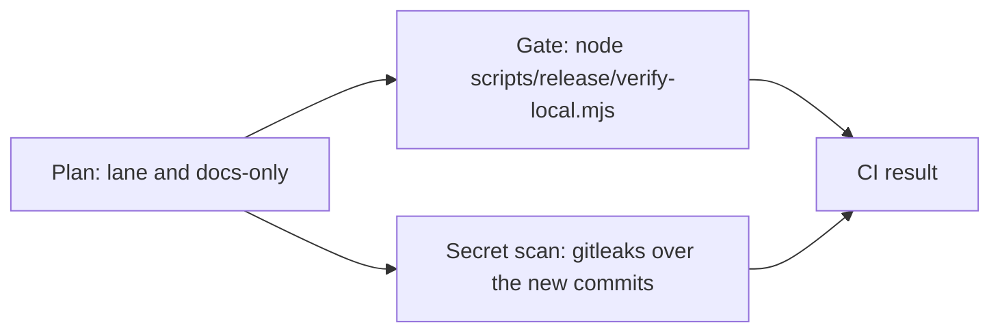

# CI and deployment

How changes are checked before they reach production: what the gate runs,
where it runs, what is required to merge, and how to debug a red run.

**One gate, two places to run it.** Every check lives in
`scripts/release/verify-local.mjs` (`pnpm verify:release`, §5): the same
steps, rules and receipt whether it runs on the owner's Mac or in GitHub
Actions. `.github/workflows/ci.yml` only chooses a runner, skips docs-only
pull requests, installs the tools the gate needs and calls the script, so the
two cannot drift (they did, before 2026-10-21: see
[the audit](audits/2026-10-21-test-ci-modernization/AUDIT_REPORT.md)).

**The release evidence is local.** Hosted Actions has not started a job
since about 2026-10-04: every hosted job is annotated "The job was not
started because an Actions budget is preventing further use" (checked
2026-10-21; Actions is enabled and the triggers fire). `pnpm verify:release`
and its receipt are what `pnpm release:promote` (§7) requires; hosted check
runs are not consulted. Hosted CI returns when the `lapeninns` account's
Actions budget allows it, or for same-repository PRs when the self-hosted
lane (§8) is switched on. Until then, a pull request carries the gate's
summary in its description (`.github/pull_request_template.md`).

- Workflows: `.github/workflows/ci.yml` (the required `CI result`) and
  `codeql.yml` (dormant: code scanning is unavailable on this private
  repository); Dependabot: `.github/dependabot.yml`.
- Shared install step: `.github/actions/setup` (pnpm from `packageManager`,
  Node from `.nvmrc`, `pnpm install --frozen-lockfile`).
- Node runtime: Node 24 everywhere. `.nvmrc` (`24`) drives local nvm and CI;
  `package.json` `engines.node` (`>=24 <25`) drives Vercel and, with
  `engineStrict: true` in `pnpm-workspace.yaml`, makes `pnpm install` refuse
  another major. `tests/server/toolchain-parity.test.ts` fails on any drift.
- CI scripts: `scripts/ci/` (throwaway Postgres, migration policy, PG client,
  result aggregation, runner-hook reference copies), `scripts/db-migrate.mjs`,
  `scripts/vercel-ignore-build.mjs`; the gate:
  `scripts/release/verify-local.mjs` (§5); production promotion and
  rollback: `scripts/release/promote.mjs`, `scripts/release/rollback.mjs`
  (§7). How tests are organised: [docs/testing.md](testing.md).

## 1. What runs when

| Situation | What runs | Where |
|---|---|---|
| Before a push | `pnpm verify` (typecheck, lint, format check of changed files, unit and component tests, design ratchet) and gitleaks over the pushed commits, through the opt-in pre-push hook; documentation-only pushes get gitleaks only | your machine |
| Before a merge, and before a release | `pnpm verify:release` on the head commit; paste its summary into the PR | your machine (the evidence) |
| Same-repo PR | `ci.yml`: Plan, Gate (the whole of `verify:release`), Secret scan, `CI result` | hosted; Mac when enabled |
| Same-repo PR, docs-only | Plan, Secret scan, `CI result`; Gate skipped | as above |
| Fork or Dependabot PR | as a same-repo PR, a fork **after a maintainer approves the run** | always hosted |
| Push to `main` | as a same-repo PR, never cancelled; the upgrade test starts from the last promotion | hosted; Mac when enabled |
| Release | `pnpm verify:release`, then `pnpm release:promote` (§7) | operator's Mac |

"Docs-only" means every changed file (both names of a rename) is under
`docs/` or ends in `.md`, except any `AGENTS.md` and the documentation tests
read: `README.md`, `docs/runbook.md`, `docs/ci.md`, `docs/architecture.md`,
`docs/frontend-backend-feature-map.md` and everything under `docs/release/`
(`TEST_INPUT_DOCS` in `scripts/vercel-ignore-build.mjs`). Anything under
`.github/`, `scripts/` or `supabase/` always counts as code. `ci.yml`'s Plan,
the pre-push hook and the Vercel ignored-build step use the same rule
(`tests/server/vercel-ignore-build.test.ts` keeps them in step).

CI needs no secrets: `ci.yml` sets placeholder `NEXTAUTH_SECRET`,
`TOKEN_ENCRYPTION_KEY` and `CRON_SECRET` (the gate sets the same values), so
fork and Dependabot PRs run the whole gate. No workflow reads a repository
secret.

## 2. The job graph



| Job | Timeout | What it does |
|---|---|---|
| Plan | 5 | Picks the lane (§8) and whether the PR changes code |
| Gate | 90 | Checkout with full history, install, pinned gitleaks and Playwright Chromium, then `verify-local.mjs` (`--base-ref` the PR's base, or the last promotion on `main`); uploads the receipt, per-step logs and browser traces |
| Secret scan | 5 | Pinned, checksum-verified gitleaks over the PR's or push's new commits; runs on docs-only PRs too |
| CI result | 5 | Aggregates the three jobs (§3) |

Inside the Gate, the steps run as soon as the steps they need have passed
(§5): the static checks side by side, then integration (two shards on a
4-vCPU hosted runner, four on the Mac, each on its own throwaway cluster) and
e2e at the same time after the build. Before 2026-10-21 the workflow spread
the same checks over 13 jobs (median 7 minutes wall, 33 billed minutes per run
on hosted, n=39, 2026-09-25 to 2026-10-03) while the local gate ran them one
after another (54-74 minutes); the workflow now calls the local gate.

## 3. Required checks

**`CI result` is the only check to require.** It runs with `if: always()`,
checks out only `scripts/ci`, and runs `node scripts/ci/aggregate-results.mjs`
with `needs`, Plan's `code` output and the event. Every job that applies must
be `success`; `skipped`, `failure` and `cancelled` all fail, except one
planned skip: the Gate, when Plan succeeded and reported `code=false` on a
pull request (a docs-only PR). Anything uncertain fails closed: Plan not
`success`, a missing or unexpected `code` output, `code=false` on an event
other than `pull_request`, a job missing from `needs`, or a job in `needs`
the script does not classify. The rules are unit-tested in
`tests/server/ci-aggregate.test.ts`, which also reads `ci.yml`.

To add a job, add it to `result`'s `needs` and to `REQUIRED_ALWAYS` or
`CODE_JOBS` in `scripts/ci/aggregate-results.mjs`. A new check belongs in
the gate (`GATE_STEPS` in `scripts/release/local-receipt.mjs`), not in a new
job, so it runs locally too. No ruleset change is needed: the ruleset only
knows `CI result`, and job names are the same on both lanes.

**Ruleset "main protection"** (id `23895031`, applied 2026-09-25 as
`lapeninns`). Source of truth: `.github/rulesets/main.json`.

- Deletion and non-fast-forward pushes are blocked.
- A PR is required, with 0 approvals.
- `CI result` (GitHub Actions, integration 15368) is required, and the
  branch must be up to date.
- Admins can bypass only through a PR, so there are no direct pushes. While
  hosted CI cannot run, every merge uses that bypass: 178 PRs between
  2026-10-04 and 2026-10-21 merged with `CI result` failing. Record the
  gate's receipt summary in the PR (the template asks for it) and any
  bypass in `docs/release/ledger.md` (CI-04).

Merges are squash merges from an up-to-date branch, so the tree on `main`
is the tree the gate tested.

To change the ruleset, edit the JSON in a PR, then re-apply it and read it
back:

```bash
gh api -X PUT repos/lapeninns/naba-presence/rulesets/23895031 --input .github/rulesets/main.json
gh api repos/lapeninns/naba-presence/rules/branches/main
```

Repository Actions settings, also applied 2026-09-25: fork PR runs need
approval from all external contributors, the default `GITHUB_TOKEN` is
read-only, and Actions cannot approve PRs. The repository is private, so
hosted runs consume metered minutes.

## 4. Caching and artifacts

| What | Key | Lifetime |
|---|---|---|
| pnpm store (hosted only) | `actions/setup-node` `cache: pnpm`, keyed on `pnpm-lock.yaml` | GitHub cache (7 days unused) |
| Playwright Chromium | `ms-playwright-<os>-<arch>-<playwright version>` | GitHub cache; on a hit Linux runs `playwright install-deps chromium` only |
| `gate-<attempt>` artifact | the receipt, `verify.log`, per-step logs and e2e `test-results/` (the gate keeps its worktree in CI) | 7 days, uploaded always |

The Mac keeps its pnpm store and browsers on disk instead of the Actions
cache. The gate builds once and reuses the build for integration and e2e
inside the same job, so there is no build artifact to pass between jobs.

## 5. Local workflow

```bash
pnpm verify            # typecheck, lint, format check of changed files, unit + component tests, design ratchet; no database
pnpm test:integration  # integration suite on its own throwaway PostgreSQL 17
pnpm build && pnpm test:e2e   # browser journeys (pnpm test:a11y: accessibility only)
pnpm format:changed    # Prettier-format the files your branch changed
pnpm lint:workflows    # actionlint + zizmor over .github/
pnpm verify:release    # the whole gate on a fresh worktree; writes the receipt
```

Run `verify` before pushing (the opt-in hook does). Run `test:integration`,
`test:e2e` and `test:a11y` as well when you touch server code, the database
or UI flows, and `verify:release` before asking for a merge. How the suites
are organised and the rules they follow: [docs/testing.md](testing.md).

### Local release gate (`pnpm verify:release`)

The release evidence is `pnpm verify:release`
(`scripts/release/verify-local.mjs`), and `ci.yml` runs the same script.
Each step starts as soon as the steps it needs (`GATE_STEPS` in
`scripts/release/local-receipt.mjs`) have passed, so independent steps run
side by side; every step that needs a database gets its own throwaway
PostgreSQL 17 cluster, started one at a time:

| Step | Needs | What runs |
|---|---|---|
| `frozen-install` | | `pnpm install --frozen-lockfile` |
| `typecheck`, `lint` | install | `pnpm typecheck`, `pnpm lint` (zero warnings) |
| `unit` | install | `pnpm test`: the unit and component projects, files in parallel |
| `format` | install | `scripts/format-changed.mjs --check --base origin/main`: the files the change touches are Prettier-formatted (a ratchet: about 775 older files are not; on `main` itself nothing is new) |
| `design` | install | `pnpm check:design --ratchet` and `pnpm check:contrast` |
| `build` | install | `pnpm build` (webpack standalone) |
| `bundle-budget` | build | `tests/perf/route-js.mjs` with the ceilings from `tests/perf/budgets-baseline.json` (gzip KB: chunk 70, shared 400, route 560) |
| `migration-policy` | | `node scripts/ci/migration-policy.mjs` against the base (see below) |
| `migrate-fresh` | install | migrate from scratch, a no-op re-run, `db:runtime-role` twice, `db:status --expect-current` |
| `migrate-upgrade` | migrate-fresh | migrate to the merge base, then to HEAD; the schema must equal the from-scratch one |
| `migrate-concurrent` | install | two `db:migrate` runs at once on a fresh cluster; each version recorded exactly once |
| `integration` | install, build | `pnpm test:integration` in `--integration-shards` vitest shards (default 4, `NABA_GATE_INTEGRATION_SHARDS`), each on its own migrated cluster; the shards' counts are added up, and the step passes only if more than 0 passed and none skipped |
| `e2e` | install, build | installs Playwright's pinned Chromium (a no-op when present), then `pnpm test:e2e --forbid-only` on its own migrated cluster, port 3100 (a free pair if 3100/3101 are busy); passes only if more than 0 passed |
| `audit` | | `pnpm audit --prod --audit-level high` |
| `workflow-lint` | | `actionlint` and `zizmor --offline .github/`. Optional: skipped with a note where the tools are not installed (`brew install actionlint zizmor`); a finding fails the gate |
| `secret-scan` | | `gitleaks git --redact --log-opts=HEAD`: the full history of the commit under test (not other branches the worktree's refs can see). **Required**: without gitleaks installed the step is skipped with a note and the gate fails (SEC-13 follow-up) |

On an M-series Mac the integration shards and e2e dominate: before this
change the same steps ran one after another in 54-74 minutes, integration
alone 34-38 and e2e 17-31 (receipts of five promotions). `--serial` runs one
step at a time in the table's order, with integration in one shard, for a
busy or small machine.

The base is what production runs: the `sha` of the newest committed
promotion receipt in `docs/release/receipts/`, read at `HEAD`. Before the
first promotion there is none: pass `--base-ref <the SHA production runs>`
(`release.sha` from the platform health check). Without either it falls back
to `origin/main`, which suits a branch; on the `origin/main` commit itself the
merge base is `HEAD`, so `migration-policy` and `migrate-upgrade` would
compare `HEAD` with itself, and promotion refuses that receipt. The receipt
records the base and where it came from (`base.source`).

It checks `HEAD` out into a fresh detached worktree under the OS temp
directory, so no `.env*` file, untracked file or local build output takes
part (uncommitted changes in your checkout are not tested; it warns). The
gate's own code runs from your checkout, so uncommitted changes under
`scripts/release/`, `scripts/ci/`, `lib/domain/redaction.ts`, `package.json`
or `.nvmrc` are recorded in the receipt (`gateSource`) and promotion refuses
it. It starts its own PostgreSQL 17 clusters with `scripts/ci/postgres.mjs` and
stops them at the end, even on failure or Ctrl-C. The steps inherit only an allowlist
of your shell's variables (`PATH`, `HOME`, temp and terminal variables, the
pnpm, npm config, corepack and nvm ones, `NABA_PG_BIN`/`NABA_PG_MODE`, Docker,
proxy and Playwright browser locations; `INHERITED_ENV` in
`scripts/release/verify-local.mjs`), so database URLs, CI variables and any
provider credentials you have sourced never reach integration or e2e, and it
never reaches the shared dev database on 54322. It sets `ci.yml`'s
placeholder `env:` values and `LC_ALL`/`LANG` (Homebrew Postgres needs a
UTF-8 locale). It must run on the `.nvmrc` Node major.

Every step runs even after a failure, unless `--fail-fast` (steps not yet
started are then `not-run`). A step whose need failed is `not-run`. Each
step's output goes to `logs/<step>.log` in the printed run directory, all of
it to `verify.log` there with each line prefixed by its step, and a failed
step's last 80 lines are printed. The receipt (version 3) is written to
`docs/release/receipts/local/<UTC time>-<sha12>.json` (gitignored, so the
checkout stays clean for promotion): SHA, base ref, base and merge-base SHAs,
Node, pnpm, PostgreSQL, gitleaks, actionlint, zizmor and Playwright versions,
the options (skips, `--serial`, shard count), and each step's status,
duration, test counts and note. The exit code is 0 only when the gate passed.
`--skip <id,...>` and `--fail-fast` are for iterating; such a receipt never
passes promotion. `--list` prints the steps; `--keep-worktree` keeps the
worktree for debugging. Rules are unit-tested in
`tests/server/release-verify-local.test.ts`.

`test:integration`, `test:e2e`, `test:e2e:touch` and `test:a11y` go through
`scripts/run-test-command.mjs`. It never runs them against a database it was
merely handed. By default it starts a throwaway PostgreSQL 17 for the run
(`scripts/ci/postgres.mjs`, its own temp `NABA_PG_DIR`; about 1-3 s with the
migrations and runtime role), points `DIRECT_DATABASE_URL`,
`TEST_RUNTIME_DATABASE_URL`, `DATABASE_URL` and `DATABASE_SESSION_URL` at it,
and stops it when the command exits or on Ctrl-C/SIGTERM. A cluster from
`postgres.mjs start` (the local gate, ci.yml, or the recipe in "Reproduce a CI
database locally") is reused instead: `start` exports
`NABA_PG_DISPOSABLE=<host:port>`, and the wrapper checks that every URL
reaches that port and that the cluster carries `naba.disposable_cluster = on`.
`NABA_TEST_DB=existing` runs against the configured URLs. The guard
(`scripts/test-database.mjs`, shared with the integration helpers and
`scripts/cleanup-harness-data.mjs`) refuses a non-local host in any of those
four variables unless `ALLOW_REMOTE_TEST_DB=1`, and the local Supabase
database port 54322 (the dev tenant) unless `NABA_ALLOW_DEV_DB=1`, even with
`NABA_TEST_DB=existing`. The default needs Homebrew `postgresql@17` on macOS,
or Docker with `NABA_PG_MODE=docker`. Before the first integration file and
after the last, `tests/integration/helpers/global-setup.ts` lifts pauses,
ends `naba:%` fleet leases and drops unused test billing plans, only on such
a throwaway cluster.

**Pre-push hook (opt-in):** `pnpm hooks:install` sets
`core.hooksPath=.githooks`. `.githooks/pre-push` then runs `pnpm verify` and,
if `gitleaks` is installed, scans the commits you are pushing (`@{u}..HEAD`,
or `origin/main..HEAD` for a new branch). There is deliberately no `prepare`
script, so CI and Vercel installs never install hooks.

- `core.hooksPath` lives in the clone's shared `.git/config`, so it applies to
  every worktree of that clone. A worktree whose branch has no `.githooks/`
  runs no hook.
- Skip once with `SKIP_VERIFY=1 git push` or `git push --no-verify`. Undo with
  `git config --unset core.hooksPath`.

`tsconfig.json` excludes `.claude`, `.design-sync`, `.ds-sync`, `ds-bundle`
and `.worktrees`, matching ESLint's ignores. TypeScript already skips
dot-directories under `**` wildcards, but the gitignored `ds-bundle/` output
(60 generated files) was being typechecked wherever it existed.

`pnpm lint` runs `eslint --max-warnings 0`, so a warning fails the gate the
same way an error does. ESLint also ignores the gitignored local evidence and
report directories (`.omo`, `.superpowers`, `test-results`,
`playwright-report`, `coverage`, `.pnpm-store`), and `tsconfig.json` excludes
`.omo` and `.superpowers`. `.omo` holds QA evidence with copied source trees
that would otherwise be linted as app code. Ignoring these directories does
not delete them. For a full-document navigation inside the app, use
`hardNavigate` from `lib/client/hard-navigate.ts`, not a relative
`location.assign`, which Next's lint rule flags.

## 6. Migrations

### Rules

- `supabase/migrations` is **append-only**. A migration that exists on `main`
  is never edited, renamed or deleted. Fix forward with a new file.
- New files are named `NNNN_snake_case.sql` and their 4-digit number must be
  higher than `main`'s highest. Numbers are compared as numbers, not strings.
  Allowlisted exceptions, in `scripts/migration-rules.mjs`: the `0021` gap,
  and the legacy `20260729000400_remove_local_demo_data.sql`.
- Each file records itself in `schema_migration`. The runner fails and rolls
  back a file that does not.
- **Expand, then contract.** Production migrations are run by hand and are not
  tied to a deploy (see below), so the deployed code and the schema are
  briefly out of step. Every migration must work with the code that is live
  when it runs, and the new code must work before it runs:
  - Expand (safe in one PR): add tables, nullable columns or columns with
    defaults, new indexes, new functions, and widen constraints.
  - Contract (a later PR, once no deployed code uses the object): drop or
    rename columns and tables, add `NOT NULL` without a default, and tighten
    constraints or RLS.
  - Reviewers hold PRs to this rule. A PR that needs both halves is split.
- **Migration safety** (`scripts/migration-rules.mjs`, enforced on new files
  by `migration-policy.mjs`, so in the gate's `migration-policy` step and the
  Migrations job):
  - A new file containing contract-type or table-locking DDL fails the
    policy unless its leading comment block has
    `-- migrate:contract <reason>`: `drop table`, `drop column`, any
    `rename`, and, on a table the same file did not create,
    `alter column ... type`, `set not null`, `drop default`,
    `add column ... not null` without a default, and `create index` without
    `concurrently`. The marker is the author saying the contract half is
    intended and that the deployed code no longer needs the old shape; ship
    such a file in its own PR. New indexes on existing tables belong in a
    `-- migrate:no-transaction` file with `create index concurrently`, one
    per file.
  - Every transactional migration runs with `lock_timeout` `5s`, so DDL
    queued behind a long transaction fails and rolls back instead of
    queueing every request behind it. Re-run `db:migrate` when the database
    is quieter. A file can set its own with
    `-- migrate:lock-timeout <value>` in its leading comments (`0` for none);
    `MIGRATION_LOCK_TIMEOUT` changes the default for a run. A
    `-- migrate:no-transaction` file gets none unless its header asks: a
    `create index concurrently` that times out leaves an invalid index.

### How the runner behaves (`pnpm db:migrate`)

- Takes a session advisory lock on one connection, so concurrent runs queue.
  The two-int key `("naba", 1)` cannot collide with the app's own
  `hashtext()` locks. Waits up to `DB_MIGRATE_LOCK_TIMEOUT` seconds
  (default 600).
- Refuses a port-6543 (transaction pooler) URL, where a session lock would
  protect nothing. Use the direct URL or the session pooler (5432).
- Runs each file in its own transaction. Every file carries its own
  `begin;`/`commit;`, which the runner strips so its transaction owns the
  file. A file whose first line is `-- migrate:no-transaction` runs as-is;
  none currently do.
- Environment variables:

| Variable | Default | Purpose |
|---|---|---|
| `DIRECT_DATABASE_URL` (falls back to `DATABASE_URL`) | – | Admin connection |
| `MIGRATIONS_DIR` | `supabase/migrations` | Apply another tree, for example the merge base's |
| `DB_MIGRATE_EXPECT_NOOP=1` | off | Exit non-zero if any file would be applied |
| `DB_MIGRATE_LOCK_TIMEOUT` | `600` | Seconds to wait for the lock |
| `MIGRATION_LOCK_TIMEOUT` | `5s` | PostgreSQL `lock_timeout` for each transactional file (`0` for none); a file's `-- migrate:lock-timeout` header wins |

### What the gate checks (the migration steps)

1. **Policy (`migration-policy`):** `node scripts/ci/migration-policy.mjs
   <base>` checks the rules above against the merge base with the gate's base
   (the last promotion, or the PR's base in CI).
2. **From scratch (`migrate-fresh`):** `db:migrate`, then again with
   `DB_MIGRATE_EXPECT_NOOP=1`, `db:runtime-role` twice, then `db:status
   --expect-current`. The schema is dumped.
3. **Upgrade (`migrate-upgrade`):** the database is recreated, the merge
   base's migrations are applied (`git archive` → `MIGRATIONS_DIR`), then
   head's migrations. The schema must match step 2's dump exactly. The diff
   ignores comments, blank lines and pg_dump 17's random `\restrict` lines.
4. **Lock (`migrate-concurrent`):** two `db:migrate` runs start at once on a
   fresh cluster. Both must succeed, and each version must appear exactly
   once.

The integration shards and e2e then migrate their own clusters and create the
runtime role, and every test runs through that non-superuser role.

### Required-migrations manifest

`lib/server/schema-manifest.ts` lists every migration version the code may
rely on. **Every PR that adds a migration appends its version there.**
`tests/schema-compat.test.ts` fails until the manifest holds exactly the
versions in `supabase/migrations` (it uses `listMigrationVersions` from
`scripts/migration-rules.mjs`, the same rule `db:migrate` and `db:status`
use). In production, `assertProductionSafety` refuses to start when a listed
version is missing from `schema_migration`; extra applied versions are
allowed, so expand-only migrations can run ahead of the code.
`tests/integration/startup-assertion.test.ts` checks both directions against
the migrated CI database through the runtime role.

### Production: manual, from the operator's machine

Vercel does **not** run migrations. The project has no Build Command
override, production build logs show a plain `next build --webpack`, and
Production has no `DIRECT_DATABASE_URL` (Preview does). Checked on
2026-09-25 while building this pipeline; there is no `vercel-build` script on
purpose.

For a PR that adds a migration:

1. `pnpm verify:release` has passed for the commit whose migrations you are
   applying (the branch head when migrating before merge), and the migration
   is expand-only. Never run `db:migrate` against production before the gate
   has passed: it is the only check that the migrations apply from scratch
   and from production's schema.
2. Take a restorable database snapshot, and note the current production
   deployment (the rollback unit in `docs/runbook.md`).
3. From your machine, with the admin URL (direct, or session pooler on 5432):
   `DIRECT_DATABASE_URL='<admin url>' pnpm db:migrate`, then
   `DIRECT_DATABASE_URL='<admin url>' pnpm db:status --expect-current`
   (exits 1 while anything is pending; check that the printed `target` is the
   production host).
   Run this **before merging** when the new code depends on the new schema:
   the live code tolerates an expand-only migration, but the new code would
   fail against the old schema.
4. Merge, then promote with `pnpm release:promote` (§7). Merging does not
   deploy production; the promotion script runs `db:status --expect-current`
   again and refuses while anything is pending.
5. On failure, restore the snapshot and promote the noted deployment
   together. Never run ad-hoc down migrations.

## 7. Deploys (Vercel)

**Production ships from the operator's machine, not from a merge.** Merging
to `main` does not deploy production: the operator runs
`vercel deploy --prod` from a clean worktree of `origin/main`, through
`pnpm release:promote` (`scripts/release/promote.mjs`). Whether the Vercel
GitHub integration is still connected for previews, and whether it could
promote production on its own, is a dashboard check recorded under D-38 in
`docs/release/decision-log.md`; if it can, turn off automatic production
promotion or require `CI result` through Vercel Deployment Checks.

### Promotion (`pnpm release:promote`)

First run the local release gate (§5) on the `origin/main` commit and keep
the receipt path it prints; production migrations (§6) come after it has
passed, never before. Then, from a fresh worktree of `origin/main`
(`git worktree add`), with `pnpm install --frozen-lockfile` run, the project
linked (`vercel link`) and the production admin URL in the environment:

```bash
DIRECT_DATABASE_URL='<admin url>' pnpm release:promote --local-receipt <receipt> --production-url https://<production origin> --dry-run
DIRECT_DATABASE_URL='<admin url>' pnpm release:promote --local-receipt <receipt> --production-url https://<production origin>
```

The script refuses, before deploying anything, unless every gate holds
(`checkCandidate`, unit-tested in `tests/server/release-promote.test.ts`):

- The worktree has no changed, staged or untracked files, and no ignored
  `.env*` or `.dev.vars` file that `vercel deploy` would upload.
- `HEAD` equals `origin/main` after a fetch.
- `--local-receipt` names a `verify:release` receipt for exactly that SHA,
  produced in a fresh worktree on the `.nvmrc` Node major, with no
  `--skip`, and every step `passed` (`secret-scan` included; the
  integration and e2e steps must show tests ran), no uncommitted edits to the gate's own
  code, and a base equal to the `sha` of the newest committed promotion
  receipt (with no promotion receipt yet, any base whose merge base is not
  the commit itself). The gate re-judges the steps
  (`scripts/release/local-receipt.mjs`), so a receipt edited to say `ok`
  over a failed step still refuses. Hosted check runs are not consulted.
- `db:status --expect-current` against `DIRECT_DATABASE_URL` reports no
  pending migration (it prints the target; confirm it is production).
  `DIRECT_DATABASE_URL` must be set explicitly, so a local `.env` can never
  stand in for production.

It also refuses unless `READINESS_PROBE_TOKEN` (production's `CRON_SECRET`)
is set for the probes below, and a production origin is given with
`--production-url https://<production origin>` (or `READINESS_URL`). It then
promotes in four phases (`stagedPromotion` and `verifyProduction`,
unit-tested with the Vercel CLI and the probe mocked):

1. **Stage:** `vercel deploy --prod --skip-domain --yes --format json
   --build-env NABA_RELEASE_SHA=<sha> --env NABA_RELEASE_SHA=<sha>
   --meta releaseSha=<sha>`. A production build with production
   environment, but the production domains stay on the current deployment.
2. **Probe:** `scripts/ops/readiness-probe.mjs --url <staged deployment URL>
   --expect-sha <sha>`, up to 3 attempts 10 s apart (a cold start). Ready or
   degraded passes; not ready, unreachable, 401 or another SHA fails. If the
   project uses Vercel Deployment Protection, set
   `VERCEL_AUTOMATION_BYPASS_SECRET` (Project → Settings → Deployment
   Protection → Protection Bypass for Automation) so the probe can reach the
   deployment URL; it is sent as `x-vercel-protection-bypass`.
3. **Promote:** only after the probe passed, `vercel promote <deploymentId>
   --yes`. If every probe attempt failed the script exits 1, writes no
   receipt and production still serves the previous deployment: there is
   nothing to roll back. Inspect the staged deployment's logs from its URL.
4. **Verify production:** `readiness-probe.mjs --url <production origin>
   --expect-sha <sha> --json`, up to 5 attempts 15 s apart (each killed after
   30 s); it passes only when production answers with the promoted SHA. The
   result is recorded in the receipt as `productionProbe`. If production
   does not serve the SHA, the receipt is still written (production has
   changed) and the script exits 3: commit the receipt, check `vercel promote
   status`, and roll back with `pnpm release:rollback` (below).

After the promotion it writes `docs/release/receipts/<UTC time>-<sha12>.json`:

- build: `sha`, `deploymentId`, `url`, and `localGate`: the local receipt's
  file name, the sha256 of its bytes, its finish time, base and each step's
  status, and `copy`, the `<receipt>.local.json` file beside it holding the
  local receipt's exact bytes, so the sha256 stays checkable;
- migrations: every `supabase/migrations` version the commit ships, with the
  file's sha256;
- configuration: the production variable **names** from
  `vercel env ls production` (values are never read into the receipt), plus
  `operator` (`git config user.name`) and `timestamp`.

The script refuses to write a receipt in which any value would be changed by
`lib/domain/redaction.ts`, or a configuration entry that is not a variable
name. It validates a provisional receipt before deploying, so those refusals
happen before production changes, and prints the deployment ID and URL as soon
as the deploy returns. If the receipt write still fails after that, roll back
or write the receipt by hand from the printed values. Commit the receipt and
its `.local.json` copy; the next release's gate takes its base from it.

Smoke check after the receipt: its `productionProbe.ok` is `true`, and
`GET /api/operations/health?scope=platform` with the cron bearer returns
`release.sha` (equal to the receipt's `sha`, with `source`
`naba_release_sha`) and `schema.compatible: true`. Only the platform scope
reports these; the session scope does not.

### Rollback (`pnpm release:rollback`)

From a checkout holding every promotion receipt (fetch `origin/main`; include
an uncommitted receipt if the release just failed), with the project linked
and `READINESS_PROBE_TOKEN` set:

```bash
pnpm release:rollback --production-url https://<production origin>          # dry run: prints the plan, runs nothing
pnpm release:rollback --production-url https://<production origin> --yes    # acts
```

The dry run prints what production serves according to the receipts, the
deployment it would return to (the promotion before, or `--to <receipt |
deploymentId>`) and the exact commands. `--yes` runs `vercel promote
<deploymentId>`, probes production for the target's SHA (as phase 4 above)
and writes `docs/release/receipts/<UTC time>-<sha12>.rollback.json`; commit
it. Exit 3 means production does not serve the target: check `vercel promote
status`.

It refuses when the target ships different migrations from production:
migrations are roll-forward-only and a deployment rollback cannot undo one.
Restore the snapshot taken before the migration (`docs/runbook.md`), confirm
`db:status`, then rerun with `--database-restored`, which the receipt
records. Afterwards read the deployed cron list back against the target's
`vercel.json` (ledger OPS-09). The script trusts the receipts for what
production serves; compare its dry run with `vercel promote status`. It has
not been drilled on a staging project yet (owner, OPS-09). After a
`--database-restored` rollback, run the next `verify:release` with
`--base-ref <the rollback target's sha>`: the gate's default base is still
the newest promotion receipt.

### Ignored build step

- `vercel.json` `ignoreCommand` runs `scripts/vercel-ignore-build.mjs`. Exit 0
  means **skip**; exit 1 means build.
  - **Production is never skipped.**
  - Previews are skipped for `dependabot/*` branches, and when every file
    changed since the branch's last deployment
    (`VERCEL_GIT_PREVIOUS_SHA..VERCEL_GIT_COMMIT_SHA`) is docs-only.
  - Anything uncertain builds: an unknown `VERCEL_ENV`, no previous SHA, or a
    SHA outside Vercel's shallow clone.
- GitHub environment protection rules do not apply to Vercel deploys.

## 8. Self-hosted runner runbook

Every job, Plan, Secret scan, Dependency review and `CI result` included,
runs on the lane Plan chooses, and Plan's own `runs-on` applies the same
trust rule, so a trusted run on the Mac uses no hosted minutes. While the
Actions budget blocks hosted jobs, this lane is the only way `CI result`
runs for same-repository PRs; fork and Dependabot PRs stay hosted and stay
blocked until the budget allows them.

Status: **not set up yet.** `scripts/ci/runner-setup.sh` is ready, but the
owner has not run it on the Mac, and `SELF_HOSTED_ENABLED` is unset, so
every job runs on GitHub-hosted runners. The repository is private, so hosted
minutes are metered (the Actions budget is currently blocking every job); the
Mac would buy both speed and savings, and the hosted lane must always keep
working.

### The lane switch

`plan` puts every job (Plan itself, Gate, Secret scan and `CI result`) on
`["self-hosted","macOS","ARM64","naba-trusted"]` only when **all** of these
hold:

- repo variable `SELF_HOSTED_ENABLED` is `true` (unset means hosted);
- the repository is `lapeninns/naba-presence`;
- the run is a push or dispatch on `refs/heads/main`, or a same-repo pull
  request whose author and actor are not Dependabot.

Fork and Dependabot pull requests, and `codeql.yml`, always run hosted.

```bash
gh variable set SELF_HOSTED_ENABLED --body true  -R lapeninns/naba-presence   # Mac lane on
gh variable set SELF_HOSTED_ENABLED --body false -R lapeninns/naba-presence   # back to hosted
```

**If the Mac is offline,** set the variable to `false`, cancel the queued
runs, and re-run them. `timeout-minutes` does not count queue time, so a job
waiting for an offline runner sits queued for up to 24 hours. The lane is
chosen in `plan`, so a re-run of only the failed jobs keeps its old lane: use
**Re-run all jobs**. (An automatic online-runner probe was considered and not
built.)

### Fork safety

A fork PR's `pull_request` run uses the fork's own workflow file, so a fork
can write `runs-on: self-hosted` whatever `plan` says. The layers are:

1. **Fork approval:** Settings → Actions → "Require approval for all external
   contributors". Applied (see [Required checks](#3-required-checks)). **Never approve a fork run that changes `.github/**`**;
   read the diff before approving any run.
2. **Pre-job hook on the Mac** (`ACTIONS_RUNNER_HOOK_JOB_STARTED`). It refuses
   any job unless the repository is `lapeninns/naba-presence` and the event is
   a push, schedule or dispatch on `main`, or a same-repo, non-Dependabot
   `pull_request`. `pull_request_target`, `issue_comment`, `workflow_run` and
   anything else are refused. The live hook lives outside any checkout, so a
   PR cannot change it. Reference copy: `scripts/ci/runner-hooks/pre-job.sh`.
3. **Least privilege:** register the runner at repo level only, with the
   `naba-trusted` label. Run it as a dedicated non-admin macOS user
   `gh-runner` with no SSH keys, no `gh` auth, no keychain items and no access
   to the owner's home folder. The default workflow token is read-only
   (applied).

### Install

**Use [`scripts/ci/runner-setup.sh`](../scripts/ci/runner-setup.sh).** It
does steps 1–4 below plus a verify pass. It is idempotent and stops at the
first error. Run it from a checkout, as the Mac's admin user; it asks for
`sudo` itself. The registration token comes from `RUNNER_TOKEN`, or the script
prompts for it. It passes the token to `config.sh` through stdin, never on a
command line.

```bash
RUNNER_TOKEN="$(gh api -X POST repos/lapeninns/naba-presence/actions/runners/registration-token --jq .token)" \
  bash scripts/ci/runner-setup.sh          # install or update, then verify
bash scripts/ci/runner-setup.sh verify     # checks only
```

It pins actions/runner to a version and SHA256, then lets the runner update
itself. It closes your home folder to other users (`chmod 700`), so jobs
cannot read checkouts or `.env` files; set `NABA_KEEP_HOME_PERMS=1` to skip
that. Re-run it after changing a hook's reference copy. The steps it
automates:

1. `brew install postgresql@17 gitleaks jq`. Create the `gh-runner` user.
2. Two runner instances, `mac-1` and `mac-2`, in separate folders, so two
   pull requests' gates can run at once (each Gate already runs its
   integration shards and e2e side by side):
   `./config.sh --url https://github.com/lapeninns/naba-presence --labels naba-trusted --name mac-N --work _work --unattended`.
   `self-hosted`, `macOS` and `ARM64` are added automatically.
3. Copy `scripts/ci/runner-hooks/{pre,post}-job.sh` to
   `/usr/local/libexec/naba-runner/`, owned by root and not writable by
   `gh-runner`. In each runner folder's `.env`, set
   `ACTIONS_RUNNER_HOOK_JOB_STARTED` and `ACTIONS_RUNNER_HOOK_JOB_COMPLETED`
   to those paths. Changing a reference copy in the repo does nothing until
   you copy it again.
4. Run each instance as a LaunchDaemon with `UserName=gh-runner`, not
   `svc.sh`'s LaunchAgent, so it runs without anyone logged in. Disable sleep
   on AC power (`sudo pmset -c sleep 0`). Leave runner auto-update on.
5. The post-job hook stops any throwaway cluster under `$RUNNER_TEMP`, kills
   leftover `standalone/server.js`, `postgres -D` and Playwright processes,
   empties `$RUNNER_TEMP`, and runs `git clean -ffdx` on the workspace. The
   pnpm store and Playwright browsers persist.
   - Why not `--ephemeral`: one-job registration needs an admin token stored
     on the Mac to mint registration tokens, which is a bigger risk than a
     persistent runner with cleanup hooks.

### Before switching the lane on

Run the gate on both lanes and compare. Both use Playwright's pinned
Chromium (`playwright.config.ts` uses a system browser only with
`PLAYWRIGHT_CHANNEL`). macOS and musl sort
`en_US.UTF-8` differently, so fix or note any `ORDER BY` assertion that
fails on one lane only.

## 9. Removed workflows and owner decisions

Removed on 2026-10-21 (restore any of them from git history if its premise
changes):

- **`claude-review.yml`.** A `pull_request` run executes the head branch's
  copy of the workflow, so anyone who could push a branch could read the
  repository's only secret, `CLAUDE_CODE_OAUTH_TOKEN`; and it had not
  completed since the Actions budget block. Owner action: delete that secret
  (Settings → Secrets and variables → Actions). Reviews now come from a
  separate reviewer account through MultiCA.
- **`nightly.yml`.** Failed 27 of 27 runs (the first nine were real critical
  advisories ignored for nine days, the rest the budget). Its CI half
  duplicated the push run and its `pnpm audit --prod` is a required gate
  step. Dependabot alerts cover advisories between releases.
- **`readiness-probe.yml`.** Every run was skipped (never configured), and
  once configured it would bill at least a minute every five minutes. Schedule
  `pnpm ops:readiness` outside Actions instead (docs/observability.md,
  "Scheduling the probe").
- **Dependency review job.** The dependency-graph compare API answers 403 on
  this private repository (checked 2026-10-21), so `CI result` could never
  pass with it.

Owner decisions, not taken here: restoring hosted CI (an Actions budget, or a
public repository, which would also bring back dependency review and code
scanning, and with them `codeql.yml`); switching on the Mac lane (§8);
turning Dependabot security updates on (Settings → Code security), and
fixing Dependabot npm updates, which have failed with
`ERR_PNPM_NO_MATURE_MATCHING_VERSION` since 2026-10-09 (cause not found in
the repository's pnpm settings).

## 10. Gate maintenance

- A new check goes in `GATE_STEPS` (`scripts/release/local-receipt.mjs`) with
  the steps it `needs`, and in the `steps` map of
  `scripts/release/verify-local.mjs`; `tests/server/release-verify-local.test.ts`
  pins the list and the order. Changing the steps changes the receipt
  version, and promotion accepts only the current version.
- Prefer a step to a new workflow job: it then runs on the Mac and in CI
  alike, and in every receipt.
- A step that needs a tool which may be missing is `required: false` and
  returns `skipped` with a note when the tool is absent; a finding still
  fails the gate.

## 11. Debugging a red run

**Start with `CI result`.** Its log lists the three jobs' results, then one
`::error::` line per problem (for example `gate: failure (code changed)`).

**Gate:** its log ends with the gate's summary table, one line per step with
its duration and counts, then `gate: <problem>` lines. Download the
`gate-<attempt>` artifact for the receipt, `verify.log` and the per-step logs
(`logs/<step>.log`); a failed step's last 80 lines are already in the job
log. Browser traces are under `naba-verify-*/src/test-results/`:

```bash
gh run download <run-id> -n gate-1 -D /tmp/gate
pnpm exec playwright show-trace /tmp/gate/<run dir>/src/test-results/<test>/trace.zip
```

**Reproduce it locally:** `pnpm verify:release` runs exactly what the Gate
ran (`--keep-worktree` keeps the checkout; `--skip`/`--fail-fast` to
iterate). One suite on its own: `pnpm test:integration [files]` or
`pnpm build && pnpm test:e2e -g "<test name>"`.

**Re-run:** Re-run all jobs (a re-run of only `CI result` re-reads the same
results). A job skipped because Plan failed recovers only through Plan, so
re-run all jobs. A cancelled run (superseded by a newer push to the PR) stays
red; look at the newest run.

**Reproduce a CI database locally:** this uses the same script as CI.

```bash
eval "$(node scripts/ci/postgres.mjs start)"   # exports DIRECT_DATABASE_URL, DATABASE_URL, TEST_RUNTIME_DATABASE_URL, NABA_PG_DISPOSABLE
pnpm db:migrate && pnpm db:runtime-role
pnpm test:integration
node scripts/ci/postgres.mjs stop
```

Plain `pnpm test:integration` does this on its own; start a cluster by hand
only to keep it between runs or inspect it. On macOS it uses Homebrew
`postgresql@17` (`NABA_PG_BIN` overrides the bin folder);
`NABA_PG_MODE=docker` uses `postgres:17-alpine`. It picks a free port and
never one in 54320-54329, so it never collides with the Supabase stack.

**Postgres logs:** when `start` fails, it prints the log itself: `pg.log`
under `NABA_PG_DIR` in native mode, and `docker logs` in docker mode. In the
gate each cluster's directory is `pg-<step or shard>` in the run directory.

**Migration steps:** *policy* failures name the file and the rule; *upgrade*
failures print the lines only in the from-scratch or only in the upgraded
schema; for *lock* failures both `db:migrate` logs are in the step's log.

**Lane mismatch:** a job passes on hosted but fails on the Mac, or the other
way round. Check `Plan`'s `Lane: …` line. Usual causes are collation order,
timing and a leftover process. Setting `SELF_HOSTED_ENABLED=false` and
re-running all jobs confirms whether it is lane-specific.

**Stuck "Queued" jobs:** a self-hosted job waits for a `naba-trusted` runner.
Check Settings → Actions → Runners. If the Mac runners are offline, flip the
variable to `false` and re-run all jobs.

**Docs-only PR shows no Gate:** expected. `Plan` printed `Gate: false`, and
`CI result` stays green because the aggregation allows the Gate to skip on a
docs-only pull request. If `CI result` is red with `plan output code:
missing`, Plan failed or did not write its output: re-run all jobs; the Gate
is then required.
