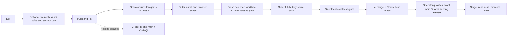
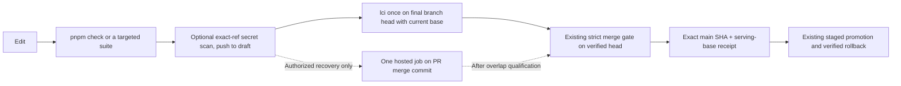

# NabaPresence engineering infrastructure pilot

## Scope and baseline

Inspected 25 November 2026, Europe/London. The sole implementation target is
`lapeninns/naba-presence`. GitHub lists 35 active organisation repositories and
the installed local CI bundle has 25 profiles. These inventories include repos
with different ownership, gate and deployment models. No other repository is
included in this pilot.

The original checkout was on `feat/review-reply-rebuild` at
`117148d7684d33f63fc545c870e5d7128b1851e1`. It had a modified
`supabase/.temp/cli-latest` and untracked `.tmp-view/`. Implementation starts
from remote `main` at `4ef72a80b8196917d63205d0a7ee2dbcf898ba8b` in a
separate checkout. That baseline has 4,727 tracked paths and tree
`99e6da1c396b509d205873a0ccda09f601092bd1`. The SHA-256 of
`git ls-tree -rz <baseline>` is
`fe9ff858d7d62d49b939ff38922481c8cc0e5503761d83c40af5368e1c6fa083`.

The change allowlist is the Actions CI and CodeQL workflows, their package
manager setup composite, the local release-gate driver and its base resolver, the opt-in pre-push
hook, tests of those engineering contracts, removal of the old CI aggregate, the tightening of its quality ratchet, the engineering sections of
`AGENTS.md` and `docs/ci.md`, and this `docs/engineering/` directory. All other
tracked paths are protected by default. The application build and its
standalone packaging, Next.js and TypeScript config, runtime and development
dependency manifests, the complete lockfile, Supabase files, Vercel config,
provider scripts, release tooling consumers, fixtures and application tests
are outside this allowlist. Existing deployed crons and health routes remain
out of scope.

| Shared input | Baseline SHA-256 |
| --- | --- |
| `package.json` | `be81098150e4936612977890fc65aec242a6e7a21b2e09203beca1fc58df45a7` |
| `pnpm-lock.yaml` | `973426eb64ec8f0571cfed527cdc0a4c0a9ada9913d9c160ab98d6f97c32d9e2` |
| `.nvmrc` | `68ca3fba3b7e864770cb61aeb306d4bd4354b68ab4dd38450860c5d823e42a53` |
| `next.config.ts` | `f846e78aec3ae501fdfabf19d76f0d7005e9c05ba39b2b654a14389bb3293bb2` |
| `vercel.json` | `a8f6381419593655a8acf582ef5a76ee154b0f6fde9d006717542285a1030ddb` |

The complete lockfile fingerprint covers the resolved production graph,
including the shared transitive snapshots. Validate it with the package and
workspace manifests and a frozen install. Tailwind, PostCSS, TypeScript,
`@next/env` and the standalone packager can affect shipped output even when
listed or invoked as development tools.

## Existing lifecycle

## Infrastructure inventory

| Component and caller | Output and dependencies | Disposition |
| --- | --- | --- |
| `pnpm check`, `pnpm verify`, ESLint, Prettier changed-file ratchet, TypeScript, design and contrast | Developer feedback with frozen deps. `pnpm check` uses affected tests, while `pnpm verify` runs the full quick suite. | Keep explicit commands. Move the duplicative full suite out of the default opt-in hook. |
| Vitest unit/components, PGlite and integration, Playwright Chromium/touch and accessibility | Unit/component and integration reports, one standalone build, Playwright reports and local failure traces. Integration shards and browser lanes own disposable PG17 instances. | Keep framework, test inputs, worker policies and behavior assertions. |
| `verify:release` command and receipt | Detached worktree, frozen pnpm, lint/type/format/design, webpack standalone build with bundle budget, append-only/fresh/upgrade/concurrent migrations, integration, browser, workflow lint, dependency audit, secret history scan. | Retain the scheduler and receipts. Validate the target base before PR verification starts. |
| Installed `lci` profile and launchd | GitHub statuses on PR head, local logs, tree-reuse records and shared slots. Outer install, Chromium and full-history scan duplicate work already done inside the release gate, except locally installed browser/runner dependencies. | Keep live profile. Prepare an owner-reviewed shared-repo profile change and stronger reuse policy. |
| GitHub CI workflow, setup composite and legacy Mac hooks | Dormant PR/main CI job graph and optional Macs, dependent on repo Actions. | Replace dormant CI with one fail-closed hosted job. Retain legacy runner scripts and tests as rollback material while host-wide usage remains unverified. |
| CodeQL and Dependabot | CodeQL JavaScript/TypeScript and Actions analysis, scheduled update PRs and security signals. | Preserve CodeQL PR and scheduled scans in hosted mode. Keep Dependabot settings and 7-day age policy. |
| Branch ruleset `23895031`, `lci merge` | Strict `local-ci/release-gate`, PR requirement, deletion and force-push restrictions. Merge/squash/rebase allowed. Repository-role bypass recorded for PR mode. `lci` also checks summary and head-specific Codex review. | Preserve live settings. Squash from a current head via the existing operator path. |
| `release:promote`, `release:rollback`, readiness script, DB status/migration checks | Exact-SHA and serving-base receipt, provider deployment ID and staged and production probes. Production configuration comes from Vercel/operator. | Retain working delivery. Validate mocked control paths. Stage and rollback rehearsal requires an authorized isolated provider target. |
| Vercel, GitHub integrations | Vercel API reported `nabapresence` with Node 24.x and no Git project link. GitHub Actions disabled, zero repo runners, no repo webhooks or environments. | Draft pushes are review-only. Org runner and GitHub installation endpoints returned 404. Do not assume other org projects share this deployment configuration. |
| Caches and artifacts | Local pnpm content store, versioned Chromium browser cache, lci history and logs, release receipts. No CI artifact is the Vercel production artifact. | Use the same local caches, with a frozen install on each worktree. Hosted VM uses its per-run store and uploads receipt JSON only for seven days. |
| Shared runner host | Apple Silicon, 18 logical CPUs, 64 GiB RAM, 84 GiB free at 91% disk used. Installed lci reported 3 runner slots and 5 machine slots, one of which was occupied at sampling. NabaPresence profile has watch enabled but the ordinary watcher was not running. | Keep official runner registration out of this host. Start at one NabaPresence gate, cap the gate CPU budget during contention and measure before allowing more parallel suites. |

## Proposed lifecycle

| Event | Local mode, authoritative now | Hosted recovery proposal |
| --- | --- | --- |
| Iteration and branch pushes | Explicit fast checks and optional secret hook. No automatic full job. | No push workflow. |
| Draft opened or updated | No automatic full job. Maintainer runs one final `lci` after focused checks. | When Actions is authorized, PR open/synchronize/reopen starts one merge-candidate verification. Avoid using hosted mode for routine draft iteration. |
| Base moves | Rebase, push and qualify the new head. Strict GitHub protection prevents merging a stale head. | Update branch to retrigger. The PR test-merge status must match the current merge ref. |
| Fork or Dependabot | Do not run external contribution code on this Mac. Reviewed changes need isolated verification or a maintainer-owned, independently reviewed change. | Standard `pull_request` on a GitHub-hosted VM with a read-only validation token and disposable data. |
| Superseded PR update | A queued old run must not authorize a new SHA. Avoid parallel runs for the same PR. | Cancel the older run only within its workflow and PR. |
| Main, tags, and release | Main merge alone has no deploy. Verify serving-base migration compatibility and exact release revision only when releasing. | No push/tag build. Authorized operator executes delivery. |
| Manual or scheduled | Explicit `pnpm verify:release` for regression or release. | Manual candidate workflow always runs full. Weekly CodeQL retains advisory coverage. |

For local qualification the supplied base SHA must be a strict ancestor of
the checked-out PR head. GitHub also requires main to remain included when
the merge occurs. A squash of that up-to-date branch yields its verified
tree. If the base moves during execution, the result stays on the old head
and branch protection requires a new up-to-date candidate. No merge queue is
configured. The hosted job checks both parents of the synthetic merge commit
against the event, with read-only checkout of that exact object.

A missing dependency, tool failure, test omission, cancellation or timeout
cannot produce a successful hosted job. The gate's existing inert-docs
classifier is the only reduced suite. Its required checks and explicitly
inapplicable steps are recorded, and promotion refuses that receipt.

## Tool selection

Checked against upstream on 25 November 2026. Updates in this change are
limited to independently pinned GitHub actions and the hosted zizmor binary.

| Tool | Observed or selected | Compatibility decision and source |
| --- | --- | --- |
| Node | Mac 24.16.0, Vercel 24.x, CI `.nvmrc` major 24 | Node 24 is LTS. The workstation also has 22, which the manifest correctly rejected in the initial shell. Keep production and test major parity. [Node release schedule](https://nodejs.org/en/about/previous-releases) |
| pnpm | 10.34.5, exact manifest pin | Evaluated the pnpm 11 and 12 lines. Retain 10 for the existing lockfile and lifecycle policy. A migration needs a separately proven production dependency-graph comparison. [pnpm 12 release notes](https://pnpm.io/blog/releases/12.0) |
| Vitest and Playwright | Vitest 5.0.3, Vite 8.1.6, Playwright 1.64.0 | Keep the current Vitest 5 line and Playwright 1.64.0. Playwright 1.64.1 exists and the patch changes the browser test environment. Review it with the full deterministic suite. [Vitest guide](https://vitest.dev/guide/) · [Playwright CI guidance](https://playwright.dev/docs/ci) |
| ESLint and formatting | ESLint 9.39.5, eslint-config-next 16.3.8, Prettier 3.9.9, TypeScript 5.9.3 | ESLint 9 is EOL. Evaluate ESLint 10 and plugin compatibility in a separate engineering lockfile diff, preserving rule parity. Keep formatter and compiler pinned because their application-facing outputs are protected. [ESLint support policy](https://eslint.org/version-support/) |
| Build and database | Next.js 16.4.1 webpack, PostgreSQL 17.11 native | Keep Next.js and production build semantics. PostgreSQL 17 remains supported. Hosted uses the existing disposable PostgreSQL 17 Docker path, whose tag can pick up patches. Record the actual version on qualification. [PostgreSQL support policy](https://www.postgresql.org/support/versioning/) |
| GitHub toolchain | checkout v7.0.1, setup-node v7.1.0, pnpm/action-setup v6.1.1, upload-artifact v7.0.2, CodeQL action v4.39.5 | Pin reviewed upstream commit SHAs in YAML. Checkout and node setup use modern action runtimes. Official runner v2.338.2 was evaluated by release metadata. There is no installed repo runner to update. [Checkout](https://github.com/actions/checkout/releases) · [Setup Node](https://github.com/actions/setup-node/releases) · [Setup pnpm](https://github.com/pnpm/action-setup/releases) · [Upload artifact](https://github.com/actions/upload-artifact/releases) · [CodeQL](https://github.com/github/codeql-action/releases/tag/v4.39.5) · [Runner](https://github.com/actions/runner/releases/tag/v2.338.2) |
| Workflow and secret scan | Mac actionlint 1.7.12, zizmor 1.30.1, gitleaks 8.30.1. Hosted 1.7.12, 1.33.1 and 8.30.1 respectively. | Upstream hashes are checked before executing the hosted binaries. Retain the existing narrowly scoped zizmor exception for a local action reference syntax actionlint does not understand. [Actionlint](https://github.com/rhysd/actionlint/releases/tag/v1.7.12) · [Zizmor](https://github.com/zizmorcore/zizmor/releases/tag/v1.33.1) · [Gitleaks](https://github.com/gitleaks/gitleaks/releases/tag/v8.30.1) |

GitHub documents that the PR workflow uses the test-merge ref, and that
strict branch protection requires the head to be up to date. Workflow
concurrency is PR-scoped here. The fork route uses GitHub-hosted VMs and
standard pull-request token restrictions. [Workflow events](https://docs.github.com/en/actions/reference/workflows-and-actions/events-that-trigger-workflows) · [Required check troubleshooting](https://docs.github.com/en/pull-requests/collaborating-with-pull-requests/collaborating-on-repositories-with-code-quality-features/troubleshooting-required-status-checks) · [Concurrency](https://docs.github.com/en/actions/how-tos/write-workflows/choose-when-workflows-run/control-workflow-concurrency) · [Runner reference](https://docs.github.com/en/actions/reference/runners/self-hosted-runners)

Vercel can trigger builds from all branches when a Git integration is linked.
The pilot used read-only project and deployment queries before pushing.
[Vercel project settings](https://vercel.com/docs/project-configuration/project-settings)

## Performance and acceptance

Measure comparison runs on this Mac with frozen dependencies, equivalent
application trees and recorded load. Use wall time for total gate duration
and per-step timings for diagnosis because steps overlap. Compare full
qualification with full qualification. The serving-base release check can
take longer because it validates a different migration range.

Historical context is sampled from five 19–20 November local-ci runs on
PRs #284, #285, #288 and #290 with a full passing gate and job measurements.
The gate alone ranged from 394.7 to 507.8 seconds. The outer install ranged
from 3.8 to 5.2 seconds and the extra Gitleaks scan from 5.2 to 8.1 seconds.
The outer Chromium check is included in the recorded gate time. One additional
failed #290 attempt reported a browser setup journey failure and the same
head passed its later run. This is a baseline reliability signal.
The committed production receipt at `2fec6010` has different release scope
and a longer browser lane duration. The two sampled live repository surfaces
show an empty local queue before the pilot and Actions disabled. A historical
Actions PR failure on 22 October had a one-second start delay and a five-second
run. Its Gate and Secret scan were skipped, so it has no usable full-job timing.
Hosted cost and billing data were unavailable.

A fresh full baseline on `4ef72a80` against its parent `2fec6010` passed in
552.84 seconds (one warm-store run). Build took 142.8 seconds, integration
292.8 seconds and Chromium e2e 292.5 seconds. The suite passed 10,911 unit
and component cases (2 existing skips), 1,705 integration cases and 629
Playwright cases. The baseline's frozen install used its warm store and
took 7.4 seconds. Concurrent host work makes timing variation material.

A dependency-only cold/warm pair used the same frozen manifests, pnpm 10.34.5
and the same ARM64 host. An isolated empty store took 8.16 seconds
(752 downloaded). A fresh offline install from that store took 4.52 seconds
(752 reused). These are single observations, excluding queue time. The
frozen lock still validates on either path. Hosted cache and stale-store
behavior remain unqualified.
GitHub also reported 25 open Dependabot alerts: 1 high, 8 moderate and 2
low development alerts, plus 14 moderate runtime alerts. The existing
high-severity production audit passed. These scopes explain the different
signals. Dependency changes require individual review outside this pilot.

Acceptance for an authorized cutover requires an equal test and security
scope, one full gate per up-to-date candidate, one frozen install and
Chromium provision per gate, and explicit failures for stale base or
missing required jobs. Local peak load and storage must fit the operations
guide's limits. The installed local wrapper still duplicates preparation,
and the proposed hosted job removes its predecessor's extra job, install,
browser and scan graph. Compare the proposed hosted job count and timing
in a real rehearsal before making a hosted speed or cost claim.

| Rehearsal dimension | Evidence required before cutover |
| --- | --- |
| App changes, lockfile, unknown input | Full gate. Keep all application assertions and production dependency hashes. |
| Inert docs and code moved into docs | Known classifiers and explicit docs-only receipts. Renamed code falls back to full verification. |
| Stale head, ref mismatch, missing result | Local candidate ancestry and hosted parent rejections, followed by GitHub required-status readback. |
| Fail, cancel, timeout, missing and skipped | Script and job tests plus on-platform checks before ruleset migration. |
| Warm, cold and stale caches | Frozen install runs every time. Record one empty-store run and one warm run on each actual platform before adopting cross-run caching. |
| Runner contention and availability | Record queue behavior and a deliberately unavailable rehearsal executor. The gate must stay red or pending. |
| Delivery and rollback | Retain mocked release coverage and rehearse on a separately authorized provider project before automating delivery. |

For exact PR-head qualification results, timings and residual limitations,
use the draft PR's validation record. Keep sanitized receipts and local logs
with the experiment. Release acceptance remains a separate operator action.
